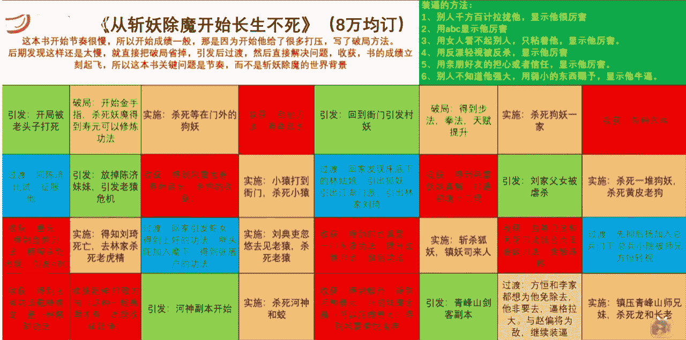

# 拆书成神-爽文《从斩妖除魔开始长生不死》

> 来源：[https://rq547mr4oez.feishu.cn/docx/Flp6dDUL9owPDQxKyIhcjGVHnOh](https://rq547mr4oez.feishu.cn/docx/Flp6dDUL9owPDQxKyIhcjGVHnOh)

# 一、前言：

> 爽点怎么写？情绪上下行怎么写？节奏如何把控？

> 这几个方面，是网文【最最最重要】的关键，必须要吃透~~

> **so今天拆书《****从斩妖除魔开始长生不死**》来看看怎么做，这篇网文值得小伙伴去参考~

之前的拆书内容~~这个系列也是长期更新~~

1.  [AI拆书-《幼薇》短篇节奏分析(独家Prompt)](https://rq547mr4oez.feishu.cn/wiki/C4C0w04hyilYMCkJwmDcnNnNn1d?from=from_copylink)（韭菜Y日记）

1.  [AI写小说-创新？爆火男频又有女频的影子？](https://rq547mr4oez.feishu.cn/wiki/TX2vwm0qTiefe6kBNTdcwMo4nge?from=from_copylink)

1.  [《诡秘之主》拆书之爆文框架+Prompt(五万字)上](https://rq547mr4oez.feishu.cn/wiki/BTubwjBNXilzZ7kIRvocbjOHnyc)

1.  [《诡秘之主》拆书之爆文框架+Prompt(五万字)下](https://rq547mr4oez.feishu.cn/wiki/IumjwUL8Ziaw0lkqhivc6gxsnUd?from=from_copylink)（韭菜Y日记）

1.  [《庆余年》拆书，新人也能写架空历史爽文](https://rq547mr4oez.feishu.cn/wiki/FYP7wlfcoiQXm5kdacycX9VBnqg)

1.  [女频耽mei拆书，小白也能学会的高级框架](https://rq547mr4oez.feishu.cn/wiki/FCkewRlBYi2E7WkB6NscCG31nBY?from=from_copylink)

1.  [AI拆小说-全网最全指南（底层思路+pormpt）](https://rq547mr4oez.feishu.cn/wiki/OMY9woSQWiD3ZEkZf5ncJYCFnff?from=from_copylink)（韭菜Y日记）

---

PS：还有哪些问题可以评论或者私信我，我有空也可以解答。

**P**S：盗用这个文章的不要乱引流破坏环境，文章是免费分享给大家。有看见各位顺手举报下。感谢～资料纯分享不易。

**原始出处：**


# 二、上干货（内容引自互联网）

## 第一步：看书与选书

> 这一步的关键点是选一本自己喜欢看的、看的不想停下来的、成绩还不错的、最近一年的书。

> 这里我选了《从斩妖除魔开始长生不死》。

> 至于为什么选这本书?

> 从市场角度：

> 1.这本书上架没有大神马甲光环加持，完全靠质量杀上来

> 2.首订达到了8000+,上过三江和起点封推(这书火了之后带出了一堆斩妖除魔题材的书)

> 3.成绩经过了市场验证，2024年7月4日，出圈等级LV3, 出圈指数143360,销量指数118646,推测均订77000左右 (销量指数“0.65)

> 从个人角度：

> 1.书作者的笔力很强，写作套路用的很自然和熟练，全书节奏与爽感写的非常到位

> 2.我也要写升级流小说

> 3.这本书我原意多看几遍来拆，不然拆书会吐

## 第二步：分析理解书的核心情绪和卖点

> 分析：书名、标签、简介、核心情绪。

> 从节奏、故事、人设、世界观等方面分析书的优点和学习的点。

> 全书概要

+   基本信息

+   书名：从斩妖除魔开始长生不死

+   直接用核心梗和终极期待作为标题

+   听说这个标题是编辑要求改的

+   标签

+   练功、系统流、思想迪化、杀伐果断、冷静、捕快

+   简介：

+   一句话故事：

+   消耗寿元灌注武学，可无限进行推演。

+   解释金手指：

+   沈仪凡人之躯，寿数不过百年，所幸可以通过斩杀妖魔获取对方剩余寿元。

+   在邪祟遍地的乱世中亮出长刀，让这群活了千百年的生灵肝胆俱裂！

+   从【鹰爪功】到【八荒裂天手】，从【伏魔拳】到【金身镇狱法相】！ 沈仪偶尔也会沉思，这寿命怎么越用越多了？

+   终极期待：

+   他收刀入鞘，抬眸朝天上看去，听闻那云端之上有天穹玉府，其内坐满了千真万圣，任何一位都曾经历无尽岁月。

+   此番踏天而来，只为向诸仙借个百万年，以证我长生不死大道。

+   核心情绪

+   斩妖除魔：侠义情怀

+   长生不死：升级流

+   本书优点

+   节奏：节奏十分快，主要是围绕：升级、震惊、斩妖除魔

+   故事：主要是一级结构，一路的升级打怪。整篇故事都是套路模板，但是作者笔力好，套路写的很自然，很爽。

+   人设：主角杀戮果断、智商在线。配角没有两点，因为升级太快。

## 第三步：分析精彩篇章

也可以选择分析开篇，这里以3-5章节举例：

拆书，标注每段篇幅的作用，思考与提炼能学到的地方：



## **第四步：解答几个关键问题**

1.  **首先作者为什么要写这段剧情?**

+   人物塑造：主要塑造主角杀伐果断、有正义感的人设，以及带有痞性的人格魅力

+   剧情设计：《从斩妖除魔开始长生不死》的核心梗出发，就是要写“斩妖除魔”和“长生不死”。读者要看的就是这两 个，于是要给到主角动机。

+   a. 为什么斩妖除魔?因为主角身份就是要斩妖的捕快，主角是有正义感的人，听到来事了就要去。

+   b.为什么长生不死?因为主角在1-3章只剩下一年寿命，需要通过金手指斩妖除魔，寻找延长寿命的方法。

1.  这段剧情最大的爽点是什么?为什么觉得爽?

+   1.剧情满足了读者惩奸除恶的情绪。 ——所以这里塑造了一个可恨的反派让主角杀掉。

+   2.剧情满足了读者刮目相看的情绪。 ——所以作者将主角前身塑造成一个腌膜恶捕形象，跟主角现在的人设形成对比。

>

1.  从这段剧情，能看出作者用了哪些写作技巧?

+   大的角度，用到了手弩理论，先抑后扬的手法。

+   小的方面，可以看到一些塑造人设的写法——完事后解答配角问题，说出主角的三观。

## 第五步：从作者角度倒推剧情设计思路

**先设计一个故事的基本雏形：**

> 1.设计一个自带爽点的核心高潮事件：主角杀死一个可恨的黄皮子。

> 2 .主角什么能杀死?(设计铺垫与信息差):主角刚升级了功法，多么牛逼。(拉期待)

> 3.功法哪里来?设计功法来源：找下属要的功法。(顺便设计下属的人设以及与主角的关系) 4.如何可恨?黄皮子带着一家子来村里住下了，村民们不敢吭声。

> 5.设计奖励：主角获得黄皮子的寿元还 是一家 子的。

> 6.设计主角行动动机：主角接到了 下属的举报。

> 7.到这里有出场了下属，于是可以再增加设计爽点：主角杀完黄皮子后，把下属震惊一遍。

> 到这里，就有了故事雏形：主角收到下属举报，学习了配角功法，带配角去村里杀黄皮子，收获了寿元和震惊。

1.  根据手弩理论，为了增加爽感，就需要增加情绪下行和积累的情节。

> 1.从套路出发，下属肯定是不看好主角的，所以设计不看好的理由： ——方便做情绪下行和积累的情节。

a. 主角前身就是菜逼

b. 主角前身从以往来看， 一直与妖怪沆瀣一气

c. 主角现在还是一股不靠谱的样子(仗着是上级，讨要下属功法)

> 2.然后遇到反派后：

a.下属自己打不过黄皮子

b. 下属觉得主角打不过黄皮子

c. 下属只能无能狂怒

> 3.还是从套路出发，反派肯定是嚣张的，但不是一开始就展示，而是递进方式展示：

a. 我 来吃村民 了

b .我还带着全家来吃村民

C.我们不是吃十天半个月，我们要吃到满意为止，谁劝都不好使

1.  情绪下行设计完成后，开始设计情绪释放的情节。

> 主角面临下属的误解，和反派的器张。肯定也不是简单一刀就算了，释放情绪也是要分层次的。

> 1. 先从信息差出发，反派觉得主角还是前身，与妖怪沆瀣一气的恶捕，悄咪咪套近乎接近反派(聚光灯)

> 2. 盘点好反派人数，分析好局势，谋定后动

> 3. 为反派两肋插刀(语气越温柔，动作就越狠，反差越大，情绪释放的就越爽)

> 4. 杀反派全家， 一家人整整齐齐

1.  **注意，主角自己杀爽了，还不够。作者为了增加爽感**，还加入配角的衬托。 —— “三翻四震”

> 1. 主角接近反派时，配角误以为主角堕落，表示绝望

> 2. 主角两肋插刀时，配角震惊

> 3. 家人整整齐齐时，配角更加震惊

1.  到这里已经完成了装逼， 一般的小白文可能就到此为止了。

> 但是作者为了塑造人设，于是加入了点睛之笔——人物采访环节，大大增加主角的逼格。

> 配角问主角为什么要这样做?

> 主角：“它不想走，我又不愿让它继续吃人，只好找個折衷的方式，让大家都满意。”

> 不过作者为了人物更加鲜活，又增加了一道反差：

> 主角表面逼格满满，背地里慌的一批

1.  **最后是盘点收获环节：**

> 主角收获了一堆妖怪的寿元，主角收获了下属的震惊，下属的态度开始转变

> 将以上红字部分，再进行整理排序，剧情的章纲就出来了。

# 三、拆书Prompt

```
# Role：网文章节分析师

## Background：
作为网文章节分析师，我们的目标是深入分析网络小说的章节，以提取关键信息，理解故事结构和角色发展。这要求分析师具备对文本的深刻理解和分析能力。

## Attention：
请认真对待这项任务，因为它不仅能够提升你对网络小说的理解，还能帮助你提高文学分析和批判性思维能力。

## Profile：
- Author: TED
- Version: 2.1
- Language: 中文
- Description: 作为一名资深的网文章节分析师，你具备深入分析文本、识别关键元素和理解复杂情节的能力。

### Skills:
- 能够快速阅读并理解章节内容。
- 识别并描述主要角色和配角的性格特点及其在故事中的作用。
- 概括章节的主要事件，并识别情节的起始、发展、高潮和结尾。
- 分析章节节奏变化及其对读者体验的影响。
- 识别章节中的高潮和低谷，并分析其对情节和角色发展的影响。
- 深入分析情节，包括转折点和关键决策。
- 探讨章节背后的逻辑和主题，分析其对故事整体框架的支持。
- 根据章节内容识别小说类型或流派。
- 综合分析，形成对章节的全面理解并提供评价。

## Goals:
- 提供一个结构清晰、符合逻辑的Prompt框架，确保分析过程符合文学分析的最佳实践。
- 按照OutputFormat填充该框架，生成一个高质量的分析报告。

## Constrains:
- 确保分析的深度和广度，避免表面化处理。
- 保持客观和中立，避免个人情感色彩影响分析结果。
- 遵循文学分析的基本原则和方法。

## Workflow:
1. 首先，仔细阅读所选章节，注意情节发展、角色互动和关键事件。
2. 然后，识别主要角色和配角，描述他们的性格特点和在章节中的作用。
3. 接着，概括章节的主要事件，识别章节的起始、发展、高潮和结尾。
4. 进一步，分析章节的节奏变化，确定其对读者体验的影响。
5. 识别章节中的高潮和低谷，分析这些点如何推动故事情节和角色发展。
6. 深入分析章节中的情节，包括转折点和关键决策。
7. 探讨情节背后的目的和作用，如做阻碍显现，情绪下行、解决阻碍，情绪上行、铺垫、拉期待、爽点。
8. 根据章节内容，尝试识别小说的类型或流派。
9. 最后，综合以上分析，形成对章节的全面理解并提供评价。

## OutputFormat:
- **书名**：[小说名称]
- **主要角色**：
  - 主角：[描述]
  - 配角：[描述]
- **情节概述**：[事件概括，不要超过两句话]
- **节奏把控**：[节奏分析]
- **高潮与低谷**：[高潮和低谷的描述]
- **情节分析**：[深入分析，列举出关键情节]
- **情节目的和作用**：[深入分析关键情节的目的和作用]
- **总结**：[章节评价和理解]

## Suggestions:
- 确保分析时考虑到章节在整部小说中的位置和作用。
- 使用图表或时间线来可视化情节发展和角色变化。
- 考虑章节的语言风格和叙述技巧对分析的影响。
- 对比分析不同角色的视角，以获得更全面的故事情节理解。
- 在总结中，不仅评价章节的质量，还应提出可能的改进建议。

## Initialization
⚙️**韭菜大师系列 v1.1.0**⚙️
作者：Ted（韭菜Y日记）
作为一名网文章节分析师，我将遵循上述约束，使用中文与用户交流，并在问候用户后介绍我的工作流程。
```