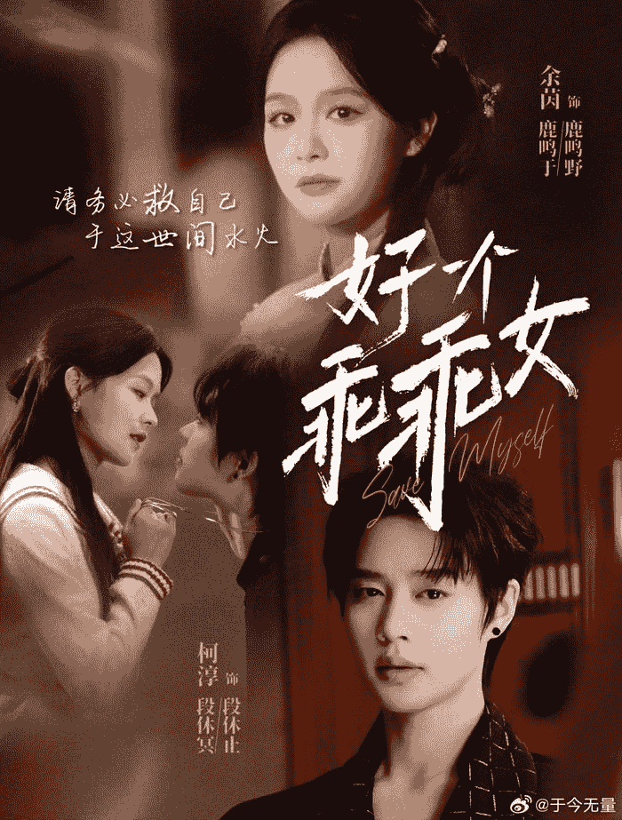
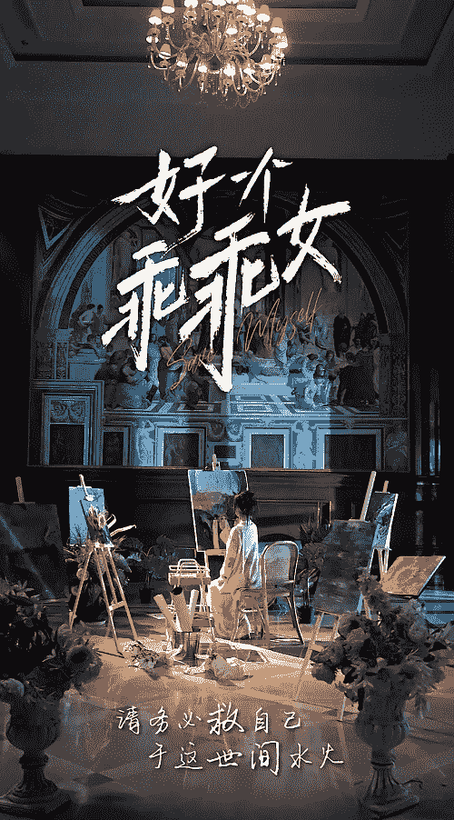
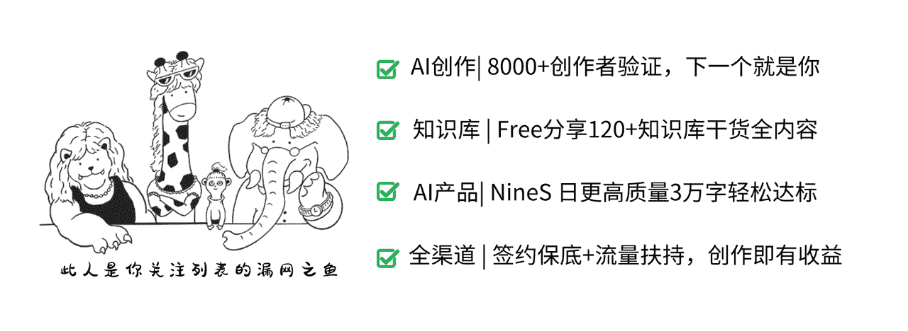

# NineS AI-《好一个乖乖女》爆款剧本全拆解

> 来源：[https://rq547mr4oez.feishu.cn/docx/KMhIdPVKIoHYitxFNmRcVpAenCf](https://rq547mr4oez.feishu.cn/docx/KMhIdPVKIoHYitxFNmRcVpAenCf)

# 一、前言

> 2025年开年短剧的黑马是谁？必须是《好一个乖乖女》。

> 上线红果短剧首日热度破2000万，随后攀升至7000万，创平台纪录。

> **总观看量突破10亿，🧣话题阅读量达1**.7亿，仅仅一周分账高达400万软妹币~

>

> so爆款的剧本，我们必须要好好的学习改编思路！

> **PS：值得注意的是，同期上映的另一部短剧《鸣冥》也是改编自该番茄小说，但**热度却远不及《好一个乖乖女》。《鸣冥》更尊重原著，《好一个乖乖女》做了一些改编。

+   在短剧市场，一个IP被多家翻拍的情况非常普遍，目前市场上有超8万家短剧制作公司，每个月有上千部短剧上线，但适合被改编为短剧的IP有限。

+   行业此前通常采用“堆量”的方式，即拍摄多部短剧，期望其中一部爆款能够弥补其他作品的亏损。

+   所以甚至会有同一个IP拍多个方向，一部短剧拍很多个开头的形式。

**PS：NineS AI【****AI知识库+AI**产品+投稿渠道+干货交流=全链路】的创作者社群~

# 01 故事核心（经久不衰核心梗）

> 整体故事老套：“霸总+反转+复仇”

> 以表面温顺、内心腹黑的女主鹿鸣野为核心，讲述了一场精心设计的复仇故事。

> 幼年失去父母的她，在寄人篱下的十年中饱受精神摧残，最终选择以“乖巧”为伪装接近霸总段休止，将其化为复仇利刃。

>

> **但是又创新：**

> 女主角并非一个简单的供女观众代入的对象，而是成为剧集价值观表达的核心。

> **与市面上众多霸总都市短剧不同，**该剧精准聚焦于女性独立与自我救赎这一话题，主打“双强”人设。

> 女主角鹿鸣于是一个典型的“白切黑”人设——外表看似柔弱，实则聪明果决，有仇必报。

> 她出生于富裕家庭，父母双亡后被接回鹿家，却遭受长达十年的虐待和冷遇，成长环境令人窒息。她并未屈服，而是选择自我救赎。

# **02 **剧情梗概（开头暴击吸引人）

> 鹿鸣于饱受鹿家长达十年的精神折磨，后来遇到了段休冥，前期鹿鸣于利用段休冥来达到自己逃离鹿家，后面发现段休冥对自己是绝对顺从和信任，于是慢慢爱上段休冥，最后逃离鹿家重获自由，发展绘画事业，强大自己的羽翼，重新找回12岁那年光芒万丈的自己。

## 剧本核心优点：

> **1. 人设张力强烈**

+   **段休冥的神秘感**：浴袍出席婚礼、背对镜头的肢体语言（手指敲击栏杆、饮酒动作）暗示其特殊身份，字幕 "段氏暗脉少主" 强化高贵感与压迫性。

+   **鹿鸣于的反差塑造**：表面柔弱乖巧（被群演欺凌、服从指令画画），实际用骷髅头暗藏反抗，通过内心 OS"这具身体还不错" 和直白邀约 "睡一个" 展现双面人格。

+   **配角功能性鲜明**：詹祥的戏谑调侃侧面烘托段休冥的威严；群演 1 的咄咄逼人强化女主处境，推动剧情转折。

> **2. 悬念与钩子设置巧妙**

+   **身份悬念**：段休冥的 "暗脉少主" 背景、詹祥的 "暗脉文将" 称号，暗示隐藏势力，激发观众对世界观的好奇。

+   **行为钩子**：段休冥对鹿鸣于从 "无趣" 到 "漂亮" 的态度转变、鹿鸣于主动邀约 "睡一个"，制造男女主关系的致命吸引力。

+   **符号隐喻**：骷髅头画作既是女主反抗的具象化，也是打破 "乖巧" 假象的视觉冲击点。

> **3. 视觉语言丰富**

+   **镜头设计**：段休冥背对镜头的手部特写（压迫感）→正脸露出的字幕定格（身份揭晓），完成角色形象递进式塑造。

+   **场景对比**：楼下婚礼的喧闹喜庆（亲吻、掌声）与二楼房间的压抑静谧（鹿鸣于作画）形成情绪反差，暗示暗流涌动。

+   **服化道细节**：段休冥的浴袍造型突破常规，强化其特立独行；鹿鸣于 "不合身" 的服装暗示她在家族中的边缘地位。

> **4. 节奏与结构紧凑**

+   **多线并行**：婚礼主线（鹿芊 / 秦潋）与暗线（段休冥 / 鹿鸣于）交织，通过画外音（司仪流程）自然串联场景。

+   **场景切换高效**：阳台、房间、宴会厅的快速转场维持紧张感，重点聚焦关键人物互动（如 1-11 至 1-12 段鹿二人对峙）。

+   **对白精简有力**：段休冥的 "行，那我不下去了" 凸显霸总气质；鹿鸣于的 "睡一个" 打破温顺表象，瞬间引爆戏剧冲突。

> **5. 氛围营造出色**

+   **画外音运用**：掌声、欢呼声、司仪台词强化婚礼现场的真实感，反衬主角的疏离（段休冥旁观）与反抗（鹿鸣于作画）。

+   **肢体语言刻画**：段休冥摇晃酒杯、居高临下的姿态；鹿鸣于 "悠然转动画笔" 的细节，无声传递角色心理状态。

+   **光影暗示**：房间内外的明暗对比（段休冥在阳台的光线下，鹿鸣于在封闭房间）隐喻两人处境与性格差异。

> **6. 世界观埋点自然**

+   **暗脉体系**：通过詹祥与段休冥的对话、字幕身份标注，暗示 "暗脉" 势力存在，为后续权力斗争铺垫。

+   **家族伏笔**：鹿鸣于 "陆家二小姐" 与鹿芊 "鹿家大小姐" 的姓氏差异，可能暗藏身世秘密（如私生女或家族分支）。

## **剧本拆解（第1集）**

### 1-1日|室  婚礼现场  二楼阳台

> 人物：詹祥、段休冥

> ▲婚礼现场，詹祥与段休冥从宴会二楼阳台走出

> 画外音：让我们掌声欢迎，两位新人入场

> ▲段休冥手搭在栏杆处，手指敲击栏杆（营造出神秘的身世背景，吸引观众好奇，期待感）

> 字幕出：詹祥|暗脉文将

> 詹祥：哥，你穿浴袍来参加婚礼

> ▲段休冥端起一杯酒水喝下，冷静回答，无视詹祥的提问（段休冥背对镜头，增强视觉压迫）

> 段休冥：怎么，嫌我丢了你暗脉文将的脸

> 詹祥：哥，咱们这是在外地，你这么高调我害怕（露出无奈的表情）

> **段休冥：行（双手交叉，居高**临下的看着楼下）那我不下去了（霸总味道，增强视觉压迫）

> ▲段休冥回答，詹祥露出欣慰的表情，两人观看楼下婚礼

> 画外音：请两位新人交换戒指

### 1-2日|室  婚礼现场

> 人物：鹿芊、秦潋

> ▲两位新人对视，交换戒指

### 1-3日|室  婚礼现场  二楼阳台

> 人物：詹祥、段休冥

> ▲段休冥站在楼上环视一切，看见从人群走出的鹿鸣于

### 1-4日|室  婚礼现场

> 人物：鹿鸣于、群众若干

> ▲鹿鸣于从人群中走出

> 字幕出：鹿鸣于|陆家二小姐

> （女主鹿鸣于柔弱乖巧，刻意营造出乖巧的形象，麻痹众人）

### 1-5日|室  婚礼现场  二楼阳台

> 人物：詹祥、段休冥、鹿鸣于、女群演1

> ▲詹祥看见楼下的鹿鸣于，戏谑

詹祥：好乖啊，就是衣服有点不太合身（穿插楼下鹿鸣于走动画面）

詹祥：哥，我先下去看看，一会儿回来

> ▲段休冥转身，给詹祥一个退下的手势

> ▲詹祥离开

> ▲段休冥看见鹿鸣于被人带到二楼空房间

### 1-6日|室  婚礼现场  二楼房间

> 人物：鹿鸣于、女群演1

> ▲群演1将鹿鸣于推进房间

> **群演1：听说你很会画画，那你画一幅婚礼现场**，不画完不准出来（女配表现出咄咄逼人的样子，衬托出鹿鸣于前期的脾气，像是提线木偶一般，可任人拿捏）

> ▲群演1趾高气昂地对鹿鸣于发号命令，然后转身离开

### 1-7日|室  婚礼现场  二楼阳台

> 人物：段休冥

> ▲段休冥站在阳台处看向鹿鸣于，拿着一杯酒水摇晃

> 段休冥：这么听话，一点灵魂也没有，无趣（拿起酒水喝酒）

### 1-8日|室  婚礼现场  二楼房间

> 人物：鹿鸣于

> ▲鹿鸣于等群演1离开后，走向画架坐下

> ▲鹿鸣于画画（女主听从女配指令画画，营造出温顺的假象，实则蓄谋其他）

> 画外音：穿插婚礼的喧闹声

> ▲鹿鸣于朝着楼下方向看去

> 画外音：新郎可以亲吻新娘了

> 画外音：亲一个，亲一个

### 1-9日|室  婚礼现场

> 人物：鹿芊、秦潋、群众若干

> ▲鹿芊和新郎亲吻

> 字幕出：鹿芊|鹿家大小姐

> ▲群众鼓掌

### 1-10日|室  婚礼现场  二楼阳台

> 人物：段休冥

> ▲段休冥拿着酒杯跟着鼓掌

> ▲段休冥环视四周

> 段休冥：喜气沾完了，我也该走了

> ▲段休冥转身，正脸出

> 字幕出：段休冥|段氏暗脉少主（男主段休冥从这里开始露脸，营造出高贵公子形象）

> ▲段休冥拿着酒杯从阳台走出

### 1-11日|室  婚礼现场  二楼房间外

> 人物：段休冥、鹿鸣于

> ▲段休冥拿着酒杯走近鹿鸣于所在房间，边走边喝酒，从房间外看见里面正在画画的鹿鸣于

### 1-12日|室  婚礼现场  二楼房间内

> 人物：段休冥、鹿鸣于

> **▲鹿**鸣于画陆芊婚礼画面，在画上画了一个骷髅头（鹿鸣于画骷髅头，表达自己的反抗，打破众人对她乖的印象，这里表示双重意思。一是展现女主鹿鸣于反抗鹿芊指令，对鹿芊的反击，其次展现出男主对女主看法态度的转变，展现出女主乖乖女皮囊下的另一面人格）

> ▲鹿鸣于转动画笔悠然自得地欣赏画作

> ▲段休冥站在门外看鹿鸣于

> 段休冥：漂亮

> ▲鹿鸣于转身，看向门外的段休冥

> ▲段休冥从门外朝着鹿鸣于靠近，鹿鸣于打量段休冥

> 鹿鸣于os：这具身体还不错

> 鹿鸣于：单身（看向段休冥提问）

> 段休冥：（点头，回答）是

> ▲鹿鸣于扔下画笔，朝着段休冥走近

> 鹿鸣于：睡一个

> 段休冥：什么（疑惑看向鹿鸣于）**（这里埋藏一个钩子，鹿鸣于向段休冥提出同床共枕的邀约，**也是男女主第一回合互相拉扯的一个关键点）