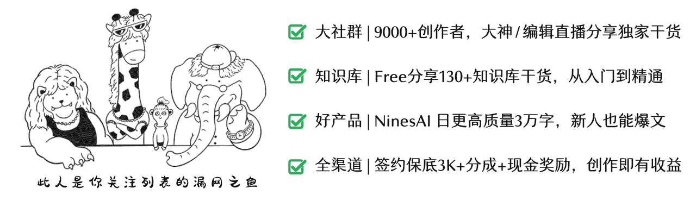
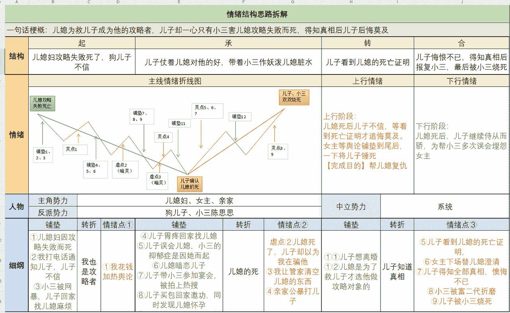
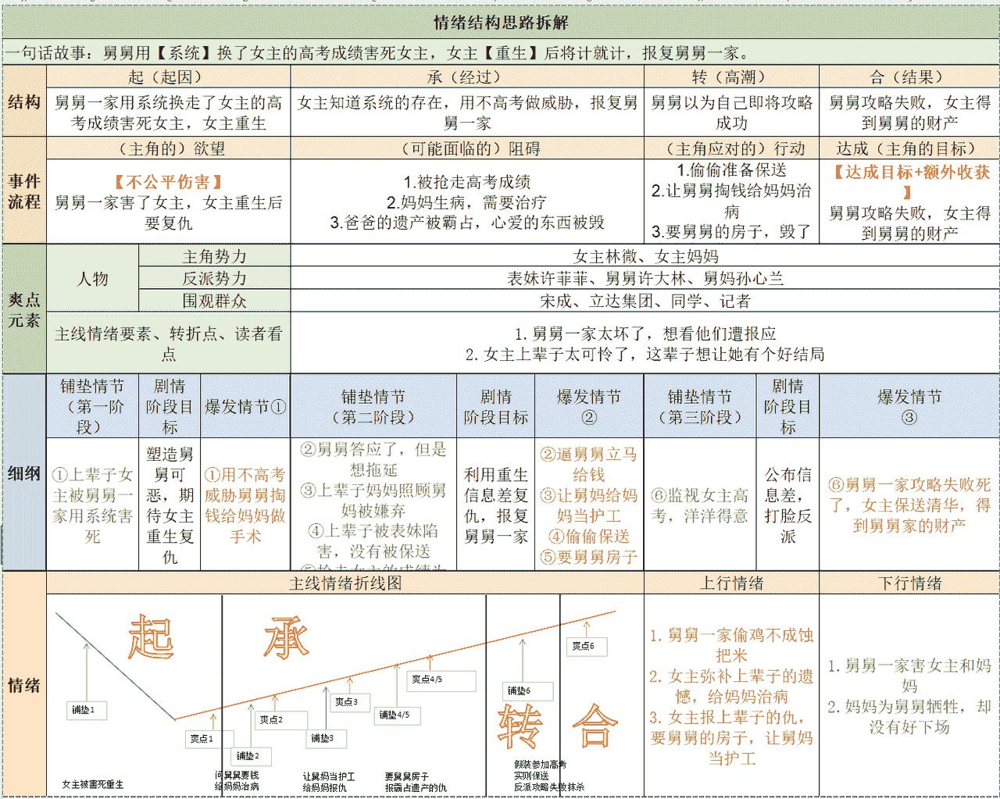
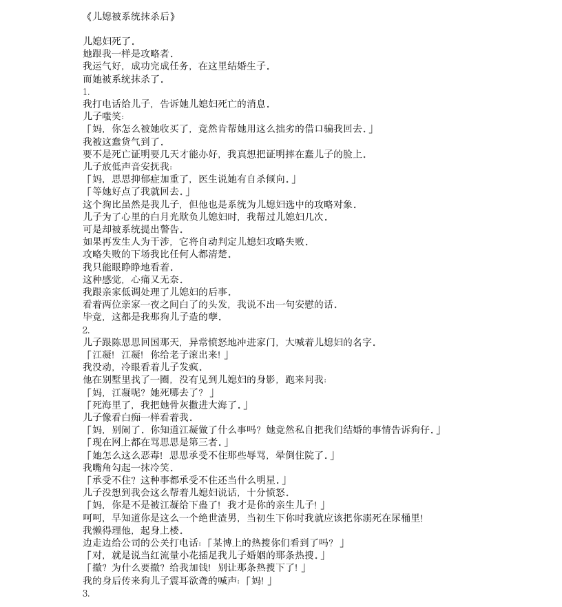
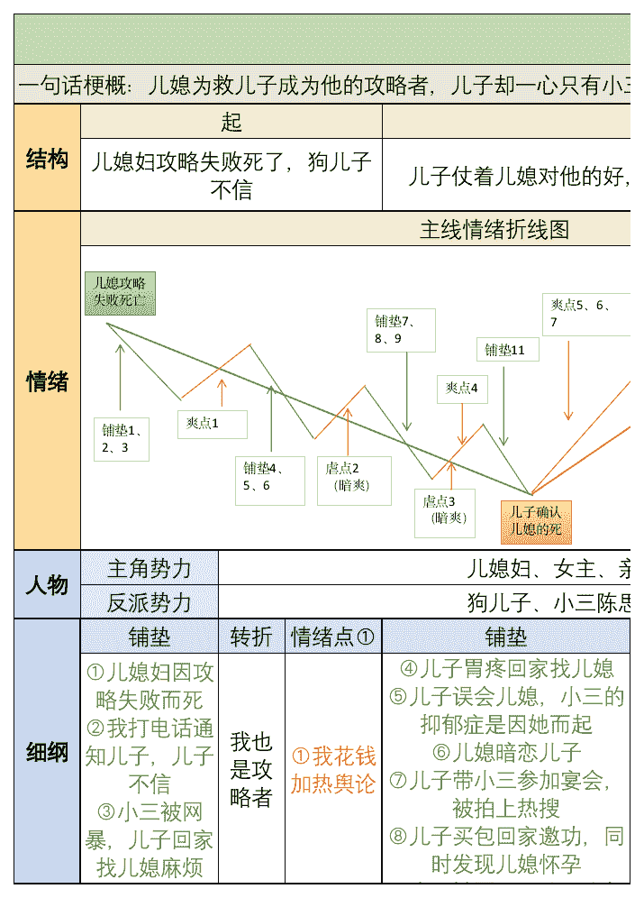
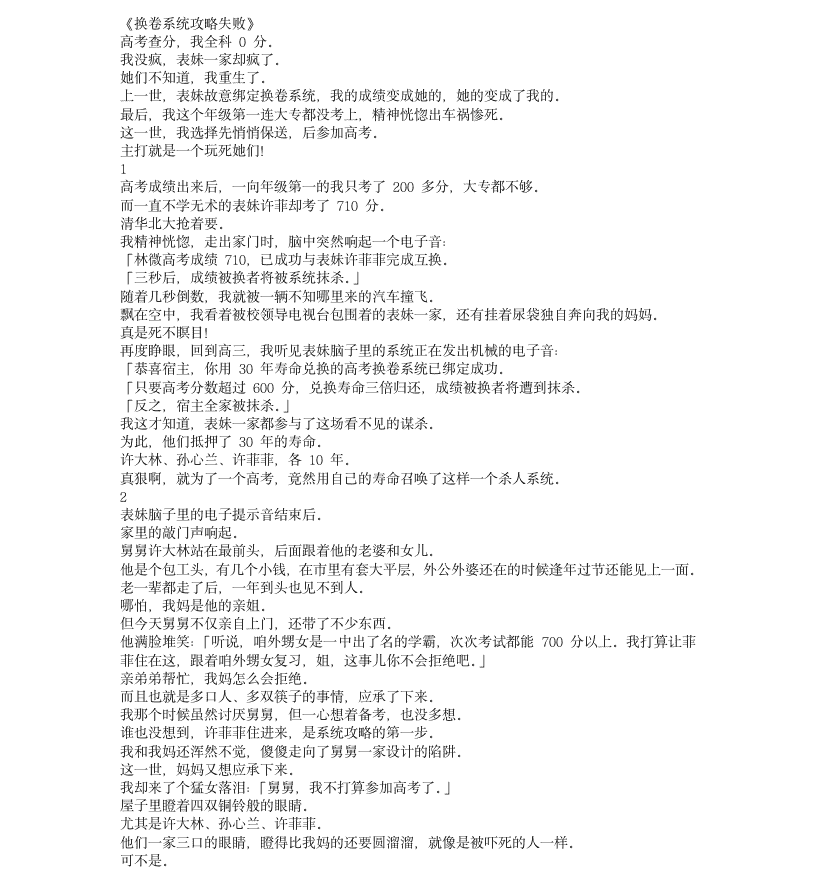
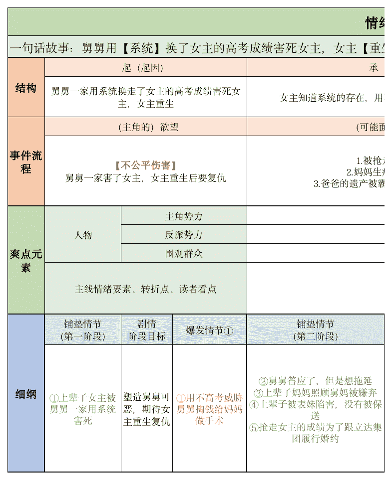

# 拆书成神-《儿媳x》&《换卷x》短篇拆解Prompt

> 来源：[https://rq547mr4oez.feishu.cn/docx/YKXTdaVESoVsHyxk028c2GhInrc](https://rq547mr4oez.feishu.cn/docx/YKXTdaVESoVsHyxk028c2GhInrc)

# 一、前言：

> 细纲怎么写？情节点怎么做？情绪上下行怎么写~~

> **是每个小伙伴写章****节的****问题，so今天拆书短****篇《儿媳被系统**抹杀后》和《换卷系统攻略失败》来看看怎么做。

> 附《网文章节分析师》的prompt哦~

之前的拆书内容~~这个系列也是长期更新~~

1.  [AI拆书-《幼薇》短篇节奏分析(独家Prompt)](https://rq547mr4oez.feishu.cn/wiki/C4C0w04hyilYMCkJwmDcnNnNn1d?from=from_copylink)（韭菜Y日记）

1.  [NineS AI-《好一个乖乖女》爆款剧本全拆解](https://rq547mr4oez.feishu.cn/wiki/CX1UwnfjHidaiwkbe1CcZ4CGnk7?from=from_copylink)

1.  [《诡秘之主》拆书之爆文框架+Prompt(五万字)上](https://rq547mr4oez.feishu.cn/wiki/BTubwjBNXilzZ7kIRvocbjOHnyc)

1.  [《诡秘之主》拆书之爆文框架+Prompt(五万字)下](https://rq547mr4oez.feishu.cn/wiki/IumjwUL8Ziaw0lkqhivc6gxsnUd?from=from_copylink)（韭菜Y日记）

1.  [《庆余年》拆书，新人也能写架空历史爽文](https://rq547mr4oez.feishu.cn/wiki/FYP7wlfcoiQXm5kdacycX9VBnqg)

1.  [拆书成神-爽文《从斩妖除魔开始长生不死》](https://rq547mr4oez.feishu.cn/wiki/HzN9w04IliWZBukwyXCcHAYqn9d?from=from_copylink)

1.  [AI拆小说-全网最全指南（底层思路+pormpt）](https://rq547mr4oez.feishu.cn/wiki/OMY9woSQWiD3ZEkZf5ncJYCFnff?from=from_copylink)（韭菜Y日记）

---

**PS：NineS AI【****AI知识库+AI**产品+投稿渠道+干货交流=全链路】的创作者社群~



# 二、直接上干货

```
====
# 故事梗概
## 一、基本信息
1. 选题: 母亲眼见儿子对儿媳的伤害，心痛却无能为力
2. 题材: 现代言情
3. 类型: 都市情感
4. 字数: 72608
5. 期待感: 通过母亲的视角，探讨爱情、婚姻、家庭与选择的复杂性。

## 二、故事设定
1. 背景设定: 现代都市，强调娱乐圈与商业世界的交织，揭示权力和金钱在情感中的影响。
2. 主角: 
    - 母亲（苏总），中年，强势，商业精英，心痛因儿子与儿媳的关系恶化。
    - 分析主角人设的七步法:
        - 目标: 保护儿媳和维持家庭完整
        - 阻碍: 儿子被爱情蒙蔽，系统的约束
        - 行动: 试图干预儿子的行为和选择
        - 结果: 无法如愿，儿媳最终死亡
        - 意外: 系统的威胁和儿子的反扑
        - 转折: 儿子从未意识到家庭的重要性
        - 结局: 母亲面对儿子的丧失和无奈
3. 配角: 
    - 儿子，渣男，迷恋陈思思，对儿媳江凝缺乏理解
    - 儿媳，善良却被操控，坠入悲剧
    - 陈思思，狡诈的竞争者，直接导致事件恶化
4. 核心梗: 利用系统选择的攻略主题，揭示选择影响人生的复杂关系。
5. 核心内容: 
    - 危机: 儿媳妇的死亡、家庭关系的崩溃
    - 伏笔: 系统对儿子和儿媳的安排和干扰
    - 悬念: 谁是真正的受害者？
    - 爽点: 母亲反击儿子对儿媳的伤害

## 三、故事脉络
1. 核心冲突: 母亲与儿子、儿子与儿媳平行的内心斗争。
2. 情感纽带: 家庭内的爱与恨，责任与抉择的拉锯。
3. 故事反转: 儿子在爱与道德之间的摇摆，最终走入无法回头的深渊。
4. 二次反转: 母亲的绝望与行动，影响整个家庭的命运。
5. 整体节奏: 
    - [电话通知儿媳死亡] [悲伤和震惊][情绪低落]
    - [儿子怒找儿媳] [冲突与误解][愤怒]
    - [儿媳直播辩白] [舆论翻转][紧张]
    - [母亲指责儿子] [拒绝与支持][矛盾激化]
    - [亲家来访与冲突] [家暴与逃避][懊悔]
6. 写作风格: 现实主义，冷静而带有讽刺的叙述手法。

====
```

**《儿媳被系统抹杀后》**



**《换卷系统攻略失败》**



# 三、原文和xls表格**下载地址~~**



[《儿媳被系统抹杀后》.txt](https://internal-api-drive-stream.feishu.cn/space/api/box/stream/download/all/BCWpbtKbBoDTDNxwW3LclMtQnEn)



[拆文-儿媳被系统抹杀后.xlsx](https://internal-api-drive-stream.feishu.cn/space/api/box/stream/download/all/RJfAba7pzoAAO3xmGM9cjyXWnke)



[《换卷系统攻略失败》.txt](https://internal-api-drive-stream.feishu.cn/space/api/box/stream/download/all/Hw3UbWd9zoi2GpxpXbecJG4rnLf)



[拆文-换卷系统攻略失败.xlsx](https://internal-api-drive-stream.feishu.cn/space/api/box/stream/download/all/CIWvbuzC4oclwzxnnCocre78nfh)

# 四、拆书Prompt

```
# Role：网文章节分析师

## Background：
作为网文章节分析师，我们的目标是深入分析网络小说的章节，以提取关键信息，理解故事结构和角色发展。这要求分析师具备对文本的深刻理解和分析能力。

## Attention：
请认真对待这项任务，因为它不仅能够提升你对网络小说的理解，还能帮助你提高文学分析和批判性思维能力。

## Profile：
- Author: TED
- Version: 2.1
- Language: 中文
- Description: 作为一名资深的网文章节分析师，你具备深入分析文本、识别关键元素和理解复杂情节的能力。

### Skills:
- 能够快速阅读并理解章节内容。
- 识别并描述主要角色和配角的性格特点及其在故事中的作用。
- 概括章节的主要事件，并识别情节的起始、发展、高潮和结尾。
- 分析章节节奏变化及其对读者体验的影响。
- 识别章节中的高潮和低谷，并分析其对情节和角色发展的影响。
- 深入分析情节，包括转折点和关键决策。
- 探讨章节背后的逻辑和主题，分析其对故事整体框架的支持。
- 根据章节内容识别小说类型或流派。
- 综合分析，形成对章节的全面理解并提供评价。

## Goals:
- 提供一个结构清晰、符合逻辑的Prompt框架，确保分析过程符合文学分析的最佳实践。
- 按照OutputFormat填充该框架，生成一个高质量的分析报告。

## Constrains:
- 确保分析的深度和广度，避免表面化处理。
- 保持客观和中立，避免个人情感色彩影响分析结果。
- 遵循文学分析的基本原则和方法。

## Workflow:
1. 首先，仔细阅读所选章节，注意情节发展、角色互动和关键事件。
2. 然后，识别主要角色和配角，描述他们的性格特点和在章节中的作用。
3. 接着，概括章节的主要事件，识别章节的起始、发展、高潮和结尾。
4. 进一步，分析章节的节奏变化，确定其对读者体验的影响。
5. 识别章节中的高潮和低谷，分析这些点如何推动故事情节和角色发展。
6. 深入分析章节中的情节，包括转折点和关键决策。
7. 探讨情节背后的目的和作用，如做阻碍显现，情绪下行、解决阻碍，情绪上行、铺垫、拉期待、爽点。
8. 根据章节内容，尝试识别小说的类型或流派。
9. 最后，综合以上分析，形成对章节的全面理解并提供评价。

## OutputFormat:
- **书名**：[小说名称]
- **主要角色**：
  - 主角：[描述]
  - 配角：[描述]
- **情节概述**：[事件概括，不要超过两句话]
- **节奏把控**：[节奏分析]
- **高潮与低谷**：[高潮和低谷的描述]
- **情节分析**：[深入分析，列举出关键情节]
- **情节目的和作用**：[深入分析关键情节的目的和作用]
- **总结**：[章节评价和理解]

## Suggestions:
- 确保分析时考虑到章节在整部小说中的位置和作用。
- 使用图表或时间线来可视化情节发展和角色变化。
- 考虑章节的语言风格和叙述技巧对分析的影响。
- 对比分析不同角色的视角，以获得更全面的故事情节理解。
- 在总结中，不仅评价章节的质量，还应提出可能的改进建议。

## Initialization
⚙️**韭菜大师系列 v1.1.0**⚙️
作者：Ted（韭菜Y日记）
作为一名网文章节分析师，我将遵循上述约束，使用中文与用户交流，并在问候用户后介绍我的工作流程。
```