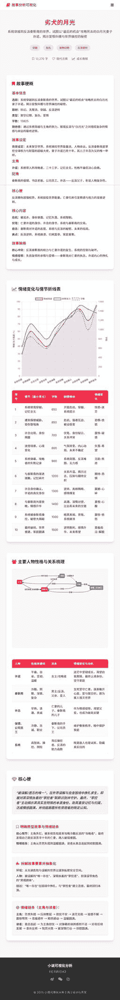

# 拆书成神-知乎6.7万赞-劣犬的月光

> 来源：[https://rq547mr4oez.feishu.cn/docx/UnmddUs7WoMr6zxpNXVckNkLnlf](https://rq547mr4oez.feishu.cn/docx/UnmddUs7WoMr6zxpNXVckNkLnlf)

> 这本《劣犬的月光》也是老作品了，但是【核心梗】优秀：

> “被误解/遗忘的唯一”，在外界误解与自身困境中挣扎求生，却被对其深情执着的“配角”默默识别并守护。

> “配角”主动揭示其真实且特殊的本源身份，助其重获记忆与归属，达成情感圆满，并彻底颠覆所有旁观者的既定认知。

>

+   与“替身转正”不同，这个是“你本来就是正主”。

+   与“霸道总裁爱上我”不同，这里强调的是“重逢”与“守护”。

+   与“身份揭露”不同，这里的揭露带有强烈的“深情”、“苦寻”和“颠覆外界认知”的反差。

> 是，具有其独特的“身份错位（实际未错位）+深情守护+外界反转”的结合。

>

> **这**个【核心梗+换元法】可以套用在多种情境中：比如“职场版”、“仙侠版”、“古言宫斗”等~~期待小伙伴的新作

> html网页版本可以找哦老杨要哦！~

