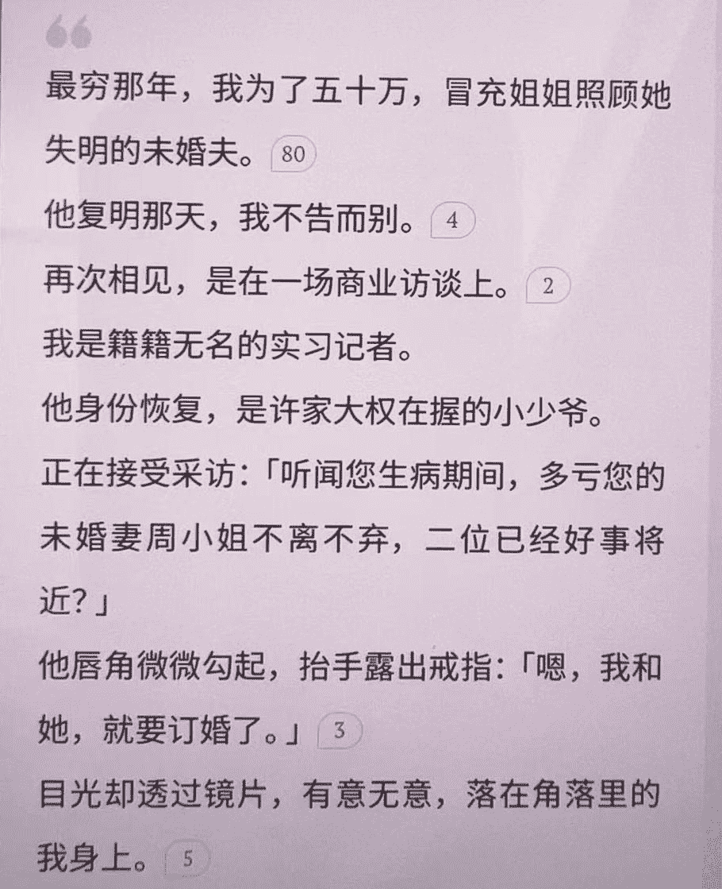
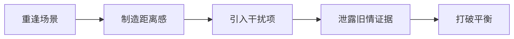

# 拆文《燎原》-大神是如何拉扯情绪！🔥新手速成

> 来源：[https://rq547mr4oez.feishu.cn/docx/FNn7dW3r2otBrqxoIASc5Ytqnth](https://rq547mr4oez.feishu.cn/docx/FNn7dW3r2otBrqxoIASc5Ytqnth)

# 一、前言

> **女**频大神“巧克力阿华甜”7月14日发布的《燎原》作品开头，6天内斩获九千多赞、三千评！到现在4.6万赞~

> **真大神~~**

> 其核心魅力在于对“情绪拉扯”的精准把控。

> **所以更值得好好的学习和拆解，如何用三千字构建起旧爱重逢的高**张力剧情，让读者在情绪的起伏中欲罢不能。

> 同时，老杨也根据这篇文章，整理出《破镜重圆》的情节卡~给小伙伴参考~~

>

> 原文：导语如下：

# 二、废话少说，上干货

> 故事主线简洁却充满张力（核心梗就是：破镜重圆）：

> 曾因特殊原因相爱、如今仍牵挂彼此的男女主，在一场访谈中意外重逢。

> 女主的过往是关键伏笔——最穷时为五十万冒充姐姐，照顾失明的男主；

> 而在男主复明当天，她选择了不告而别。

> 五年后，男主已是江家掌权人，身边伴着“未婚妻”（实为女主姐姐），女主则作为旁观者，在这场重逢中直面过往情感与当下错位。

### (一)核心技巧：五层情绪（通过3个场景递进呈现5个关键信息点）

> **大神就像个钓鱼高手，不是一竿子把鱼（读者）拽上来，而是**慢慢遛，让鱼又急又馋，最后心甘情愿上钩。

#### 第一招：导语“钩子”：重逢前的铺垫

+   原文例子：

> “最穷那年，我为了五十万，冒充姐姐照顾她失明的未婚夫。他复明那天，我不告而别。”

+   大神操作拆解：

+   一句话讲清恩怨： 女主为了钱，假冒姐姐照顾瞎了的男主（埋下“替身”雷）。

+   关键节点引爆： 男主一好（复明），女主就跑了（留下巨大疑问：为啥跑？男主知道被骗了吗？）。

+   群众嘴替： 旁边人聊天说“多亏他未婚妻（其实是女主）不离不弃，不然人早没了”。（强调女主的功劳，但功劳被姐姐占了！读者替女主憋屈！）

+   效果：

+   短短几句，你就知道：这俩人过去有故事，有恩情，有欺骗，现在身份天差地别（男主是豪门大佬，女主是小记者）

+   钩子下好了，你这条“鱼”就咬上了，想知道后来咋样了。

#### 第二招：见面了？偏不让你相认！吊胃口

+   场景： 采访现场，男主风光出场，女主在角落。

+   原文例子：

> 大门推开，熟悉身影撞进来，女主脑子“嗡”一下空白了！... 男主变高变帅了，但眼神冷冰冰。

> 他淡淡说“借过”，目光扫过女主像看陌生人，飘过一阵冷清的木头香... 女主直接僵在原地。

+   大神操作（为啥这么写牛？）：

+   不按套路出牌： 你期待“一眼万年”“激动相认”？偏不！男主直接当她是空气！（读者：？？？咋回事？不认识？还是装的？急！）

+   慢镜头折磨你： 不是“他走过来了”，而是拆开写：推门→身影→女主懵→看他变样→他开口（冷漠）→他眼神（陌生）→他走过（带起一阵熟悉的味道）→女主僵住。像电影慢放，把女主（和读者）那瞬间的震惊、失落、心酸拉得长长的。

+   “味道”是暗器： 写他走过留下一阵“冷清的木质香”。这味道女主肯定记得！（读者也猜：他是不是还用以前的香水？他还念旧？）味道比语言更戳心。

+   对比新手（可能咋写）： “男主看到女主，愣住了，眼中闪过惊喜/痛苦，冲过来...” （太直给，没拉扯感，读者爽一下就完了）。

#### 第三招：补一刀！情敌闪亮登场！

+   原文例子：

> 上面“无视打击”还没缓过来呢，漂亮时髦的女配（周宁薇）踩着高跟鞋就进来了，娇滴滴地对男主说：“抱歉凌舟，剧组来晚了~” 然后亲昵地坐他旁边。

+   大神操作拆解：

+   时机超毒辣： 专挑女主（和读者）心最塞、最懵的时候补刀！伤口上撒盐！

+   全方位碾压：

+   身份： 女配是演员（提“剧组”），女主是小记者。

+   穿着： 女配穿华丽香槟裙，女主估计是普通工作服（前面还冒雨跑腿）。

+   关系： 女配当众亲昵抱怨，显示她和男主关系不一般（是正牌？）。

+   读者反应： 刚被男主无视的心塞还没平复，又看到情敌这么光鲜亮丽登堂入室！替女主憋屈到爆炸！更想知道男主到底爱谁了！

#### 第四招：给点甜头，再挖个坑！

+   场景： 采访中。

+   原文例子：

+   主持人问感情状况，男主抬手，露出当年女主送的、很便宜的银戒指，说“我和她（指女配？）就要订婚了”。（读者：啊？他戴着她送的戒指！但他说要和别人订婚？？？）

+   说话时，男主目光扫过全场，在女主位置停了几秒，才收回去。（读者：他看谁呢？他看见女主了吗？他是不是故意的？）

+   有人问他和“未婚妻”当年患难的故事，他冷冷说：“没什么好讲的，回忆只我们两个人知道。”（读者：他是在保护回忆？不想提？还是对女配没感情？）

+   大神操作：

+   “糖”里有玻璃渣： 戴旧戒指（哇！他还留着！念旧情！）→ 但说是要和女配订婚（？？？心碎！）。

+   眼神“出卖”他： 目光停顿那几秒，暴露了他注意到女主了！（读者：我就知道！他没忘！他装的！）

+   话说一半： 拒绝谈过去，留下巨大想象空间。读者会自己脑补：他是珍惜和女主的回忆才不想提？还是觉得现在这个女配不配知道？

+   效果： 给你点希望（他还留着戒指！他看女主了！），又泼盆冷水（他要和别人订婚？），让你心痒难耐，更想往下看。

#### 第五招：狭路相逢，气氛拉满！

+   场景： 采访结束，电梯口偶遇。

+   原文例子：

+   女主想躲，走楼梯。男主一句“站住！”把她定住。

+   男主让女主用电梯，但自己堵着路不让开，就盯着她看。

+   女主压低声音（怕被认出？）说自己是实习记者没资格提问。

+   男主最后才说“走吧”。

+   大神操作：

+   空间压迫： 电梯口，狭小空间，男主堵路，形成巨大压迫感。和公开场合完全不同，私下交锋开始了！

+   言行矛盾： 嘴上让女主用电梯，身体堵着不让走（男主你到底想干嘛？）。女主装不认识（压低声音、强调身份）。

+   无声较量： 大量的眼神描写（男主盯着看），制造紧张气氛。话不多，但暗流汹涌。

+   效果： 读者屏住呼吸：这是要摊牌了吗？他认出她了吗？他俩会说啥？

#### 第六招：终极大招，引爆期待

+   场景： 女主在饭局被灌酒，狼狈吐完，在昏暗走廊。

+   原文例子： 男主从暗处走出来，一字一顿、清清楚楚地叫出女主的真名：“唐、予、安。”

+   大神操作：

+   天时地利：

+   女主最脆弱时： 喝醉、呕吐、狼狈不堪（心理防线最低）。

+   绝对私密空间： 昏暗走廊，没外人（可以撕下伪装了）。

+   “核弹”级台词： 不叫假名“周宁薇”，而是清清楚楚叫出她的本名“唐予安”！这等于直接撕破所有伪装：“我知道你是谁！我认出你了！”

+   语气拿捏： “一字一句”“微沉的嗓音”“复杂的情绪”，这语气一听就憋着大事儿呢！

+   效果： 读到这儿，读者绝对会一拍大腿：“卧槽！终于！” 前面憋了几千字的情绪，在这里达到顶点，迫不及待想知道下一章他俩要干嘛！是质问？是拥抱？是清算？

### (二)“破镜重圆”情节卡

> 大神用三个场景传递了五个关键信息，共同支撑起“破镜重圆”的主线，

> 且缺一不可：

1.  男女主过去真心相爱（如女主为保护失明男主受伤、献吻证心意）；

1.  男主现在很优秀（江家掌权人），却暂时认不出女主；

1.  女主现在还爱男主（重逢时的“大脑空白”“僵在原地”）；

1.  男主对女主余情未了（旧戒、视线、反常态度）；

1.  男主的新欢是坏人（嫌弃落魄时的男主、窃取功劳），配不上他。

>

> **这五个信息点构建出清晰主线：“两个相爱的人，终**将克服重重阻碍/解开误会，重新在一起”。

> 少了任何一点，剧情都会失去张力——若过去不相爱，重逢便无期待；

> 若男主变平庸，情感便无吸引力；若新欢是好人，复合便失合理性。

### (三)情绪拉扯技巧

> 大神对情绪的把控，本质是对读者心理的精准拿捏。

>

1.  **信息差制造悬念**：

1.  读者知道女主是“真恩人”，男主却认作姐姐；知道男主戴的戒指是女主所赠，新欢却以为是自己的功劳。

1.  这种“读者知情而角色蒙在鼓里”的设定，让“男主何时发现真相”成为持续勾着读者的钩子。

1.  **落差感激发共情**：

1.  围观群众称赞“新欢不离不弃成就男主”，实则真正照顾男主的是女主；男主如今的风光与女主的平凡形成对比。

1.  这种“付出被忽视、功劳被窃取”的落差，让读者代入女主的委屈，产生“希望她夺回一切”的强烈情绪。

1.  **矛盾细节维持猜测欲**：

1.  男主“认不出却戴旧戒”“对新欢亲密却态度疏离”的矛盾行为，让读者不断猜测“他是装的吗？”“他在等女主主动吗？”。

1.  这种持续的解读欲，让读者始终被剧情牵着走。

1.  **“糖渣比例”贴合期待**：

1.  “破镜重圆”题材读者既渴望“虐”的拉扯，也期待“甜”的圆满。

1.  作者先给“渣”（擦肩而过的陌生、新欢的刺痛），再撒“糖”（旧戒、视线停留），最后用“电梯试探”暗示希望