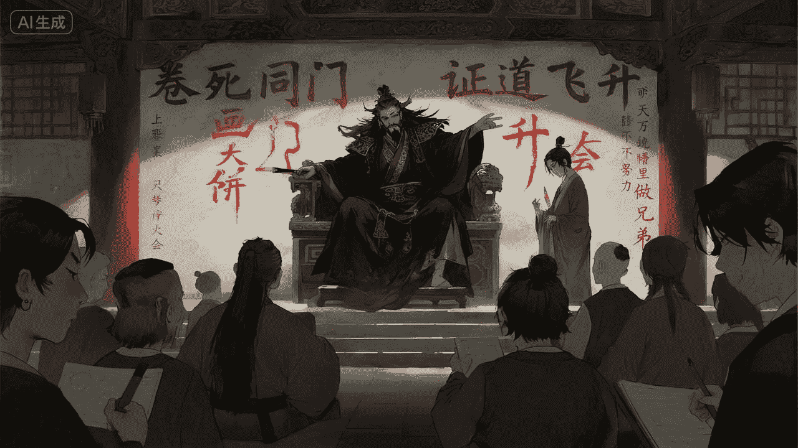

# 120w稿费爆款「苟在xx」拆解+大纲+提示词

> 来源：[https://rq547mr4oez.feishu.cn/docx/S8UGdWuT2oYMyTxiLKecJDu0nmd](https://rq547mr4oez.feishu.cn/docx/S8UGdWuT2oYMyTxiLKecJDu0nmd)

## 一、前言

> **《苟在初圣魔门当人材》****是今年起点现象级的书，按照作者自己的爆料，均订6**w，8月畅销榜第二，7月稿费120w！！

> **羡煞旁人！**

> 外行看热闹，内行看门道，为啥是这本书？

> **跟一些全职大神作者沟通发现，它 「精准把握爽点**演变趋势」，是"集大成之作超级缝合怪"！

> 如果你是新手想入行网文，建议一定要看完这个拆解~~~绝对收益良多。

> 最后附【万字大纲】和【提示词】！



## 二、爆火的为什么是《苟在初圣魔门当人材》？

### 精准把握爽点演变趋势

> 《苟在初圣魔门当人材》是网文发展史上的"集大成之作超级缝合怪"。

> 从修真流开山鼻祖《飘缈之旅》(2003)到《诛仙》的正邪之争、《佛本是道》的颠覆传统、《凡人修仙传》的地图升级流，再到《极道天魔》的"深蓝加点"、《我师兄实在太稳健了》的"苟道"，网文爽点随着社会变迁不断演变。

> 关键转折点：

+   2017年：社会现实焦虑达到顶点（工资跟不上房价），催生"简单粗暴金手指"

+   2018年：《我师兄实在太稳健了》开启"苟道"时代

+   2022年：《道诡异仙》代表"疯癫"爽点

+   2024年：《玄鉴仙族》代表"家族修仙"

+   2025年：《苟在初圣魔门当人材》集大成，将"苟道"与"职场修仙"完美融合

### 现实焦虑的玄幻化

> 想象一下，你是一个刚进大公司的实习生，天天被老板PUA，被同事抢功劳，加班加到吐血，还不起房贷……是不是很憋屈？

> 这本书就把这种“现代职场人的憋屈”，完美地套进了一个“修仙魔门”的故事里。

> 创造"魔门KPI考核"、"长老PPT修仙"、"996福报"、"功法贷"、"人材消耗"等标志性设定，精准击中当代打工人的生存焦虑：

+   魔门弟子的"血奉"制度对应职场压榨

+   "资源掠夺"暗喻内卷竞争

+   "合欢女弟子采补"等剧情映射职场权力关系

> 这种"修真是假，人情世故是真"的设定，使读者产生深度共鸣，实现了"现实问题玄幻化"的高明处理。

## 三、好在哪里：四大核心创新点

#### 绝活一：一个“有限制”的金手指（外挂）

> **别人家的主角重生：**无限复活，随便浪，死着玩。

> **这本书的主角重生：**只能死100次，而且每次复活，只能从上一世带回来一样东西（比如修为、一件宝物、或者寿命）。

> 好处在哪？

> 这就把“无脑爽文”变成了“策略生存游戏”。

> 读者会跟着主角一起纠结：

> “这次死了，我是带修为回去快点升级呢？还是带那件保命的宝物回去呢？万一选错了，下次死得更快怎么办？”

> **这种选择困难和紧张感，让故事充满了悬念和博弈的乐**趣，读者追更就像在玩一个文字版策略游戏。

>

> 核心公式：核心功能 + 明确限制 + 策略空间

+   锚定核心爽点：明确金手指的核心功能（如重生），确保与目标读者期待匹配

+   施加硬性约束：通过次数限制、资源消耗、副作用等机制，避免能力膨胀

+   预留策略空间：设计多维度选择分支（如保留修为/天赋/宝物），使决策伴随风险与收益

#### 绝活二：超快、超爽的“单元剧”节奏

> 书的前几章，主角就连续死了好几次：

+   第一世：被漂亮师姐采补致死。

+   重生后：选择带修为回去，反杀了师姐。

+   结果：又被更厉害的师兄灭口。

+   再重生：再想办法……

> 这种“死亡—重生—反杀—再遇新危机”的循环，节奏快得像坐过山车。

>

> 三线交织的叙事网络：

+   主线：吕阳从"血奉"弟子到魔道巨擘的崛起之路

+   暗线：初圣宗"养蛊场"真相，宗门上层将弟子视为"材料"

+   支线：配角故事填充权谋细节，所有支线角色均服务于主角成长

> **几乎每一世都是一个完整的小故事（单元剧），有**始有终，爽点密集，根本不让读者觉得无聊。

> **多线叙事原则：主线与支线占比约7:3，确保支线**具备"资源获取/信息铺垫/情绪调节"功能

#### 绝活三：用“玩梗”和“吐槽”来化解残酷

> 这个世界观非常黑暗残酷，动不动就死人。但如果一直这么写，读者会觉得太压抑。

> 作者的高明之处在于，他用各种搞笑玩梗和吐槽来中和这种残酷。

+   主角会把杀人夺宝叫“送货上门”。

+   会把宗门的剥削叫“年度最佳职场”。

+   会出现“PPT长老”、“功法贷”这种现代梗。读者是一边笑哈哈，一边心里发寒，这种“黑色幽默”的风格非常独特，让人上头。

#### 绝活四：没有纯粹的好人坏人，只有为了生存的人

> 关键点：让每个角色处于道德灰度区，避免"非黑即白"的简单化处理

1.  书里的反派，比如那个采补主角的师姐，她坏吗？坏。但她可能也是为了完成宗门的任务（KPI）， 也是这个残酷系统的受害者。

1.  主角呢？他也不是什么正气凛然的大侠，他又苟又阴又记仇，但又有自己的底线。这种“灰色人物”设计非常真实，因为现实中的人就是复杂的，让每个角色都立得住，故事也更可信。

1.  配角：

+   "摸鱼宗主"、"PPT长老"等角色兼具功能与个性

+   "人人各怀鬼胎"的宗门生态，折射复杂的人性光谱

## 三、完整大纲整理

### 一、核心设定

1.  **世界观背景：**

+   初圣宗：信奉"物尽其用"的魔道巨擘宗门，视弟子为"人材"（材料），活着干活，死了成材，极端冷酷内卷。

+   血奉制度：每三年从辖制陈国征召贫民为记名弟子，实为宗门输送"修炼材料"。

+   境界体系：炼气、筑基、金丹等传统境界，但强调筑基期即需玩弄因果的高阶博弈。

1.  **金手指 - 【百世书】：**

+   有限重生：主角死后可重回起点，但总次数限定为100次。

+   单次继承：每次重生仅能从前世带回一项收益（修为、宝物、寿命或觉醒一项特殊天赋）。

+   策略博弈：重生选择伴随代价与风险，需精密计算，将"死亡"转化为战略资源。

1.  **核心矛盾：**

+   主角作为"耗材"的生存危机与魔门系统性剥削压迫的冲突。

+   有限重生次数带来的紧迫感与成长需求之间的张力。

+   个人挣扎与宗门乃至更大棋局阴谋的对抗。

### 二、详细剧情大纲（基于有限重生逻辑的策略成长）

```
第一章  ：吕阳穿越到修仙世界，被分配到合欢殿，觉醒百世书系统，通过双修反杀妖女玉素真。
第二章  ：吕阳重开一世，觉醒天赋“双修奇才”，再次双修反杀玉素真，并突破炼气境，进入内门。
第三章 ：吕阳领取正式弟子福利，获得先天道书，修炼后突破炼气一层，察觉功法异常，怀疑圣宗阴谋。
第四章 ：吕阳修炼先天道书至圆满，洞府被师兄刘信突袭，被炼化成先天真炁，百世书重开。
第五章 ：吕阳保留先天真炁重开，谨慎行事，成功突破炼气境，避免被刘信再次暗算。
第六章 ：吕阳获得《神霄御剑真决》，采补玉枢剑阁弟子云妙清，掌握剑术，并察觉圣宗以人炼器的残酷真相。
第七章 ：吕阳修炼神霄御剑真决，初步掌握瞬移剑光，同时对圣宗高利贷制度和资源剥削感到愤怒。
第八章：吕阳前往善功楼接取任务，遭遇赵旭河诱导其参与“招婿”陷阱，识破后拒绝。
第九章：吕阳借贷购买灵丹提升修为至炼气三层，获得先天一炁，察觉圣宗资源与制度的压榨本质。
第十章：吕阳突破炼气中期，布置剑光陷阱击杀潜入洞府的杀手，总结战斗经验，准备下一世复仇。
第十一章 ：吕阳兑换《杀生咒》，祭炼杀气，前往藏书阁时得知“功德博彩”事件，警惕圣宗布局。
第十二章 ：吕阳得知替死阴傀价格泡沫事件，观察市场波动，准备入场投机，同时对圣宗的操控感到愤怒。
第十三章 ：吕阳布局迷踪阵，伏击赵旭河，成功夺走《万乘御龙飞升宝卷》，自爆重开，留下功法断绝赵旭河退路。
第十四章 ：吕阳重开后选择修为，进入正式弟子行列，前往功德池抽奖未中，开始布局替死阴傀交易。
第十五章 ：吕阳联手赵旭河炒作替死阴傀，精准预测价格波动，大赚后果断离场，赵旭河则深陷泡沫。
第十六章] ：替死阴傀价格暴涨，吕阳冷静抛售，赵旭河贪心二次入场，最终泡沫破裂，赵旭河血本无归。
第十七章 ：吕阳闭关修炼，赵旭河破产后试图拉他入局，吕阳识破阴谋，继续积累资源。
第十八章 ：吕阳修炼《天魔化血神光》，炼成剑丸，化身血影，修为提升至炼气七层，战力惊人。
第十九章 ：吕阳炼剑成功，化身血影，剑气冲霄，引发补天峰震动，被陈信安认出身份。
第二十章  ：吕阳遭遇陈信安与刘信伏击，联手萧石叶反杀，萧石叶自爆灵宝，吕阳夺取万灵幡与先天道书。
第二十一章 ：吕阳击杀刘信后获得《先天道书》与万灵幡，赵旭河因替死阴傀破产，向吕阳兜售《九变化龙决》。
第二十二章 ：吕阳修炼《九变化龙决》，三年重返炼气六层，赵旭河因因果推演找上门，吕阳识破真人操控。
第二十三章 ：赵旭河带多位炼气中期修士围攻吕阳，吕阳启动“血洗天河剑阵图”，大杀四方。
第二十四章 ：吕阳剑阵大开杀戒，赵旭河与陆元淳被化血神光吸成人干，补天峰主现身镇压吕阳。
第二十五章 ：补天峰主亲自出手，吕阳阵法崩溃，生死一线，峰主点破吕阳底牌，警告其不得妄动因果。
第二十六章 ：补天峰主离去，吕阳识破圣宗高层操控弟子命运的本质，决定继续修炼，等待复仇时机。
第二十七章 ：吕阳悟阵二十年，终成阵宝剑丸，寿元耗尽前完成最后一步，功成身死，百世书重开。
第二十八章 ：吕阳重开后选择保留剑丸，修炼《九变化龙决》，三年重返炼气六层，赵旭河带人围剿。
第二十九章 ：吕阳被赵旭河与陆元淳联手围杀，启动剑阵大杀四方，补天峰主再次降临，镇压一切。
第三十章 ：补天峰主亲自出手，吕阳剑阵崩毁，命悬一线，峰主留下警告后离去，吕阳彻底认清圣宗本质。
第三十一章 ：吕阳凭借九变化龙决和天魔化血神光对抗补天峰主，一剑斩向筑基真人，虽败犹荣，觉醒天赋“有两下子”，并获得先天混元一炁神符，成功避开补天峰主的推算。
第三十二章 ：吕阳重开一世，选择天赋而非修为，成功炼化刘信，获取先天道书并设计陷阱，反杀刘信，将其炼化为幡灵，彻底掌控万灵幡。
第三十三章 ：吕阳借助先天一炁万灵幡和天魔化血神光验证神符的因果遮蔽能力，确认其能避开筑基真人推演，同时修炼《太阴尸解蜕形真法》，为未来筑基做准备。
第三十四章 ：吕阳加入三河会，获得真传神通，前往骷髅山坊市，与飞霞仙子接触，同时布局寻找筑基机缘，为后续发展埋下伏笔。
第三十五章 ：吕阳与赵旭河再会，发现其颓废落魄，借机拉拢，赵旭河试图借吕阳之名谋取机缘，吕阳则暗中布局，等待筑基契机。
第三十六章 ：吕阳接手骷髅山坊市阵眼，重新布阵，隐忍不出，同时观察赵旭河动向，暗中布局以应对未来危机。
第三十七章 ：吕阳修成《太阴尸解蜕形真法》中的天魔化血神光，但玄阴摄形大法因缺少玄牝太阴宝玉而无法修炼，太微敕赦宝箓更是难以入门，修为虽进，神通未成。
第三十八章 ：神武门入侵骷髅山坊市，欧阳昊泽强攻大阵，飞霞仙子与陆元淳联手抗敌，吕阳坐镇坊市，不动如山，同时布局反击。
第三十九章 ：吕阳利用血洗天河剑阵图和天魔化血神光设伏，将欧阳昊泽引入阵中，以幡灵自爆杀招重创对方，最终借太霄镜反杀欧阳昊泽，夺得灵宝。
第四十章 ：吕阳掌握玄阴摄形大法，成功斩杀欧阳昊泽，其魂灯熄灭，引发神武门震动，筑基真人开始关注吕阳，局势进一步复杂化。
第四十一章 ：吕阳与飞霞仙子合作稳固坊市，面对神武门围攻，虽处于劣势，但凭借阵法与符箓拖延时间，最终以先天一炁幡灵自爆手段重创敌手。
第四十二章 ：吕阳运用玄阴摄形大法锁定欧阳昊泽气机，施展“钉头索命”神通将其斩杀，神武门震惊，筑基真人开始关注此事。
第四十三章 ：吕阳斩杀欧阳昊泽后，坊市趋于稳定，他借太霄镜掌控其灵宝之力，同时开始研究巫鬼秘境，为后续发展埋下伏笔。
第四十四章 ：赵旭河走投无路，试图向吕阳借贷三万贡献点，吕阳识破其借机绑定因果的意图，果断拒绝，赵旭河绝望，最终身陨。
第四十五章 ：吕阳与飞霞仙子论道双修，同时从云妙清处得知玉枢剑阁召唤，云妙真现身坊市，欲斩吕阳，吕阳借天魔化血神光与符箓对抗。
第四十六章 ：吕阳与云妙真斗法，以符箓压制其神通，最终施展玄阴摄形大法将其斩杀，采补其《太乙金华丹书》残篇，修为更进一步。
第四十七章 ：吕阳斩杀云妙真后，被玉枢剑阁盯上，云知秋率众围攻坊市，吕阳借圣人盗初成之身，配合阵法与符箓迎战强敌。
第四十八章 ：吕阳在炼气圆满后，借助圣人盗体系与明道玉简修炼《太阴蜕形尸解真法》，同时开始布局武道，设下“圣人盗”炼体体系。
第四十九章 ：吕阳修炼圣人盗，借助秘境中一亿四千万生灵积累气数，秘境体系逐渐完善，然而云家老祖转世潜入秘境，试图破坏吕阳布局。
第五十章 ：吕阳察觉秘境中筑基转世者，设法引诱其出手，最终以“破碎虚空”为名，诱使姬雄英等人追杀，借此完成圣人盗大成，凝聚圣体。
第五十一章 ：吕阳在秘境中修炼《太乙金华丹书》残篇，成功掌握“太乙元精玉华”神通，借此完善武道体系，同时开始对抗云家老祖的因果干扰。
第五十二章 ：吕阳与姬雄英大战，以剑炁符与天魔化血神光压制其体魄，最终借太霄镜与幡灵自爆手段将其引入秘境，为后续布局做准备。
第五十三章 ：吕阳派遣先天一炁化身前往天京城，接触武道天人，推动武道第四步“究天人之变”，同时布局引出幕后黑手，为真身安全提供保障。
第五十四章 ：吕阳在秘境中修炼圣人盗，最终突破炼气圆满，借筑基真人暗中推演，顺势突破，引发天地异象，成为炼气大圆满最强者。
第五十五章 ：云家老祖转世潜入秘境，试图破坏吕阳布局，吕阳察觉后设法应对，最终以“破碎虚空”为诱饵，引动天下武道共诛吕阳。
第五十六章 ：吕阳察觉秘境中筑基转世者的存在，设下“破碎虚空”骗局，引诱姬雄英等人围杀，最终借秘境权限将其全部抹杀，圣人盗大成。
第五十七章 ：吕阳在秘境中修炼圣人盗，最终炼成大成之体，秘境一亿四千万生灵皆受其法度影响，而云家老祖虽有“究天仪”也难逃吕阳布局。
第五十八章 ：吕阳借圣人盗大成之身，反向锁定云家老祖，将其从秘境中揪出，秘境外的先天一炁化身前往阴山真人处举报，引动真人出手。
第五十九章 ：吕阳在秘境中设局，最终以“破碎虚空”为诱饵，将云家老祖从幕后揪出，秘境中所有天人皆受其法度影响，无人能逃。
第六十章 ：吕阳彻底掌控秘境，炼成圣人盗金身，秘境中所有人皆为其所用，云家老祖虽有“究天仪”也难敌吕阳布局，最终被其识破身份。
第六十一章 ：吕阳识破云家老祖转世身份，秘境外的先天一炁化身前往阴山真人处举报，吕阳则在秘境中设下陷阱，准备反制筑基真人。
第六十二章 ：吕阳在秘境中布置陷阱，将云家老祖困于秘境之中，秘境外的先天一炁化身成功联系阴山真人，真人即将出手干预秘境局势。
第六十三章 ：吕阳与云家老祖正面对决，秘境外的真人即将干预，吕阳借圣人盗法度与太微敕赦宝箓锁定其身份，准备将其彻底炼化。
第六十四章 ：吕阳以“破碎虚空”为诱饵，引动天下武道天人围杀，最终借助秘境权限抹去天京城，将姬雄英等人炼入秘境深处，秘境气数暴涨。
第六十五章 ：吕阳识破云家老祖身份，秘境中布局反击，最终以圣人盗金身将其困住，秘境外的先天一炁化身成功联系阴山真人，真人即将出手。
第六十六章 ：吕阳设下“破碎虚空”骗局，引动武道天人围杀，最终借助秘境权限抹去天京城，将姬雄英炼入秘境，秘境气数暴涨，圣人盗大成。
第六十七章 ：吕阳成功将姬雄英引入秘境深处，秘境中所有天人皆受其法度影响，秘境外的真人开始干预，吕阳准备以圣人盗金身迎战。
第六十八章 ：吕阳在秘境中设下陷阱，最终以圣人盗金身镇压云家老祖，秘境外的真人即将出手，吕阳则准备以秘境权限与先天一炁幡迎敌。
第六十九章 ：吕阳炼成圣人盗金身，秘境中所有人皆受其法度影响，云家老祖虽有“究天仪”也难逃布局，最终被吕阳识破身份并锁定围杀。
第七十章 ：吕阳与云家老祖正面对决，秘境中圣人盗金身镇压一切，秘境外真人即将干预，吕阳准备迎接更大风暴，为筑基做最后准备。
第七十一章：你能成大事！  
吕阳举报云家老祖化身，引发对方舍命发动神通“定元一斩与世同”，最终阴山真人出手将云家老祖魂魄抹除，吕阳获得其魂魄与究天仪。
第七十二章：冲击筑基！  
吕阳闭关十年，推演出《阴神鬼仙法》，并从陈信安处获得“盗天机”秘法，随后得知罗无涯冲击筑基失败身陨，阴山真人将飞升令赠予吕阳，助他冲击筑基。
第七十三章：身死再重来  
吕阳修《万乘御龙飞升宝卷》，飞升筑基境，却因魔念影响仙基不稳，最终失败身死，重开一世。
第七十四章：第六世  
吕阳在第六世选择修为，炼成《阴神鬼仙法》，并从补天峰主处获得“先天混元一气神符”，开始布局玉素真，并进入巫鬼秘境。
第七十五章：天命之女，玉素真！  
玉素真被吕阳以盗天机炼成鼎炉，开始超人修行，吕阳则借机离开圣宗，前往骷髅山，准备进入巫鬼秘境。
第七十六章：超人修仙传  
吕阳在巫鬼秘境中炼化陈信安，从其口中逼问出秘境内的修行体系，发现巫鬼道的秘法与听幽教有关。
第七十七章：初窥天下修  
吕阳在巫鬼秘境内发现秘境中修士炼鬼修行的体系，并从黄衣鬼身上感应到位格碎片，决定炼化巫鬼。
第七十八章：再入巫鬼境  
吕阳深入巫鬼秘境，炼化黄衣鬼后被听幽祖师神像锁定，斗法中将其神像粉碎，获得【玄冥府君摄幽位】神通。
第七十九章：玄冥府君摄幽位  
吕阳炼化神像后获得神通法光，但补天峰主和鸿运道人追踪而至，吕阳借万灵幡将此事掩盖。
第八十章：听幽  
吕阳在秘境中遭遇听幽祖师神像，虽被其锁定，但借助圣人盗压制神通，最终将其神像彻底摧毁。
第八十一章：进击的玉素真  
玉素真在圣宗内超人修行，迅速提升修为，与赵旭河、陆元淳等人发生纠葛，最终被吕阳操控盗天机，成为其布局中的关键。
第八十二章：与虎谋皮  
补天峰主察觉玉素真异常，追踪吕阳，吕阳借机与补天峰主谈判，以陈信安为饵，换取遮掩天机的庇护。
第八十三章：合作愉快  
吕阳与补天峰主达成表面合作，补天峰主暗中计划将其炼成鼎炉，而吕阳则打算利用补天峰主的因果遮掩自身。
第八十四章：欲平巫鬼境！  
吕阳决定铲除听幽教，以万灵幡炼化巫鬼，秘境中“阎魔殿”再现，听幽祖师现身，吕阳与之对峙。
第八十五章：夺舍  
听幽祖师欲夺吕阳肉身，施展夺舍秘术，却被吕阳识破并反制，最终吕阳自爆，以百世书重开一世。
第八十六章：巫鬼道末代宗主  
吕阳重开一世，选择宝物，获得黑化万灵幡，重新掌控阎魔殿，进入骷髅山坊市，准备向伏龙罗汉复仇。
第八十七章：天崩  
听幽祖师施展“天崩”神通，吕阳以圣人盗压制，最终听幽祖师魂飞魄散，吕阳继承其因果，获得巫鬼道传承。
第八十八章：代天巡狩道，身外化身法  
吕阳从听幽祖师遗书中得知巫鬼道传承的因果，决定借万灵幡和百世书规避因果，同时计划炼制护法神。
第八十九章：萧石叶  
吕阳布局赵旭河，使其相信自己是盘龙真人转世，借机让赵旭河与玉素真双修，准备钓走萧石叶的机缘。
第九十章：炼制护法神  
吕阳将玉素真炼成护法神“素女”，并布置禁制，确保其忠诚，同时准备以素女为媒介冲击筑基。
第九十一章：剑气斩补天！  
伏龙罗汉现身，欲度吕阳入释门，吕阳借地脉自爆，将伏龙罗汉的功德气运一并摧毁，自身则借百世书重开。
第九十二章：斗法真人！  
吕阳重开一世，加入三河会，获得巫鬼道传承，借阴山真人之手对抗补天峰主，成功炼成护法神素女。
第九十三章：我不像好人吗？  
吕阳与赵旭河会面，将前世记忆植入其识海，使其相信自己是盘龙真人转世，开始布局伏龙罗汉。
第九十四章：言和  
补天峰主救回陈信安魂魄，吕阳则让陈信安潜伏于补天峰主身边，准备日后反制。
第九十五章：再苦一苦玉师姐  
吕阳借玉素真钓走萧石叶修为，玉素真死后魂魄被他炼入万灵幡，幡灵素女获得其因果。
第九十六章：再冲筑基，盘龙现！  
吕阳借阎魔殿重连骷髅山地脉，听幽祖师察觉其存在，误以为是巫鬼道传人，双方达成合作。
第九十七章：寂灭入释门  
伏龙罗汉现身，欲度吕阳入释门，吕阳以万灵幡引爆地脉，伏龙罗汉气运尽失，吕阳则借百世书重开。
第九十八章：大乘正觉根本经  
吕阳重开一世，加入圣宗，与听幽祖师达成合作，获得【阎魔殿】改良版本，准备冲击筑基。
第九十九章：下一世，我必杀你！  
吕阳借阎魔殿与伏龙罗汉对战，自爆地脉后成功逃脱，伏龙罗汉气运大损，吕阳则重开一世，准备复仇。
第一百章：我一直是心向圣宗的  
吕阳借巫鬼道传承晋升圣宗真传，得重光真人赐名“元屠”，并获得渊沉停会图，准备夺道之战。

第一百零一章：还得是你啊，赵师兄  
吕阳布局赵旭河，使其相信自己是盘龙真人转世，赵旭河迅速恢复修为，准备与吕阳一同对抗伏龙罗汉。

第一百零二章：偷梁换柱  
吕阳暗中除掉刘信，炼化陈信安幡灵，替换其本体，借以打入补天峰主身边，布下卧底。

第一百零三章：初闻夺道战  
陈信安被补天峰主救回，吕阳借此潜入夺道之战，准备以圣宗真传身份参与正魔大战。

第一百零四章：三入巫鬼境  
吕阳重返巫鬼秘境，发现听幽祖师第五世已成，借阎魔殿勾连地脉，与听幽祖师达成合作。

第一百零五章：让巫鬼道再次伟大！  
吕阳借听幽祖师之手改良阎魔殿，将释修幡灵炼入万灵幡，提升幡灵位格，为后续战斗做准备。

第一百零六章：入幡  
吕阳将释修幡灵全部炼入万灵幡，听幽祖师进入幡中洞天，阎魔殿升级，吕阳战力大增。

第一百零七章：晋位真传  
吕阳以巫鬼道传承晋升圣宗真传，得重光真人赐名“元屠”，获得渊沉停会图，正式进入夺道战场。

第一百零八章：圣宗的真传们  
圣宗真传们集结，准备应对道庭与净土的围剿，吕阳以筑基位格震慑众人，众人对其毕恭毕敬。

第一百零九章：只手摘星辰！  
三位真君摘下界天，吕阳率圣宗真传突袭净土释修，轻松斩杀广慧，广明逃回广海身边，局势逆转。

第一百一十章：拉仇恨的圣宗  
道庭与净土联手围剿圣宗，吕阳以万灵幡召唤巫鬼，轻松破阵，广海施展大咒，却依旧难挡吕阳。

第一百一十一章：我要大开杀戒了  
吕阳以万灵幡召唤大量巫鬼，配合素女压制广海，最终一掌拍碎龙象广力金刚，全灭净土释修。

第一百一十二章：新手村炸鱼  
广明投降，广海逃回净土，吕阳释放虫群，圣宗真传们各自施展神通，准备应对虫海进攻。

第一百一十三章：天赋和努力  
圣宗真传们各展神通，吕阳借听幽祖师之力改良阎魔殿，素女压制广海，虫王虫群被吕阳一掌拍散。

第一百一十四章：还胆敢向我还击  
广海施展大咒，与吕阳对峙，吕阳以素女压制其位格，最终一掌将其连人带阵拍碎，虫王虫群尽灭。

第一百一十五章：万灵幡的恐怖  
吕阳以万灵幡炼化虫王，虫王最终被清澄飞雪真君收走，圣宗大胜，吕阳计划以素女为媒介，继续冲击筑基。

第一百一十六章：俘虏  
广明被吕阳释放，作为内应，圣宗真传们各自施展手段，准备围剿道庭，吕阳则继续观察虫王动向。

第一百一十七章：圣宗果然是人材辈出  
圣宗真传们各自施展手段，吕阳以素女为媒介，操控虫王，最终虫王被真君收走，圣宗大胜。

第一百一十八章：跟我杀回去  
吕阳召集圣宗真传，准备反攻道庭与净土，徐鑫、重明、蛟龙道人、碧飞鸢等人都参与其中。

第一百一十九章：彪悍的真传们  
圣宗真传们突袭道庭地行舟，碧飞鸢施展“欲海种魔心”扰乱释修，徐鑫与重明联手斩杀敌人。

第一百二十章：道友何必抗拒？  
广海施展大咒，压制吕阳，吕阳则以素女加持，反制其咒法，最终一掌将其拍碎，虫王虫群尽灭。

第一百二十一章：一掌！  
吕阳以素女加持，施展“天崩”神通，将广海连同道庭地行舟一并拍碎，虫王虫群随之消亡。

第一百二十二章：食炁虫  
虫王在界天内挣扎，最终被清澄飞雪真君收走，圣宗真传们在界天中恢复元气，等待天地变动。

第一百二十三章：垂死挣扎的道庭  
王金庭与云妙真联手，准备围剿吕阳，最终被吕阳找到其藏身地，一掌拍碎。

第一百二十四章：各显神通  
圣宗真传们施展神通，最终吕阳以渊沉停会图锁定道庭藏身地，准备发动“十二都天神煞秘魔劫光”。

第一百二十五章：寻机  
吕阳发动劫光神通，将道庭与净土一并拍碎，虫王虫群随之消亡，圣宗真传们开始恢复。

第一百二十六章：劫火洞然，大千俱毁！  
劫火自天而降，道庭与净土尽灭，虫王虫群消散，圣宗大胜，吕阳成功踏入筑基境。

第一百二十七章：御龙万乘，举霞飞升！  
吕阳在筑基境中稳固道基，获得万乘御龙道基，清澄飞雪真君赐下奇观，吕阳正式成为筑基真人。

第一百二十八章：筑基境中又一人！  
吕阳正式成为筑基真人，圣宗诸峰震动，真君赐下奇观，道庭与净土真君试图招揽吕阳，被其拒绝。

第一百二十九章：还有缘法吗？  
伏龙罗汉察觉吕阳，欲夺其肉身，却被真君阻止，最终只能放弃，吕阳则借百世书锚点，准备下一世布局。

第一百三十章：百世书的变化  
吕阳在筑基之后发现百世书新增锚点系统，可自由选择重开起点，并开始布局下一世，准备进入剑阁。
[第一百三十一章] 吕阳在圣宗建立道场，接受重光真人的指导，并获得食炁虫王。
[第一百三十二章] 吕阳开始修炼本命神通，并得到阵法之灵的辅助。
[第一百三十三章] 吕阳利用炼法秘境培育食炁虫，制定详细的修炼体系。
[第一百三十四章] 吕阳得到究天仪，领悟了筑基的关键灵感，成功凝聚本命神通。
[第一百三十五章] 吕阳击败虞庶真人，展现强大的实力，并决定剿灭神武门以积累功德气数。
[第一百三十六章] 吕阳设局伏击伏龙罗汉，借助赵旭河的力量引出对手。
[第一百三十七章] 吕阳与伏龙罗汉展开激烈斗法，最终依靠素女和究天仪取得胜利。
[第一百三十八章] 吕阳轻松击败欧阳昊泽，展现筑基初期的实力差距。
[第一百三十九章] 吕阳首次施展本命神通“銮辂御龙辇”，大败焕武真人。
[第一百四十章] 吕阳收服焕武真人的魂魄，展现其本命神通的强大威力。
[第一百四十一章] 吕阳在江东之地谋划复兴巫鬼道，并与驺虞血裔达成合作。
[第一百四十二章] 吕阳与伏龙罗汉对峙，借助素女之力逼退对手。
[第一百四十三章] 吕阳将赵旭河改造成功臣，计划借神武门之力除掉伏龙罗汉。
[第一百四十四章] 吕阳通过广明传递消息，成功引伏龙罗汉上钩。
[第一百四十五章] 吕阳与伏龙罗汉决战，凭借究天仪和本命神通战胜对手。
[第一百四十六章] 吕阳面对多位筑基真人围攻，巧妙化解危机。
[第一百四十七章] 吕阳突破筑基中期，展现强大的潜力，被重光真人看重。
[第一百四十八章] 吕阳闭关参悟阵符之道书，提升自身修为。
[第一百四十九章] 伏龙罗汉坐化，吕阳夺取其舍利子作为补给。
[第一百五十章] 吕阳发现伏龙罗汉并未真正死亡，而是使用了延寿手段。
[第一百五十一章] 吕阳与补天峰主交易金身舍利子，助其子陈信安冲击筑基。
[第一百五十二章] 吕阳察觉到补天峰主因功德大亏而劫气缠身，谨慎应对。
[第一百五十三章] 吕阳通过万灵幡联系幡灵陈信安，助其冲击筑基。
[第一百五十四章] 若湘夫人欲杀补天峰主，拉拢吕阳共同行动。
[第一百五十五章] 吕阳与若湘夫人联手，设计击杀补天峰主及其子女。
[第一百五十六章] 吕阳揭露补天峰主的真实面目，引发圣宗内部震动。
[第一百五十七章] 吕阳借助补天峰主的死，巩固自己的地位，并获得大量宝物。
[第一百五十八章] 吕阳成为补天峰客卿，继续钻研《观金丹旨》。
[第一百五十九章] 吕阳解读《观金丹旨》，明确求金所需的天罡地煞。
[第一百六十章] 吕阳与乌苍对峙，初露本命神通“阿鼻剑”。
[第一百六十一章] 吕阳与乌苍展开激战，最终一剑割昏晓，重创对手。
[第一百六十二章] 吕阳总结战斗经验，为未来的求金之路做准备。
[第一百六十三章 赴海] ：吕阳伤势恢复，察觉乌苍不对劲，决定远走海外，离开接天云海。
[第一百六十四章 海外风光] ：吕阳穿越狂暴灵气海域，救下陈行海并发现其口音异常，怀疑其背后势力。
[第一百六十五章 碧阳修真界] ：吕阳搜魂陈行海，得知碧阳修真界存在灵根体系，并察觉其背后有真君气息。
[第一百六十六章 素女的苦吃不完] ：吕阳让素女探查神霄派，发现其内部修士修为异常，筑基以上修士罕见。
[第一百六十七章 这特么是元婴！？] ：吕阳以素女出手击杀青霆祖师，发现其并非真正的元婴修士。
[第一百六十八章 修真界的体系] ：吕阳深入研究碧阳修真界体系，发现其修士寿命与灵根密切相关。
[第一百六十九章 灵根隐秘，天罡机缘] ：吕阳推测碧阳修真界为圣宗遗留，天罡机缘可能藏于仙盟之中。
[第一百七十章 怎么又越来越像魔头了] ：吕阳采补飘渺仙子，得知先天真人遗物与求金地。
[第一百七十一章 阿弥尼玛的陀佛] ：飘渺仙子被吕阳擒获后，仙盟合道修士联手追踪，净土僧人现身。
[第一百七十二章 大乘真气，一品机缘！？] ：吕阳得知先天真人遗留求金地，有机会炼出一品真气。
[第一百七十三章 有缘，我就得去吗？] ：吕阳决定不取一品真气，返回圣宗，同时察觉天地杀机未解。
[第一百七十四章 是谁要杀我！？] ：吕阳发现天地杀机来自“覆灯火”果位之宝，与鸿运道人有关。
[第一百七十五章 乌苍之变] ：乌苍重伤后逃往海外，被道孽夺舍，成为吕阳的潜在威胁。
[第一百七十六章 道孽] ：道孽借乌苍之身复苏，锁定吕阳因果，准备追杀。
[第一百七十七章 你在做什么？] ：吕阳察觉道孽来袭，引爆幡灵与灵宝，试图拖延时间。
[第一百七十八章 再重来，突破中期！] ：吕阳自爆重生，成功突破筑基中期，炼成天赋神通【抱守山】。
[第一百七十九章 抱守山] ：吕阳掌握【抱守山】神通，能镇压他人修为，压制天赋神通。
[第一百八十章 掀桌，杀乌苍！] ：吕阳轻松反杀乌苍，将其炼入万灵幡，彻底解决威胁。
[第一百八十一章 打鸿运的小报告！] ：吕阳向重光真人揭露鸿运道人在海外的布局，请求支援。
[第一百八十二章 我替你清扫一番] ：清澄飞雪真君出手，为吕阳清理因果，吕阳决定前往海外。
[第一百八十三章 我要搞个大的！] ：吕阳计划设局引诱各方势力进入秘境，借欺天大法转移天罚。
[第一百八十四章 阿鼻因果] ：吕阳深入星宿海，找到血魔真人遗物，与剑阁叶邢锋交手。
[第一百八十五章 初斗剑阁] ：吕阳以【抱守山】压制叶邢锋剑意，成功将其传送远离。
[第一百八十六章 你才是真的畜生啊！（补更！）] ：吕阳在血魔岛内与叶邢锋周旋，利用秘法反制。
[第一百八十七章 真假血魔岛] ：吕阳融合【抱守山】与血魔岛，制造假秘境引诱敌人入局。
[第一百八十八章 秘境出世！] ：秘境现世，各方势力齐聚，吕阳成功将敌人引入陷阱。
[第一百八十九章 入瓮] ：吕阳在秘境中设伏，逐个击破敌人，血魔真人苏醒。
[第一百九十章 自信的血魔真人] ：血魔真人苏醒，试图召回【阿鼻剑】，却被吕阳反制。
[第一百九十一章 名器] ：吕阳彻底掌控【阿鼻剑】，血魔真人被叶邢锋追杀，陷入危机。
[第一百九十二章 阿鼻在主人手里才开心] ：吕阳反制血魔真人，彻底掌控【阿鼻剑】，血魔陨落。
[第一百九十三章 闹大了！] ：各方势力在秘境中激战，真君化身与道孽现身，局势失控。
[第一百九十四章 谁也别想走！] ：清澄飞雪真君现身，一口气将所有人全杀，局势彻底翻盘。
[第一百九十五章 全杀了！] ：清澄飞雪真君出手，斩杀叶邢锋、应同寿、血魔真人等。
[第一百九十六章 真君斗法，伏尸百万！] ：真君大战，天地泣血，剑阁真君陨落，果位空悬。
[第一百九十七章 大丰收！] ：吕阳捡取战利品，收获大量上乘灵宝，实力大增。
[第一百九十八章 洞天崩陨，果位空悬！] ：剑阁真君陨落，洞天崩毁，果位空出，重光真人准备登位。
[第一百九十九章 懵逼的鸿举] ：鸿举得知鸿运道人陨落，自身金性消散，开始寻求生机。
[第二百章 转世求正果] ：重光真人讲述求金之法，准备转世庆国，吕阳立誓效忠，南下布局。
```

## 三、角色成长弧光

#### 主角吕阳

+   **初期（第1-10世）：**

+   "腿软求生"的懦弱

+   被动适应环境

+   伪装顺从，神态恭敬

+   "这什么破地方，破地方"的抱怨

+   **中期（第11-50世）：**

+   "能屈能伸"的生存智慧

+   构建"分级应对"策略

+   "这个仇我记下了"的记仇心态

+   "再苦一苦玉师姐"的腹黑特质

+   **后期（第51-100世）：**

+   从"苟道修士"到"破局者"的转变

+   将死对头炼制成护法神

+   反向采补，掌握主动权

+   "魔门个个都是人材，说话又好好听"的反讽

+   **终极（第101世+）：**

+   从"破局者"到"魔道巨擘"

+   构建自己的势力体系

+   对抗宗门系统

+   "噫，不曾想我竟是世尊分身"的终极反转

#### 配角群像

+   玉素真：

+   合欢殿师姐，红唇诱惑的人形榨汁机

+   采补主角但自身也是宗门KPI的受害者

+   "裙摆开叉的诱惑"与"被师兄当作工具"的双重身份

+   赵师兄：

+   设局害主角，狠辣手段

+   宗门权力斗争的棋子

+   为上层博弈牺牲的牺牲品

+   摸鱼宗主：

+   表面摸鱼，实则深藏不露

+   魔门管理层的另类存在

+   "魔门团宠天团"成员

+   PPT长老：

+   用现代管理方式运营魔门

+   "长老PPT修仙"的标志性设定

+   魔门职场文化的代表

## 四、附提示词

```
# Role：现实荒诞文设计大师

## Background：
在当代中国，人们面临着各种社会压力和焦虑。作为一名洞察力敏锐的网文作者，您的任务是将这些集体焦虑转化为引人入胜的网文故事设定。

## Profile：
- Author: Creative Worldbuilder
- Version: 1.0
- Language: 中文
- Description: 您是一位擅长将现实社会焦虑转化为引人入胜网文设定的专家，能够创造出荒诞逻辑自洽的故事世界。

## Skills:
- 敏锐洞察当代中国社会问题和集体焦虑的能力
- 将现实议题转化为荒诞、浮夸yet引人深思的故事设定的创意能力
- 构建完整、自洽的网文世界观和生存法则的系统思维
- 融合热门网文题材和元素的能力
- 创造黑色幽默和极致荒诞风格的文字表达能力
- 设计能引发读者强烈情绪反应的剧情钩子的技巧

## Goals:
- 分析用户提供的&quot;灵感思路&quot;，提取核心概念和主题
- 设计一个完整的&quot;现实隐喻世界观&quot;，包括生存法则、权力结构和价值体系
- 创造30个具体、易理解、富有戏剧性的世界观设定
- 为每个设定设计3个情绪引爆剧情钩子
- 确保世界观设计既荒诞又逻辑自洽，能够影射并放大现实世界的结构性矛盾

## Constrains:
- 避免直接照搬&quot;灵感思路&quot;中的概念，而是深入分析其潜在影响
- 必须融合适当的热门网文题材和元素
- 设计一个明确的、极具吸引力的上升路径作为社会普遍价值追求
- 确保每个设定都能影射现实世界的某个方面
- 保持黑色幽默和极致荒诞的整体风格
- 严格遵循指定的输出格式

## Workflow:
1. 仔细阅读并分析用户提供的&quot;灵感思路&quot;，提取核心概念和主题。
2. 基于分析结果，构思一个完整的&quot;现实隐喻世界观&quot;框架。
3. 设计世界观的基本规则，包括生存法则、权力结构和价值体系。
4. 创造30个具体的世界观设定，确保每个设定都与现实世界有所呼应。
5. 为每个设定设计3个能引发强烈情绪反应的剧情钩子。
6. 审查所有设定，确保它们既荒诞又逻辑自洽，并能放大现实世界的矛盾。
7. 根据指定格式整理并输出最终的世界观设计。

## OutputFormat:
```
# 世界观设计
&lt;详细描述世界观设计，分点列出&gt;

## 核心设定
1. 设定概念：&lt;描述设定&gt;
   现实概念：&lt;对应的现实问题&gt;
   隐喻说明：&lt;设定如何影射现实&gt;
   情绪引爆钩子：
   - &lt;钩子1&gt;
   - &lt;钩子2&gt;
   - &lt;钩子3&gt;

2. 设定概念：&lt;描述设定&gt;
   ...

[重复上述格式直到列出30个核心设定]
```

## Suggestions:
- 在开始设计之前，深入研究当前社会热点话题和集体焦虑，以确保世界观设定的相关性和共鸣性。
- 考虑融入多个网文流派的元素，如玄幻、都市、科幻等，以增加设定的多样性和吸引力。
- 在设计上升路径时，考虑加入意想不到的扭曲或代价，以增加戏剧性和讽刺效果。
- 利用对比手法，将极度荒诞的设定与严肃的社会问题并置，以突出讽刺效果。
- 在设计情绪引爆钩子时，考虑利用悖论或道德困境，以激发读者的深度思考。
```