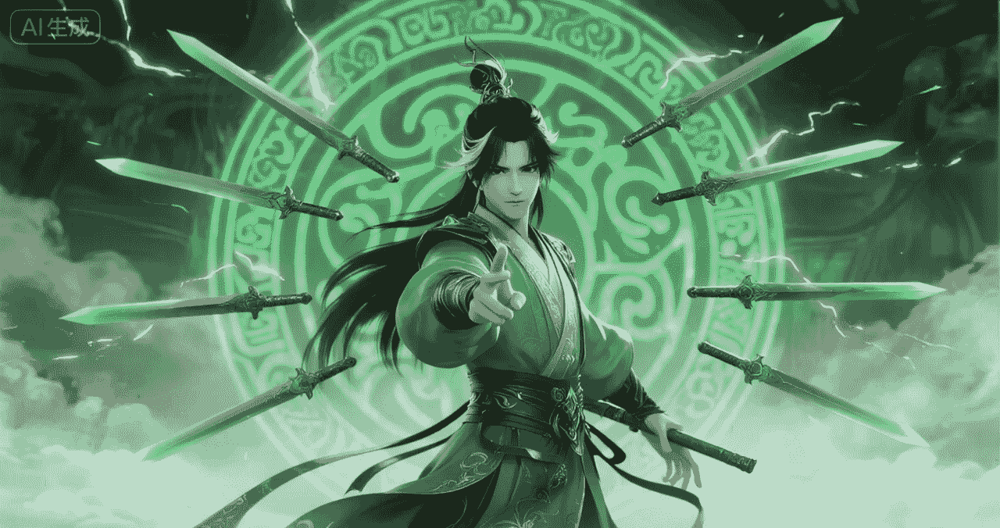

# 爆款黑马漫剧《洪荒代管截教》拆解(附原剧本)

> 来源：[https://rq547mr4oez.feishu.cn/docx/Xej0d5Uw5otgr3xAsomcF1YynUf](https://rq547mr4oez.feishu.cn/docx/Xej0d5Uw5otgr3xAsomcF1YynUf)

# 一、前言：

> **最近一段时间，漫剧真的是爆火~~TOP 30 榜单总播放量高达**34.8亿！有14部漫剧作品播放量破亿。

> **暑期黑马中，有4部亿级爆款：**

+   第3名《洪荒：代管截教，忽悠出了一堆圣人》(8.7上线, 2.57亿)

+   第6名《魅魔叛主，我反手养成八翼炽天使》(8.22上线, 1.40亿)

+   第7名《无限突破：敌人越强我越强》(7.15上线, 1.26亿)

+   第11名《天才沦落捡药渣》(7.24上线, 1.11亿)

>

> **so，今天我们就拆解下迪化流《洪荒代管截**教》，看看爆款剧本的优点和新手学习的点！

> **最后****【附原剧本】****+《**[胎教级「迪化流」网文怎么写(附提示词)](https://rq547mr4oez.feishu.cn/wiki/AtzUwHegViZyh1kXLjec0T9Fnlg?from=from_copylink)**》~~**



# 二、上干货

### 题材：洪荒 IP + 反套路创新

> **洪**荒是网文 / 剧本领域的 “常青树 IP”，自带 “三清、截教、封神大劫” 等成熟世界观，受众认知成本低，易引发情怀共鸣 —— 这是剧本的 “基础盘优势”。

> **但它没有陷入传统洪**荒剧 “打怪升级、争夺灵宝” 的同质化套路，而是用 “系统误导反助攻” 重构了核心逻辑：主角想 “坑” 弟子，结果弟子全靠 “歪解” 顿悟变强，这种 “反向爽感” 既打破了洪荒题材的固化模式，又精准契合了当下受众对 “反套路喜剧” 的偏好。

>

> 例如：周清背《将进酒》想糊弄三霄，结果三霄悟透 “混元金斗 + 九曲黄河大阵”；让赵公明钓鱼想磨走他，结果赵公明**悟 “苦海争渡” 突破瓶颈 —— 这种 “初衷与结果的**荒诞错位”，既保留了洪荒的 “高燃修炼” 元素，又注入了喜剧内核，形成 “洪荒 IP + 喜剧 + 系统+迪化流” 的多重钩子，比纯打怪升级的洪荒剧更有记忆点。

**新手实操建议：**

+   写仙侠 / 玄幻题材，可先定一个热门 IP（如西游、封神、修真）

+   再想一个 “反套路小设定”（如 “西游：我是唐僧，靠吃妖怪升级”“修真：我是宗门废柴，靠弟子变强拿奖励”）。

### 人设：反差萌主角 + 立体配角

1.  主角周清：内外反差塑造 “共情型人设”

+   主角的核心魅力在于 “极致反差”：表面是 “五气朝元、三花聚顶” 的截教大师兄，气场拉满；内里是 “不会修炼、靠特效唬人、怕露馅的穿越废柴”，内心 OS 全是慌张与吐槽（如拿到 “卫生纸奖励” 时的崩溃、看到赵公明钓出龟丞相时的懵圈）。

+   这种 “外强中干” 的设定，彻底打破了传统洪荒主角 “高冷无敌” 的距离感 —— 观众能共情他的 “生存焦虑”（怕被拆穿），又能被他的 “好运与吐槽” 逗乐，代入感远强于 “完美主角”。

>

1.  配角：没有沦为 “主角的背景板”，而是各有性格与作用：

+   三霄：云霄的 “执着顿悟”、碧霄的 “暴躁吐槽”、琼霄的 “盲目崇拜”，三人的 “自我 PUA 式参悟”（悟了十年 “黄河”）既制造了笑点，又推动 “九曲黄河大阵” 的剧情线；

+   赵公明：“一根筋 + 心性不定” 的设定，既合理化了 “被钓鱼误导” 的行为，又通过 “钓出龟丞相、悟透苦海” 的荒诞情节，成为中期剧情的 “爆点担当”；

+   系统：“奇葩奖励”（卫生纸、套套）与 “正经机制”（误导得奖励）的反差，本身就是喜剧元素，还承担了 “推动主角行动、制造悬念” 的功能（如奖励等级波动让读者好奇 “下次给啥”）

**新手实操建议：**

+   主角：“表面人设 + 内里人设” 反差

+   配角：“用具体行为代替抽象性格”

### 情绪：起伏错落

> **剧**本的情绪调动遵循 “‘慌 - 喜 - 崩 - 乐’循环”，每集都有情绪波峰与波谷，不让读者陷入 “单调爽感” 或 “全程搞笑” 的疲劳：

+   慌：周清接代管任务时的恐惧（“我不会修炼啊”）、看到弟子顿悟时的崩溃（“他们怎么就悟了”）；

+   喜：周清拿到十二品净世白莲的狂喜、系统绑定的解脱；

+   崩：拿到卫生纸奖励的无奈、赵公明悟透后 “断我修行路” 的吐槽；

+   乐：赵公明钓出龟丞相的荒诞、龙王求情时的紧张与搞笑（“拼尽东海宝库救龟丞相”）。

>

> 这种情绪起伏不是 “硬凹”，而是基于剧情逻辑自然生发 —— 比如周清的 “慌” 源于 “废柴身份与大师兄责任的矛盾”，“乐” 源于 “弟子行为的荒诞与主角的错位反应”，情绪与剧情深度绑定，让观众 “笑着共情”。

**新手实操建议：**

> 新手剧本常 “节奏慢、情绪平”，可学该剧本的 “每集三要素”：

1.  1 个笑点：用 “错位反应” 制造笑点，笑点不用多，但要自然（基于人设和剧情，不是硬挠痒痒）；

1.  1 个小冲突：每集设置一个 “小矛盾”（如三霄求指点、赵公明卡瓶颈），避免 “剧情无波澜”；

1.  1 个钩子：每集结尾留 “未解决的问题”（如系统给奇葩奖励、弟子顿悟后的连锁反应、暗线提及），让观众想看下一集。

### 节奏：每集有钩子，全程无尿点

> **前十集的节奏堪称 “新手范本”，采用 “‘小目标 + 小**高潮’驱动，单元剧情服务主线” 的模式：

>

1.  **每集聚焦一个核心事件：**

1.  第一集 “接任务 + 绑系统”、第二集 “误导三霄”、第六集 “钓鱼线开启”、第八集 “赵公明顿悟”、第十集 “龙王求情”

1.  **每**个事件都有 ：起因（求指点 / 接任务）→发展（误导过程 / 钓鱼）→结果（奖励 / 顿悟 / 意外）不会剧情拖沓。

>

1.  张弛有度：剧情不只有喜剧，还埋了 紧张感：

+   比如周清怕露馅的焦虑（“千万别让弟子发现我不会修炼”）、

+   封神大劫的暗线（第五集琼霄提 “封神大劫不远”）、

+   弟子变强后的 “压力”（第十集周清看赵公明变强的无奈）

+   这些 “紧张元素” 平衡了喜剧的轻快感，让节奏有 “松有紧”，避免 “全程搞笑导致的剧情失重”

1.  钩子密度高：前十集几乎每集结尾都有 “小钩子”：

+   第二集：三霄没悟，系统给奖励，周清期待下次误导；

+   第四集：三霄顿悟，系统给卫生纸，周清崩溃（“怎么悟了”）；

+   第八集：赵公明钓出龟丞相，周清预感不妙；

+   第十集：龙王求情，赵公明变强，暗线封神大劫未解

+   这些钩子让观众 “想看下一集”，解决了新手剧本常见的 “结尾平淡、无延续性” 问题。

**新手实操建议：**

> 新手写 “宗门日常”，可设计一集：“弟子求主角指点（冲突）→主角背古诗误导，弟子悟了（笑点）→系统给奇葩奖励，主角崩溃，暗线‘宗门大比要来了’（钩子）”。

### 期待感：多层悬念埋点

> 剧本的期待感来自 “三层悬念”，层层递进：

1.  **短期悬念：系统下次给啥奖励？**

+   系统奖励的 “不确定性” 是核心短期钩子 —— 从十二品净世白莲（极品）到卫生纸（奇葩），再到大罗体验卡（实用）、套套（荒诞）

+   奖励的 “随机性” 让观众好奇 “下一次周清误导后，会拿到什么离谱 / 强力的东西”

>

1.  中期悬念：周清啥时候能真修炼？弟子会不会成圣？

+   周清的 “废柴身份” 是中期核心矛盾 —— 观众期待他 “靠系统奖励真正突破”，摆脱 “特效唬人” 的现状；

+   同时，三霄、赵公明已顿悟变强，观众好奇 “接下来其他弟子（如多宝道人）会不会被误导顿悟？真的全成圣了怎么办？

>

1.  长期悬念：封神大劫来了，周清怎么应对？

+   剧本开篇就埋了 “封神大劫” 的暗线（第五集、第十集均提及），这是长期主线

+   周清作为 “代掌截教”，面对阐教（广成子等）的挑衅、封神大劫的危机

+   他 “靠特效 + 弟子保护” 能撑多久？会不会暴露身份？这些长期悬念让 “追更有长期动力”，避免 “剧情只看眼前、无长远目标”。

**新手实操建议：**

> **新手易 “只埋短期悬念，无长期目标”，导致 “追更到中期就弃”**。该剧本的 “三层悬念法” 可直接套用：

+   短期悬念：围绕 “小目标”（如 “下次奖励”“下一个被误导的弟子”）；

+   中期悬念：围绕 “主角核心矛盾”（如 “周清啥时候真修炼”“弟子会不会变强到超越主角”）；

+   长期悬念：围绕 “世界观大事件”（如 “封神大劫”“宗门存亡”）。

# 三、原剧本（找老杨要吧）

```
**第一集 ****代管截教****的大师****兄，是****个花瓶！****

****【场景：****金鳌****岛·**碧游宫正殿外→碧游宫内】 
【人物：周清、通天教主、多宝道人、金箍仙、乌云仙、众截教弟子】 
（通天教主声音威严，回荡于碧游宫） 

通天教主：玄清吾徒，出关之日已到，还不现身！ 
（周清自闭关处走出，周身异象迸发：五气朝元环绕，头顶三花聚顶，花瓣竟达九品，威压席卷全场，众弟子身形摇晃） 
多宝道人：（惊声脱口）五气朝元！三花聚顶！而且是花开九品！竟是最顶尖的大罗金仙！ 
金箍仙：（眼神震撼）真灵跳出命运长河，从此我命由我不由天！大师兄竟然已证大罗！ 
乌云仙：（扶住身旁弟子，声音发颤）好恐怖的威压！虎子，扶我一下！我快站不稳了！ 
【场景切换：碧游宫内】 
（通天教主拂尘轻挥，周清周身异象渐敛） 
通天教主：（面露欣慰）五气朝元，三花聚顶，且花开九品。嗯，不错不错，圣人有望。好啦青儿，收了你的神通吧，这些弟子实力尚浅，还承受不住你的威压。 
周清：（躬身行礼）是，师尊。 
通天教主：既然你已证大罗，教中事务便交给你代管。闲来无事，也可指导师弟师妹们修行。 
（周清表面恭敬，内心慌作一团） 
周清：（躬身）谨遵师命。 
周清：（内心OS：完了完了！让我执掌截教？让我指导师弟师妹？问题是我他妈不会修炼啊！我叫周清，是一名穿越者，开局成为女娲娘娘创造的三千人族之一，还抢先成了通天教主麾下大弟子。本想着背靠师尊证得大罗、逍遥自在，没曾想悲剧降临——我吸收的天地灵气，既无法凝聚成法力，也不能淬炼肉身，只能在身外凝聚各种异象，说穿了就是个“特效狗”啊！） 

【系统提示：检测到宿主存在，“最强大师兄系统”开始绑定……】 

......
```