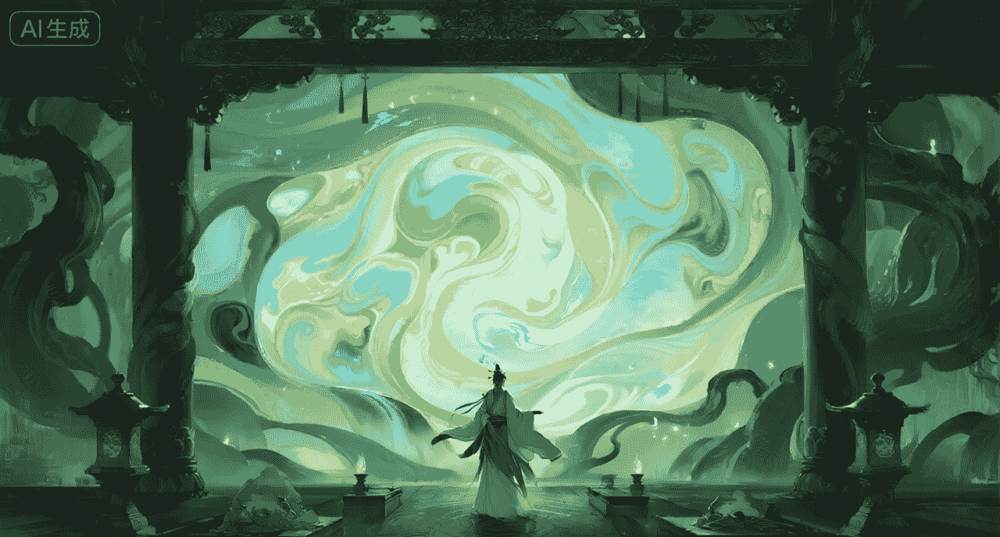

# 炸裂番剧《师兄太稳健》拆解(附30集剧本)

> 来源：[https://rq547mr4oez.feishu.cn/docx/PGfxdjNzooOVkSxwBJ7cAMkVnQh](https://rq547mr4oez.feishu.cn/docx/PGfxdjNzooOVkSxwBJ7cAMkVnQh)

# 一、前言

> **2019年《我的师兄太稳健了》，**打破了2020 年仙侠品类的均订纪录！！

> 作为稳健流的开山之作，改编的难度可想而知~~

> 改编的动画《师兄太稳健》上线第一季播放量超 10 亿！

>

> **老杨从一些渠道找到原始30集的剧本，来分析**学习剧本的长处！同时分享给社群小伙伴~~

> PS：这个是目前漫剧的其中一种（沙雕漫/动态漫/传统漫），

> **PS：剧本精品化要求很高！值得学习**学习！30集剧本有38万字~~囧囧囧囧囧



# 二、剧本拆解（完整30集剧本找老杨要吧）

> 漫剧剧本的核心价值在【人物立得住、情节抓得住、节奏稳得住、伏笔埋得巧】

> 可以对比原文，看看大神编辑的改编思路！

```
**1-1度仙门群山 日 外**
（人物：齐源OS）
△旭日东升，悠扬钟声**在****云间回荡。
△随着钟**声，云霞散开，露出了仙气飘渺、群峰错落的度仙**门。山间霞光万丈，一派仙**峰景象。（展示度仙门概念图）
齐源（哼吟**）：“鸿蒙开辟龙凤****劫，万元千会弹指过。不见仙台****登临阁，只闻****重霄九华歌”——（**装逼特写，世界观洪荒）

1-**2 小琼峰吊桥  日 **** 外  （开篇以“收徒****”为主线，穿插回忆**与幻想，情节层层递进）
（人物：齐**源 蓝灵娥）
△镜头向度****仙门深处缓缓推**去，越过层层云雾，最后却落在了度仙门最矮最破的小琼峰上。（反差感，小琼峰）
△小琼峰前一座破烂吊桥上，一派仙人气质的齐源拉着灵秀女童蓝灵娥，正向小琼峰走去。齐源侃侃而谈，蓝灵娥却一脸嫌弃，半信半疑。
齐源：（得意）灵娥你看，此地便是东胜神州，三界一等一的修行之地。你瞧前面的仙山，是不是钟秀慧灵，十分气派啊？
蓝灵娥：（为难）嗯……很……很气派……（小师妹的回答与师傅的反差，进一步烘托小琼峰，穷）
△蓝灵娥话未说完，脚下踩空，一块吊桥木板被踩裂。

1-3 吊桥深渊  日  外
（人物：蓝灵娥）
△被蓝灵娥踩断的木板掉落吊桥下的万丈深渊，蓝灵娥看得心有余悸，吞了一口唾沫，颤颤悠悠追齐源而去了。
（特写，穷）

1-4 小琼峰-殿外庭院 日 外
（人物：齐源 蓝灵娥）
△吊桥后一面摇摇欲坠的小旗帜；旗面潦草地写了三个字——“小琼峰”。（进一步烘托场景）
△两人正站于旗帜前方。
△齐源尴尬上前两步摩挲着旗帜。（师傅人设，细节体现）
齐源：许久不打理了……咳，灵娥啊。
蓝灵娥：在！
齐源：今日带你入我仙门，为师要求你从今往后好好修行，不可有半分懈怠，争取早日修炼有成！
蓝灵娥：是！（头一歪）……师父，您成仙了吗？（诚实的孩子，反差萌）
△齐源没忍住打了个喷嚏，“吱呀”一声，旗帜晃晃悠悠地落了地。
齐源（嘀咕）：咳，快了快了，为师早年间修行出了些差错……（欲言又止，伏笔）
△他捡起旗帜，怎么都弄不回原处，随意扔至一旁。
齐源：……走，随为师来。
△两人一路走向齐灵殿。
△殿下的湖水波光粼粼，湖边短草仍沾有露水，草木芬芳伴清风徐来，好一片湖光美景，令蓝灵娥露出愉悦神色。
齐源：待会为师为你办理入门事务，虽说咱们一脉如今只有你我师徒三人，该走的程序还是要走的。
蓝灵娥：（好奇）老听您提起长寿师兄，他是什么样的人呢？
齐源：（神色古怪）你在仙霖峰外门打杂了小半年，都听过哪些关于他的风言风语？（拉期待，师兄是什么样）
蓝灵娥：（绞尽脑汁、回忆）我听说——我听说——（气馁）我什么也没听说过。就好像——
齐源：就好像度仙门没这号人似的？
△蓝灵娥连连点头。
齐源：（哀叹）那就对了！你来看……

1-5 小琼峰-齐灵殿  日  内
（人物：齐源 蓝灵娥）
△齐源带着蓝灵娥，来到齐灵殿内，指着墙上的一幅画。
齐源：这是他入门多年，留下的唯一一幅肖像。
△图上只有一只埋头吃草的白羊。
蓝灵娥：（肃然起敬）师兄好厉害，扮羊吃草都扮得惟妙惟肖。（呆萌，人设）
齐源：……那是真羊。李长寿在后面！
△蓝灵娥顺着齐源的手指，费了好大劲，才发现图角缝里有一个米粒大小的侧影。
蓝灵娥：（咋舌）这也叫肖像？
齐源：他就爱遮掩！洪荒强者为尊，谁家的好苗子不是异军突起，扬名立万？只有那小子，越修越没动静……（忽然吸气、骇然）不好！
（表面不靠谱实则重情重义，与李长寿形成鲜明对比，增强戏剧张力）
蓝灵娥：什么？（同时中招、头晕眼花）这是……迷药？
△齐源察觉到空气中的异香，忙揽住蓝灵娥往外奔去，但仍慢了一步，身子飞到一半，就软软跌了下去。
△蓝灵娥一咬牙，把齐源扛了起来，向外拖去。

....//剧本内容实在是太多了，就不贴上来
```

### 人设：先定标签，再补细节

> 新人易犯 “人设写了一堆形容词，却没行动” 的错，可学本剧本：

+   第一步：给核心人物定 “1 个可落地的行动标签”（如李长寿 “稳健”→行动：不做没把握的事、设机关防风险）；

+   第二步：加 “反差细节” 打破扁平（如 “稳健” 的李长寿，会为了师父 “用百年珍珠酿引酒玖”，体现 “护短” 的反差；“怂” 的齐源，会为了蓝灵娥 “硬刚仙霖峰”，体现 “心软” 的反差）。

+   例：新人写 “学霸” 人设，别只写 “爱学习”，可定 “行动标签：考前必刷 3 遍题”，加 “反差细节：会帮学渣抄笔记（怕学渣挂科影响班级评分）”，人设立刻鲜活。

### 节奏：3-5 分钟一个小钩子，15-20 分钟一个大闭环

> 漫剧观众易 “快进”，需用 “小钩子” 抓注意力：

+   **小钩子：**每 3-5 分钟设计一个 “小危机 / 小反转”（如本剧本：蓝灵娥踩裂吊桥→迷药晕倒→被绑查身份→答题被扔出门），每个钩子都要 “关联人设”（被扔出门关联李长寿 “稳健拒风险”）；

+   **大闭环**：每 15-20 分钟解决一个核心冲突（如 “仙霖峰找茬” 从围堵到酒玖解决），避免 “冲突堆着不解决”，让观众有 “爽感”。

+   新人避坑：别贪多写第1集聚焦 “1 个核心事件 + 1 个人设落地”（如本集 “蓝灵娥入门 + 李长寿稳健人设”），节奏更稳。

>

+   三幕式结构清晰：

+   开端（1-8场）：破败小琼峰与仙门反差→蓝灵娥入门→李长寿登场制造冲突

+   中段（9-38场）：三次答题测试→仙霖峰围攻→李长寿暗中布局（纸鹤、仙鹤、酒玖）

+   高潮（39-45场）：三重反转（仙鹤假象→酒玖真身→蓝灵娥归属）

### 伏笔：道具复用 + 台词留白

+   **道具复用：**让伏笔道具在当前情节有用（如李长寿的纸符，当前用来看住齐源，后续用做假仙鹤），避免 “专门拿一段写‘这个道具以后有用’”；

+   **台词留白：**用 “疑问 / 模糊表述” 埋伏笔（如齐源说 “李长寿早年间修行出了差错”，不直接说 “大劫”，留悬念）；

+   例：新人写 “主角有秘密”，别直接说 “他有个祖传玉佩藏着魔力”，可写 “主角每天擦玉佩，擦的时候会避开别人（当前情节有用：体现谨慎），玉佩偶尔发光（伏笔）”。

### 喜剧：人物特质驱动搞笑，而非段子驱动

+   **搞笑来源：**从人物特质出发（如酒玖 “爱酒”→酒葫芦炸山头；元恒 “嚣张”→打蓝灵娥却跪成磕头），搞笑同时强化人设；

+   **搞笑目的：**服务情节（如元朗打元恒的搞笑场面，让仙霖峰 “嚣张” 的形象崩塌，为后续酒玖镇场铺垫），避免 为搞笑停剧情。

### 场景：场景服务情节

> 漫剧需要 “视觉化场景”，而且场景是服务情节：

+   **用 “反差” 凸显核心信息：**开篇 “度仙门仙气缭绕、群峰错落”（全景）→“小琼峰破吊桥、歪旗帜”（近景），通过反差快速告诉观众 “小琼峰在度仙门的边缘地位”；

+   **场景服务情节：**每个场景都有 “功能”（如吊桥场景：展现小琼峰破落 + 蓝灵娥的警惕；丹房场景：展现李长寿 “谨慎”+ 蓝灵娥的反抗），避免 “无意义的风景描写”（如 “夕阳很美，鸟儿飞过” 却不关联人物心情 / 情节）。