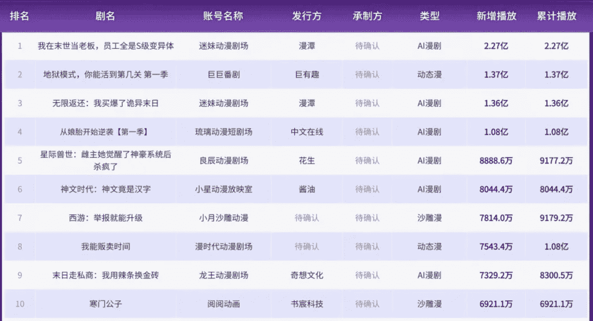

# 炸裂漫剧《无限返还xx》拆解(附原剧本)

> 来源：[https://rq547mr4oez.feishu.cn/docx/FvPsd7Uz9o7O6YxIID1cW9EHnmc](https://rq547mr4oez.feishu.cn/docx/FvPsd7Uz9o7O6YxIID1cW9EHnmc)

# 一、前言

> 10月漫剧数据炸裂！某音漫剧播放量：【月增量超80+亿】！恐怖如斯~~~所以，最近抓紧时间拆剧本~

> 以下是新增的TOP10排行榜~

> 今天我们来拆解《无限返还：我买爆了诡异末日》

> **这个是在末日题材基础之上，增加了“规**则怪谈”的爆款~~~值得大家细细的品尝！

> 话不多说！直接上干货~（10个剧本都会拆完）



# 二、上干货（原剧本找老杨要吧）

```
** 第1集
 1-1 日 内 **鬼鬼贷公司-办公室 
人物：莫凡、鬼鬼贷经理、鬼鬼贷职员
△莫凡将一叠文件拍在办公桌前。
莫凡（咬牙）：1万的规避借款利息是5万，滞纳金要罚50万，欠你们的鬼鬼贷全部还清了，今后别再来找我了。
经理（挑眉）：5年了，还是第一回有人类能还清借款。
职员（阴笑）：这么优秀的牛马，我怎么舍得让你走呢。
△职员伸手抓住莫凡手臂。
莫凡（挣扎）：啊啊啊！放开我！债我都还了，你们不能再搞我了！
经理（拿出另一份合同）：这里有你的一笔担保，你的女朋友李瑶瑶、好兄弟赵峰在我们这贷款20万，担保人填的是你。
职员：加上利息滞纳金，一共欠公司300万。
莫凡（怒吼）：300万？那两个白痴和我有什么关系！
经理（摊手）：合同里写得明白，债务的解释权归本公司所有。
莫凡（急声）：我是被他们骗的！
职员（冷笑）：没钱的话，就用你的命抵债吧。

 1-2 夜 内 未知空间 
人物：莫凡
△莫凡蜷缩在地，猛地抬头。
莫凡（嘶吼）：被女朋友背叛，被好朋友出卖，被大资本压榨，我不甘心！不甘心！我不甘心！
△转场
莫凡（环顾四周，茫然）：我在哪？
......
```

### （一）1-10 集爽点 & 冲突表

### （二）剧本火爆的关键原因

+   **题材组合拳精准吸睛**：融合「诡异末日」「系统金手指」「重生复仇」三大热门元素，覆盖悬疑、爽文、逆袭三类受众，题材自带流量基础。

+   **爽点密集且直给不绕弯**：重生后立刻打脸背叛的女友和兄弟，金手指（债务 10 倍返现）见效极快，从负债到暴富仅用 1 集，满足观众即时爽感需求。

+   **节奏紧凑无拖沓**：10 集内完成「重生觉醒→获得系统→触发任务→解决危机→逆袭收购产业」完整闭环，每集都有冲突（任务压力、反派刁难）和反转（砸店触发返现、收购便利店），无多余铺垫。

+   **情绪共鸣强烈**：聚焦「被背叛、被压榨」的憋屈感和「逆天改命、打脸仇人」的释放感，情绪张力拉满，观众代入感极强。

### （三）新人值得学习的核心要点

#### 题材：热门元素 + 核心玩法

+   不盲目叠加元素，而是以「重生复仇」为核心，「诡异末日」做背景，「债务返现」做核心玩法，三者相互支撑。

+   可借鉴：先确定 1 个核心爽点（如逆袭、复仇），再搭配 1-2 个热门题材（如末世、系统、甜宠），避免元素杂乱。

#### 爽点：每集有高潮

+   爽点不拖沓，重生后第一时间直面仇人，金手指简单（负债 10 倍返现），观众一眼能懂，且快速看到效果（砸店获 200 万）

+   可借鉴：金手指设定要「**低理解成本 + 高回报」**，每集至少设计 1 个小爽点（如打脸、获利、解危），让观众有追更欲

#### 节奏：快速进入主线

+   开篇 3 集完成「重生→获系统→进入核心任务」，无冗长背景介绍，直接切入矛盾（被卷入诡异场景、被仇人道德绑架）

+   可借鉴：**前 2 集必须抛出核心设定（世界背景**、金手指）和核心冲突（主角要解决的问题），避免前期铺垫过多导致观众流失

#### 人设：反差感 + 强立场

+   主角前后反差极大（前世背锅→今生逆袭），仇人标签化明显（自私、虚伪），观众无需复杂共情，直接站边主角

+   可借鉴：主角人设要「目标明确」（如复仇、暴富），反派人设要「功能清晰」（推动冲突、让观众反感），减少模糊的灰色人设，降低观众代入成本。

#### 冲突：每集有明确目标

+   每集都有清晰任务（进入便利店、挑变质商品、偿还债务），且任务自带压力（失败变血奴、巨额债务），推动剧情快速前进

+   可借鉴：**给主角设置「短期可完成的目标」，每集围绕目标**设计阻碍和解决方案，让剧情有明确的推进感