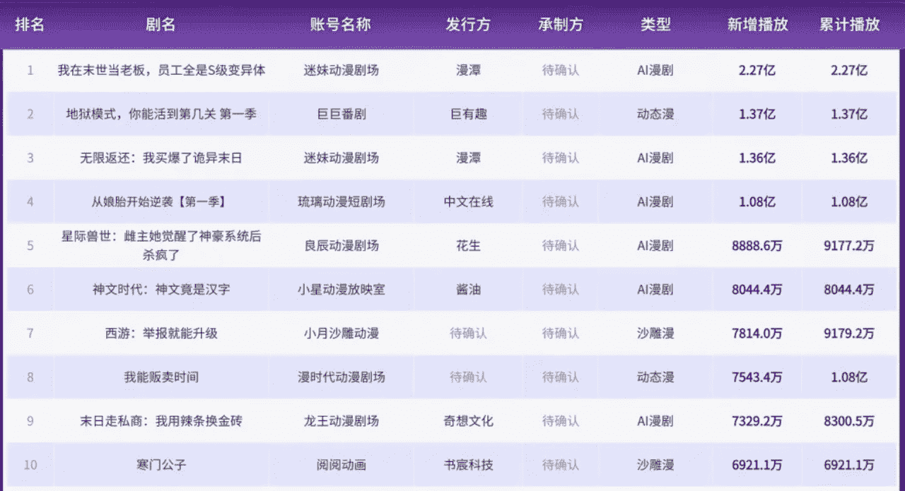

# 炸裂漫剧《雌主她觉醒xxx》拆解(附原剧本)

> 来源：[https://rq547mr4oez.feishu.cn/docx/XwZgdHzWHocRXvxJxH5c22KXnte](https://rq547mr4oez.feishu.cn/docx/XwZgdHzWHocRXvxJxH5c22KXnte)

# 一、前言

> 10月漫剧数据炸裂！某音漫剧播放量：【月增量超89亿】！恐怖如斯~~~所以，最近抓紧时间拆剧本~

> 以下是新增的TOP10排行榜~

> **今天我们来拆解《****星际**兽世：雌主她觉醒了神豪系统后杀疯了》！

> 看名字就知道，这个是少有的【女频题材】，同时也是有点女频后宫的精品番剧~~

> **话不多说！直接上干货~**



# 二、上干货（原剧本找老杨要吧）

```
1-1 日 内 帝国皇宫 - 二公主寝宫 人物：岚姝（刚苏醒，面色苍白）、玄墨（俊雅，假意关切）、宫女甲

VO：这是一个雄威雌尊的世界，强大的雌性拥有多个雄性伴侣再正常不过。雄性天生精神力狂暴，需要雌性安抚才能活下去，雌性就是雄性的神。雌性的精神力安抚，是雄性说话最好的解药。而我，一个996猝死的社畜，竟然穿越成以虐待四位婚契者为乐的帝国二公主！原主已经被绿茶男害死了！

△ 原主饮下玄墨递来的酒，口吐黑血倒地；玄墨嘴角勾起阴笑
玄墨（阴笑）：蠢货终于死了，没了你公主之位和那四个极品雄性就都是大公主了！
△ 岚姝猛地睁眼，眼神迷茫，抬手抚向脖颈，似残留窒息感
岚姝 os：啊不是，这给我干哪来了？我在公司加班猝死了我穿越了？等等我中了1,000万彩票呢，我还没花呢。
系统音（机械）：检测到宿主对花钱欲望强烈，神豪系统紧急绑定！新手任务发布：为你的四位契约老公之一消费100万金币，即可获得10倍返利，并修复身体、提升1%精神力。任务失败抹杀。
岚姝 os：哇全都是绝色美男，没想到我一个996的射出穿越过来，居然还能过上左拥右抱的日子！
系统音（机械）：检测到原主虐待四位婚契者克扣资源补给用于追求渣男玄墨，目前已被玄墨毒杀！
岚姝（疑惑OS）：什么雌性为尊的世界？至高无上的公主居然能被绿茶男整死，原主你真是王者号青铜操作呀。
玄墨（诧异）：不可啊，这剧毒连s级磁性都扛不住他！
岚姝（眼神锐利，冷笑）：怎么这酒是你给我喝的？
玄墨（伪善担忧）：殿下您醒了？您刚才突然晕倒，吓死我了。
△ 岚姝抬手，一巴掌甩在玄墨脸上
岚姝（眼神锐利，冷笑）：在我面前演奥斯卡，也欠你一个小金人。我这人有密集恐惧症，看不了心眼子多的人。
玄墨（捂着脸，错愕）：二公主竟然打我？
宫女甲（慌张闯入）：公主殿下，不好了！金修将军在前线遭到偷袭，重伤垂危！我们的军需物资全被您扣下送给玄墨大人了，前线快撑不住了！
玄墨（立刻辩解）：殿下这不能怪我，是您说金修将军总惹您生气，要把他的东西都给我，您还说他就算死在外面也跟你没关系。
岚姝（拍案而起，气势凌厉）：我男人在前线为国捐躯，你一个吃软饭的也配在这里说风凉话？
玄墨（内心）：软饭男？
岚姝：听着，从今天起，本公主的雄性，本公主护着！我的钱只会花在我的雄性身上！
......
```

## （一）钩子&爽点

## （二）新手作者可学：从“爆款逻辑”到“落地方法”

#### 1. 题材组合：套用“成熟公式”，降低创作风险

> 新手无需原创“高概念”，可直接复用“女频情感+高概念+爽感”的融合公式，比如：

+   情感打底：选择“甜宠/成长”等成熟赛道（避免小众情感），加入“男全洁/双向奔赴”等精准戳点设定（参考摘要3、4，这是女频用户的“刚需雷点”）；

+   设定赋能：选择“系统、穿书、兽世”等AI漫剧易还原的高概念（避免“现实职场”等需复杂实景的设定）；

+   爽感加持：每3-5章加入“打脸、花钱、男主守护”等爽点（参考剧本“救金修-救星野”的节奏），保证用户不流失。

#### 2. 节奏设计：每集“1个危机+1个爽点”，拒绝拖沓

> 新手容易犯“剧情拖沓、爽点滞后”的错，可学习这部漫剧的“短闭环”逻辑：

+   危机要“小而具体”：不要一开始就搞“拯救世界”，而是“男主重伤、被反派陷害”等小危机（如金修缺药、星野狂化），让女主的“开挂”更有针对性；

+   解决要“快而直接”：女主的解决方案必须与“核心设定”绑定（如神豪系统→花钱解决，兽世设定→精神力安抚），避免“靠巧合过关”；

+   爽点要“可视化”：比如“花1000万拍药剂”“掌掴玄墨”，尽量用“动作、对话”呈现爽感（如“去救我的大猫猫”），而非内心OS。

#### 3. 人设塑造：“接地气女主+成长型男主”，拒绝扁平

> 新手容易把人设写得“脸谱化”（女主傻白甜、男主霸总），可参考这部漫剧的“反差人设法”：

+   女主：给“开挂人设”加“接地气细节”——比如“神豪女主”也会吐槽“5块钱难倒英雄汉”，“强势女主”也会花痴“黑皮体育生腹肌”，让角色更真实；

+   男主：给“美强惨人设”加“成长线”——比如金修从“质疑女主”到“发誓忠诚”，星野从“狂化凶兽”到“撒娇猫猫”，男主的转变要与女主的“付出”挂钩（如金修因女主救他而改观），避免“男主无脑爱上女主”；

+   反派：坏得“明确且有动机”——玄墨贪财、岚灵争权，反派行为要服务于“推动女主逆袭”（如岚灵换毒药→女主用体验卡打脸），避免“为坏而坏”。

#### 4. 注意点！！划重点！

+   别让“系统”与主线脱节：新手常写“系统发布无关任务”（如让女主捡垃圾），这部漫剧的系统“只给婚契者花钱”，既推动剧情（救男主），又服务情感（甜宠），值得借鉴；

+   别忽略“AI漫剧的视觉适配”：新手若想适配AI制作，避免写“复杂现实场景”（如多人职场戏），多写“奇幻场景+简单互动”（如拍卖会举牌、笼子前安抚兽化男主），降低制作成本，提升爆款概率。

## （三）内部整理女频漫剧-创作模板（偷偷收藏）

#### 爽点类型：6 大核心类型

#### 钩子设计逻辑：

（一）核心逻辑 1：危机型钩子（占比 60%）

+   设计逻辑：直接威胁女主的婚契者、地位或目标，让用户担心 “主角能否解决”

+   剧集案例：

1.  金修重伤垂危 + 军需被克扣（1 集）：关键男主遇险，绑定 “系统任务”，用户想知道 “女主怎么凑钱救他”

1.  星野被投毒狂化（3 集）：核心男主濒临兽化，唯一解药需 1000 万，用户焦虑 “筹钱 + 救人能否成功”

1.  药剂被掉包，星野彻底兽化（9 集）：救人行动反转，女主陷入 “毒杀” 指控，用户想知道 “如何自证 + 救星野”

+   新手创作公式：关键对象（男主 / 女主目标）+ 致命威胁（重伤 / 狂化 / 被陷害）+ 唯一解法（需花钱 / 冒险 / 解锁技能）

（二）核心逻辑 2：悬念型钩子（占比 25%）

+   设计逻辑：留下 “未揭晓的真相 / 未落地的结果”，让用户产生 “想知道答案” 的冲动

+   剧集案例：

1.  女主余额 5 金币，如何凑 100 万（1 集）：资源缺口明确，用户好奇 “神豪系统怎么发挥作用”

1.  岚灵换了药剂，女主未察觉（6 集）：反派阴谋隐藏，用户担心 “女主会不会中招”

1.  S 级精神安抚术能否救下狂化星野（10 集）：技能效果未知，付费卡点勾住用户 “想看到成功安抚的结果”

+   新手创作公式：已知困境（缺钱 / 遇险）+ 隐藏变量（阴谋 / 未知技能）+ 不确定结果（能否成功 / 是否中招）

（三）核心逻辑 3：冲突型钩子（占比 15%）

+   设计逻辑：通过 “信任危机 / 地位争夺” 让主角与他人产生对立，用户想知道 “冲突如何化解”

+   剧集案例：

1.  金修误会女主 “用垃圾消遣自己”（4 集）：情感冲突，用户想知道 “女主怎么证明清白、化解不信任”

1.  婚契者 A/B 计划解除婚契（5 集）：关系冲突，用户关心 “女主能否挽回男主团”

1.  岚灵争夺继承权，邀请皇后重臣围观（8 集）：利益冲突，用户期待 “女主怎么打脸反派、保住地位”

+   新手创作公式：对立双方（女主 vs 男主 / 反派）+ 冲突点（误会 / 夺权 / 偏见）+ 未解状态（冲突未平息 / 关系未修复）

#### 单集创作模板（适配 2-3 分钟漫剧，对标《星际兽世》单集节奏）

#### 多集钩子串联模板（避免剧情断层，对标《星际兽世》1-10 集逻辑）