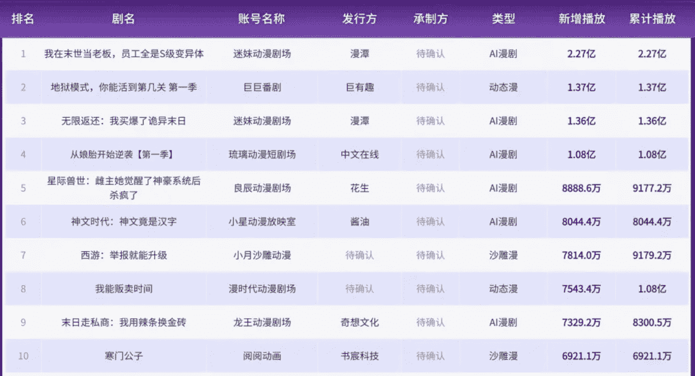

# 炸裂漫剧《从娘胎开始逆袭》拆解(附原剧本)

> 来源：[https://rq547mr4oez.feishu.cn/docx/Ppidd3dhroCX8IxdN6vcQ6Hjn4b](https://rq547mr4oez.feishu.cn/docx/Ppidd3dhroCX8IxdN6vcQ6Hjn4b)

# 一、前言

> 10月漫剧数据炸裂！漫剧播放量【月点击超89亿】！恐怖如斯~~~所以，最近抓紧时间拆剧本~

> 以下是新增的TOP10排行榜~

> 今天我们来拆解《从娘胎开始逆袭，出世即无敌》

> 看名字就知道，这个是男频爽文题材，同时也是有原文进行改编~~

> **话不多说！直接上干货~**



# 二、上干货（原剧本找老杨要吧）

```
第 1 集 
1-1 日 内 洛族 - 密室 人物：姜慈心（孕肚）、洛族长老、洛云鹤
姜望 os（困惑）：我不是已经死了吗？
△ 姜慈心手抚孕肚，额头渗汗，背靠石壁微微颤抖
姜慈心（哀求）：老祖，求求你，让我把他生下来吧
洛族长老（冷厉）：不可！你腹中胎儿根基平凡，我洛族断不可留
姜望 os（困惑）：是谁在说话？胎儿根基平凡……难不成我穿越成玄幻世界还未出生的婴儿了？这人便是我的母亲，要被打掉的就是我？
修真世界实力为尊等级森严，拥有天赋才配出生。看来这中登和老登打定主意要抛弃我了！若是母亲也这么想，那我...
△ 洛云鹤缓步走入，袖袍一甩带起一阵风
姜慈心（哭泣）：展天你也是这么想的吗？
洛云鹤（不屑）：这孩子根骨已经受损，怎么配跟鱼儿腹中的孩子分我洛族资源汽运？墨云腹中乃是仙体，你的孩子如何比得上？
姜慈心（激动）：你难道忘了？当初你重伤，是我将先天真元渡让于你！若非如此，我的孩子怎么会根骨受损！
洛云鹤（冷漠）：既然如此，你若想生出这孩子，只有一条路可以走——离开洛族
姜望 os（愤怒）：要么被赶出家族，要么放弃自己的孩子？什么样的人渣会让母亲做这种选择？母亲她会怎么选？
△ 姜慈心猛地站直身体，眼中闪过决绝
姜慈心（坚定）：既然如此，这洛族我姜慈心便离开！从今日起，我们母子的生死，与你洛族无关！
姜望 os（感激）：谢谢母亲，你选了我。母亲放心，哪怕我是先天根骨破损的废物，也一定会努力修炼，把我们的尊严赚回来！
系统音（机械）：检测到宿主产生修行决心，大器晚成系统已绑定
姜望 os（震惊）：卧槽！我竟然还有系统？只是大器晚成系统……谁大器晚成了？老子还没出生呢！这系统到底是什么鬼？还在娘胎就让我努力了？
......
```

### 首先，查看每集的爽点和钩子

### 接着，查看单元故事（这个就不多说了）

### 最后，总结可以学习的点

#### 爽点密集 + 节奏紧凑，契合漫剧碎片化观看场景

> 漫剧的核心受众需求是 “即时刺激”，剧本完美踩中这一痛点：

> 从第 1 集 “绑定系统”，到第 2 集 “融合荒古圣体”，第 3 集 “连破四重境界”，第 5 集 “青铜镜显圣体震惊众人”，第 6 集 “获吞天魔功 + 法宝认主”，第 8-10 集 “击退退婚使者 + 妙圣人神念护徒”。

> 每集都有明确的 “逆袭爽点” 或 “冲突高潮”，无冗余铺垫，节奏快到几乎零废话。

> 这种高密度爽点设计，能适配短视频平台的碎片化观看习惯，让观众在 1-3 分钟内获得情绪满足，愿意追更。

#### 设定讨喜 + 切入点新颖，降低受众接受门槛

> 剧本融合了玄幻赛道的 “爆款元素矩阵”：系统流、逆袭流、荒古圣体、吞天魔功、退婚打脸等，都是受众熟悉且喜爱的设定，无需额外解释背景，观众能快速代入。同时，“娘胎开始修炼” 的切入点突破常规（区别于少年逆袭、重生逆袭），自带 “猎奇感”—— 胎儿能驱动灵力、让法宝认主、硬刚仙帝级强者，这种反差感极具记忆点，容易引发 “想看后续如何逆天” 的好奇心。

#### 视觉化场景丰富，适配漫剧动画化改编

> **漫剧的核心竞争力是 “视觉冲击”，剧本提供了大量可直接**落地的 “高光场景”，无需额外二次创作：

+   特效类：姜望腹中金光冲破殿宇、青铜镜映照九头龙尊虚影、乾坤寒火罩化作青色火焰光罩、妙圣人神念虚影威压全场；

+   动作类：玄冥二老黑气攻击、姜族老祖纵身护主、灵力对撞时的色彩碰撞（黑气化归、金光反击）；

+   仪式感类：法宝认主时的光晕流转、境界突破时的等级弹窗（系统提示音 + 境界晋升文字）。这些场景色彩对比强烈、动作张力足，漫剧改编时只需还原剧本描述，就能做出震撼的视觉效果，吸引观众停留。

#### 冲突直接明确，无理解成本

> 剧本**的核心冲突 “弱者逆袭打脸势利者” 简单直白：洛族因主角 “根**骨受损” 抛弃母子、大夏神朝因主角 “废物” 上门退婚，冲突双方立场清晰（主角方 = 正义逆袭，反派方 = 势利眼），没有复杂的权谋铺垫或反转，适合漫剧 “快速建立冲突 - 快速解决冲突” 的叙事逻辑，即使是低龄或轻度玄幻受众，也能一眼看懂剧情。