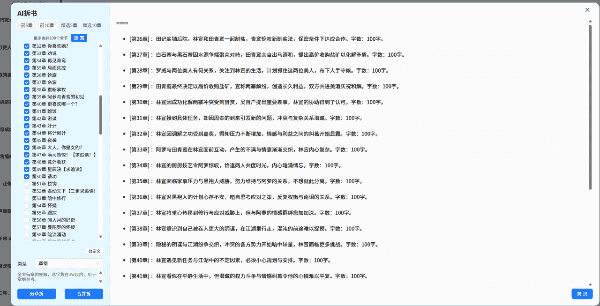

# 《锦衣无双》万字套路详拆，新人也能写爆款！

> 来源：[https://rq547mr4oez.feishu.cn/docx/QhCUdl38MoXfdDxAe1ucvrLmnIf](https://rq547mr4oez.feishu.cn/docx/QhCUdl38MoXfdDxAe1ucvrLmnIf)

## 一、前言

> **《锦衣无双》是**[荣小荣](https://my.qidian.com/author/4285387/)大神的新作，**45.34万**字 **5.58万**总推荐！

> 看到这篇文章时，我想说《大奉》的商业框架，还在持续发力！

> 之前也拆解过【卖鲍小郎君】的小说~~

[看懂《大奉打更人》框架，小白也能写小说](https://rq547mr4oez.feishu.cn/wiki/RjaowLBGEiiURAkpJSFcDT6LnWh?from=from_copylink)

[写小说必火《灵境行者》de写作框架.docx](https://rq547mr4oez.feishu.cn/wiki/PkThw4eFfiYiKIkLFUucnu4nni3?from=from_copylink)

> 所以，作为常常扑街的新人，掌握这个框架，肯定能写出爆款文章！


## 二、上干货（故事脉络/节奏/开篇详拆）

### 先拆书（故事脉络）

> 划重点：对于长篇拆解，千万不要一上来全部丢给AI，这样拆出来没有意义！参考小九，先拆章纲！

> **新手**最常犯的错就是 “想到啥写啥”—— 比如写主角穿越成囚犯，本来该琢磨 “怎么洗冤”，结果突然插一段主角研究怎么煮面，最后自己都忘了要写啥。这份分析最核心的逻辑就是 “按核心目标分单元”，相当于给新手一个方向！



```
- 1：林宣穿越成被诬陷的囚犯，在问心镜下侥幸脱罪，却发现自己已被南诏密谍控制。
- 2：黑袍人曼陀罗以“心囚症”为由逼迫林宣产生感情，反被林宣将计就计，扰乱其计划。
- 3：林宣晋升总旗后精神力提升，察觉体内噬心蛊的存在，并开始怀疑曼陀罗的真实目的。
- 4：洪天被当作叛徒处死，林宣靠前世记忆骗过问心镜，获得疗伤丹药并确认自己身处异世。
- 5：黑袍人现身逼问林宣如何通过问心镜，并以噬心蛊威胁他继续做卧底。
- 6：吴百户升迁离任，闻人月借蹭饭名义融入林家生活，曼陀罗留下诀别信悄然离去。
- 7：林宣升任总旗，协助闻人月解救失踪女子，借田青鸾之力向石家施压成功。
- 8：张虎送包子探望林宣，闲聊中透露九黎族可解蛊，为林宣指明求生方向。
- 9：林宣托田青鸾出手救回刘小倩母女，阿萝感动于他的付出，坚定追随他的决心。
- 10：陈百户被调往北境，临行前劝林宣离开靖边司避祸，林宣陷入进退两难之境。
- 11：吴百户夺权后打压林宣三人，林宣识破其伎俩，表面顺从实则暗藏应对之策。
- 12：吴百户升调京城，邀请林宣同行遭拒；闻人月即将调任播州，林宣面临新抉择。
- 13：闻人月邀林宣同赴播州，林宣权衡利弊后答应，阿萝与田青鸾相继表态愿随行。
- 14：林宣被降为门房，黑袍人再度出现，赐予淬骨液助其突破八品武者境界。
- 15：林宣服药突破时爆发强大精神力，引起黑袍人震惊，对方上报将其潜力提为“地级”。
- 16：田青鸾强吻林宣告别，阿萝默许二人关系，林宣携二女随闻人月启程前往播州。
- 17：一行人抵达播州，杜云州接待并安排住处，林宣选择在外租房保持独立空间。
- 18：林宣突破八品获第二层镇岳功法，吴百户被迫恢复其旗官职位，心中不甘另起算计。
- 19：吴百户派林宣调解黑石寨与白石寨冲突，意图借刀杀人，林宣冷静接下任务。
- 20：林宣分析两寨矛盾根源，制定“一鱼三吃”策略，准备用制盐技术化解争端。
- 21：林宣拜访田记盐铺，提出精盐工艺合作，最终以两成利润十年期达成交易。
- 22：田青鸾亲赴播州寻林宣，三人重聚同住一院，阿萝嫉妒但隐忍不发。
- 23：林宣传授提纯技术，帮助田家大幅节省用水、提高产量，奠定合作基础。
- 24：林宣察觉有人跟踪，巧妙甩开尾巴并为二女购置幕离以防危险。
- 25：林宣查明跟踪者来自罗府，确认罗家四公子觊觎阿萝与田青鸾，心中杀意渐起。
- 26：田记盐铺后院，林宣和田青鸾一起制盐，青鸾惊叹新制盐法，保密条件下达成合作。
- 27：白石寨与黑石寨因水源争端聚众对峙，田青鸾亲自出马调和，提出高价收购盐矿以化解矛盾。
- 28：罗威与两位美人有何关系，关注到林宣的生活，计划抓住这两位美人，布下人手守候。
- 29：田青鸾最终决定以高价收购盐矿，宣称两寨解纷，创造长久利益，双方共进美酒庆祝和解。
- 30：林宣因成功化解两寨冲突受到赞赏，吴百户提出重要差事，林宣的协助得到了认可。、
```

### 通过AI分析故事脉络（单元故事嵌套）

> 看到这里，有没有回想起《大奉》的故事：

1. 税银案（1-5章）主线：穿越入狱→查案自救→逻辑推理→当众翻案→洗清罪名

2. 家庭篇（6-9章）情感线：冷遇→自尽事件→发现妹妹→化解偏见→家庭和解

3. 命案篇（10-14章）新案件：复职接案→查证受阻→突破推理→审讯博弈→真相大白

4. 日常篇（15-16章）日常**（闲来无事，勾栏听曲）**

> 关键锚点：其实就是 “剧情打卡点”。

> 新手写的时候，先定好 “这单元必须完成 3 件事”比如穿越文开篇，得先

1. 确认自己穿越了

2. 搞清楚现在啥处境（是囚犯还是平民，还是皇帝！）

3. 找到第一个威胁 / 目标

> 照着这个打卡，就不会写 20 章还没弄明白主角要干嘛。

#### 细分单元 1：密谍案（第 1-5 章）

+ **核心脉络**：林宣穿越成诬陷囚犯→问心镜脱罪却发现被南诏密谍（曼陀罗）控制→曼陀罗用 “心囚症” 逼其生情反被算计→晋升总旗后察觉体内噬心蛊→洪天被处死，林宣借前世记忆骗问心镜确认异世身份，黑袍人（曼陀罗）以蛊威胁其做卧底。

+ **关键锚点**：穿越身份落地（4 章）、噬心蛊首次察觉（3 章）、南诏密谍控制关系确立（5 章），解决 “生存初始危机 + 敌人初步亮相” 的核心问题。

#### 细分单元 2：靖边司立足（第 6-10 章）

+ **核心脉络**：吴百户升迁离任，闻人月借蹭饭融入林家→林宣正式升任总旗，协助闻人月解救失踪女子，借田青鸾施压石家→张虎透露 “九黎族可解蛊” 线索→林宣托田青鸾救回刘小倩母女，阿萝坚定追随→陈百户调往北境，劝林宣避祸，林宣陷入两难。

+ **关键锚点**：解蛊线索出现（8 章）、阿萝忠诚度确立（9 章）、首个合作对象（田青鸾）绑定（7 章），完成 “从被动受控到初步建立人脉” 的过渡。

#### 细分单元 3：播州抉择（第 11-16 章）

+ **核心脉络**：吴百户夺权后打压林宣三人，林宣表面顺从暗备对策→吴百户升调京城邀林宣同行遭拒，闻人月拟调播州抛出邀请→林宣权衡后答应随行，阿萝、田青鸾表态同往→林宣被降为门房，黑袍人送淬骨液助其突破八品武者→突破时爆发强精神力被提为 “地级” 潜力，田青鸾吻别，三人随闻人月启程。

+ **关键锚点**：播州方向确定（13 章）、武力境界突破（14-15 章）、核心团队（阿萝 + 田青鸾）成型（16 章），完成 “从靖边司内斗到主动选择新地图” 的闭环。

#### 细分单元 4：危机初现（第 17-19 章）

+ **核心脉络**：林宣一行人抵播州，杜云州接待，林宣选外租屋保独立→林宣突破八品获第二层镇岳功法，吴百户被迫恢复其旗官职位却怀恨→吴百户借 “调解黑石寨与白石寨冲突” 设借刀杀人计，林宣冷静接下任务。

+ **关键锚点**：新地图（播州）环境适应（17 章）、与吴百户矛盾升级（18-19 章）、核心任务（调解两寨）接收（19 章），开启 “播州生存战” 首阶段。

#### 细分单元 5：精盐破局（第 20-23 章）

+ **核心脉络**：林宣分析两寨矛盾根源，制定 “一鱼三吃” 策略（制盐技术破局）→拜访田记盐铺，以两成利润十年期达成精盐合作→田青鸾亲赴播州，三人同住一院，阿萝隐忍嫉妒→林宣传授提纯技术，帮田家省水提产，夯实合作基础。

+ **关键锚点**：破局核心（制盐技术）确立（20 章）、与田家合作绑定（21 章）、田青鸾归队（22 章），完成 “从接任务到找到破局手段” 的关键铺垫。

#### 细分单元 6：两寨和解（第 24-30 章）

+ **核心脉络**：林宣察觉被跟踪，甩尾后为二女购幕离防险→查明跟踪者来自罗府，确认罗威觊觎阿萝、田青鸾→田记盐铺后院，林宣与田青鸾完善制盐合作细节→田青鸾出面调和两寨，以高价收盐矿化解争端，双方共庆→林宣因功获赞赏，吴百户提出新差事。

+ **关键锚点**：罗威威胁确立（25/28 章）、两寨冲突解决（27/29 章）、任务回报（获认可 + 新差事）（30 章），完成 “核心任务闭环 + 埋下新冲突（罗府）” 的阶段收尾。

### 故事的衔接，**埋个小钩子**

> 单元之间怎么接？先埋个小钩子！

> 比如第 13 章田青鸾说 “我之后跟你去播州”，到第 22 章田青鸾真的找过来了

> 新手就能学：写角色离开当前地方前，先留个话口，比如 “等你去了播州，我就来找你”，后面换地图时，就用 “履行承诺” 接上，别让角色 “凭空冒出来”！

### 节奏很重要！该紧就紧，该松就松

> 新手写文要么 “一直绷着”—— 全程都是打打杀杀、勾心斗角，读者看得累；

> 要么 “一直瘫着”—— 写半天日常，主角吃了睡睡了吃，没一点进展，读者看得困。

> 重点：紧张的时候插点软的，别让读者喘不过气

> 比如第 11 章主角应付吴百户打压”（特紧张的权力斗争）之后，加一段 “阿萝给主角熬药，俩人说两句话”

> 新手就能学：剧情高压的时候（比如主角被反派针对、要赶紧急任务），插 1-2 段小互动，不用长，哪怕就是 “配角递杯茶，问一句‘累不累’”，既能缓一缓节奏，又能让角色更有人情味，读者也能歇口气。

### 第1章逐字逐句，详细拆解（对比大奉）


# 第1章 地狱开局

冰冷的石壁紧贴着后脑，浓重的血腥味混杂着霉烂的潮气，顽固地钻入鼻腔，几乎令人窒息。// 危机开篇，用“触觉”（冰冷石壁）+ 嗅觉（血腥味 + 霉味”）具象化囚牢压抑感，新人可学：开篇别写“很压抑”，用感官细节让读者“身临其境”。

林宣艰难地掀开沉重的眼皮，眼前一片模糊昏暗，什么都看不真切。

他下意识地想挪动身体，一股撕裂般的剧痛猛地从四肢百骸炸开，让他忍不住痛呼出声。

视线艰难下移，发现他的手腕和脚踝被粗重冰凉的铁环紧紧箍着。

铁链另一端深深嵌入身后的石墙，将他整个人牢牢钉在冰冷的石壁上。// 用“铁环 + 铁链嵌石墙”的具体场景，直接证明主角“被囚禁”，新人可学：不用旁白说“主角被抓了”，用道具 / 动作体现处境。

身上那件破烂的白色囚衣，早被暗红与褐色的血污浸透板结，散发出令人作呕的气息，衣襟前一个巨大的“囚”字尤为刺目。//“血污板结”暗示囚禁已久，“囚”字是视觉符号，新人可学：用“旧痕迹 + 标志性符号”，悄悄补全场景背景，不拖沓。

借着墙角火把摇曳的昏黄光芒，林宣勉强看清了眼前的景象。

对面的石壁上，挂着三道和他一样的人影，他们同样穿着囚服，囚服上布满了交错纵横的鲜红血痕。

这是哪里？

林宣心中充满了无限的疑惑和震惊。

记忆告诉他，他刚刚考上公务员不久，被分配到贵州一个偏远山村扶贫，短短两年，帮助村民收入翻了三番，昨天在去往扶贫村子的路上，不慎一脚踩空，跌落山崖------再睁眼时，就是这样一副炼狱般的景象。// 先立“现代正面身份”（公务员 + 扶贫功臣），新人可学：给主角加“读者熟悉的正面标签”，快速拉近距离，避免陌生感。

几百米高的悬崖，自己掉下去，绝对没有活下来的可能，如今身体虽然处处剧痛，但应该都是些皮外伤。

而就算他大难不死，又怎么会出现在这种地方？// 用主角的“自我怀疑”同步读者疑惑，新人可学：让主角替读者问“为什么”，带着读者一起解谜，代入感更强。

“醒了？”

一道冷硬如铁的声音突兀地刺破黑暗，紧接着，更加刺眼的火光猛地逼近，灼痛了林宣刚刚适应黑暗的眼睛。

脚步声沉稳地响起，靴底踩在湿滑的石板上，发出粘腻而令人心头发紧的“啪嗒”声。

火光下出现一个中年男人，面容冷峻如刀削斧劈，高耸颧骨，薄唇紧抿。

眉间一道寸许长的旧疤，在火光跳跃下如同活过来的蜈蚣，随着眉宇微蹙而狰狞扭动。

他一身藏青劲装外罩软甲，头发一丝不苟束在脑后。

林宣一脸茫然。

这男人他绝不认识，那装扮发型，也绝非现代模样，倒像是电视剧里的古代武将。// 通过主角视角“认不出装扮”，间接点明“穿越到古代”，新人可学：不用直白说“主角穿越了”，用“主角对环境的陌生感”体现设定，更自然。

“百户大人问你话呢！”

见林宣没有立刻回应，旁边一个满脸横肉的狱卒猛地甩动手中的鞭子，鞭梢带着恶风，“啪”地一声抽在林宣裸露的肩头。

火辣辣的剧痛瞬间炸开，皮开肉绽的感觉无比清晰，林宣疼得浑身剧颤，面容扭曲。

狱卒狞笑着再次扬起鞭子，这时，那被称为百户大人的中年男人缓缓抬起手。// 用“狱卒对陈百户的态度反差”，凸显陈百户权威，新人可学：不用写“陈百户权力大”，用配角的动作 / 态度侧面烘

狱卒脸上的凶悍瞬间消失，立刻收鞭垂首，恭敬地退到一旁阴影里。

陈百户站在林宣面前，目光锐利如鹰隼，仿佛要穿透他的皮肉，直视灵魂深处。

“林小旗，一天前的行动，路线只有你们四人知晓。”//危机事件开启

他的声音低沉，却带着彻骨的寒意：“押送失败了，一百件价值连城的玄光甲被南诏抢走，六名同袍惨死……，你们之中，有人提前给南诏通风报信，你说……，这个人会是谁呢？”

林宣依旧一脸茫然，什么林小旗，什么押送，什么玄光甲，什么南诏？

他是刚刚来到贵州参加工作的公务员，扶贫路上不慎跌落山崖，醒来就被绑在了墙上被人鞭打拷问，眼下什么情况都没有搞清楚，他怎么知道通风报信的是谁？

陈百户看着林宣，声音低沉了几分：“本官与你爹乃是旧识，如果真的是你，此刻招认，本官可以给你一个痛快，倘若被查出来，就很难留下全尸了……”

刚才那一鞭的剧痛仍在灼烧神经，林宣疼得几乎无法思考，更不知从何“招认”起。

这种真实的痛觉，不可能是在做梦。

此刻，一些零零散散的记忆如潮水般涌来，却又难以拼凑。

雍国，思州府，靖边司小旗官……，这是属于另一个林宣的记忆。

一个荒谬却无法否认的念头如惊雷般炸响。

自己……穿越了？！//自然而然的引出穿越

虽说和掉落百丈山崖，摔成肉泥相比，穿越也不是不能接受，可刚死里逃生，就又遇到了另一个死局。

“陈大人，跟他废什么话，将知晓此次行动的四人全都杀了，岂不干脆利落？”// 让吴副百户提“全杀”，与陈百户“不冤枉好人”对立，新人可学：给配角加“对立立场”，制造额外危机，避免冲突太单一。

另一道声音从陈百户身后响起，一个身材臃肿、穿着同样制式官服的男人踱步进来。

他面皮白净，下颌微胖，一双细小的眼睛闪烁着精光，慢悠悠地扫视着墙上挂着的几人，最后目光落在陈百户身上，淡淡道：“万一有漏网之鱼，以后可能会造成更大的损失……，陈大人，你说呢？”

陈百户面容冷峻，冷声道：“本官不会放过一个叛徒，但也不会冤枉一个好人，此事如何处理，是本官自己的事情，就不劳烦吴副百户费心了。”

吴副百户扯了扯嘴角，露出一个皮笑肉不笑的表情：“下官也是一片好心提醒……”

陈百户不再理会他，眉头微锁，似乎下定了决心。

他探手入怀，取出一面巴掌大小、银光流转的镜子。

此镜只有巴掌大小，镜面光滑如平静的水面，能清晰映出人影，镜背则刻满了繁复玄奥的纹路，那纹路在火光下隐隐流动，只看一眼，便让人心神摇曳，仿佛要被吸摄进去。

吴副百户只是瞥了一眼，就有些心神失守的感觉，心中不由一惊，脱口道：“问心镜！”// 借配角的“震惊反应 + 脱口命名”，带出道具“问心镜”，新人可学：不用旁白介绍道具，让角色“看到道具的反应”来补设定，不枯燥。配角的正确用法

回过神后，他看着陈百户，语气酸溜溜地道：“千户大人对陈百户真是器重，竟然连问心镜都给你了，即便是九黎部落的长老，想要打造一面问心镜，也并非易事，只是为了抓个叛徒，就浪费此等宝物，你就不觉得可惜吗？”//开始拉期待

陈百户没有回答，只是低头凝视着手中的银镜，指腹轻轻摩挲过冰冷的镜背。

问心镜------九黎部落以秘传灵纹之术锻造的奇物，普通人哪怕心志再坚定，在问心镜前，也要吐露真言。

此等宝物，虽然对于那些真正的强者没有作用，但用来审问几个小旗官，绰绰有余。

朝廷每年要花大价钱从九黎部落购买问心镜，专用于至关重要的审讯。

靖边司坐镇大雍西南边陲，既要弹压桀骜不驯的西南诸部，又要严防死守南诏密谍的渗透，审讯是常事，每年都有问心镜的配额。

一面问心镜，有三次让人吐露真言的机会。

三次之后，问心镜便会沦为普通银镜。

这件案子，只有四位疑犯，三次机会，足够了……//道具越牛，主角越危险，期待越高

阴冷潮湿的刑房，火把噼啪作响，空气中弥漫着血腥和绝望。

陈百户手持问心镜，走到林宣对面一名壮汉的身边，运转真气注入此镜，

银镜背面的灵纹一阵闪烁，镜面瞬间亮起柔和却不容抗拒的白光，笼罩住那人。

被光芒照射的刹那，壮汉脸上痛苦挣扎的表情瞬间凝固，眼神变得空洞茫然，如同被抽走了魂魄的木偶。

陈百户沉声发问，声音在寂静的牢房里格外清晰：“张虎，这次的行动，是不是你泄露的，你是不是南诏的密谍？”

壮汉表情呆滞，眼神空洞，缓缓道：“不是。”

陈百户闻言，肃然的表情缓和了一些，轻轻挥手：“放他下来，从今日起，张虎休养半月，补偿半年俸禄。”

两名差役立刻上前解开锁链，将虚脱的张虎扶下。

张虎勉强抱拳，声音嘶哑虚弱：“谢大人……”

陈百户微微颔首，目光转向挂在墙上的那名身形消瘦的青年，再次催动问心镜，问道：“陈豹，这次的行动，是不是你泄露给南诏的？”

被问心镜的光芒照射，消瘦青年的表情同样变的呆滞，缓缓摇头，语调毫无起伏：“不是我……”

霎时间，所有人的目光，都转到了林宣和最后一人的身上。

陈百户手下，知晓昨日行动路线的，只有张虎、陈豹、林宣、洪天这四名小旗官。

如今，张虎和陈豹已在问心镜前洗脱嫌疑，那么，叛徒必然就在林宣与洪天之间！// 用“排除法”缩小嫌疑范围，把压力集中到主角身上，新人可学：通过“排除配角”，让主角成为矛盾焦点，读者会更关心主角的处境。

洪天在刚才的刑讯中，已经晕了过去，陈百户思索片刻，径直走向林宣。

林宣的后背，早已被瞬间涌出的冷汗浸透。

虽然他不知道那面会发光的镜子是什么东西，但从刚才那两人在光芒照射下如同提线木偶般有问必答的状态，以及陈百户对结果的信任，无疑说明这镜子有着类似测谎仪的作用。

如果他问心无愧，倒也没什么……

可问题是，他的脑海中，刚才又多了一些记忆片段。

画面中，在一个幽暗的角落，他鬼鬼祟祟地从怀里掏出一封信，颤抖着递给了一个全身笼罩在宽大黑袍中、看不清面容的人影，声音颤抖：

“这是押送玄光甲的路线，你说过，这次之后就放过我……”// 在“问心镜要审主角”的高危时刻，抛“原身递路线”的反转记忆，新人可学：结尾一定要留“主角关联的黑料 / 难题”，下钩子
