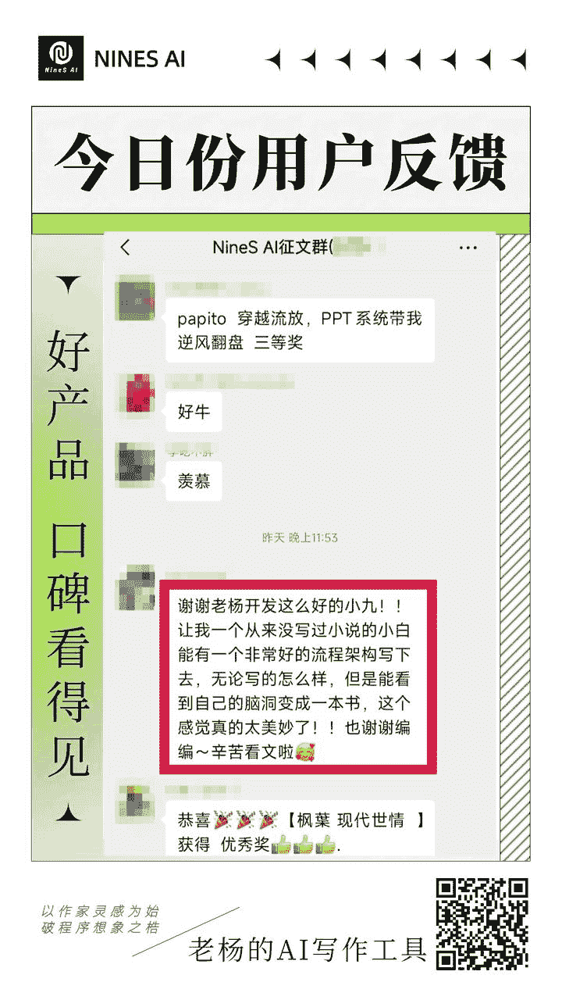

# 成功案例

> 来源：[https://rq547mr4oez.feishu.cn/docx/XNXxdDmk1o4YeXx0eLIcMtodnRf](https://rq547mr4oez.feishu.cn/docx/XNXxdDmk1o4YeXx0eLIcMtodnRf)

> 案例：NineS AI 的成功案例

测试期间：从2024年10月开始，到内测结束期间送出1亿2千344万字数

+   长篇：成熟作者可以做到五开作品，极大提高效率

+   短篇：无论是成熟作者，还是新手作者，都可以4个小时一篇商业短篇K50+

+   短剧：20天的短剧，可以10天写完并修稿

# 二、**群小伙伴实操案例**

>

1.  [NineS AI实操-小白入门流程(by 鹤凤w)](https://rq547mr4oez.feishu.cn/wiki/ICfIwYFR3i19nokvL05cMG28nHd?from=from_copylink)        PS：纯萌新的参考实录，第一次就签约了~

1.  [NineS AI实操-创作小说步骤(By Amaryllis)](https://rq547mr4oez.feishu.cn/wiki/B5oMwPeywi8Tx7kMkVqcDr9ynQd?from=from_copylink)    PS：生成正文如果有跑偏可以看下实操，小技巧解决

1.  [NineS AI实操-续写旧文过程(By NEKO)](https://rq547mr4oez.feishu.cn/wiki/OhAHwcemciKO7dkOWb9ceOQqn5f?from=from_copylink)         PS：笔者4开，续写番茄长篇，收获满满

1.  [NineS AI实操-拆书获取情节卡(by 星如雨)](https://rq547mr4oez.feishu.cn/wiki/G85ewmlk5iNO0nkytLTcs64KnQh?from=from_copylink)    PS：情节卡的方式

1.  [NineS AI实操-仿写入门流程(by 变成胖虎)](https://rq547mr4oez.feishu.cn/wiki/C2N4w0C2sir82Pk1G2ncAKrlntb?from=from_copylink)    PS：仿写短篇4小时轻松K30，到K50

1.  [NineS AI实操-续写40万的小说（By 快乐星球球长）](https://rq547mr4oez.feishu.cn/wiki/H2mYw5ArQioySRkizjxcFhLengd?from=from_copylink)PS：续写长篇一些干货

1.  [NineS AI实操-“仿写”的三个阶段（By 老杨）](https://rq547mr4oez.feishu.cn/wiki/F9gHwbDbni1386kI3ivcC0PSnRb?from=from_copylink)

1.  [NineS AI实操-灵感来源“情节卡”（By 老杨）](https://rq547mr4oez.feishu.cn/wiki/ApJtw9PYbil6pJkF0lhckX3fnrb?from=from_copylink)

1.  [12-18社群直播分享（去AI味/提示词本质/上下文衔接等）](https://rq547mr4oez.feishu.cn/wiki/LR8Cw4AnJi7iFHkTnlwcREuhnme?from=from_copylink)（提示词本质、上下文关联、完整去AI味思路）

1.  短剧改写

1.  ....持续增加ing

> **同**时开启有奖征文活动：NineS AI创作技巧、案例、使用说明等等，根据内容质量奖励“字数~月卡/现金”

### 荣誉墙

### 感谢对产品提出建议和意见的作者（代号）,排名不分先后