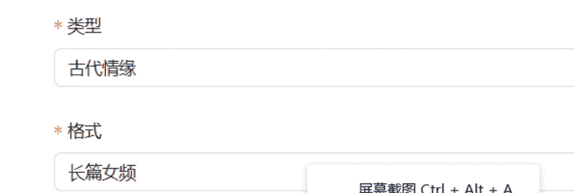
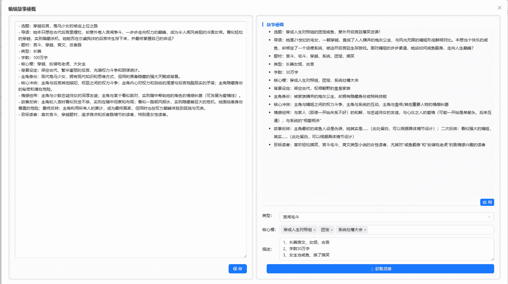
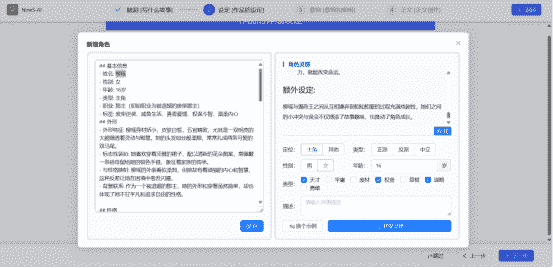
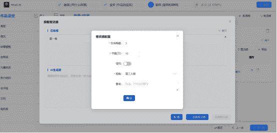
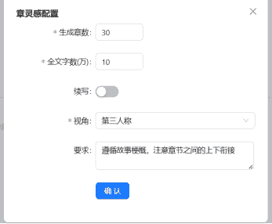
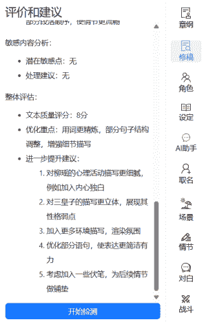
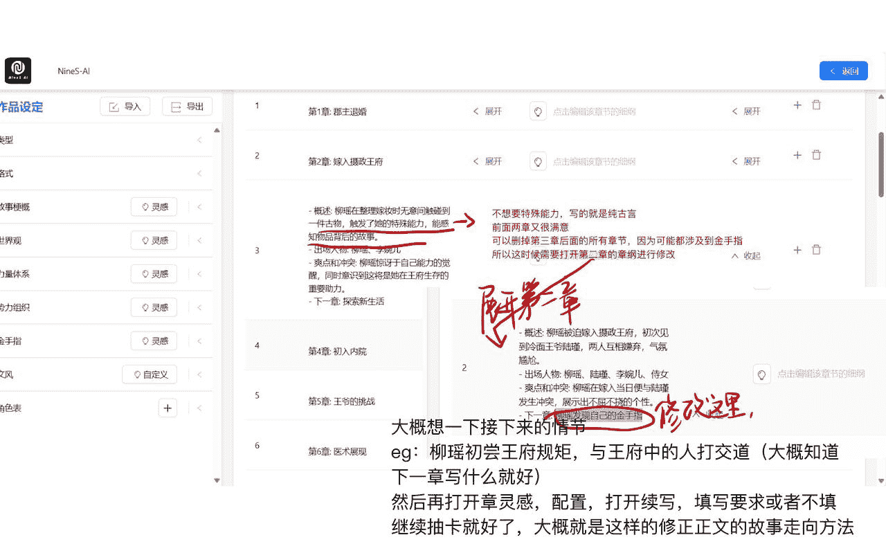

# NineS AI实操-创作小说步骤(By Amaryllis)

> 来源：[https://rq547mr4oez.feishu.cn/docx/BUwid6aMBo6NsyxDTyCch2Ninbe](https://rq547mr4oez.feishu.cn/docx/BUwid6aMBo6NsyxDTyCch2Ninbe)

> 老杨：群小伙伴Amaryllis提供，奖励月卡~大家可以踊跃分享哦！

> **同时开启有奖征文活动：**

> **NineS AI创作技巧、案例、使用**说明等等，根据内容质量奖励“字数~月卡”

=====================================================================================

## Amaryllis：使用流程

#### 1、灵感阶段

> 大概摸索了一下，如果想让AI写出一个较符合预期的全文，

> 前面的步骤一直到第一章正文书写都可以让AI自己发挥，加上自己的一点小tips

>

> 下面是我自己摸索的一个让AI达到比较理想化的一个状态的步骤（仅供参考，具体还需自己上手）：

1.  直接点击创建

1.  选择标准工作流，

> 想法：女频，古言，女主是咸鱼的类型，轻松，

> 后面的勾选如图所示





> 后面描述就按照123点标好，

> 重点是第三点，如果有想法，可以多写一点，写的具体一些，下面是我大概的一个想法

> **1.核心梗可以参照你想发布的平台，哪个火选哪个，可以随**便叠加几个，不用太多，因为有可能写不好。

> **2**.小故事输入自己想写的或者随便选一个火的故事的框架，比如晋江的一句话总结全文，就是整体你想要一个什么样的故事。

####

#### 2、灵感框架阶段

接着获取灵感，直到选出你比较满意的故事框架。

大致满意的可以把故事框架删删改改，这一块不用太严谨，够用就行。

1.  世界观，力量体系，势力组织，金手指，不需要可以不填写

1.  角色表  我写的古言，所以需要女主，也需要男主，女主的丫鬟，男主的小厮，女主的朋友，敌对势力（这里根据你的需要先创建几个主要角色就行，后面逐步添加或不添加）

1.  获**取后，大致满意的可以直接删删改改**，比如这块我只不满意名字，其他都满意，就可以只改名字，后面其他任何设定都可以根据需要留下或自行修改。（推荐选一个大致满意的自己修改，不要一直生成，因为后面可能生成的更不满意。）



####  3、卷纲到正文

1.  前面大致创作完成之后，

+   卷灵感分章节这块个人觉得可以好好写，如果有喜欢的故事的，可以让AI整理出大致起承转合的框架喂一下效果会更好

+   没有也没事，直接生成就好了

> tips：生成的不满意按照卷纲给出的重心调整，比如它给我的偏谋略，而我想要男女主情感发展多一点，我就会告诉AI我的需要，这里看自己需求。

> **直到抽出较符合预期的，直接应用。后面个别卷不符合，按照老**杨的说明书进行部分重新抽卡，直到比较满意



1.  抽章节，同抽卷纲（要求可以自己更改）

> 遵循故事梗概或者卷纲，这样子抽出来的章节大部分是连贯的，最后几章可能需要重新抽取，大致满意即可



1.  最重要的来啦，开始写正文

> 没有想法没有故事没有情节不要紧，只要会看小说，能看懂大致的错处或者不连贯，就可以。

>

> **步骤1：**

> AI版本四个版本都抽一下，看哪一版较符合你的预期节奏，然后先抽取到自己较满意的第一章，应用到正文

> tips：我这里每章需要3000就够了，后面润色修改


> **步骤2：**

> **通读一遍，挑出不连贯的地方**

> 剧情太磨蹭，或者某处剧情安排你有新的想法，哪个人物出场较早等不符合预期的，让AI润色

>

tips1：

**12点排排列队就好了**

这篇我没细读，大致看了一下还可以，修改的时候字数一般和之前一样，这里我忘记修改了，

如果AI自己写的情节比较多它多直接多生成，

比如有一章我需要2500，但是它根据我的情节生成了6000多字，自行选择删改或保留

tips2：

如果你不会或者不知道哪里写的不好，可以点击右侧修稿，让AI检测，

**复制意见**1234点之后**回**到AI写作界面重新润色，写作要求就粘贴方才进一步提升建议，

应用正文后面不满意就重复操作，直至满意




> 步骤3：第二章与第一章通常不连贯

解决办法，复制前一个章节的最后几句话

在第二章的写作要求里 列出：

1.  续写：“……”

1.  故事情节遵循章纲概述（这里是大致的，如果你有更好的情节复制粘贴就可以）

1.  （你的要求，没有不写）

1.  （你的要求，没有不写）

1.  ……

（**仅供参考**，目前个人实践操作得出这样输出的正文，是比较符合预期。）

####  4、案例

下面是举例生成的小说第一章要求和正文

eg:

> 生成的章节概述是这样：

+   概述: 被退婚的柳瑶面临人生低谷，却意外获知自己将嫁给摄政王陆瑾。她决心在新生活中寻找自我价值。

+   出场人物: 柳瑶、李婉儿、父母、媒人

+   爽点和冲突: 柳瑶面对退婚时展现出幽默和机智，令媒人和父母无言以对，留下深刻印象。

+   下一章: 柳瑶准备嫁入摄政王府

根据前面的步骤来，如果还是实在不会提要求，

可以根据生成的你正在写的这章和下一章的章节概述内容，修改增添剧情，实在不会增添，可以询问AI帮你填充剧情

写作要求（让AI帮你扩充情节，可修改）：

```
**背景铺垫**：
描绘柳瑶被退婚后的心理状态及生活境况，展现她的失落和对未来的不确定。
提及柳瑶的家庭背景，她的医术天赋如何被家族或师傅认可，却因性格懒散而被外界低估。

**突如其来的变故：**
描述柳瑶接到将嫁给摄政王陆瑾的消息时的震惊、疑惑，以及家人、朋友对此消息的反应。
增加一些幕后操控与权谋，例如，婚事的推动者是谁，以及他们背后的动机。

**陆瑾的简介：**
插入对摄政王陆瑾的初步描绘，关于他的权势、声望及外界对他的评价，可以通过他人的视角让读者初步认识这一人物。
暗示陆瑾的真正性格与表面看到的不同，是冷酷王爷，亦或有着鲜为人知的柔情。

**内心的挣扎与转变：**
描写柳瑶在接到婚礼消耗后的内心挣扎，是抗拒这桩政治婚姻，还是接受命运安排。
她对摄政王的好奇与忌惮，并在内心制定出一些应对婚后生活的计划。

**事件铺陈：**
在准备婚事的过程中，加入一些插曲，例如柳瑶偶然得知一些关于摄政王的传闻，或是她发现嫁入王府可能涉及更大的阴谋。
通过与亲友的对话或自我反思，展现其在态度上的逐步转变，从抗拒到尝试接受命运的安排。

**推动主线：**
通过平行事件描绘出柳瑶与王府之间的联系逐渐加深，
比如说，柳瑶因医术被请去为某个患重病的王府成员诊治，借此机会增加与陆瑾的接触。
强化权臣与反对力量的博弈，将柳瑶婚事作为政治斗争的一部分，提升叙事张力。
```

#### **5、例文（篇幅太长，截取）：**

```
 第一章 郡主退婚
 
盛夏时节，柳府后花园的荷塘里，粉色的荷花开得正盛，清香四溢，然而这满园的芬芳却丝毫无法驱散柳瑶心头萦绕的阴霾。
 
柳瑶百无聊赖地坐在池塘边的凉亭里，手里拿着一本医书，却一个字也看不进去。
 
泛黄的书页上，密密麻麻地记载着各种草药的特性和药方，这些曾经让她痴迷的文字，如今却如同天书一般，在她眼前模糊一片。
 
她的思绪飘到了几天前，那场让她颜面尽失的退婚宴上，靖王冰冷的退婚书，如同尖刀一般，狠狠地刺穿了她的心。
 
“郡主，靖王殿下派人送来了退婚书。”丫鬟春桃的声音还在耳边回响，柳瑶仿佛还能感受到当时那种锥心刺骨的羞辱，以及周围那些窃窃私语，如同毒蛇一般，啃噬着她的自尊。
 
她，大梁王朝唯一的郡主，自幼被圣上宠爱，集万千宠爱于一身，却因为一场意外，摔断了腿，落下了病根，被冠上了“废柴”之名，曾经围绕在她身边的光环，瞬间黯淡了下来。
 
靖王，她的未婚夫，曾经对她温柔体贴，如今却毫不留情地将她抛弃，甚至连一句解释也不屑给予。
 
“郡主，您别伤心了，靖王殿下那是瞎了眼，才会看不上您。”春桃心疼地看着柳瑶，想要安慰她，却不知该如何措辞。
 
柳瑶苦笑一声，说道：“春桃，我知道你是为了我好，可是，我心里真的很难过。”
 
她从小就喜欢靖王，一直以为他们会幸福地生活在一起，没想到，这一切都只是一场梦，一场被现实无情击碎的梦。
 
“郡主，您还有我们呢，我们会一直陪着您的。”春桃握住柳瑶的手，坚定地说道，她知道，郡主现在最需要的就是陪伴和支持。
 
柳瑶看着春桃真诚的眼神，心中涌起一股暖流，是啊，她还有家人，还有朋友，她不能就这样被打倒，她还有自己的骄傲和尊严。
 
她要振作起来，要活出自己的精彩，要让那些看不起她的人后悔！柳瑶在心中暗暗发誓，她要重新找回属于自己的光芒。
 
柳瑶自幼便展现出过人的医术天赋，她的祖父是太医院的院判，从小便悉心教导她医理药性，柳瑶也对医术产生了浓厚的兴趣，很快便掌握了祖父的毕生所学，甚至青出于蓝。
 
然而，柳瑶生性淡泊，不喜名利，更喜欢在自己的小院子里莳花弄草，研究医书，对于家族的期望和外界的赞誉，她都毫不在意，也因此被一些人误解为懒散无用。
 
就在这时，柳府管家急匆匆地跑了过来，打破了凉亭里的宁静，他的脸上带着一丝慌张，说道：“郡主，宫里来人了，宣您进宫。”
 
柳瑶心中一惊，难道是皇上要为她做主？这个念头让她心中燃起一丝希望，或许，皇上会为她讨回公道。
 
她不敢怠慢，连忙跟着管家进了宫，一路上，她的心中充满了忐忑和期待，不知道等待她的将会是什么。
 
御书房里，皇上正襟危坐，脸色凝重。
 
……
……
 
柳瑶不知道陆瑾是什么意思，但她还是说道：“王爷过奖了。”她努力让自己保持镇定，但她知道，自己内心深处的恐惧，是无法掩饰的。
 
陆瑾看着柳瑶，眼神中闪过一丝复杂的情绪，他看不透这个女人，她明明是一个弱女子，却有着一股不服输的劲头，这让他感到一丝好奇。
 
他说道：“我希望你能安分守己，不要给我惹麻烦。”他的语气中带着一丝警告，仿佛在说，如果你敢挑战我的权威，我一定会让你付出代价。
 
柳瑶心中一凛，说道：“臣妾明白。”她知道，在这个王府里，她必须小心谨慎，否则，她将会万劫不复。
 
陆瑾没有再说什么，转身离开了房间，他的背影消失在门外，柳瑶这才松了一口气，她感觉自己就像是从鬼门关走了一遭。
 
她看着陆瑾的背影，心中充满了疑惑和不解，她不知道陆瑾到底想要做什么，但她知道，她必须小心谨慎，才能在这个王府里生存下去。
 
柳瑶醒来的时候，陆瑾已经离开了，房间里空荡荡的，只有她一个人。
 
她独自一人用过早膳后，便开始在王府里闲逛，她想要了解这个她即将生活的地方，也想要找到一些可以帮助她的人。
 
王府很大，也很冷清，到处都弥漫着一股压抑的气息，柳瑶走着走着，来到了一处花园，这里的花草，似乎是王府里唯一的一抹亮色。
 
花园里种满了各种各样的花草，姹紫嫣红，美不胜收，柳瑶看着这些花草，心情渐渐好了起来，她感觉自己就像是从一个黑暗的世界，来到了一个充满阳光的世界。
 
她走到一株牡丹花前，弯下腰，仔细地观察着花朵，这株牡丹花开得正艳，花瓣层层叠叠，娇艳欲滴，柳瑶忍不住伸出手，轻轻地抚摸着花瓣。
 
就在这时，一个声音在她身后响起，“你喜欢牡丹花？”
 
柳瑶转过身，看到一个身穿白衣的男子站在她身后，男子长得十分俊美，气质温润如玉，仿佛是从画中走出来的一般。
 
柳瑶看着男子，心中充满了好奇，她问道：“你是谁？”
 
男子微微一笑，说道：“我是陆瑾的弟弟，陆玉。”
```

> **tips：这样的正文已经大致可以的，剧情差不多是通顺的**，如果想发表，还需对里面的句子进行删改。



> tips2：个别章节叙述完全不符合预期，修改的时候需要注意以下细节

1.  直接修改较为满意的章节的概述，删改一些

1.  下一章导向一定要记得删除，并修改

1.  章纲能影响整体正文的书写，所以章纲就要注意会跑偏的程度，可以自己拆解一下卷纲的故事

1.  章灵感配置时把它拆分成几个小点123456告诉AI，想不到的暂时不写，后面跑偏再用上面的方法进行修改。