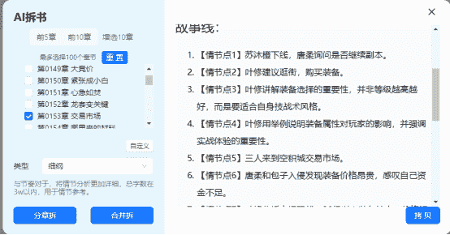
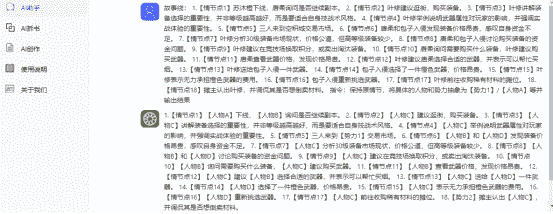
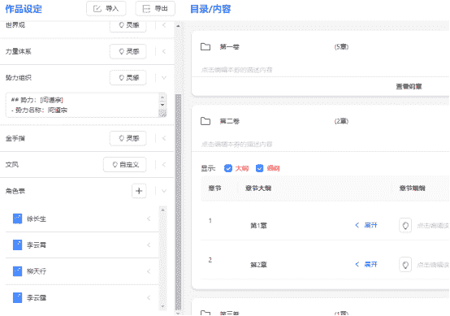

# NineS AI实操-拆书获取情节卡(by 星如雨)

> 来源：[https://rq547mr4oez.feishu.cn/docx/F6OudpQWEoBkelxBxqHcOCo0nIg](https://rq547mr4oez.feishu.cn/docx/F6OudpQWEoBkelxBxqHcOCo0nIg)

> **老杨：**

> **群小伙伴“星如雨”提供，这个情节卡**非常有用，奖励月卡~大家可以踊跃分享哦！

> **同时开启有奖征文活动：**

> **NineS AI创作技巧、案例、使用**说明等等，根据内容质量奖励“字数~月卡”

## 前言

> 我写小说时候总是先定好世界观、主角/重要配角人设和全书大致走向，结果正式写起来，几个主线剧情之间经常不知道该写什么，日常也写得干巴巴的。

> 就像玩一个游戏，20级的主线跑完了，30级的主线还没开，在等级升到30级前，我不可能天天打怪刷经验，那将毫无游戏体验……

> 那要怎样获取这种和主线没什么关系，但又要符合世界观和人设的剧情灵感呢？以下方法是我看完教程中的【情节卡】突然想到的，感觉可以作为参考。

> 大致操作步骤：

1.  任意/挑选一本小说中非连续的两章进行拆书，拆出细纲情节

1.  将拆出的情节中具体的人物/势力等内容抽象化

1.  **将两组抽象后的情节打乱重组**

1.  在重组后的情节中填入符合自己需求的人物/势力

1.  **情节转化成细纲**

1.  **细纲生成正文**

> 注意，步骤4是在我已经在设定中做好【人设】【势力】的前提下完成的

我比较喜欢写仙侠，示例中选择了全职高手作为拆文对象。

## 步骤一、选一本小说，任选其中两章进行拆文，拆文选项选择细纲

我选择的是合并拆，不过单章拆书的合并和分章很难说会有什么差别



```
故事线：
【情节点1】苏沐橙下线，唐柔询问是否继续副本。
【情节点2】叶修建议逛街，购买装备。
【情节点3】叶修讲解装备选择的重要性，并非等级越高越好，而是要适合自身技战术风格。
【情节点4】叶修举例说明武器属性对玩家的影响，并强调实战体验的重要性。
【情节点5】三人来到空积城交易市场。
【情节点6】唐柔和包子入侵发现装备价格昂贵，感叹自身资金不足。
【情节点7】叶修分析30级装备市场现状，价格公道，但高等级装备较少。
【情节点8】唐柔和包子入侵讨论购买装备的资金问题。
【情节点9】叶修建议在竞技场换取积分，或卖出淘汰装备。
【情节点10】唐柔询问需要购买什么装备，叶修建议购买武器。
【情节点11】唐柔查看武器价格，发现价格昂贵。
【情节点12】叶修建议唐柔选择合适的武器，并表示可以帮忙买烟。
【情节点13】叶修送给包子入侵一件武器。
【情节点14】包子入侵选择了一件橙色武器，价格昂贵。
【情节点15】叶修表示无力承担橙色武器的费用。
【情节点16】包子入侵重新挑选武器。
【情节点17】叶修前往收购稀有材料的摊位。
【情节点18】摊主认出叶修，并调侃其是否想倒卖材料。
```

## 步骤二、将拆出的情节中具体的人物/势力等内容抽象化

### 指令：保持原情节，将具体的人物和势力抽象为【势力1】/【人物A】等并输出结果

我是直接使用了AI助手，效果还可以。



```
故事线1：
【情节点1】】【人物A】下线，【人物B】询问是否继续副本。
【情节点2】【人物C】建议逛街，购买装备。
【情节点3】【人物C】讲解装备选择的重要性，并非等级越高越好，而是要适合自身技战术风格。
【情节点4】【人物C】举例说明武器属性对玩家的影响，并强调实战体验的重要性。
【情节点5】三人来到【势力1】交易市场。
【情节点6】【人物B】和【人物D】发现装备价格昂贵，感叹自身资金不足。
【情节点7】【人物C】分析30级装备市场现状，价格公道，但高等级装备较少。
【情节点8】【人物B】和【人物D】讨论购买装备的资金问题。
【情节点9】【人物C】建议在竞技场换取积分，或卖出淘汰装备。
【情节点10】【人物B】询问需要购买什么装备，【人物C】建议购买武器。
【情节点11】【人物B】查看武器价格，发现价格昂贵。
【情节点12】【人物C】建议【人物B】选择合适的武器，并表示可以帮忙买烟。
【情节点13】【人物C】送给【人物D】一件武器。
【情节点14】【人物D】选择了一件橙色武器，价格昂贵。
【情节点15】【人物C】表示无力承担橙色武器的费用。
【情节点16】【人物D】重新挑选武器。
【情节点17】【人物C】前往收购稀有材料的摊位。
【情节点18】【势力2】认出【人物C】，并调侃其是否想倒卖材料。
```

### 同上，再找一个章节拆文并替换，这样就得到了两个故事线。

```
【情节点1】申彦斗法失利，嘉世门人嘘声一片。
【情节点2】陶轩安慰申彦，并安排苏沐橙最后出场。
【情节点3】陈果察觉到苏沐橙出场背后的隐情，叶修愤怒。
【情节点4】叶修质问陶轩，陶轩含糊其辞。
【情节点5】魏琛向陈果解释苏沐橙最后出场的真正原因：嘉世对苏沐橙心存猜忌，故意安排她最后出场，以此试探其忠诚。
【情节点6】陈果理解了事情的真相，为苏沐橙的处境担忧。
【情节点7】苏沐橙上场，没有认输，而是采取了积极的进攻策略。
【情节点8】苏沐橙的进攻方式出乎意料，李艺博的分析与实际情况大相径庭。
【情节点9】苏沐橙强势压制孙哲平，陈果担忧苏沐橙是否在放水。
【情节点10】苏沐橙的强势表现，让观众和微草三人组都感到意外。
```

```
故事线2：
【情节点1】 【人物A】斗法失利，【势力1】门人嘘声一片。
【情节点2】 【人物F】安慰【人物A】，并安排【人物B】最后出场。
【情节点3】 【人物D】察觉到【人物B】出场背后的隐情，【人物C】愤怒。
【情节点4】 【人物C】质问【人物F】，而【人物F】含糊其辞。
【情节点5】 【人物E】向【人物D】解释【人物B】最后出场的真正原因：【势力1】对【人物B】心存猜忌，故意安排她最后出场，以此试探其忠诚。
【情节点6】 【人物D】理解了事情的真相，为【人物B】的处境担忧。
【情节点7】【人物B】上场，没有认输，而是采取了积极的进攻策略。
【情节点8】【人物B】的进攻方式出乎意料，【人物G】的分析与实际情况大相径庭。
【情节点9】【人物B】强势压制【人物H】，而【人物D】担忧她是否在放水。
【情节点10】【人物B】的强势表现，让观众和【势力3】【势力4】【势力5】都感到意外。
```

## 步骤三、将两组抽象后的情节打乱重组

### 指令：将故事线1和故事线2合并并打乱顺序重新组合，生成新的故事情节，并保证逻辑通顺

这一步AI助手似乎不太好用，我改用了Kimi生成，Kimi写小说不怎么样，不过逻辑还可以，可以让它多生成几种：

```
【情节点1】 【人物A】斗法失利，【势力1】门人嘘声一片。
【情节点10】 【人物B】的强势表现，让观众和【势力3】【势力4】【势力5】都感到意外。
【情节点1】】【人物A】下线，【人物B】询问是否继续副本。
【情节点2】 【人物F】安慰【人物A】，并安排【人物B】最后出场。
【情节点4】 【人物C】举例说明武器属性对玩家的影响，并强调实战体验的重要性。
【情节点3】 【人物D】察觉到【人物B】出场背后的隐情，【人物C】愤怒。
【情节点5】 【人物E】向【人物D】解释【人物B】最后出场的真正原因：【势力1】对【人物B】心存猜忌，故意安排她最后出场，以此试探其忠诚。
【情节点6】 【人物D】理解了事情的真相，为【人物B】的处境担忧。
【情节点7】 【人物B】上场，没有认输，而是采取了积极的进攻策略。
【情节点8】 【人物B】的进攻方式出乎意料，【人物G】的分析与实际情况大相径庭。
【情节点9】 【人物B】强势压制【人物H】，而【人物D】担忧她是否在放水。
【情节点2】 【人物C】建议逛街，购买装备。
【情节点5】 三人来到【势力1】交易市场。
【情节点6】 【人物B】和【人物D】发现装备价格昂贵，感叹自身资金不足。
【情节点7】 【人物C】分析30级装备市场现状，价格公道，但高等级装备较少。
【情节点8】 【人物B】和【人物D】讨论购买装备的资金问题。
【情节点9】 【人物C】建议在竞技场换取积分，或卖出淘汰装备。
【情节点10】 【人物B】询问需要购买什么装备，【人物C】建议购买武器。
【情节点11】 【人物B】查看武器价格，发现价格昂贵。
【情节点12】 【人物C】建议【人物B】选择合适的武器，并表示可以帮忙买烟。
【情节点13】 【人物C】送给【人物D】一件武器。
【情节点14】 【人物D】选择了一件橙色武器，价格昂贵。
【情节点15】 【人物C】表示无力承担橙色武器的费用。
【情节点16】 【人物D】重新挑选武器。
【情节点17】 【人物C】前往收购稀有材料的摊位。
【情节点18】 【势力2】认出【人物C】，并调侃其是否想倒卖材料。
```

> **这**个新的故事线以【人物A】的失败开始，接着是【人物B】在竞技场上的强势表现，然后转向【人物B】、【人物C】和【人物D】在装备市场上的冒险。

> **故**事中穿插了【人物B】的背景故事和【势力1】的内部猜忌，同时也展现了角色们在装备选择和资金管理上的挑战。

> **一般情况下做完这一步就可以根据已有的情节打开思路了，后续**步骤是为了进一步细化，便于直接生成正文。

## 步骤四、在重组后的情节中填入符合自己需求的人物/势力

手动：将人物ABC/势力123替换为已有的人设和势力

（可以拷贝到word里进行全局替换，注意，示例中我进行这一步的时候已经填写了势力组织和人设）



## 步骤五、情节转化成细纲

### 复制填充好的情节，在AI助手中输入指令：将以下情节整理为仙侠小说大纲

```
第一章：仙法失利
情节点1：李云霄在一场对决中失利，遭到问道宗弟子的嘲笑。
情节点10：徐长生的卓越表现让观战的漠城、天音殿、散修盟修士都感到震惊。

第二章：秘境的抉择
情节点1：李云霄下擂台后，徐长生询问是否继续探索秘境。
情节点2：李云霆安抚李云霄，并安排徐长生作为压轴出场。

第三章：法宝与修炼
情节点4：柳天行举例说明法宝属性对修仙者的影响，强调实战修炼的重要性。
情节点3：柳天行察觉到徐长生出场背后的隐情，柳天行心生怒火。

第四章：忠心的试炼
情节点5：李云霆向柳天行揭示徐长生最后出场的真正原因——问道宗对他心有疑虑，故意安排他以此试炼其忠心。
情节点6：柳天行理解事情原委，为徐长生的处境感到忧虑。

第五章：绝地反击
情节点7：徐长生登台，没有退缩，而是采取积极的攻伐策略。
情节点8：他的攻伐方式出人意料，天音殿修士的预判与实际情况大相径庭。
情节点9：徐长生强势压制对手，而柳天行担心他是否在暗中相助。

第六章：法宝寻觅
情节点2：为了增强修为，柳天行提议下山购买法宝。
情节点5：三人来到问道宗交易市集。

第七章：财力困境
情节点6：徐长生和柳天行发现法宝价格高昂，感叹囊中羞涩。
情节点7：柳天行分析法宝市场现状，价格合理，但高等级法宝稀缺。

第八章：解决之策
情节点8：徐长生和柳天行商议购买法宝的财力问题。
情节点9：柳天行建议在仙门比武中赚取善功或出售闲置法宝。

第九章：法宝挑选
情节点10：徐长生询问需要购买何种法宝，李云霄建议选购法宝剑。
情节点11：查看法宝剑价格后，发现价格不菲。

第十章：情谊与支持
情节点12: 柳天行建议挑选合适的法宝剑，并表示可以帮忙寻觅炼器材料。
情节点13: 柳天行予徐长生一件法宝作为助力。

第十一章：仙器之争
情节点14: 徐长生选中了一件天级法宝剑，但价格昂贵。
情节点15: 柳天行表示无力承担天级法宝剑的费用。

第十二章：再次挑选
情节点16: 徐长生重新挑选法宝，以价格适宜为首要考量。

第十三章：高级炼器材料交易
情节点17: 柳天行前往收购高级炼器材料的摊位。
情节点18: 凌霄剑宗修士认出徐长生，并打趣其是否想倒卖材料，引来一阵欢笑。
```

### 复制以上，在AI助手中输入指令：将以下小说内容整合为2章

```
**第一章：仙法失利与秘境抉择****
情节点1：仙法失****利
李云霄在一场至关重要的对****决中不幸失利，这一结果不****仅让他本人深感沮丧，还****遭到了问道宗其他弟子的无情****嘲笑。他的挫败感在众人冷嘲热****讽中愈发强烈。
情节点10：**徐长生的震撼表现
与此同时，徐长生在对战中的卓越表现如同一股清流，震撼了在场的漠城、天音殿以及散修盟的众多修士。他的技艺高超，实力非凡，赢得了众人的一致惊叹，与李云霄的失利形成了鲜明对比。
情节点1：秘境的继续探索
对决结束后，李云霄黯然走下擂台，此时徐长生上前询问他是否还有心情继续探索之前提及的秘境。李云霄虽心有不甘，但在徐长生的鼓励下，勉强同意了继续前行。
情节点2：李云霆的安排
为了安抚李云霄的情绪并振作士气，李云霆精心安排，决定让徐长生作为压轴选手，在后续的比赛中出场，以期通过徐长生的胜利来提振整个团队的士气。
第二章：法宝寻觅与试炼忠心
情节点4与3：法宝影响与怒火中烧
柳天行在一次讨论中，详细阐述了法宝属性对修仙者实力的重大影响，并强调了实战修炼的重要性。同时，他也敏锐地察觉到了徐长生被安排最后出场的背后隐情，这让柳天行心中燃起一股怒火，对问道宗的做法感到不满。
情节点5与6：试炼忠心与忧虑
李云霆向柳天行透露了徐长生最后出场的真正原因——问道宗高层对徐长生心有疑虑，故意以此试炼他的忠心。柳天行在了解事情原委后，对徐长生的处境深感忧虑，担心他会因此受到不公平的对待。
情节点7至9：绝地反击与担忧
比赛继续，徐长生登台后没有丝毫退缩，反而采取了积极的攻伐策略，令天音殿修士的预判完全落空。他凭借出色的战斗技巧，强势压制住了对手，赢得了场下观众的阵阵喝彩。然而，这一切却让柳天行心生疑虑，担心自己是否在暗中相助，影响了比赛的公正性。
情节点2与5至7：法宝寻觅与财力困境
为了增强修为，柳天行提议下山购买法宝。三人来到问道宗的交易市集，却发现法宝价格高昂，囊中羞涩的徐长生和柳天行不禁感叹。柳天行分析市场现状，指出价格虽合理，但高等级法宝稀缺，难以轻易获得。
情节点8至11：解决之策与法宝挑选
面对财力困境，徐长生和柳天行商议对策，最终决定通过仙门比武赚取善功或出售闲置法宝来筹集资金。在挑选法宝时，李云霄建议选购法宝剑，但查看价格后发现价格不菲。柳天行建议挑选合适的法宝剑，并表示愿意帮忙寻觅炼器材料，同时赠予徐长生一件法宝作为助力。
情节点14至16：仙器之争与再次挑选
在挑选过程中，徐长生看中了一件天级法宝剑，但价格过于昂贵，柳天行无力承担。最终，徐长生不得不重新挑选，以价格适宜为首要考量，选择了另一件更适合自己的法宝。
情节点17与18：高级炼器材料交易
为了进一步提升法宝的威力，柳天行前往收购高级炼器材料的摊位。在那里，他们意外遇到了凌霄剑宗的修士，一番打趣后，气氛变得轻松起来，也为接下来的修炼之路增添了几分乐趣。
```

### 手动：大致看一下生成的章纲，手动修改人物关系和情节。注意，在这一步骤的示例中，我已根据自己的想法修改了人物和情节顺序。

```
**====****
仙法失利
李云****霄在一场至关重****要的对决中不****幸****失利，这一结果不仅****让他本人深感沮****丧，还遭到了问道宗****其他弟子的无情嘲笑****。他的挫败感在**众人冷嘲热讽中愈发强烈。

徐长生的震撼表现
与此同时，徐长生在对战中的卓越表现如同一股清流，震撼了在场的漠城、天音殿以及散修盟的众多修士。他的技艺高超，实力非凡，赢得了众人的一致惊叹，与李云霄的失利形成了鲜明对比。

秘境的继续探索
对决结束后，李云霄黯然走下擂台，此时徐长生上前询问他是否还有心情继续探索之前提及的秘境。李云霄虽心有不甘，但在徐长生的鼓励下，勉强同意了继续前行。

李云霆的安排
为了安抚李云霄的情绪并振作士气，长老精心安排，决定让徐长生作为压轴选手，在后续的比赛中出场，以期通过徐长生的胜利来提振整个团队的士气。
 
法宝影响与怒火中烧
李云霄在一次讨论中，详细阐述了法宝属性对修仙者实力的重大影响，并强调了实战修炼的重要性。同时，他也敏锐地察觉到了徐长生被安排最后出场的背后隐情，这让李云霄心中燃起一股怒火，对问道宗的做法感到不满。

试炼忠心与忧虑
李云霆向李云霄透露了徐长生最后出场的真正原因——问道宗高层对徐长生心有疑虑，故意以此试炼他的忠心。李云霄在了解事情原委后，对徐长生的处境深感忧虑，担心他会因此受到不公平的对待。

法宝寻觅与财力困境
为了增强修为，李云霄提议下山购买法宝。二人来到问道宗的交易市集，却发现法宝价格高昂，囊中羞涩的徐长生和李云霄不禁感叹。李云霄分析市场现状，指出价格虽合理，但高等级法宝稀缺，难以轻易获得。

解决之策与法宝挑选
面对财力困境，徐长生和李云霄商议对策，最终决定通过仙门比武赚取善功或出售闲置法宝来筹集资金。在挑选法宝时，李云霄建议选购法宝剑，但查看价格后发现价格不菲。李云霄建议挑选合适的法宝剑，并表示愿意帮忙寻觅炼器材料，同时赠予徐长生一件法宝作为助力。

绝地反击与担忧
比赛继续，徐长生登台后没有丝毫退缩，反而采取了积极的攻伐策略，令天音殿修士的预判完全落空。他凭借出色的战斗技巧，强势压制住了对手，赢得了场下观众的阵阵喝彩。然而，这一切却让李云霄心生疑虑，担心自己赠与的法宝是否影响了比赛的公正性。
====
```

## 步骤六、细纲生成正文

### 手动：将以上内容填入本章细纲

### 指令：严格按照本章细纲的内容写全文（可根据需求增加指令明确人称、主角等）

```
**章节正文**

问道宗驻地内，气氛凝重得仿佛一块巨石压在每个人的心头。
李云霄与天音殿弟子的对决已经结束，结局却如同一盆冷水浇灭了问道宗众弟子的热情。
李云霄面色铁青，一言不发地站在原地，那紧握的双拳和微微颤抖的身躯都在无声地诉说着他的愤怒和不甘。
他的对手，天音殿的那名弟子，则是一脸得意之色，仿佛胜利的喜悦已经将他淹没。
「师兄，你没事吧？」
徐长生走到李云霄身边，关切地问道，语气中带着一丝担忧。
李云霄摇了摇头，没有说话，只是将头偏向一边，似乎不愿面对眼前的现实。
他的内心充满了挫败感，如同汹涌的潮水般将他吞噬。
在问道宗年轻一辈弟子中，他一直被视为佼佼者，如同冉冉升起的新星，承载着宗门的希望。
然而，在这次与天音殿弟子的对决中，他却败得如此彻底，如同从云端跌落谷底，摔得粉身碎骨。
「胜败乃兵家常事，师兄不必太过在意。」
徐长生安慰道，试图用温和的言语抚平李云霄内心的伤痛。
「你不懂。」
李云霄深吸一口气，语气低沉地说道，「我输的不是一场比赛，而是问道宗的颜面。」
徐长生沉默了，他知道，李云霄说的没错。
问道宗与天音殿一直以来都是竞争关系，如同水火般不相容。
这次对决，问道宗的失利，无疑会让天音殿更加嚣张，如同打了胜仗的公鸡般耀武扬威。
问道宗的弟子们，也纷纷对李云霄投来异样的目光，有惋惜，有失望，甚至还有嘲讽。
「废物，连天音殿的弟子都打不过，真是丢人现眼！」
「哈哈，我还以为他有多厉害呢，原来也不过如此。」
「真是给我们问道宗丢脸！」
一句句刺耳的话语，如同尖刀般刺入李云霄的心脏，让他心中的怒火越烧越旺。
然而，徐长生在对战中的表现却截然不同，他如同一道耀眼的光芒，照亮了整个赛场。
他的剑法，如同行云流水般流畅自然，却又带着雷霆万钧之势，让人防不胜防。
他的身法，如同鬼魅般飘忽不定，却又快如闪电，让人难以捉摸。
他的每一次攻击，都精准无比，却又威力十足，让人胆战心惊。
漠城、天音殿以及散修盟的众多修士，都被徐长生的表现所震撼，他们从未见过如此年轻却又如此强大的修士。
「这徐长生，究竟是什么来头？竟然如此厉害！」
「他的剑法，简直出神入化，我从未见过如此精妙的剑法！」
「他的实力，恐怕已经达到了筑基后期，甚至更高！」
一声声惊叹，从人群中传来，如同潮水般涌向徐长生。
徐长生，成为了这场比赛的焦点。
他用自己的实力，证明了自己的价值。
他用自己的实力，赢得了所有人的尊重。
李云霄黯然走下擂台，他的心中充满了不甘和愤怒。
他无法接受，自己竟然败给了天音殿的弟子。
他更无法接受，自己竟然被问道宗的弟子们嘲笑。
就在这时，徐长生走了过来。
「师兄，你还好吗？」
徐长生问道。
李云霄摇了摇头，没有说话。
徐长生说道，「师兄，我知道你很难过，但是你不能就这样放弃。」
「你还有机会，你还有时间。」
「你一定能够重新站起来，成为问道宗的骄傲。」
李云霄看着徐长生，眼神中闪过一丝光芒。
徐长生继续说道，「师兄，你还记得我们之前说过的，要去探索那个秘境吗？」
「现在，我们还有心情去吗？」
李云霄犹豫了一下，最终还是点了点头。
他需要一些时间，来平复自己的心情。
秘境的探索，或许能够让他暂时忘记这场失利。
「那就走吧。」
徐长生说道。
两人离开了问道宗驻地，朝着秘境的方向走去。
一路上，李云霄都沉默不语。
徐长生也没有多说什么，只是默默地陪伴着他。
他知道，李云霄现在需要的是安静。
为了安抚李云霄的情绪，也为了振作问道宗的士气，长老李云霆做出了一个决定。
他决定让徐长生作为压轴选手，参加后面的比赛。
李云霆相信，徐长生的实力，一定能够为问道宗赢得荣誉。
秘境位于问道宗驻地外的一片山脉之中。
根据宗门典籍记载，这处秘境中隐藏着不少宝物。
不过，秘境中也存在着一些危险。
因此，问道宗一直没有派人前来探索。
李云霄和徐长生两人小心翼翼地进入秘境。
秘境之中，灵气浓郁，景色宜人。
各种奇花异草，争奇斗艳。
「这里真是个好地方。」
徐长生感叹道。
「是啊。」
李云霄也难得地露出了一丝笑容。
两人继续深入秘境。
突然，一阵阴风袭来。
「小心！」
李云霄大喝一声，将徐长生拉到身后。
只见一头巨大的妖兽出现在两人面前。
这头妖兽，形似巨狼，浑身漆黑，散发着恐怖的气息。
「是黑风狼！」
李云霄脸色一变。
黑风狼，是一种非常凶猛的妖兽。
它的实力，相当于人类修士的筑基期。
「师兄，我们怎么办？」
徐长生问道。
「我来对付它，你保护好自己。」
李云霄说道。
说罢，他拔出长剑，朝着黑风狼冲了过去。
黑风狼发出一声怒吼，也朝着李云霄扑了过来。
一人一狼，顿时战成一团。
李云霄的实力虽然不如黑风狼，但是他的剑法精妙，一时间竟然与黑风狼斗了个旗鼓相当。
徐长生在一旁观战，心中暗暗着急。
他知道，李云霄现在的状态并不好。
如果长时间战斗下去，他必败无疑。
就在这时，李云霄一个不慎，被黑风狼击中。
他顿时口吐鲜血，倒飞而出。
「师兄！」
徐长生惊呼一声，连忙冲了过去。
黑风狼没有给徐长生机会。
它再次扑向李云霄，想要将其杀死。
就在这千钧一发之际，一道剑光闪过。
黑风狼顿时被斩成两段。
徐长生抬头看去，只见一个身穿青色道袍的老者出现在面前。
「长老！」
徐长生惊喜地叫道。
这位老者，正是问道宗的长老，李云霆。
「你们没事吧？」
李云霆问道。
「我们没事，多谢长老救命之恩。」
徐长生说道。
「嗯。」
李云霆点了点头，然后看向李云霄，说道，「云霄，你太让我失望了。」
李云霄低下了头，没有说话。
「你身为问道宗弟子，竟然败给了一个天音殿的弟子，真是丢尽了问道宗的脸面。」
李云霆说道。
「长老，我……」
李云霄想要解释，却被李云霆打断。
「我不想听你的解释。」
李云霆说道，「你回去好好反省一下吧。」
说罢，李云霆转身离去。
徐长生扶起李云霄，说道，「师兄，我们回去吧。」
李云霄点了点头，两人离开了秘境。
回到问道宗驻地后，李云霄的情绪更加低落了。
他把自己关在房间里，谁也不见。
徐长生知道，李云霄需要时间来调整自己的心态。
他也没有去打扰他，只是默默地等待着。
几天后，李云霄终于从房间里走了出来。
他的脸色虽然依旧有些苍白，但是眼神却变得更加坚定。
「长生，谢谢你。」
李云霄说道。
「师兄，你不用谢我。」
徐长生说道，「我相信你一定能够战胜心魔，重新振作起来。」
「我会的。」
李云霄说道。
就在这时，问道宗的长老李云霆走了过来。
「云霄，你跟我来。」
李云霆说道。
李云霄跟着李云霆来到了一处偏僻的地方。
「云霄，我知道你这段时间很不好过。」
李云霆说道，「但是，你不能一直这样消沉下去。」
「长老，我……」
李云霄想要说什么，却被李云霆打断。
「我知道你心里很难受。」
李云霆说道，「但是，你要明白，胜败乃兵家常事。」
「你这次输了，并不代表你永远都会输。」
李云霆说道，「只要你肯努力，你一定能够变得更强。」
「长老，我明白了。」
李云霄说道。
```