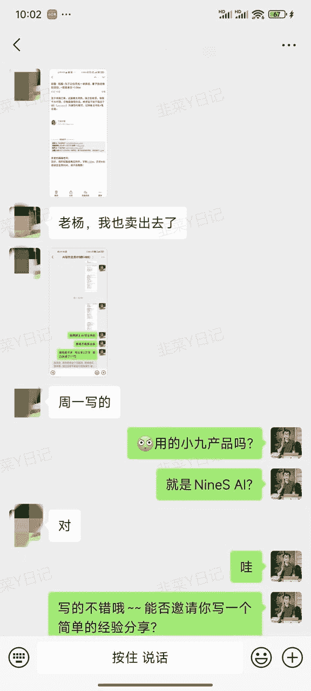

# NineS AI实操-仿写入门流程(by 变成胖虎)

> 来源：[https://rq547mr4oez.feishu.cn/docx/Xx3FdLduQoWEvxxOjt8c7SH6nEd](https://rq547mr4oez.feishu.cn/docx/Xx3FdLduQoWEvxxOjt8c7SH6nEd)

> **老杨：**

> 群小伙伴“变成胖虎”提供，简单的仿写流程，内测第二天就卖出去了。

> 奖励50万字~大家可以踊跃分享哦！

> **同时开启有奖征文活动：**

> **NineS AI创作技巧、案例、使用**说明等等，根据内容质量奖励“字数~月卡”

## 变成胖虎：

> AI不能完全代替人写作，

> 需要有一定的写作能力和故事构建能力，AI可以帮助找灵感或者完善自己的想法，提高你的效率。

### **第一步：找书**

> 查排行榜，自己找需要仿写的小说TXT版本文件，

> 无责任推荐：http://103.239.244.123:81/jiexi.html 这个网站可以提取市面上所有小程序短篇小说TXT，可自行开会员使用，8块钱一个月。如果打开不就去淘宝或者咸鱼上找类似的商家。

### 第二步：拆书

1.  将小说txt文件中的章节改成第X章，短篇小说多用数字区分章节，AI拆书是识别不了的。

1.  将TXT放入拆书功能中，我一般是综合和章纲合并拆、细纲分章拆（超级好用）。

1.  拆出来的内容全部复制放入word文档中，然后将大纲细纲改成自己想要的内容。

+   tips：具体可以见老杨的拆书说明，我就不重复了。

### 第三步：AI创作

1.  开始AI创作，将改写好的大纲细纲放入AI框架中，文风自定义，将仿写文章的大纲和原文丢进去（注意要匹配）。

1.  生成全文，写作要求那里我一般是用一下指令：

**用**主角第一人称视角写作，多用人物对话来推进剧情，故事要有爽点和逻辑性，要预埋爽点铺垫，每个章节的结尾不要用总结性语言，用对话或者钩子结尾。

### 第四步：优化

1.  根据生成的内容抽卡，不满意就重新生成，直到满意为止。或者有一部分觉得满意就复制出来。

1.  细纲情节点多的话AI会遗漏一部分，最好是情节点分开生成，复制下来到文档保存，后续再去人工精简，这样文章质量会比较高。

1.  最后修改生成的文章，AI直接生成的文章有部分会比较拖沓，不适合短篇节奏，或者废话比较多，自行去删减，直到前后文逻辑通顺流畅。

1.  最好是按照自己的细纲去改，如果有遗漏的内容，就单独生成后添加进去就好了（不要想着AI能100%完成，任何AI都做不到的）

###  总结，划重点：

1.  我仿写一般都会**改原文的背景或者替换部分元素**，这样就不会被判抄袭，所以还是要有原创部分的。

1.  自己想不出来情节的，可以将两本或者多本书拆出来，然后情节结合在一起。但一定要能够保证故事逻辑是通顺的（见，情节卡的教程）

1.  其实使用AI写小说更多的是要有审稿和改稿的能力，要明白怎么样的小说是能够被市场接受的，写出来是有人要，能卖出去才是王道。

1.  **能用AI变现**才是最终目的，而不是单纯用AI写一本小说。

1.  短篇市场比较卷一定要多看多读，**明白能卖出去文章的共性**，这样才能变现。

1.  我按照上面的步骤写出来过一本小说，总用时差不多4个多小时，最终是K30保底的价格卖出去的。虽然价格不高，但是胜在用时短。