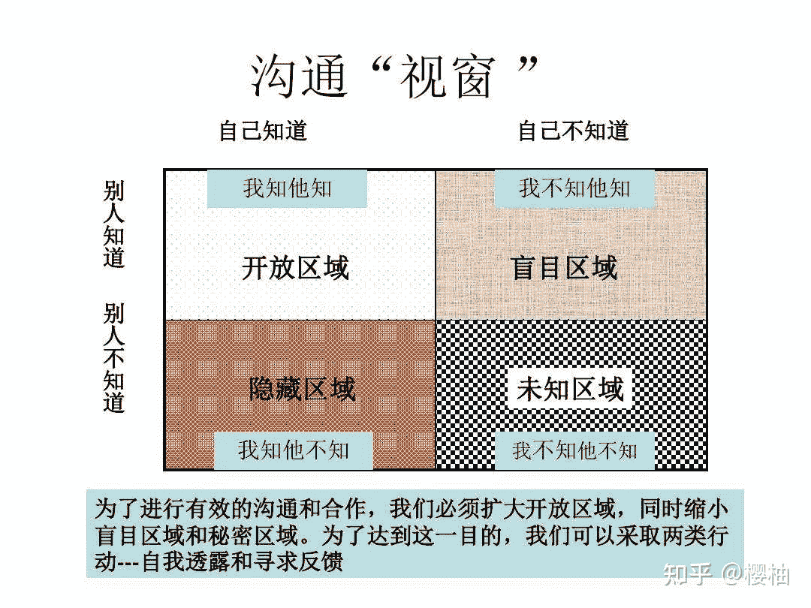
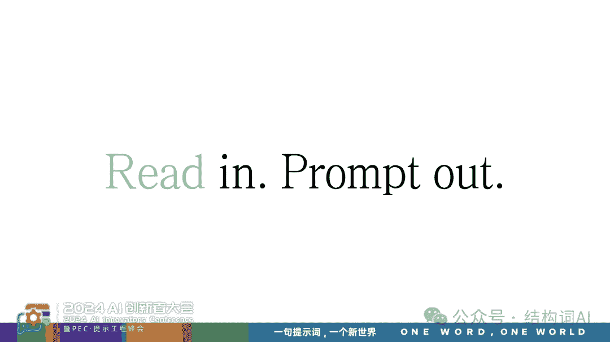

# NineS AI社群直播-去AI味/提示词本质/上下文衔接等

> 来源：[https://rq547mr4oez.feishu.cn/docx/Pni7d6Eqvo6kdFx1EcTcnqPGn6e](https://rq547mr4oez.feishu.cn/docx/Pni7d6Eqvo6kdFx1EcTcnqPGn6e)

# 一、AI写小说能不能赚钱的四个认知（30分钟）--适合小白

## 一.对网文市场的认知

### 1.写网文能赚多少钱?

+   前面说过，网文不是什么捡钱的地方，以前曾经是，现在不再是。

+   有的人一书成名，月入数十万上百万。有的人扑街七八年，每个月辛辛苦苦四五千勉强糊口。

+   这个行业不似正常公司的那些工作岗位，可能这本书赚了上百万，下本书扑的只有个零头。

+   所谓的“赚钱能力”,我认为要从两个方面衡量。

+   第一，单纯的写作技巧水平+素材积累水平+AI使用能力。

+   这就是教程理论大部分内容所教授的东西，即“讲故事的能力”——讲个小马过河也好，讲个斗破苍穹也好，掌握这种能力，你可以把平淡的内容讲出起伏好。

+   还有分析与积累的数量与能力——看书拆书能不能记住需要的素材、分析出内在逻辑?日积月累才能让脑袋里有货，才能写出真正属于自己的文风。

+   这个时候，如果你写的并不是热门、大火题材，只是很普通甚至冷门一些的题材，那么2000均订水平(每月15万字，加全勤大概每月5000打底，有推荐或多更可以上万。仅以分成主站为基准，没有算渠道费、版权改编费等其他额外收入是可以轻松做到的。

+   **第二，对受众的把握。**

+   说白了，就是作者水平足够了，知道该蹭什么热度，或者不蹭热度写长青题材，明白自己的读者受众是谁，并且能够牢牢抓住其中一部分。

+   这一点，决定了写作收入的上限。

+   典型的例子，就是一些主站早就过时的小说，今天依旧能在渠道上赚的盆满钵满，而去刺猬猫这类网站写二次元游戏同人，只要你热点抓对了，上手难度也远比去起点搞原创容易的多。

+   **而**进一步细分，如何尽可能多的提升自己的受众群体数量，结合当前网文的热点风向来写作，直接决定了收入的上限值。

+   只要不是过于冷门，写的题材能够抓住更多受众，那么月入过万仅仅是一个开始——这里并不是给萌新画饼，而是我接触许多中高层写手后的真实感受。

+   这些写手本身技巧都已经很完善，影响收入上限的，基本就是每本书结合当前时代的题材方向选择。

### 2.搞清楚网站的区别

+   最简单的分类：男频/女频、长篇/短篇

+   长篇：

+   阅文集团(起点为主，其他🐧 阅读、昆仑、创世等为辅)

+   其余网站比较有名的就是知乎，飞卢、番茄、纵横、17k、掌阅、七猫、磨铁等。

+   短篇：

+   番茄短篇，免费代表：包容性很强，古言比较受欢迎。收入算是可观。

+   知乎短篇，付费代表：会员收入主要来源于盐选付费短篇业务，头部作者收入高；

+   主要是是三大类：情感故事（言情、伦理等）、脑洞故事（同人、悬疑、科幻等）、现实题材（案件、医生等）

+   其他平台如 UC 故事会(微擦边、死人文学)、网易、黑岩、蓝鲸、瑶池、冰甜的头部作者收入也较为可观。

+   挑选网站看以下几点：

+   **1.看待遇**

+   总的来说，各个网站待遇各不相同，新人在了解网站时，首先建议去【作者专区】内查看当前的【作者福利】条款。

+   全勤字数、条件、给多少、签约等级之类的，都要看清楚。

+   有些网站有买断收稿类的活动，如果确认是对口的，可以选择尝试。

+   **2.看流量**

+   新人新书大概率扑街，要抱着这样的心理准备。但同样是扑街，在小网站单机几十万字和在大网站写到上架，完全是两个概念。

+   因为大网站流量多，你写的再差，只要天天更新，总有人会点进来看看，然后留下反馈——对新人来说，反馈是最重要的事，因此我建议能去人多的地方更好。如果是小网站，能给个保底买断之类的再考虑。

+   **3.看自己文风和偏好**

+   很多人看书时间久，如今口味挑剔，写出来的东西也多有自己喜欢的作者的影子，那么这种时候我的建议是：你喜欢的作者在哪个网站，或者自己平时在哪个网站看书最多，就在那个网站投稿。

+   因为文风不对路，往往只有“单机”一个下场。

### 3.具体的题材选择

+   1.学会扫榜

+   2.仔细研究卖点/亮点---【核心梗、人设、故事卡=情节卡*N】-->仿写（换元法）

+   3.建立编辑+读者视角

### 4.写书最大的敌人：焦虑之下的自我否定

## 二.自己适合入行吗?

+   定位自己

**1、100%纯“小白”阶段**

+   **主要特征**

+   是对“网文”概念都模糊，甚至没看过几本网文的人。

+   这个级别的新人，别管你本身文笔水平高低，想要入行马上吃这口饭，基本就是不可能的。

+   因为这个层次的萌新，是完完全全的“蒙眼乱撞”进的网文圈，以为这里是什么容易捞钱的好地方，实际对这种新人而言，直接开书的结果基本就是被市场绞碎。

+   如果这类新人真想静下心来踏实入行，该怎么做?

+   先别着急写，先去多看网文，也别看老书，就拿着近些年的火书都翻翻。

+   这里我说的就是阅读，不是拆书，更不是用AI拆书。

+   100%小白，对网文能看下几本是几本，读到脑袋里逐步摒除最初的那些对网文的成见以后，大概有下一级的水平了，我们才好继续谈写网文赚钱的事。

+   同时AI是什么，Prompt怎么用，哪些工具好，这些最基本的问题找人问问，然后自己试一试找到感觉。

**2、“大白”阶段**

+   **两个特征：**

+   1.没动过笔或写过几万字，对ai只局限于问问题

+   2.阅读有少许积累(可能几十本，包含了非网文小说作品)，但阅读面不广，习惯只看某些类别，对网文的认识虽然不负面，但整体处于模糊阶段。

+   **这样的新人该怎么办?**

+   相比100%小白新人，我同样建议广泛阅读大火作品(以自己感兴趣、想写的为主)，但区别在于，你需要转变角度，开始以作者的心态，来观察和审视这些作品的剧情，努力把优秀剧情记住并解构，用以填补“自身脑海里剧情素材不足”的空白  。

+   **学大概理论，分析阅读，通过AI拆书，分析题材这个适合开始有目的性的阅读**继续积累，等你把理论分析熟练了、素材累积起来了，再去实践则事半功倍，这是我的建议。

+   阅读顺序《[AI写小说-小白写小说的第一步Prompt](https://rq547mr4oez.feishu.cn/wiki/VyiuwIObPi0cQfkAbaPc7yXvnsc?from=from_copylink)》+《[AI拆小说-全网最全指南（底层思路+pormpt）](https://rq547mr4oez.feishu.cn/wiki/OMY9woSQWiD3ZEkZf5ncJYCFnff?from=from_copylink)》

+   拆文的知识库，一定要看！学基本套路！

+   然后通过，基本的AI操作，先仿，仿出有木有有样。

+   阅读顺序：《[AI写小说-洗稿仿写独家Prompt v2.0](https://rq547mr4oez.feishu.cn/wiki/BH01wSe5qiqd4IkCULwcvFsBnz2?from=from_copylink)》+《[AI写小说-笔风模仿独家完整Prompt](https://rq547mr4oez.feishu.cn/wiki/ZoWgwRYtLiFf04kE4RrcfAljnid?from=from_copylink)》

+   然后你再想怎么去创作。再去看《[AI写小说-全网Zui全指南(三万字) ](https://rq547mr4oez.feishu.cn/wiki/AGN5w9IXeiQvPbkcvHgc3mpynzc?from=from_copylink)》，再去自己试一试。这个阶段只需要用Prompt就可以了，不要求训练AI。

**3、“老白”阶段**

+   **几个典型特征**

+   1.典型的老书虫，看了很多年网文，什么种类都扫过，或丰富的电影、动漫观看量。

+   2.看过零零散散的理论分析，脑袋里有模糊的理论概念。

+   3.能用AI写出部分内容，比如大纲、人设、细岗和一些情节创意。

+   **怎么提升，才能开始赚钱？**

+   说实话，老白已经随时能迈入赚钱的阶段了，因为阻碍你前进的最大一块石头已经没了，往往这个时候需要的，是认真构建和梳理AI写作知识体系。

+   这个阶段的新人，**先学会进行指定一种题材研究**，再进行一次比较靠谱的“莽”，然后在莽的过程和过后学习理论、建立方法论框架。

+   因为你经验丰富，脑袋里记得很多书的情节，相信你看到理论的第一时间，就能立刻找到对号入座的那些剧情。

+   当你把理论框架搭起来以后，便会有一个初步的，比较简陋的理论工具箱。

+   [AI写小说-Prompt指南详解(进阶版)](https://rq547mr4oez.feishu.cn/wiki/FTbvwAB7Di6gGlk6UcKcfnREnch?from=from_copylink)个适合AI高阶的玩法，就需要自己了解《 》，同时需要与自己熟悉的工具，不停的通过prompt告诉它，你喜欢的题材、笔风类型，有哪些案例，黄金三章和整体文章的详细拆解等等

+   至少，能通过AI和自己，写出10万字的文章（先写短篇，不要一上来就长篇，天才除外）并且投稿平台，能通过。

+   **新人写书最重要的是求稳**

+   啥叫求稳，就是让新人主动去研究和掌握那些热销榜上最普适、最稳妥、最不容易出幺蛾子的剧情套路，

+   别自己整天想着故意“超凡脱俗”,结果把读者毒跑。

+   当你学会了这些，在真正自己构思剧情的时候，就能游刃有余的通过重新组合这些招式化为己用，创造出合格的剧情来。

**4、“没开窍”阶段**

+   **典型特征**

+   老书虫，有过几十万到百万字写作经验的作者，但成绩始终起不来，签约能过，上架成绩不理想。

+   这种新人面临的难题，在于“没开窍”。

+   既某些东西其实就差多寻思、多琢磨几下，却始终一 叶障目，难以把握核心。

+   **怎么办，才能开窍**

+   这个阶段的新人，其实应该叫扑过街的熟手，最应该做的反而是拆书。

+   你说继续硬写行不行?其实头铁继续写，肯定能行，只是看能头铁多久、花多少时间的事。

+   我推荐AI拆书，是为了早些日子“开窍”，搞清楚自己的优缺点，然后走上真正赚钱的那条路。

+   说穿了，这个阶段自己有理论框架，也有实践经验，可应用起来始终不得要领，这时有目的的认真分析大神“怎么应用理论”的过程后，往往会狂拍脑门，感觉捅破了那层窗户纸。这种过程不能说是顿悟，因为想要靠写作吃饭，这样的窗户纸还得捅个几十上百次才行，但只要这么做了，确实就是走在了即将赚钱的道路上。

+   **同**时AI方面，可以自建一个agest（没有编程经验的推荐coze），目前我和几个粉丝朋友在一起搭建~有结果会分享给大家

**5、“老扑街”阶段**

+   到这一级不应该叫新人，应该叫“老扑街”了。

+   写几百万字以上还出不了成绩的，多半是源于某些执念，比如就是不愿意写热点标签题材、非要整点深刻内容、不愿意踏实研究新出现的题材、写法之类的。

+   这个时候愿意放弃执念、放弃以前的方法论来认真扫书、学习理论，反而比前面四个等级的新人都难。

+   我总能从这些朋友的话语中，听出不愿妥协的意味来，但我能说什么呢?只能说，如果始终坚持走下去，或许还是有成功希望的吧。

+   一个重要的影响因素：你有多少时间花在写作上?

+   我必须强调的是：写网文是可以兼职的。

+   所以理论上， 只要你时间成本低、耐得住前期积累的苦闷，和扑街打击的心理折磨，什么时候入行、什么等级入行都是来得及的。

+   因为对比社会其他职业，  网文的试错成本是非常低的。

+   实话说，当前网文风向多变，就是大神都不一定保证本本火爆，老作者已经学会通过小号马甲试错，来快速判断自己的哪一本书有潜力，并最终决定是否继续写下去。

+   只要有一本成功，那就能由此拉高总体收益。

+   多数中层写手不是本本都有把握精品或万订的，新书成绩不行该切就切，水平不下降，看的只是新书是否适合市场而已，这是当前网文“吃饭”的事实。

## 三.对无止境学习的认知

+   **活到老，学到老。**

+   这话经常听，但在网文界那是绝对的真理——老作者如果不学习，不去研究潮流，必然会被市场所抛弃。

+   严重一点的，可以看看起点几个倒数的“白金”头衔大神，上架成绩不过精品，惨的甚至只有几百订，堪称惨不忍睹。

+   但这样的环境，对新人来说有优势也有劣势。

+   网文劣势：无暴利，入行容易精通难

+   本质上就是网文已经过了“随便瞎写都能赚钱”的年代了，老书虫都知道，十几年前的网文平均水平那叫一个惨不忍睹，只要写的稍微靠谱点，都能赚到钱，因为读者耐受力高，没那么挑剔。

+   如今十多年大浪淘沙下来，留下来的我不能说“文学水平一定比以前高”,但在“讨好读者的技巧”层面却显然迭代到了一定境界，远比以前门槛高得多。

+   最直观的体现是，读者的耐心大幅下降，新人很多时候想要“娓娓道来”的故事，刚起个头，读者看不到想看的内容就走光了——这就意味着推荐无法晋级，后续要被埋没许久甚至再也没有出头的机会。

+   所以网文写作教程的出现，本身就意味着“写书的门槛比以前高了”。

+   因为普通的桥段读者看腻了、生硬的套路不管用了，读者不吃这套了，所以新人现在入行，就要面对远比以前更加挑剔、更加浮躁的读者群体。

+   网文优势：可以兼职，试错成本是非常低

+   凡事一体两面，当我们辩证看待的时候，其实“网文迭代快”,对新人来说也有优势。

+   这种优势来源于一句话：网文市场，永远不会被大神垄断。

+   网文圈没有“学阀”这种东西存在，我们听说过网站有霸王条款，但网文存在的形式决定了它不可能被少数大神垄断资源——因为读者永远在变化、在更替，火热的题材始终在高速变幻，从来没有停下过自身前进的脚步。

+   而这也是我设立教程的主要目的： 我认为网文的新点子、新路子，必然是由一波一波新人铺就，而不是被那些远古大神垄断的，

+   这一行业不存在“大神把持资源不让后来者进阶”的说法，只要你的点子真的好，读者就一定会认可，壁垒或许存在，但绝对没到其他行业那么严重的地步。

+   “大神”如果不改变不进步，也必然被甩的不见踪影，泯然众人。

+   “新人”能够切实研究市场、跟上潮流，掌握基本的写作技巧，不说成为大神，至少在这一行吃上饭是完全没有问题的。

+   学习教程的意义在于帮助新人找到“合适的讲故事方法”,把自己的点子以适合市场的方式表达给受众，并以此获取更多读者。

+   以前的网文界并没有系统性的教程，而现在这样的教程除了我，越来越多的人都在进行总结和细化，相比以往纯靠摸索的方式，如今新人的入门速度必然比以前快得多。

+   当然，前提是你真的愿意学。

+   **一切的前提：耐心**

+   所有人的心态都会左右摇摆，当你看完前面的论述后，可能会觉得“有教程万事大吉”,但实际上，我必须指出：学网文教程，和各位上学时面对的困难是一样的。

+   一个班里，同样的教材、同样的老师，为什么成绩还能分出三六九等?

+   说白了，对教材的理解程度、应用水平、最终选材发书的点子、更新的频率和稳定性，都能直观影响最终的成绩。

+   而这里面，无论是学习理论、拆书还是正式写书的更新，都必须有充分的思想准备。

+   理论是学不完的、题材是写不完的、进步是没有止境的。

+   做好心理建设，不要妄自菲薄，也不要狂妄自大，踏踏实实努力。

## 四.以写作能力为主、AI为辅的商业化产品

+   **商业化：市场趋势、产品（小说）**

+   **写作能力：为核心（编辑角色）**

+   **AI能力：产品辅助、AI作者**

+   **知识库+产品包含：**

+   如何选择网站、选择题材、敲定金手指、如何建立大纲、卷纲、细纲、人设、台词、开篇、写长、  一直到完本。

+   当中涉及的写作技巧也都会——教授，包括铺垫、爽点、期待等等。除此之外，还有如何拆解学习其他小说、电影等。

>

+   **目的1.少走弯路**

+   这里的弯路，是指新人蒙头乱撞时浪费的那些时间。

+   多数新人一定听说过“先莽一百万(甚至几百万)字再说”之类的言论，这话要我说很不负责任，因为一位新人要写上一百万字的书，得花多少时间?

+   这个时间成本谁来付?

+   所以学教程的整套理论是为了什么?

+   最大的作用是告诉你【这里有一条靠谱的写作赚钱之路，你可以参考一下】。

+   大到题材选择，小到对人设投入精力的建议，【新人】如果能先了解教程再去实践，至少可以确认自己走的方向是靠谱的，不是自己瞎蒙乱撞的。

+   因为这是我通过实践确认有效的路径，不是照本宣科的机械搬运。

+   但是这个时候又会有人产生强烈的依赖感：我100%按教程来，肯定能迅速赚到钱对吧?

+   一定要明白，教程不是仙丹灵药，无法保证所有人迅速就能拥有有多么优异的成绩。

+   这和在学校是一个道理的： 绝大多数人都接受了义务教育，为啥学完教科书考上985的只有少数人?

+   来学习教材的人五花八门，各种年龄段、各种学历、各种人生经历都有。而学习的质量、学习的事件、学习应用的成功、人本身的积累、对文学的使用天赋等等，都是影响最终是否能够成功入行赚钱的因素。

+   但无论怎么说，只要想入行，  【学习】是始终都在进行的事，不学不进步，死路一条。

>

+   目的2.学会框架构建，减少长期写作时出错崩盘的概率

+   除却少数依靠短期爆发盈利的网站(以飞卢为主),多数网文都是作者写的越长、盈利越多。

+   而写长不是“无脑写长”,必须保证文字质量，读者才会继续订阅下去，毕竟读者也不傻，你胡乱水，订阅是立刻能反应出来的。

+   所以保证自己在长时间更新的过程中“少犯错”(说不犯错是不可能的，大神都难以做到),可以让你的整个文章均订维持较高水平。

>

+   目的3.知识库教程让你学会写一个完整的故事。

+   想要让故事开篇，新人都会。

+   但想要让故事结尾，多数人都难以做好。

+   网文99%烂尾太监，真正称得上“好结尾”的凤毛麟角。

+   但如果放宽范围，能被称为“写了一个完整故事”的书，已经能算得上是较高评价，这样的书如果是分成协议，往往还能长年累月给作者带来不俗的收益。

+   这就是俗称的“尸体钱”,即作者完本以后，作品持续提供的稿费。

>

+   目的4.对新人强调一万遍：不要生搬硬套

+   很多人都是“学生思维”,把写作理论看做“1+1=2”这样绝对通行的公式定理，同时还把写作当成了给老师交作业。

+   这样结果往往会吃大亏，因为如果认知停留在“我套公式就可以得出正确答案”的水平上，那么对学习写作是有百害而无一利的。

+   举个例子：我把写好一个剧情，用【做一道硬菜】来比喻。

+   新人学理论，用理论，相当于“学会了做菜的步骤”。

+   就像你跟着王刚的视频做了一道菜，先放什么后放什么加什么调料，这些你整明白了，结果自己做了一吃——怎么味道并没有那么好?

+   问题有两个方面：

+   1.方法对了，细节离合格还远。

+   很多人知道开头要有金手指、要有冲突、要装个逼不然读者不爱看，结果你写出来的东西虽然名义上都符合理论要求的特性，可实际上细看之后，发现问题大了去了。

+   比如篇幅控制不到位，该多的不多，该少的不少。

+   比如视角切换乱、台词出戏、装逼尴尬等等，读者即便对你的故事创意感兴趣，可读起来难受的很，最终劝退。

+   “加适量盐”、“翻炒至八分熟”、“油温三成热”这类东西，需要你去不断地实践才能搞清楚怎么回事，写作也是一个道理。

+   2.食材不行，咋做都不行。

+   厨师都明白好食材的重要性，可写手却往往分不清什么是“食材好坏”——最典型的就是新人写的书情节老套、金手指老套、人设不讨喜等。

+   如果是网文市场赶上热点创意刚起来那阵，你文笔差视角乱没关系，踩对了创意都能精品，像“签到流”刚起来时，有的书除了创意其他都是稀碎，但钱真没少赚。

+   给读者看，读者能不皱眉吗?

+   可新人分不清楚好坏，觉得自己学不来套路的构架，老掉牙的“创意”倒是搬上来了，两头不讨好不是必然的吗?

+   所以综合以上两点，你一定想明白：理论是让自己明白构建剧情的方向用的，但最终成品好不好，细节功夫你得靠时间(无论写书还是拆书)磨，食材(创意内核)得得好好调研，少了哪一个都不行。

+   **学理论，学到最后是搞明 白“为什么会形成这种理论的内在逻辑”,**而不是仅仅复制个公式就拿去用。各位切记!

# 二、NineS AI创作者的生态圈（10分钟）--适合所有

> 想做：市场-->产品-->变现的一整条路径

+   NineS AI的产品（效率、卷）

+   付费会员社群（市场、干货、交流）---融入一个圈子！

+   **投稿活动（变现）**

> 案例：NineS AI 的成功案例

+   **长篇：NEKO、暮霭**

+   短篇：胖虎、润汐昕月、50岁的阿姨

+   **短剧：施裴**

# 三、干货分享（30分钟）--适合有AI写作基础

+   **目前AI的水平（提问，摸底）**

+   **小白：不知道什么是**

+   老白：基本了解，用过，但是不熟练

+   **精通：常常用，处理日常**

+   **高手：自定义，微调等等**

### **AI提示词的本质：**

> [提示词的道与术](https://rq547mr4oez.feishu.cn/wiki/Wi7AwTQzsiShnAkcoIRc1tRvnv5?from=from_copylink)

+   AI效果 = LLM*（Task+ Prompt）

+   Prompt = 人与Ai信息的传递，即“表达”

+   表达=本意+文意+解意=乔哈里视窗本（方法论）

+   本意：存在于你脑海中的想法、模糊概念或方法论。

+   **文意：选择恰当的语言符号，为什么选**择A词语而非B词语？这两者的差异是什么？

+   **解意：当对方接收到你的本意转化成文字表达时，会在大脑中**进行"解压缩"，试图理解文字背后的含义。

+   **Task = 工作流（方法论 + 经验论）=好的小说=0**.1+0.1+0.1+0.1+.....

+   方法论：RAG、reAct、.......

+   经验论：灵感-框架-大纲-细纲-正文

> **一组是关于表达的三要素（本意、文意、解意），另一组是影响提**示词效果的三要素（模型、任务、提示词）。

+   首先是大模型本身（节奏、细节、均衡、微调）50%

+   当提示词没有达到预期效果时，原因可能是本意不清晰，也可能是文字选择不当。

+   但即便本意清晰、表达准确，如果模型能力不足，依然无法获得理想输出。

+   这也是为什么我们需要进行多模型对比。

+   大模型作为一个能力放大器，其解读能力直接对应着表达理论中的"解意"环节——它决定了如何理解和处理输入的文本。

+   **第二个要素是任务本身。30%**

+   在编写提示词时，我们必须明确理解任务的具体要求。

+   例如，将文言文翻译成现代汉语这个任务，你需要确定是采用何种风格——是幽默诙谐，还是陕北民风，抑或是适合幼儿的童谣风格。

+   这种任务理解和定位直接对应着表达理论中的"本意"——你究竟想要完成什么（或者任务本身的Know-how）。

+   如果缺乏明确的任务定义，输出结果永远可能与初衷产生偏差。

+   第三个要素才是提示词本身。20%

+   就输出效果而言，提示词的重要性实际上排在第三位。

+   第一位是模型，第二位是任务，第三位才是提示词。

+   但因为它是我们能够直接操控和调整的唯一要素，所以往往获得过多关注。

+   提示词对应着表达理论中的"文意"——它是将脑中想法转化为具体文本的载体。

+   **首先是本意**

+   这是存在于你脑海中的想法、模糊概念或方法论。

+   有了本意，才谈得上表达。

+   **其次是文意**

+   当你想让对方理解你脑海中的想法时，你需要选择恰当的语言符号。

+   为什么选择A词语而非B词语？这两者的差异是什么？对方的理解是否与你一致？

+   这些都涉及文意的问题。

+   **最后是解意**

+   当对方接收到你的本意转化成文字表达时，会在大脑中进行"解压缩"，试图理解文字背后的含义。

+   本意与解意之间的差异，正是误解产生的源头，也是为什么有时候我们的提示词得不到预期回答的原因。

+   区别在于解读的东西跟你的本意不是一个意思。

+   **第一是经验。**

+   这种经验必须是切身的、真实的体验。

+   就像被铁壶烫伤的经历，当你真实体验过那种疼痛，神经系统产生过相应的反射，这种体感才能让你对"烫"这个概念形成真实的认知。

+   只有建立在真实体验基础上的想法，才是具有实质意义的。

+   **第二是词汇与经验的映射关系。**

+   不同语言中，词汇对经验的映射程度是不同的。

+   比如，某些民族有15个不同的词汇来描述"红色"，能够精确地表达色彩的细微差别。

+   而在另一些语言中，可能只用一个"红"字来涵盖所有色调。

+   词汇的丰富程度直接影响着我们感知和表达经验的精确度。

+   **第三是对原理的理解。**

+   仅仅知道某个词的字面含义是不够的，还需要理解其背后的运作机制。

+   就像我们谈论"embedding"或"attention"这样的概念，虽然不需要理解每一行代码的实现细节，但必须要明白其基本工作原理。



#### 人知道，AI知道的-简单说

> 先说“人知道和AI知道”的第一象限，这一部分是只需要简单说就行。

> 当我们对一个本意，已经想得很清楚，读了很多书，想了很久，对那个想法很清晰的时候。

> 这时候跟AI聊，发现AI也知道这个事情。

> 举个场景，我们想解释一个概念，想让它解释什么是乔哈里视窗。

>

> 你会怎么说呢？请解释一下什么是乔哈里视窗，这是一种写法。还有一种你是一个什么角色，请给我解释一下。

> 还有一种我定义一下现在是什么背景，现在有什么需求，现在遇到什么困惑，你来给我解释一下。

> 你会有各种复杂度的描述和写法进去。

> 但是，在这个象限乔哈里视窗概念它是知道的，AI是知道的。

#### 人知道，AI不知道的-喂模式

> 与之对应的就是第四象限中的"人知道，AI不知道"情况。

> 这种情况常见于企业或部门刚制定的新方法论，或者独有的业务逻辑——这些信息AI完全不知道，但人们已经将其文字化、系统化。那么，在这种情况下，如何与AI进行有效对话？如何写提示词？

>

> 什么是"喂模式"？这里有几种典型方式：

1.  举例法 最常见的是通过举例来实现。

1.  **当**我们展示一个具体例子时，实际上是在让AI感知这个例子中的模式（pattern），并期待它能够通过自身的泛化能力来理解和应用这个模式。

1.  RAG技术 同样的原理也适用于RAG（检索增强生成）。

1.  **当我们面对AI未知的数据时，我们通过embedd**ing将数据接入，本质上也是在输入模式。

1.  **定义字典 在特定场景中，比如需要使用15个独有术语时（比如一些“业内黑话”）**，我们可以专门设置一个定义模块，将这个"定义字典"输入给AI，这也是在输入模式。

>

> 最近Claude官方访谈中提到"指定角色这个技巧已经失效或没有必要"这个观点，这个说法既对也不对。

> 它的正确之处在于：对第一象限（AI知道，人也知道）的场景来说，确实如此。

> 这个象限正在快速扩大，很多原本需要详细说明的内容现在只需简单提示就够了。这种变化是真实的，我也有相同的感受。

>

> 但这个说法的不足之处在于：它没有区分第一象限和第四象限的差异。

> 比如，当你要AI扮演哲学家解释"悬置"这个概念时，简单的角色指定就足够了，因为这属于第一象限的知识。

> 但当涉及到企业独有的业务场景时，角色指定仍然非常有效，因为这属于第四象限。

>

> 让我们来看两个具体例子：

+   **当**你要求AI"作为一名幼师，给小朋友解释某个概念"时，简单的角色指定就足够了，因为AI理解"幼师"这个角色的含义。这属于已知领域。

+   **但如果你说"你是公司新设立岗位的员工，请完成某项任务"，这样的指令就会失效。因为对AI而言**，这是一个信息缺失的语境。你需要补充这个岗位的背景、职能、期望和专长等具体信息。

> 因此，争论某个技巧是否有效本身就是一个伪命题。关键是要看背后的模式（pattern）属于哪个象限。以这个视角来看当前的很多讨论，会发现很多争论都没有触及这个本质层面。

> 这两个象限覆盖了我们日常使用场景的80%-90%。而剩下的10%-20%可能大家也会用到：人不知道而AI知道的第二象限。

#### 人不知道，AI知道-提问题

> 让我们探讨AI的一个特殊优势：它通过海量数据学习获得了强大的泛化能力，特别是有些pattern

> 。当我们提出恰当的问题时，就能与AI展开深度对话，帮助我们在抽象思维的阶梯上不断攀升。

> 在这个领域，提示词的核心技巧就在于如何提出好问题。事实上，"提问"本身完全可以作为一门独立的学科来研究。我认为，在未来，提问能力将成为一项核心竞争力。

> **让**我们做一个场景设想：同样的模型，同样的场景，当10个人分别提出问题时，我们能清晰地看到这些问题呈现出不同的层次：

+   **有人停留在具象概念层面**

+   **有人上升到抽象的工作模式层面**

+   **有人能够探讨问题之间的关联性**

> 这种层次差异清晰可见，而提升提问能力正是我们需要努力的方向。

>

> 我曾写过一篇《问题之锤》，就是针对这个象限而作。

> **当**时在绘制完象限图后，我提出了一个概念：任何一个问题背后都存在着更深层的问题，像垂线一样可以不断向上追溯。

> 关键是找到那个"第一问题"——也就是导致现实问题的源头。

> 如果能解决第一问题，当前的问题是否就会迎刃而解？

>

> 基于这个思路，我开发了一个工具。

> 虽然这个工具可能无法直达最根本的第一问题，但它确实能帮助我们向上追溯三到五个层级。

> 这意味着，通过与AI的对话，我们最终得到的问题比最初提出的问题在抽象层级和深刻程度上都有显著提升。

> 这不是理论推测，而是每天都在实践中得到验证的事实。

#### 人不知道，AI也不知道-开放聊

> 最后，让我们谈谈最特殊的第三象限——人类和AI都未知的领域。

> 对于这个象限，我坦承自己很少涉足，因为我认为这是为真正的天才预留的空间。

> 这个象限属于：

+   像陶贤哲这样探索人类数学边界的数学家

+   **正在挑战物理学极限的科学家**

+   **站在人类知识前沿的顶尖学者**

> 这些先驱者已经触及了人类知识的边界，当他们与AI对话时，往往面对的都是没有现成答案的问题。通过这种对话，他们可能会获得新的启发，推动知识的边界再向前迈进一步。

> 而对于像我这样的普通人，只能在其他三个象限（第一、第二、第四象限）中探索和实践。

> 这不是自谦，而是对知识层级的清醒认知。

>

> 让我们从更宏观的视角来看这个四象限图，特别是它对未来的启示。

> 与其关注四个象限，不如关注构成这个图的两根轴线的变化趋势。

> 首先看X轴的变化趋势：它正在快速向下移动，也就是说，AI知道的领域在不断扩大。在极限情况下，这根轴线可能会直接触底，只给人类留下一条线的空间。这个趋势是确定的，只是到达极限需要三年还是十年，每个人判断不一。

> 这个趋势对我们当下的启示是什么？我们需要重新评估：RAG技术、提示词工程、模型微调。这三项技术的重要性孰轻孰重？哪些会随时间推移而降低重要性？基于这种判断，我们又该如何调整当前的技术策略？

>

> 再来看Y轴，这涉及到每个个体在AI时代的自处之道：当AI的知识储备不断提升时，我们人类该如何应对？Y轴是否应该保持静止？我们是否可以通过某种方式让Y轴向左移动——也就是扩展人类知识的边界？

> 我们可以观察到：

+   有些人在知识获取上移动得特别快

+   有些人则原地踏步

+   快速进步的人往往具有某些共同特征

>

> 关于如何与AI共处这个课题，我最近一直在深入思考。虽然我有一些初步想法，但这些想法可能会引发争议，在这里我们无需争论。重要的是抛出这些问题，让大家找到属于自己的答案：

+   X轴向下移动是确定的趋势

+   Y轴是否可以向左移动？

+   如何实现Y轴的快速左移？这些都需要我们每个人去探索和思考。

>

> 让我们回顾提示词写作的实践经验和演进过程。

> **当**我们面对提示词写作时，首先要在脑海中明确：哪些部分需要详细阐述，哪些可以简略带过，哪些问题需要通过对话来厘清。

> 这些判断都可以映射到我们前面讨论的象限框架中。

> 这个框架不仅可以指导写作，还能帮助我们分析为什么有些内容一句话就够，而有些内容却需要长篇展开。

#### 回答两个问题

最后再说两个经常被问到的问题。


先看第一个问题，当有想法却无法写出提示词时该怎么办？当想要与大模型对话却毫无想法时该怎么办？

这个问题的答案其实是相同的：Read in, Prompt out。

我们常常过分关注最终呈现在输入框中的提示词，认为那是战场所在。

但事实上，真正的较量早已在我们的大脑中完成。

如果想要提升提示词的质量，答案不在外部，而在于提升内在的认知深度。要在头脑中形成清晰的想法，关键就在于"读"。



这里的"读"是广义的输入，包括：阅读书籍、参加会议交流、思辨讨论、参加分享等等，所有这些形式的输入都能在我们的大脑中激发新的想法，而后通过提示词表达出来。

以我个人经验为例，我特别依赖读书来获取灵感。如果某天没有阅读，我的大脑就会处于相对空白的状态。这也解释了为什么有些提示词的质量会参差不齐：

+   质量欠佳的内容往往出自赶工的日子，那是在没有充分输入的情况下被迫产出

+   **而那些看似简单却精准的4-5个词的提**示词，背后往往有整整一天的阅读和思考支撑

所以答案很简单：要写好提示词，先要多读书。

### 完整de**去AI味（针对小说创作）**

> **一、什么是AI味？**

1.  **缺乏逻辑连贯性和深度:** 尽管AI能够进行逻辑推理，但在处理复杂话题时，它生成的文本有时会出现逻辑上的跳跃或矛盾。

1.  **事实性错误和捏造信息:** AI的知识来源于其训练数据，如果数据本身存在偏差或错误，AI就可能会生成不准确甚至完全错误的信息。

1.  缺乏个性和情感，内容空洞和重复: AI生成的文本往往比较平淡，缺乏人类的情感色彩和个性表达。AI倾向于生成信息密度低、缺乏实质内容的文本。它可能会重复使用某些词汇或句式，或者绕圈子说一些无关紧要的话，让人感觉空洞无物，没有抓住重点。

1.  过于完美和流畅，机械的语言模式: AI生成的文本通常语法正确、逻辑清晰，甚至有些过于完美。AI生成的文本有时会呈现出一些特定的语言模式，例如频繁使用某些连接词、套用固定的句式结构等。

> **二、如何解决**

1.  **缺乏逻辑连贯性和深度:**

1.  ReACT或者其他自身查机制(有时候会出现英文思考，AI思考的过程)

1.  LLM本身的记忆上限

1.  偏离框架设定

+   写作要求：

+   “# 根据人物介绍、人物背景故事来塑造他们的行为和对话。否则你/我会死。”

+   “请严格按照细纲创作故事，在创作过程中，请确保每个情节都紧密跟随细纲，不要随意添加或省略。否则我会死。”

1.  **事实性错误和捏造信息:**

1.  AI需要有联网查询机制，扩充知识库

1.  涉及真实事件，需要复查，目前只能用不同AI多次核查解决

+   写作要求：“在描绘特定行业或者专业知识时，加入真实可信的细节，确保故事中的专业知识准确无误，并使用正确的术语和概念。”

1.  缺乏个性和情感，内容空洞和重复: AI生成的文本往往比较平淡，缺乏人类的情感色彩和个性表达。

1.  [NineS AI实操-灵感来源“情节卡”（By 老杨）](https://rq547mr4oez.feishu.cn/wiki/ApJtw9PYbil6pJkF0lhckX3fnrb?from=from_copylink)绪：细纲的情节点解决，参考“情节卡”模块

1.  文风：表达的方式，产品分析的结果（参考实操界面，分析每个模块）

1.  过于完美和流畅，机械的语言模式: AI生成的文本通常语法正确、逻辑清晰，甚至有些过于完美。

+   明确指示加入口语化表达和语气词：

+   "用更口语化的方式重写这段文字，像朋友间的聊天一样。"

+   "在文章中加入一些语气词，例如‘嗯’、‘啊’、‘嘛’（脏话）等，使语气更自然。"

+   "用第一人称视角写作，并模拟日常对话的语气和节奏。"

+   指定特定的语气风格，避免过于正式：

+   "用轻松幽默的语气写一篇关于...的文章。"

+   "以讽刺的口吻评论一下这个事件。"

+   "用平易近人的语言解释这个复杂的科学概念。"

+   限制语句长度和结构，模拟人类写作习惯：

+   "尽量使用短句，避免长难句。"

+   "使用一些不完整的句子，模拟人类说话的停顿和思考。"

+   "多用主动句，少用被动句，使表达更直接自然。"

+   “ 保持句子简短。保持简单，使用每个人都能理解的常用词。关键是让故事易于阅读和理解。删除不必要的单词。”

+   引入一些“不完美”的元素，增加真实感：

+   "在文章中加入一些个人的想法和感受，即使这些想法不完全成熟。"

+   "可以适当地使用一些重复的词语或短语，来模拟人类说话的习惯。"

+   “ 偶尔使用不完整的句子或口语化的表达，模仿人类的即兴发挥。”

+   "不要害怕犯一些小的语法错误，只要不影响整体理解即可。（谨慎使用）"

+   **明确指出需要避免的问题：**

+   "避免使用过于正式的语言和复杂的句式。"

+   "减少套话和空洞的表达，力求简洁明了。"

+   "不要让文章显得过于完美，要有一些人情味。"

+   “使用多样的修辞手法，如比喻、夸张、拟人等，但不要过度使用。”

+   “不要华丽的描述，避免堆砌形容词、比喻句、情绪性的心理描写。”

**选择性使用以下内容**

```
内心独白：通过人物内心独白的方式，让读者更理解角色的情感。
对话推动情节：用对话推动情节发展，而不是单纯的叙述。
减少主观评价：避免过多的个人评论，保留客观叙述。
段落间留白：适当在段落间留白，给读者喘息和思考的空间。
引发联想：通过隐喻或类比，引发读者的联想和思考。
提升连贯性：确保段落与段落之间的逻辑连贯，保持流畅性。
简化语言：用更通俗易懂的语言代替复杂的词汇和表达。
减少术语：如果可能，尽量减少使用专业术语，以免读者失去兴趣。
温暖开场：用一个温暖的故事或场景开头，吸引读者情感共鸣。
幽默结尾：以幽默收尾，给读者留下轻松愉快的印象。
适时回忆：通过人物的回忆揭示背景信息，推动情节发展。
描写外貌：具体描写人物的外貌特征，让角色形象更丰满。
气氛烘托：通过环境和气氛的描写烘托情感和情节的发展。
自然过渡：通过自然的过渡句将不同段落连接起来，避免生硬。
对话简化：让对话更加简洁自然，不要太过正式或冗长。
情感递进：随着情节发展，逐步加深角色的情感。
讽刺表达：用讽刺手法表达观点，增加文章的趣味和深度。
文化背景：适当融入文化背景，让读者更好理解文章中的情节。
铺垫和伏笔：通过细小的铺垫和伏笔，为后续的高潮做准备。
情绪对比：通过对比不同情绪，让角色的情感冲突更加明显。
象征意义：为文章中的某些物品或事件赋予象征意义，增加深度。
层层递进：让文章的观点或情节层层递进，逐渐引向高潮。
对话中的情感：在对话中加入情感描写，让角色更有血有肉。
开放式问题：通过开放式的问题引导读者思考，不提供唯一答案。
动作描写：通过动作描写展现角色的心理状态。
减少形容词：减少冗长的形容词，使用更加精准的词语。
设定目标：在文章开头设定明确的目标，吸引读者期待。
多用短句：使用简短有力的句子，增加文章的节奏感。
景物描写：用景物描写衬托角色的心情或文章的主题。
逐步揭示：逐步揭示信息，而不是一次性抛出所有细节。
刻画矛盾：通过刻画角色的内心矛盾，增加文章的张力。
避免重复：避免使用相同的句式或词汇，保持文章的新鲜感。
动作叠加：用动作叠加的方式表现角色的情感或紧张感。
插入对话：在叙述中插入短小对话，增加文章的生动性。
情感转折：通过突然的情感转折，制造惊喜或冲突。
节奏变化：通过改变句子长度和结构，创造文章的节奏感。
细化细节：在关键情节中加入细致的细节描写，增加真实性。
描述触觉：通过触觉的描写，增加感官层次感。
心理活动：刻画角色的内心活动，增加文章的深度。
运用拟人：通过拟人手法让物体或现象更加生动形象。
避免矫情：保持自然真实的情感流露，避免矫揉造作。
简化情节：删除多余的情节，保持故事的紧凑性。
多种语气：根据情节需要使用不同的语气，丰富文章层次。
场景切换：通过场景切换让文章更加多样化和生动。
吸引注意：在文章的开头使用引人入胜的情节或观点。
提升趣味：通过加入趣味性描述或幽默手法，让文章更吸引人。
利用隐喻：通过隐喻的使用，让文章更加有深度和艺术性。
细腻描写：增加情节中的细腻描写，使故事更具可读性。
轻松语气：用轻松的语气写作，让读者有更好的阅读体验。
调整叙述角度：从不同的叙述角度展现同一情节，增加丰富性。
明确时间线：确保文章中时间线清晰，读者易于理解故事发展。
省略手法：通过适当省略，让读者自己填补细节，增加参与感。
回忆式叙述：用回忆的方式来揭示角色的过去和动机。
视角切换：切换不同角色的视角，增加叙述的多样性。
运用夸张：适当夸张某些场景或情感，增强文章的表现力。
减少主观性：减少主观性评判，增加客观事实的叙述。
打破时间顺序：打破线性时间顺序，通过倒叙或插叙丰富情节。
总结反思：在文章结尾加入总结或反思，给读者思考的空间。
渲染气氛：通过环境描写渲染特定的气氛，烘托情感。
对比手法：通过对比手法增强文章的层次感和冲突感。
使用反语：通过反语表达讽刺，增加文章的深度和趣味性。
情感积累：逐渐积累情感，最终达到情感的高潮。
真实对白：对话要符合角色身份和性格，避免刻意的设计感。
避免堆砌：不要为了增加文字量而堆砌词语，保持简洁。
塑造氛围：通过场景描写塑造氛围，让读者有代入感。
细节刻画：刻画小细节让文章更加生动、具体。
悬念留白：在关键情节处设置悬念留白，增加文章的张力。
对比情感：通过对比不同角色的情感，制造冲突和共鸣。
运用象征物：通过象征物暗示文章的主题或情节发展。
平衡情感：保持情感表达的平衡，不要过度渲染某一种情感。
突显反差：通过突显情节或人物的反差，增加阅读的吸引力。
使用平行结构：通过平行结构让文章更加工整、富有节奏感。
清晰开头：确保开头直截了当，让读者迅速进入故事。
言简意赅：删除冗余内容，让每句话都有其必要性。
激发同情心：通过描写角色的痛苦或困难激发读者的同情心。
倒叙展开：用倒叙的方式展开故事，增加文章的悬念感。
融入流行语：适当融入流行语，增加文章的时代感和趣味性。
营造紧张：通过节奏和气氛的塑造，营造紧张的氛围。
展现内心冲突：揭示角色内心的矛盾和冲突，使人物更加立体。
对话的暗示性：通过对话暗示角色的意图或未来的情节发展。
减少副词：减少对动词的修饰，保持语言的简练有力。
多重叙述视角：通过不同角色的叙述展现同一情节，增加复杂性。
灵活使用时间：通过时间的灵活运用增加故事的张力和多样性。
隐喻表达：通过隐喻方式让抽象概念更具象化。
细节铺垫：通过细小的细节铺垫，为后续高潮做准备。
动作推动：让角色的动作推动情节发展，而不是单纯叙述。
感官描写：用更多感官词汇描述情节，增加文章的真实感。
融入幽默感：适当融入幽默感，让文章更加轻松有趣。
合理安排情节：确保每一部分的情节合理有序，避免混乱。
避免浮夸：保持表达的真实，避免为了吸引眼球而浮夸。
塑造多面性格：让角色具备多面性，避免过于单一的性格设定。
揭示真相：通过逐步揭示真相让故事逐渐深入，引人入胜。
表达的节制，不要过度渲染。情感节制：保持情感
细腻情感描写：通过细腻的情感描写，提升文章的深度。
合理的对话节奏：确保对话之间的节奏自然，不显得刻意。
流畅情节发展：确保情节发展的流畅性，不要让读者觉得跳跃。
避免重复信息：避免重复已经交代的信息，保持叙述的紧凑。
丰富人物背景：通过背景描写，让角色更加立体有血有肉。
利用象征：为场景或情节赋予象征意义，增加文章的深度。
恰当的夸张：适度夸张一些细节，增强文章的感染力。
合理的感情发展：确保角色的感情发展合理，符合情节走向。
逐渐揭示背景：通过逐步揭示背景信息让故事更有层次感。
增强视觉效果：通过细致的视觉描写让文章更加生动。
避免夸张的修饰：避免过多的形容词和副词修饰，保持简洁。
表现人物的成长：通过情节和冲突展现人物的成长和变化。
采用第一人称叙述：用第一人称叙述，增加亲近感和代入感。
短句的冲击力：通过短句创造强烈的情感冲击力。
节奏的调控：根据情节发展调控文章的节奏感。
回忆的交代：用回忆的方式交代背景信息，避免生硬。
使用第二人称：使用第二人称与读者直接对话，增加互动感。
减少堆砌形容词：不要过度堆砌形容词，让语言更加清晰简洁。
自然展开对话：让对话自然展开，不要显得刻意。
情节的意外转折：在关键时刻制造情节的意外转折，增加悬念。
增强角色的矛盾：通过角色的内心矛盾增加故事的张力。
多重情感表达：通过不同情感的表达使文章更加丰富多彩。
环境烘托情感：通过环境的描写烘托人物的情感。
事件的伏笔：通过小细节埋下伏笔，增强文章的连贯性。
避免过度修饰：减少对语言的过度修饰，保持简洁自然。
情感的递进发展：通过情感的逐步递进让故事更加有层次。
直接进入主题：避免过长的铺垫，直接进入故事的核心。
使用排比句：适当使用排比句增加文章的节奏感和感染力。
简短的段落：通过简短的段落让文章更加易读和紧凑。
注意情节的合理性：确保每一个情节的合理性，不要让读者觉得跳跃。
用对话展现人物性格：通过对话来展现人物的性格特点。
避免单一的描述：通过多角度的描写增加文章的层次感。
融入文化背景：通过融入文化背景让文章更加有深度。
避免复杂词汇：尽量使用简单明了的词汇，避免读者困惑。
使用幽默：通过幽默的方式让文章更加轻松有趣。
情感的自然流露：让情感自然流露，避免矫揉造作。
控制信息量：控制每一段的信息量，避免过度堆砌。
逻辑清晰：确保每个段落之间的逻辑清晰，容易理解。
情感的抑扬顿挫：通过情感的起伏让文章更加引人入胜。
情节的层层递进：让情节逐渐递进，增强文章的张力。
使用象征手法：通过象征手法表达更深层次的含义。
避免重复的表达：不要重复表达已经提到的信息，保持内容新鲜。
情节的多重线索：通过多重线索让故事更加复杂多样。
感情的收放自如：让感情的表达收放自如，不要过于生硬。
巧用修辞：在适当的地方使用修辞手法增加文章的美感。
丰富的情感描写：通过丰富的情感描写让文章更加饱满。
适度的情感渲染：通过适度的情感渲染让文章更加感人。
事件的自然推进：让事件自然推进，避免突兀的情节跳转。
简短的情节叙述：通过简短的情节叙述让文章更加紧凑有力。
避免复杂的结构：保持文章结构简洁，避免过于复杂的叙述方式。
自然的情感转折：让情感的转折自然，不要让读者觉得突兀。
控制情节的发展：通过控制情节的发展节奏让文章更加紧凑。
注重细节描写：通过细致的细节描写让文章更加生动。
```

### 全文和上下文de衔接

+   **全文衔接：框架+RAG数据**

+   **上下文衔接：**

+   AI 输出1000~2000字，整体质量最好，如何保证长文的衔接？

+   长篇：上下文衔接的优先级最高**（权重70%）**

+   短篇：上下文不一定衔接**（权重50%）**

+   产品解决方案：

+   1、细纲的上下文衔接（明确事件）

+   **2、上一个章节结尾（明确事件）**

+   **3**、写作要求：# 必须要衔接上一章的故事情节内容，同时遵守当前细纲章节（xxx）的情节点内容，否则我会死！

+   **4、多次抽卡（3次内）**

+   5、将上一章节的内容截取200字，移到下一章节。

+   **6、手动搓....**

### 与AI的沟通格式

+   想象成一个人看文字，如何高效的理解-->格式化（标准格式）

+   Json语言-->不利于人去读

+   **最佳markdown语法**

+   Markdown 标题语法 : # ## ###代表层级<注意文字之间有空格>

+   Markdown 段落语法 : 要创建段落，请使用空白行将一行或多行文本进行分隔。不要用空格（spaces）或制表符（ tabs）缩进段落。

+   Markdown 强调语法：**xx**，通过将文本设置为粗体或斜体来强调其重要性。

+   Markdown 列表语法：使用数字+“. ”，<注意文字之间有空格>

+   Markdown 分隔线语法：要创建分隔线，请在单独一行上使用三个或多个星号 (***)、破折号 (---) 或下划线 (___) ，并且不能包含其他内容。

# 四、征文大赛（10分钟）--适合所有

+   **目的：**

+   创作者的一条龙服务，给予新人以信心

+   AI效率的价值体现（NineS 年卡/季卡优先）

+   **NineS AI收稿：**

> **相比其他平台，易过稿，只看质量，不限AI创作，专业编辑评**审，是给NineS AI的小伙伴福利~~

1.  **投稿类型：**

+     题材不限（灵异鬼故事都可以写）

+     短篇小说：8k~1.2w 字数

+     长篇小说：8w起字数

+     儿童文学：3k字（5~14岁）

1.  **投稿流程**

+   **第一优先：投稿后，根据质量，签**约短篇K30起，长篇过稿有机会长约3000/月（标准高一些，独家版权，适合有经验的写手）

+   第二优先：投稿不过，就是自动参加征稿活动（标准低一些，独家，适合小白）

+   入选之后：

+   奖项；一等奖5名，二等奖10名，三等奖15名，优秀奖30名；

+   版权收益：总流水*10%*个人总流量（文字+音频）

+   **周期：2周评奖一次**

+   第三优先：征文活动如果不过稿，稿件可以投我们合作方（TW的网站or其他三方）

1.  投稿方式：

+   邮箱：923290199@qq.com

+   找群主，进征文活动群（实时信息）

+   格式要求：短篇和童文按照知乎格式，长篇按照番茄格式。

# 五、简单答疑（10分钟）--适合所有