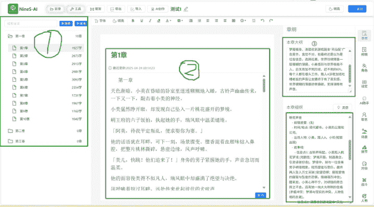
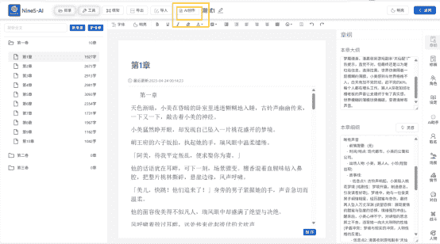
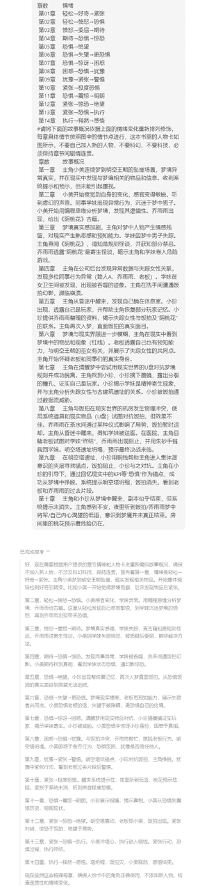
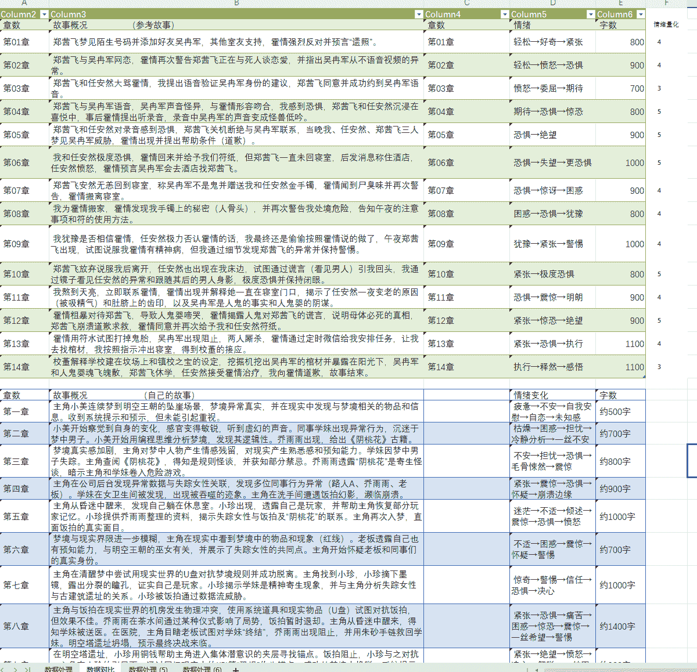
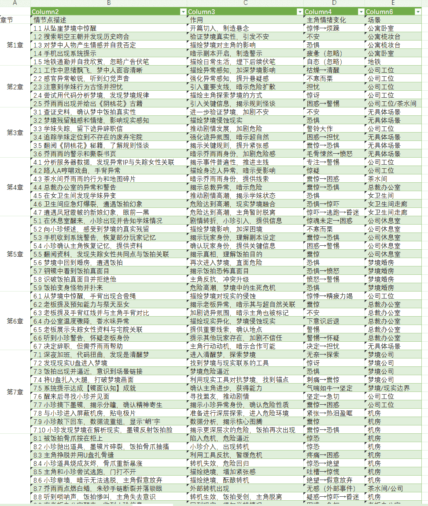
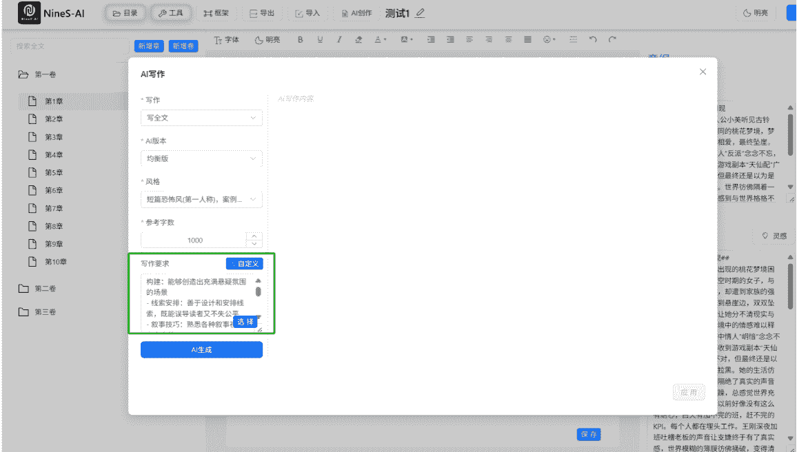
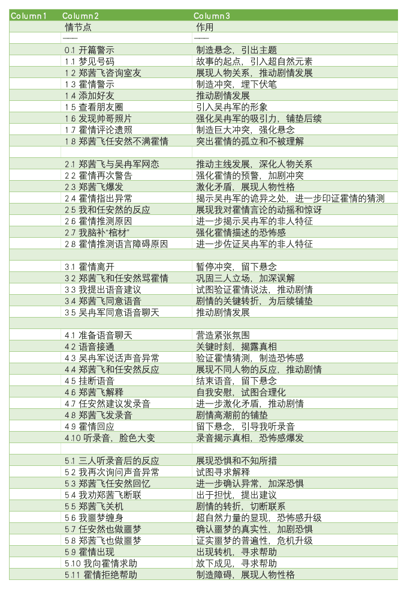

# Nines-养坏的废稿不要扔！还能抢救一下(by咕咕)

> 来源：[https://rq547mr4oez.feishu.cn/docx/JVyAdKRQ3oY6hPxl1xNcxV4OnBc](https://rq547mr4oez.feishu.cn/docx/JVyAdKRQ3oY6hPxl1xNcxV4OnBc)

# 老杨

> 咕咕这篇文档内容十分适合小白的实操。

> **同时，咕咕的优点就是，理解核心的思路，围绕以【情绪核心**】的机制拆出【情绪曲线】然后【仿写】~~

>

> 这个是目前网文创作的核心！

> [NineS AI实操-DeepSeek➕「换元法」让你灵感似尿崩](https://rq547mr4oez.feishu.cn/wiki/J0pNwmZiliR1SKkhmcQcYRCvnOD?from=from_copylink)时也是通过【换元法】的核心，见【 】

>

> **P**S：在啰嗦下，小白入门最快的方式就是【仿写】，方法就是【换元法】，厉害的基本上1~2周就能写出过稿的文章！

#  咕咕

> 前言：

1.  我是训练营里非常普通的学员，这是我的第一篇稿子，但因为我的例子存在很多新手都会有的误区，错误鲜明，因此被拎出来展示创作历程。

1.  在这个过程中，各位可以看看中白的思路，旁观者清，揪他人问题好揪，以人为镜，来看看自己是否也有这种思路。

1.  然后再去看杨教授之前的操作课，读书百遍，其异自现。

## **Part 1废稿的来时路**

1.  随便找本合眼缘的，选定《梦见陌生号码，不要联系》，之后简称为菜谱。

> Ps：当时还不在意“核心梗”的概念。

1.  将菜谱丢进小9，进行拆书：

1.  综合合并拆，章纲综合并拆，人设合并拆，节奏分开拆，细纲合并拆（这里我用的是自定义）。

1.  菜谱拆完了后，我知道它主要讲：**“核心梗:梦中得到的陌生号码引发与"**鬼“男友的纷争，涉及人鬼婴的诡异故事。”

>

> 然后，我就想起了之前的【热议话题】“做梦梦见帅哥？是阴桃花快跑”，

> 我就打算写这个主题（我当时把“核心梗“认为是”主题）。

1.  将这个**“梦见帅哥+阴桃花”**的核心梗扔进小九，选择“推理版”，进行头脑风暴。

> 最后推出“极简版故事概况”：

> 【小美和小珍是xx系统的任务者，被抹除记忆扔到了xx副本世界，两人都在梦里梦见帅哥，

> 最后发现帅哥不对劲，最后齐心协力，在各方帮助下打败boss，取得胜利。】

1.  用小9将“极简版故事梗概”完善，比如完善世界背景、人设、配角、场地。最后再根据这些完善的内容推出完整版“故事梗概”。

1.  在小9的“AI创作”板块，点击“新建项目”，填写上面出现的框框。

> **填写完后，就会跳转到这个页面**

1.  将你已经有的东西，发给右边的AI助手，要求它：

> 【**请**依据我给你的内容，生成故事情节，要求写出11章的故事情节，每章xx字，每次回答都请给出三个不同版本的内容】

>

> PS：其实操作是不对的，应该是用AI创作--生成正文

1.  选取你觉得满意的，AI助手给出的，故事情节，将它扔给小9，跟它说你要创作xx书，让它给你进行概况，再将故事概况扔给它，让它给你完善。

1.  将每章的故事情节放到图1中的“③”，点击图1中“④”旁边的“灵感”，将每章的故事情节用灵感完善。

1.  AI懂AI自己说的内容，所以得将内容让AI自己表达出来，再喂给它，当作指令。

1.  自己调整一下，或者导出整篇，再用AI修改。但是第一次结果被打回~~~

----------------------------------------------------------------------------------------------------------------------------------------------------------------------

## **Part 2 废稿的回锅再造**

> **第一次结果被打回~~~痛定思痛，再**次将训练营的课程认真观看。进行如下改进：

> **得**知了小九的正确用法，关键！！！私以为这才是小九作为写作创意专用AI的真正核心功能！KO全部其他ai的原因。

> **就是图2中的“AI创作”。**

图 2

> 前面框架，跟问卷调查一样填了那么多的内容，又是世界观、故事梗概、人设、文风，又是章纲、本章细纲。

> 这些内容都是为了“AI创作”服务，为了让它知道你到底想写个什么内容，是你给它戴的镣铐，它将戴着这个镣铐进行之后的创作。

> （推理版适合给灵感创意）。

>

> 第一篇存在的问题：【兰编说初稿总体的情绪不明显、繁琐、无冲突，且存在逻辑矛盾，以及需要重写导语】

### 解决方法：

1.  **将废稿扔给小9，进行拆解，主要拆出每章核心情节和情绪变化，放**到excell中。中间一一的核对【情绪】

1.  **找本跟废稿风格类似的短篇爆款书（菜谱）**进行拆书，拆情节、情绪、字数、场景转变。

> **以字数为x，情绪为y，excel画图分析情绪变化，直观地了解情节和情**节间的关系推出行文节奏，做到心里有数（现在可以在小九上形成情绪图了，真不错！）；

1.  拆出废稿的“章核心剧情”，按照“菜谱”的情绪变化修改，填进去，在excel里面处理会更容易。

1.  **也可以用大模型替代人工这步骤，因**为我想学习这类情绪变化，所以就自己填了。

1.  这里展示用大模型进行这步，大模型修改完的内容需要自己过一遍逻辑）；

1.  **看一遍形成的情节安排，能串起来，再重新在“AI创作”里完成问卷**调查（小九的框架），用AI创作生成正文。

1.  用不同文风都创作了一遍，多次抽卡，选喜欢的ssr，快速浏览选取。

1.  也可以选三个答案扔给大模型进行综合生成喜欢的，这个的前提是你有相处良久的大模型（喂过内容）。

1.  在生成内容的过程中，因为我重点关注废稿中，兰大批注强调的问题。所以我将兰大提出的建议，添加到了图3中的绿框中

> **如**

1.  **①不要老是描写观察环境**

1.  **②主角拥有超强第六感**

1.  ③对小珍、老板、xxx、xxx刻画多一些）。[任务外包达成]。

图 3

1.  对于生成的内容，再用图3中“AI写作”，选择“润色”。可以1-2章，2-3章，3-4章这样的顺序，将内容放进去进行润色。

1.  将润色完的内容，1k字以下的内容放进“AI助手”中，设定去ai味的提示词，焯水。

1.  **对生成的内容通读一边，人工再去**修稿【逻辑、ai味道、情绪、节奏】。锵锵！[音效声]，回炉再造的三等奖就出现啦！

## ** 3. 中场休息**

> 这里出于个人私心（我想打复活赛)，打一个小广告：

> **惊**！！某写作训练营临近结营，学员竟纷纷申请留级，留级率高达100%！杨教授扶额叹气，班班掩面苦笑，这居然是。。。

> **居然是因为——效果太好？？？！**

> 邀请人备注“咕咕”，让咱们做同学！

##  4. Part 3 总结

1.  都说拆书是为了积累故事素材、人设、故事节奏。

> 问题：上面扒的故事节奏得运用了才能记住，而且不写这个类型后很容易会忘记。

> 我个人觉得：拆书要有针对性的拆，拆书是为了学习完善自己薄弱项（经常被批注的地方），如果自己没有写过一本书，或者写了但是不知道存在的问题在哪里（训练营有批注），就没法去针对性的学习。

> 所以得先写一本书，再找批注，再拆书学习。

> **1**）最简单的操作，我觉得就找一篇自己很喜欢的书，你觉得有灵魂的，让你之后两三天都会回忆起情节和人物的，这种书最好；

> **2）用小9拆情绪曲线；**

> 3）然后回忆这本书的情节，回忆你觉得写得很好的地方，在曲线上标注；

> **4）模仿写这本书。我会感觉写出来的内容没有灵魂。然后我会倒**回去看这本书，找一找为什么会有”灵魂“。

> ** **

1.  **有****时候感觉自己剧情很单调，****想加一些虐点**和爽点，所以最近在多看，自己整理总结故事的内核、伏笔、梗，积累素材和好词好句，尤其是摘抄代入感强的片段，提升审美。

+   **这过程中找一本特别喜欢的书，多看几遍，在脑中想象画面，然后进行仿写，就是**不去自己创作剧情，而是回忆这本书的故事概况，用自己的话重复写出来，锻炼写作能力。

+   **在进行第二本书的仿写的时候，再结合第一本书的内容改变故事，结**合故事（我用手写时候思路特别快特别清晰）

###  附件：

[拆解处理.xlsx](https://internal-api-drive-stream.feishu.cn/space/api/box/stream/download/all/CGCcbpzkmokKKAxAKuycq6gzngh)