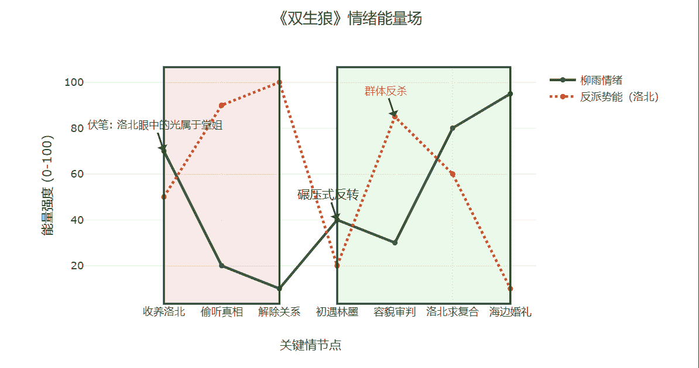
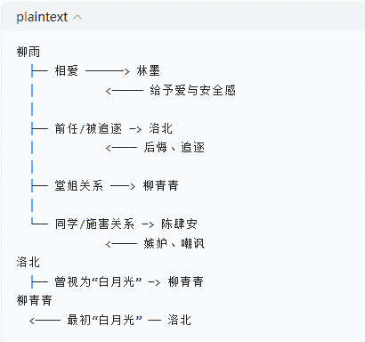
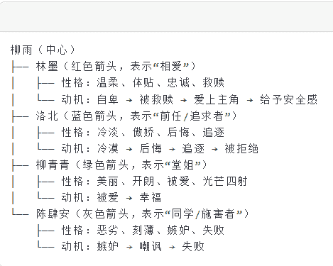

# NinesAI-AI拆书Pro升级「情绪曲线」分析

> 来源：[https://rq547mr4oez.feishu.cn/docx/Jw0kdGsFbofWQnxmTBlcw9tNnAg](https://rq547mr4oez.feishu.cn/docx/Jw0kdGsFbofWQnxmTBlcw9tNnAg)

# 一、前言

> 众所周知，网文有很多元素，如期待感、节奏、基调、主线、卖点、结构、爽点、文笔、人设、金手指、代入感等等。

> 但，抛开这些眼花缭乱的元素，扪心自问：网文，最本质的的究竟是啥？——【情绪】。所有文学的技巧，最后的目的都是为了【传递情绪】。

>

> 之前也讲过《[AI写小说-愤怒的香蕉-以情绪为核心](https://rq547mr4oez.feishu.cn/wiki/NLKcwfCdPiSOGdkYMgJcu3aonUc?from=from_copylink)》**，所以此**次AI**拆书的升**级就是为了增加【情绪曲线】和【人物关系】！

**PS：NineS AI【****AI知识库+AI**产品+投稿渠道+干货交流=全链路】的创作者社群~


# 二、上结果（NinesAI拆书-综合）

### 故事梗概

```
====
#  故事梗概
##  一、基本信息
1. 选题: 容貌焦虑女孩被救赎，与小狐狸兽人相爱
2. 题材: 都市、言情、兽人
3. 类型: 治愈、救赎
4. 字数: 10716
5. 期待感: 丑小鸭柳雨在经历了容貌歧视和情感挫折后，能否被同样经历过伤痛的小狐狸兽人林墨治愈，收获真爱与自信？通过两人互相救赎，最终走向幸福。
```

> 整篇故事的基本信息：一句话故事，题材标签的分类，字数和核心期待感！

### 故事设定

```
##  二、故事设定
1. 背景设定: 现代都市，人类与兽人共存的世界，社会中存在一定的容貌歧视现象。
2. 主角: 
    - 柳雨：圆脸、皮肤暗淡的大学讲师，性格自卑、善良、坚韧，渴望被爱。
    - 主角七步法
      - 目标：摆脱容貌焦虑，寻找真爱，获得幸福。
      - 阻碍：自身容貌的不足，原生家庭的伤害，前任兽人洛北的冷漠，社会上的容貌歧视。
      - 行动：收养小狐狸兽人林墨，努力工作，尝试改变自己，直面过去的伤痛。
      - 结果：逐渐被林墨治愈，重拾自信，收获真爱，与过去和解。
      - 意外：前任洛北的突然回头，原生家庭的再次伤害。
      - 转折：选择林墨，与洛北彻底告别，原谅母亲，与父亲决裂。
      - 结局：与林墨结婚，收获幸福，实现自我价值。
3. 配角: 
    - 林墨：小狐狸兽人，容貌俊美，性格善良、温柔、体贴，经历过被主人抛弃和毁容的痛苦。与柳雨互相救赎，给予她爱和安全感。
    - 洛北：双生狼兽人，外貌英俊，性格冷淡、傲娇，曾因柳雨的外貌而嫌弃她，后发现自己真正喜欢的是柳雨。
    - 柳青青：柳雨的堂姐，外貌美丽，性格开朗，是洛北最初的“白月光”。
    - 陈肆安：柳雨的同学，性格恶劣，曾因柳雨的外貌而嘲讽她。
4. 核心梗: 
    - 兽人：拥有部分兽类特征的人类，在故事中作为情感依附和治愈的角色。
    - 容貌焦虑：主角因外貌而产生的自卑和不安，是故事的核心冲突之一。
    - 互相救赎：主角和林墨都曾经历过伤痛，通过彼此的爱和陪伴，逐渐走出阴影。
5. 核心内容: 
    - 危机: 柳雨的容貌焦虑，洛北的冷漠，陈肆安的嘲讽，母亲的去世。
    - 伏笔: 洛北对柳青青的感情，柳雨对林墨的收养，林墨被毁容的经历。
    - 悬念: 柳雨能否摆脱容貌焦虑，洛北是否会回头，柳雨最终会选择谁。
    - 爽点: 林墨的治愈，柳雨的反击，陈肆安的失败，林墨的求婚。
```

> 故事的基础设定和人物概况！

> **同时注意：【结构七步法：目标——阻碍——**努力——结果——意外——转折——结局】：

1.  【主角的目的（目标）或者欲望是什么？】

+   网文小说开篇很重要的一个任务就是展示或者引出主角的目的（目标）。

+   主角有目标，读者才有期待，通过目标营造期待感是吸引读者追读的重要写作技巧之一。

1.  【主角想要实现自己的目标，遭遇到什么阻力或者处于什么困境中？】

+   能够轻易达成的目标不是好目标（除非是无敌流或者迪化流），主角克服阻碍与困境是最吸引读者的看点之一。

+   主角遇到的阻碍，一般分为两大类：

+   （1）内外阻碍，比如心魔、自身缺陷、性格弱点等；

+   （2）外在阻碍，比如反派的作妖。

+   装逼打脸与打怪升级之所以吸引读者，使读者觉得爽，就是因为主角用行动证明他的成长与努力，是养成与收获的爽感。

1.  **【主角如何克服阻碍与困境？】**

+   这个问题，一般是两种方式：一是主角依靠自身的才智与能力；二是借助外力或者外援。

+   简而言之，就是使用金手指。这个金手指可以是主角的特殊能力或聪明才智，也可以是系统、戒指里的老爷爷等。

1.  【主角努力（行动）后是什么结果？】

+   一般而言，主角的行动不会一下子彻底解决掉问题或者困境，而且引出一系列的问题或者影响，否则，小说不就完结了吗？

+   最常见的套路是打了小的出来老的，打赢了小炮灰，却新出了大家族，灭了小反派又冒出个大反派。

1.  **【主角遇到了什么意外？】**

+   无巧不成书，主角总是遇到各种意外，比如：摔下悬崖，却捡到了功法秘籍；英雄救美，结果却被当成采花大盗……

+   读者期待的就是各种意料之外的惊喜，当然，必须符合逻辑，即【意料之外，情理之中】

1.  【主角如何应对意外情况与全新的挑战？故事会如何发展？是否有反转？】

+   所有的小说，最精彩的部分、最吸引读者的部分就是转折/反转，因此，这部分也是故事的高潮。

+   根据故事的反转与高潮【逆推】是构思故事大纲与剧情的好方法，强烈推荐。

1.  【主角最后是胜利还是失败，故事的结局是什么样的？】

+   主角实现了目标，那么，这是个圆满的喜剧故事；

+   主角没有实现目标，那么，这是一个悲剧故事；

### 故事脉络

```
##  三、故事脉络
1. 核心冲突: 柳雨与自身的容貌焦虑作斗争，寻找真爱与自我认同。
2. 情感纽带: 
    - 柳雨与林墨之间的互相救赎的爱情。
    - 柳雨对洛北的单恋与失望。
    - 柳雨与原生家庭的矛盾与和解。
3. 故事反转: 
    - 洛北突然回头，表明自己喜欢的是柳雨。
    - 柳雨的母亲临终前向她道歉。
4. 二次反转: 
    - 柳雨最终选择林墨，与洛北彻底告别。
    - 柳雨与父亲决裂，彻底摆脱原生家庭的阴影。
5. 整体节奏: 
    - [1 柳雨听到洛北的真心话，多年走钢丝一般的情绪轰然坠地] [虐点] [绝望]
    - [2 柳雨回忆学生时代被嘲讽的经历，更加自卑] [虐点] [自卑]
    - [3 柳雨决定放手，与洛北解除收养关系] [转折点] [释然]
    - [4 柳雨收养林墨，开始新的生活] [转折点] [希望]
    - [5 林墨的出现温暖了柳雨，两人互相治愈] [爽点] [温馨]
    - [6 洛北回头，希望与柳雨复合] [转折点] [纠结]
    - [7 柳雨拒绝洛北，选择林墨] [爽点] [坚定]
    - [8 柳雨与原生家庭和解，又彻底决裂] [转折点] [复杂]
    - [9 林墨向柳雨求婚，两人幸福相守] [爽点] [幸福]
6. 写作风格: 温馨、治愈、现实
```

> 故事线的基础内容，反转or二次反转在哪里！

### 情绪变化与情节折线表

```
##  四、 情绪变化与情节折线表

| 序号| 情节（最小单元）                      | 字数  | 剧情推动（爽点/虐点/转折点）           | 情绪变化       |
|----|--------------------------------------|-------|-------------------------------------|---------------|
| 1  | 洛北说出喜欢堂姐，厌恶主角               | 200   | 虐点                            | 震惊-悲伤-绝望    |
| 2  | 主角回忆学生时代被嘲讽的经历，自卑情绪爆发 | 700   | 虐点                            | 自卑-痛苦        |
| 3  | 主角与洛北解除关系，决定离开             | 700   | 转折点                           | 释然-悲伤        |
| 4  | 主角收养林墨，开始新的生活               | 600   | 转折点                           | 希望-温暖        |
| 5  | 主角得知林墨曾被虐待，心疼不已            | 400   | 虐点                            | 心疼-怜悯        |
| 6  | 主角为林墨治疗，两人关系更进一步          | 800   | 爽点                            | 感动-温暖-甜蜜    |
| 7  | 陈肆安再次嘲讽主角，林墨为主角出头        | 900   | 爽点                            | 愤怒-感动-感激    |
| 8  | 主角与林墨确定关系，互相表白              | 500   | 爽点                            | 幸福-甜蜜        |
| 9  | 洛北回头，希望与主角复合                 | 800   | 转折点                           | 惊讶-纠结-厌恶   |
| 10 | 主角拒绝洛北，选择林墨                   | 600   | 爽点                             | 坚定-释然        |
| 11 | 母亲去世，主角与原生家庭和解又决裂        | 900   | 转折点                           | 复杂-悲伤-释然    |
| 12 | 林墨向主角求婚，两人幸福相守             | 416   | 爽点                             | 幸福-感动-圆满    |
```

> **重中之重：非常关键的情节信息！同时情绪的爽点**、虐点、转折点在哪里，如何引导情绪的拉扯

```
# 将以下情节折线表做一个html可视化的图表 
##  四、 情绪变化与情节折线表

| 序号| 情节（最小单元）                      | 字数  | 剧情推动（爽点/虐点/转折点）           | 情绪变化       |
|----|--------------------------------------|-------|-------------------------------------|---------------|
| 1  | 洛北说出喜欢堂姐，厌恶主角               | 200   | 虐点                            | 震惊-悲伤-绝望    |
| 2  | 主角回忆学生时代被嘲讽的经历，自卑情绪爆发 | 700   | 虐点                            | 自卑-痛苦        |
| 3  | 主角与洛北解除关系，决定离开             | 700   | 转折点                           | 释然-悲伤        |
| 4  | 主角收养林墨，开始新的生活               | 600   | 转折点                           | 希望-温暖        |
| 5  | 主角得知林墨曾被虐待，心疼不已            | 400   | 虐点                            | 心疼-怜悯        |
| 6  | 主角为林墨治疗，两人关系更进一步          | 800   | 爽点                            | 感动-温暖-甜蜜    |
| 7  | 陈肆安再次嘲讽主角，林墨为主角出头        | 900   | 爽点                            | 愤怒-感动-感激    |
| 8  | 主角与林墨确定关系，互相表白              | 500   | 爽点                            | 幸福-甜蜜        |
| 9  | 洛北回头，希望与主角复合                 | 800   | 转折点                           | 惊讶-纠结-厌恶   |
| 10 | 主角拒绝洛北，选择林墨                   | 600   | 爽点                             | 坚定-释然        |
| 11 | 母亲去世，主角与原生家庭和解又决裂        | 900   | 转折点                           | 复杂-悲伤-释然    |
| 12 | 林墨向主角求婚，两人幸福相守             | 416   | 爽点                             | 幸福-感动-圆满    |
```



> **PS：这个需要通过AI，将情绪曲线改成html的代码，有经**验的小伙伴可以试试！可以更加只管和清晰！

### 主要人物性格与关系梳理

```
## 五、主要人物性格与关系梳理

| 人物       | 性格关键词                | 关系                  | 情绪变化与动机                         |
|-----------|--------------------------|------------------------|--------------------------------------|
| 柳雨       | 自卑、善良、坚韧、成长     | 主角/叙述者            | 自卑-渴望被爱-被治愈-重拾自信-收获幸福    |
| 林墨       | 温柔、体贴、忠诚、救赎     | 与主角相爱             | 自卑-被救赎-爱上主角-给予主角爱与安全感   |
| 洛北       | 冷淡、傲娇、后悔、追逐     | 前任/追求者            | 冷漠-后悔-追逐-被拒绝                   |
| 柳青青     | 美丽、开朗、被爱、光芒四射  | 堂姐/洛北最初的“白月光” | 被爱-幸福                              |
| 陈肆安     | 恶劣、刻薄、嫉妒、失败      | 同学/施害者           | 嫉妒-嘲讽-失败                          |
```





> 人物之间的关系和内容！关键性格和整个正文小说中情绪的变化！

> PS：图表的内容只是重新用AI制作，可有可无，只是更好的了解这个关系！

### 起承转合结构梳理

```
## 六、起承转合结构梳理
1. 起（约1/4）：具体内容分析：
   - 柳雨听到洛北的真心话，发现自己多年的付出只是感动了自己。情绪崩溃，回忆起从小到大因为外貌受到的伤害。
2. 承（约1/4-2/4）：具体内容分析：
   - 柳雨决定放手，与洛北解除收养关系，离开伤心地。新的城市，新的工作，柳雨收养了同样经历过伤痛的小狐狸兽人林墨。
3. 转（2/4-3/4）：具体内容分析：
   - 林墨的出现温暖了柳雨，两人互相治愈，关系逐渐亲密。
   - 柳雨帮助林墨恢复容貌，林墨也给予柳雨爱和安全感。陈肆安再次出现嘲讽柳雨，林墨为她出头。
4. 合（约3/4-全文结束）：具体内容分析：
   - 柳雨和林墨确定恋爱关系，洛北突然回头希望复合，但柳雨拒绝了他。
   - 母亲去世，柳雨与原生家庭和解又决裂。林墨向柳雨求婚，两人幸福相守。
   - 柳雨最终摆脱了容貌焦虑，找到了真爱，实现了自我价值。
====
```

> 全文基本的故事架构和占比，更好的分析结构！