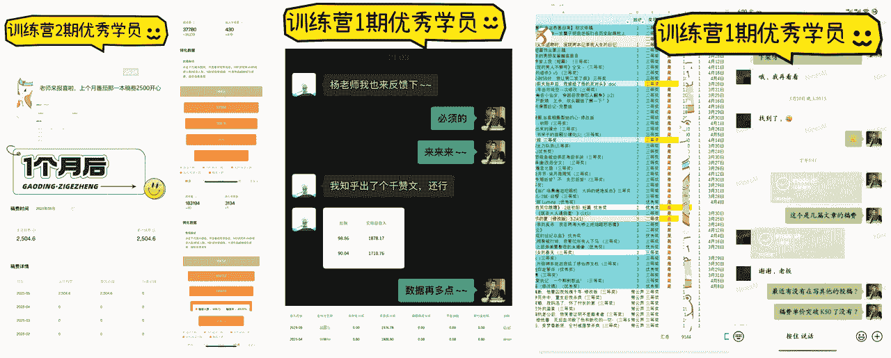
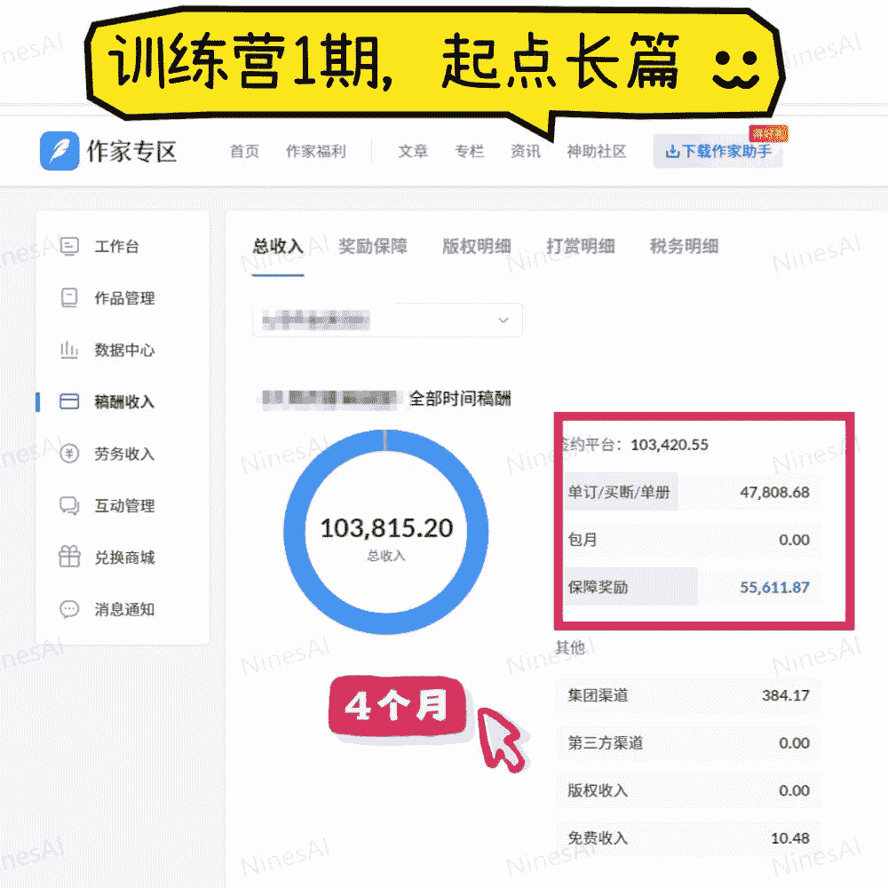
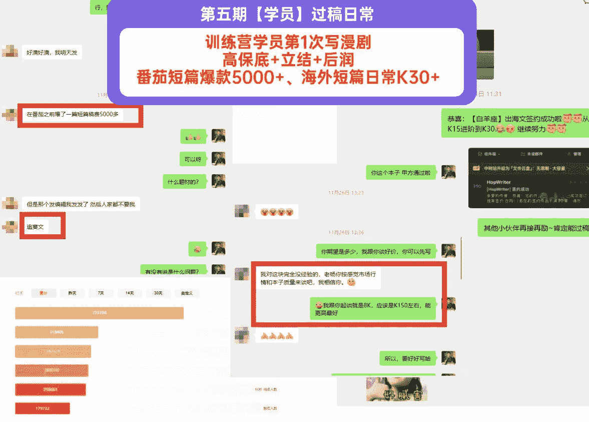
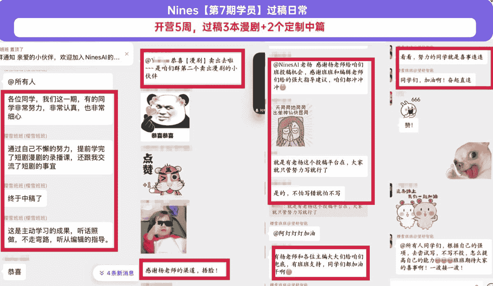
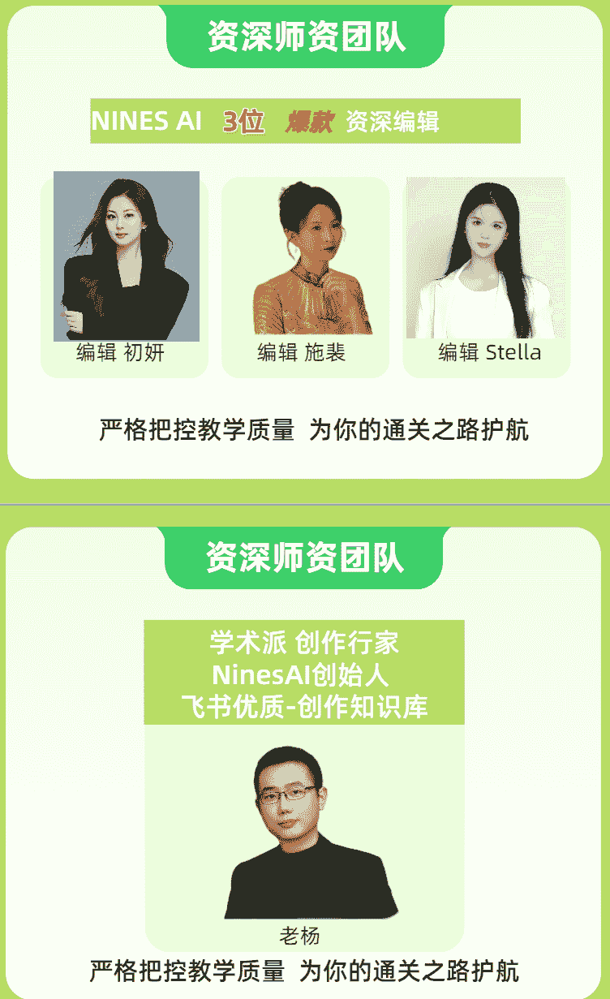

# NinesAI-全能创作人-训练营v5.1

> 来源：[https://rq547mr4oez.feishu.cn/docx/HS7Od0mM6oQy52x0tUNcZzhvnYc](https://rq547mr4oez.feishu.cn/docx/HS7Od0mM6oQy52x0tUNcZzhvnYc)

# 第八期正式开始招募啦（3.6--3.26）

# 一、训练营目标

> ✅ **结果导向****：90天让学员产出【短**篇】可投稿签约成功有稿费（没有达到可免费复学），指导中长篇和剧本，优秀者有长约！

> ✅ **新人目标**：90天让你【**短篇/中长篇/剧本/AI**】全部入门，并拿到稿费！

# 二、一些心里话

> 本来只想做**【****AI创作知识库+**AI产品+投稿渠道+干货交流=全链路】的创作者社群，奈何太多小伙伴让我们去办训练营！囧

> 一开始是拒绝的，因为我自己被割过很多次，知道【知识付费如果没有结果就是割韭菜！】

>

> 我们太懂这种感受了 —— 毕竟社群里没人没踩过这种坑！

# 三、第1-7期当前真实结果（未完全统计）

> **第1~7期学员突破346+人！开营**至今（3.18-12.30）成果全公开：

> **📖 短篇成果：**

+   ✅ 累计收稿1100+篇（外部平台投稿超700+），经我们编辑1v1指导，成功过稿405+篇，过稿率超过34%！

+   ✅ 过稿平台覆盖：知乎、黑岩、Nines、番茄 等（附真实截图凭证），75%为零基础学员首篇作品！

+   稿费成果亮眼：
✅ 第1-5期学员中，已有人稳定月入3000+，单人单平台收入即破千（仅小九平台统计）
✅ 近30%学员短篇累计稿费突破5万，其中有知乎千赞文收益6000+，番茄爆款4000+(见图2)
✅ 第3期开营2个月，已过稿29篇，预计稿费5000+，10%学员稿费已超K45(见图3)
✅ 第4期开营2周，迅速过稿6篇，合作平台单价上涨(见图4)

✅ 第7期刚开营5周，结果还在统计中~

> **🎬 短剧/漫剧实战：**

+   ✅ 第1-6期共提交作业225篇，并有过稿漫剧/短剧53本（K200+）~~

+   ✅** 第7期（**开营5周）过稿漫剧2本(见图5)

> **📚 长篇突破：**

+   ✅ 第1-5期共完成55篇长篇作业，已有15篇成功签约起点/七猫！（番茄的不算）

+   ✅ 海外平Goodnovel、亚马逊等，签约4篇（K70+）

+   ✅ 最高爆款长篇10w收益(见图1)

>

> **PS：只要你自己有时间，我们都会**指导你短篇写到过稿！长篇签约，短剧入门~

## 部分讨论截图（真实好评很多就不一一展示）

# 四、全能创作者-训练营【核心优势】

1.  全套体系化完整闭环（学-练-改-投）

+   学-练-改-投完整闭环，全流程覆盖，从小白到签约作者一步步带你走通所有流程！

+   第 1-6 期 346 +名学员已经用结果说话：75% 零基础学员首篇过稿，有人 3 个月从 0 到月入 2000+，总稿费最高的学员已经拿了20144 元（仅小九合作统计）！

1.  **豪华导师阵容（3+1）**

1.  **初妍**

+   深耕网文行业 10 年，年薪100w作者。以男频、悬疑为核心擅长领域，兼修女频创作，双赛道功底扎实。

+   8 年 + 资深审稿人、职业写手，年均审核入库作品 300 + 部、累计 20 亿字，独创 “节奏 - 人设 - 爽点” 三维评估体系，经手成品签约率提升 25%

1.  **施裴**

+   晋江签约作者 + 上市公司短剧 / 漫剧制作人，跨载体（小说 / 短剧 / 漫剧）爆款编剧。

+   手握《After Divorce: My Five Brothers Paved My Way to the Billionaire Throne》等海内外爆款，多赛道创作实力拉满。

+   剧本审稿编辑，年均审核作品入库剧本200+部

1.  **Stella**

+   深耕商业文案领域写作7年，百强名企品牌文案写手

+   5年+自由写手，番茄，起点，七猫，海外畅读签约作者，以女频大女主向为核心擅长领域，兼修男频漫剧赛道。

+   3年+国学/民俗内容向审稿人，年均审核作品入库小说平台100+部

1.  **老杨**

+   NinesAI创始人，10年资深程序员，5年自由写手，起点/GoodNovel签约作者

+   国内外自有渠道主理人，资深企业AI讲师

+   剧本审稿编辑，年均审核作品入库剧本&小说500+部

1.  独家课程：90+小时高密度（理论+实操）

+   【AI基础 + 短篇 + 剧本 + 中长篇】四大模块，33+节录播+14节直播（90+小时），干货满满，全程可回看。

+   不定期直播加餐：训练营优秀学员分享经验（2场）等

1.  **NinesAI自有AI产品赋能**

+   https://novel.nines-ai.com/dist/

+   AI拆书/创作/提示词/助手四大功能，帮你10倍提升创作效率，报名即送400万字额度。

+   提示词市场，满足你每个创作环节的要求！

1.  **专业编辑团队批改**

+   编辑团队，亲自带教，【精批】改到过稿为止。

1.  **自有收稿渠道（自有工作室）**

+   [Nines工作室-长期招募公告2026](https://rq547mr4oez.feishu.cn/wiki/U3CBwtauhiY029ko0RrczCLcn9d)

+   包括Nines自有渠道（国内+海外自有小程序，2月份上线）

+   合作平台：海外平台（GoodNovel/Volcano等）+国内短篇（知乎/番茄/黑岩/UC/网易等）+剧本（点众/咪咕/制作方等）

+   专业编辑带队接单，爆款规律同步分享。

1.  **完善售后**

+   课程结果：保证卖出去2篇短篇稿件，优秀学员并邀请签约平台

+   售后承诺：除非自己原因放弃，90 天内未变现可免费复训

+   奖金计划：开课起6个月内，任意一月稿费收益过万，额外获得3000元现金奖励!并邀请加入助教or签约平台

+   退出机制：超过7天未完成打卡学员，将启动退费淘汰机制（会扣取相对应已消费的费用）

# 五、课程体系设计（60天集训+30天陪跑+结果导向）

## [课程体系设计](https://rq547mr4oez.feishu.cn/wiki/CVoGwXN3niAfbrkkFZkctfn5nWd?from=from_copylink)**(点**** ****击查看)**

# 六**、产品价格**

1.  **价格阶梯**

1.  **售后机制**

+   参与机制：

+   入学筛选

+   售后承诺：

+   除非自己原因放弃，90 天内未变现可免费复训！

+   退出机制

+   目的：保证毕业班的毕业水平，提高口碑

+   机制：超过7天未完成打卡学员，将启动退费淘汰机制（会扣取相对应已消费的费用）