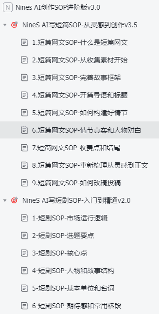
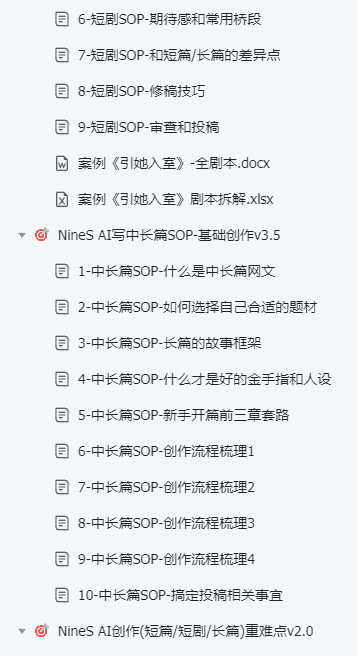
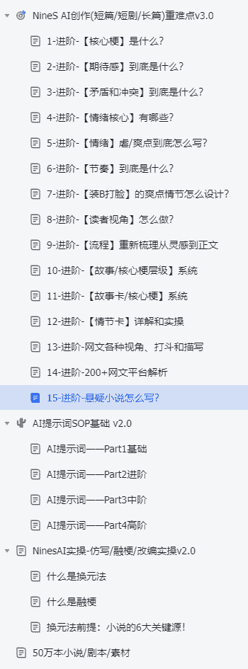

# 创作【进阶】SOP知识库v3.0

> 来源：[https://rq547mr4oez.feishu.cn/docx/K2PadDxVfoEqdPxj3accCEIInwe](https://rq547mr4oez.feishu.cn/docx/K2PadDxVfoEqdPxj3accCEIInwe)

# 一些话说在前头：

> **这个进阶知识库，前前后后梳理和优化已经快一年（还在产**品之前），一直是当成【年卡】用户的福利。

> 在没有训练营之前，这个都是很多小伙伴入门的教程，并且都取得了很好的成绩~~

> 有一些经验的小伙伴，自己能够自学，所以咨询是否单独售卖~

>

> so，作为福利博主，听人劝，吃饱饭。

# **进阶知识库v3.0介绍**

#### **你能获得什么？**

1.  **【体系化SOP，告别野路子】**

+   **短篇SOP v3.5：** 从一个灵感闪念，到一篇结构完整、引人入胜的短篇，我们用标准流程带你走通全程，稳定输出爆款。

+   **短剧SOP v2.0：** 掌握流量密码！从人设、剧情钩子到黄金三分钟，手把手教你打造分钟级爽点，让观众欲罢不能。

+   **中长篇SOP v3.0：** 帮你搭建宏大世界观和复杂人物关系，让你的长篇创作有骨有肉，不再“写着写着就崩了”。

>

1.  **【攻克核心关键点】**

+   独家拆解【节奏/情绪/矛盾/期待感/爽/虐/故事卡系统】等关键难点！让你精准理解写作的真相，快速入门。这部分内容，是区别业余与专业的“分水岭”。

+   提示词SOP基础： 告别“念经式”的无效Prompt，学会结构化、高情商地与AI对话，让它心甘情愿为你输出高质量内容。

+   N**inesAI实操v2.**0： 绝非基础操作！我们将带你手把手，实战演练【洗稿、仿写、融梗、改编】技巧，合法、高效地“AI工具”，创作出独具风格的作品。

#### **为什么选择？**

+   **历经实战检验：** 所有SOP和技巧均来自社群创作实践与用户反馈，v3.0代表当前最优解。

+   **深度 > 广度：** 不搞概念堆砌，刀刀见血，直戳创作中最痛、最难、最影响作品生死的核心环节（节奏、情绪、矛盾、期待感）

+   **操作性强：**

+   提供清晰到每一步的流程、即套即用的模板、一看就懂的实战案例。

+   今天学，明天就能用在你的创作中，效率翻倍，质量飙升！

+   **投资回报率高：**

+   一次投入，终身受益： 掌握这套系统化方法，未来所有创作项目都将受益。

+   效率就是金钱： 大幅缩短创作周期，让你在同样时间内产出更多、更优质的内容。

#### 适合谁？

+   已尝试免费知识库，渴望更系统、更深入学习AI创作的你。

+   在短剧、短篇或长篇创作中遇到瓶颈（节奏、情绪、矛盾等）亟待突破的你。

+   希望大幅提升创作效率与作品专业度，打造更具竞争力内容的你。

+   想高效利用NinesAI等工具进行仿写、融梗、改编，快速产出优质内容的你。

# 知识库内容说明

> 【免费库】 vs 【进阶库v3.0】

+   免费库教你“怎么用”，进阶库教你怎么赢。

+   免费库给你“鱼”，进阶库给你“渔”。

+   免费库让你“入门”，进阶库让你“入行”并成为“内行”。

> **【进阶库v3.0】：【50+篇】高质量的独家入门+进阶教程，覆**盖“短篇/长篇/短剧/AI基础”，四大类

+   当别人还在用AI“碰运气”时，你已经拥有了一套成熟的、可复制的“爆款”。

# 限时价格

# 付款方式

> **📢购买方式：**

+   立刻联系专属客服 ，告知客服你要购买 【进阶】SOP知识库v3.0。

+   确认订单信息并完成支付。

+   支付成功后，客服将在最快时间内发送知识库资料！

> **📢 重要提醒：**

+   本知识库为虚拟数字产品，凝结大量独家经验和心血。

+   下单前请务必确认需求，购买成功后恕不接受退款。

+   名额/优惠可能有限，先到先得！犹豫就会错过提升的最佳时机！