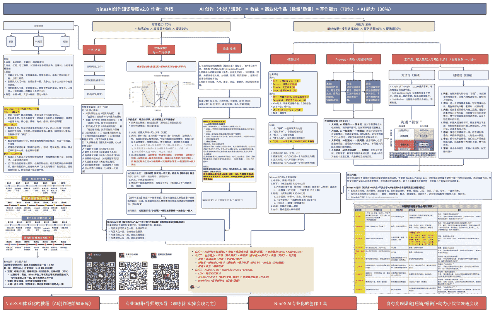

# 老杨的AIGC创作-知识库v3.6

> 来源：[https://rq547mr4oez.feishu.cn/docx/MZEhd9i15oeFEdxifmScV8JrnWc](https://rq547mr4oez.feishu.cn/docx/MZEhd9i15oeFEdxifmScV8JrnWc)

# 一、概述

> 🎈大家好我是老杨😎，欢迎来到老杨的AI创作作知识库。

> **💪N****inesAI【AI知识库+AI产品+投稿**渠道+干货交流=全链路】的创作者社群~

> PS：飞书有关键词搜索，文章找不到，就搜索【关键词】！

# 二、NinesAI**产品(****完整“创作”全流程工作流****)**

+   **产品地址：****https://novel**.nines-ai.com/dist/（使用谷歌or微软浏览器）

+   没有邀请码可以不填，注册完成后点击左下方输入兑换码兑换

+   **使用说明：**[NineS-AI使用说明&教程v2.7](https://rq547mr4oez.feishu.cn/wiki/JExnwkATziBDrjkJ3E9cfgdqnxe?from=from_copylink)（新人一定要去看，否则写出来的内容就会很差）

+   **😏完整“创作”AI工作流（**从拆书--灵感--框架--章纲--细纲--正文--润色--修稿）

+   福利：注册+社群，一共送6万字数（群公告），私聊老杨额外赠送3万字数~

# 三、NinesAI创作(短篇/长篇/短剧/漫剧)知识库

### 完整NinesAI创作知识导图v2.0老杨 （创作公式）

[NinesAI创作知识导图v2.0老杨 .pdf](https://internal-api-drive-stream.feishu.cn/space/api/box/stream/download/all/NDrZbgt7bo6ZhLxbunEcLC2Hnvd)

## **一、基础认知篇（必读15+篇）**

> 目标：建立正确AI创作观，掌握核心概念

> **优先级：**⭐⭐⭐⭐⭐

> **关键点：**

> **AI创作，不是AI直接跟你写，不**是！不是！不要被其他的自媒体宣传给误导！

> 创作能力为主、AI辅助你完成，极大的提高效率！

### 新手入门必看

> [AI写小说-新手的5个段位和进阶详解](https://rq547mr4oez.feishu.cn/wiki/TjLkwdb6Kidkq5k8E3UcOSAynOf)

> [AI写小说-网文和AI提示词基础知识大全](https://rq547mr4oez.feishu.cn/wiki/TsShwKmo7ierrJkVWM6csF5MnRe?from=from_copylink)（基础中的基础）

> [NinesAI-提示词（Prompt）入门](https://rq547mr4oez.feishu.cn/wiki/GnLNwUiWYiKPlOkwqZ8cp6mjn2g?from=from_copylink)

> [AI写小说-PUA他能得到更好结果(完整Prompt)](https://rq547mr4oez.feishu.cn/wiki/STQpwihyviHw4OkcXHIcgvZAn9b)

> [NineS AI-长篇/短篇/短剧新人如何开始？](https://rq547mr4oez.feishu.cn/wiki/Bc8gwj9XuijYKiklTp8coBbDn4e?from=from_copylink)（给迷茫的小白解答）

> [「保姆级」新人短篇是投三方/知乎/番茄详解](https://rq547mr4oez.feishu.cn/wiki/RDRpwNg19idkItkLpwlckQpKnrr?from=from_copylink)

> [AI拆小说-全网最全指南（底层思路+pormpt）](https://rq547mr4oez.feishu.cn/wiki/OMY9woSQWiD3ZEkZf5ncJYCFnff?from=from_copylink)

### 创作认知升级

> [NinesAI-别让AI背锅了，编辑拒稿真相!](https://rq547mr4oez.feishu.cn/wiki/X2SZws2udi3ronkyBsrcJOw5n4e?from=from_copylink)

> [AI写小说-愤怒的香蕉-以情绪为核心](https://rq547mr4oez.feishu.cn/wiki/NLKcwfCdPiSOGdkYMgJcu3aonUc?from=from_copylink)

> [NinesAI-短剧编剧香吗？(万字大揭秘)](https://rq547mr4oez.feishu.cn/wiki/EkhywMGaoiATaBkdbEEcegsCndd?from=from_copylink)

> [NinesAI-《大奉打更人》作者亲授万字秘籍（长文预警）](https://rq547mr4oez.feishu.cn/wiki/F3WAwjrVEi3mn4kynHVcMqegnSe?from=from_copylink)

> [80%新人作者易犯的错误（含改进办法和提示词）](https://rq547mr4oez.feishu.cn/wiki/Ipa9wIhHWisR57k5tDkcbSY1nKg?from=from_copylink)

> [海外网文「赚美刀」喂饭级~万字攻略(上)](https://rq547mr4oez.feishu.cn/wiki/JmV0wrj5Gi6aqXkkJkacoKrPnXc)

> [海外网文「赚美刀」喂饭级~万字攻略(下) ](https://rq547mr4oez.feishu.cn/wiki/YGeCw9H0BiZLoRkqDQnchHiKnBc?from=from_copylink)

> [💡 互动小说：短篇新人转型做到单篇5万+？](https://rq547mr4oez.feishu.cn/wiki/MNmYwQsVMiQNl5kuRFvc9mMsnoc?from=from_copylink)

## 二、核心能力篇（重点突破50+篇）

> 目标：掌握写作基础、故事架构、去AI味、高效创作技巧

> **优先级：⭐⭐⭐⭐**

### **【写作基础】**

> [Nines写作宝典-【写作基础】小说标点和词性详解](https://rq547mr4oez.feishu.cn/wiki/VJJaweNiziLQ8Ck3iemceSUvnZO?from=from_copylink)

> [Nines写作宝典-【写作基础】小说de句式结构](https://rq547mr4oez.feishu.cn/wiki/N6Nmw9KoPilO51k1R8BcgMAdn3c?from=from_copylink)

> [Nines写作宝典-【写作基础】爆款50种主角性格](https://rq547mr4oez.feishu.cn/wiki/NQvnwd4eSicZuYkjHw2cGTmGnXc?from=from_copylink)

> [Nines写作宝典-【写作基础】爆款72种主角设定](https://rq547mr4oez.feishu.cn/wiki/XHQMwFk5FiFdx3kRbsHc0ftcnMc)

> [Nines写作宝典-【写作基础】人物三字经](https://rq547mr4oez.feishu.cn/wiki/Uc4bwaQwNilWFfkUdJucCKSEnEh?from=from_copylink)

> [Nines写作宝典-短剧剧本规范(无废话)v1.2](https://rq547mr4oez.feishu.cn/wiki/RXrWwn0zRiUyNwkW8k9crixjnNe?from=from_copylink)（韭菜Y日记）

> [Nines写作宝典-【新手必看】编辑到底怎么看AI味？](https://rq547mr4oez.feishu.cn/wiki/IbfZwlQcviuiBFkd1hUc5JZgnRf?from=from_copylink)

> 持续补全.....

### **【故事结构】**

1.  [Nines写作宝典-【故事结构】许荣哲七步法详解](https://rq547mr4oez.feishu.cn/wiki/USQhwDUehias29k6BHXcTNyQn7b?from=from_copylink)**（非常重要的短篇思路）**

1.  [Nines写作宝典-【故事结构】短篇三幕式实操详解](https://rq547mr4oez.feishu.cn/wiki/CyiOwYsbJiWuSqkPaAMcu5MHnjg?from=from_copylink)

1.  [Nines写作宝典-有手就会写网文【七步循环法】实操](https://rq547mr4oez.feishu.cn/wiki/JtsuwuffgiTqo3kFVD2cSTcUnrg?from=from_copylink)**（简单实用，长篇的架构）**

1.  [NinesAI-从热点到短篇：四步创作法](https://rq547mr4oez.feishu.cn/wiki/GhT7wPS93iBDsSkljNScGQqsncd?from=from_copylink)

1.  [Nines写作宝典-【救猫咪15节拍】爆款短剧结构详解](https://rq547mr4oez.feishu.cn/wiki/SMYswDGvjifdxhkhumBc2BfRnJh?from=from_copylink)

1.  持续补全.....

### **【情节卡素材】**

> [Nines写作宝典-【情节卡】常用20条“虐”点详解](https://rq547mr4oez.feishu.cn/wiki/Eb4hwXBz5i5HF6k0i05cAHFgnag?from=from_copylink)

> [Nines写作宝典-【情节卡】常用20类“爽”点详解](https://rq547mr4oez.feishu.cn/wiki/W72sw7xAuigBxlkHHUOc7lr7nZd?from=from_copylink)

> [Nines写作宝典-【情节卡】常用20类“甜”点详解](https://rq547mr4oez.feishu.cn/wiki/BeJ9wLWheigfTQkgpvrcUFounKb?from=from_copylink)

> [Nines写作宝典-【情节卡】常用20类“悬”点详解](https://rq547mr4oez.feishu.cn/wiki/IcLawXudliIJu7kzMJ4c8cjxnfD?from=from_copylink)

> [Nines写作宝典-【写作素材】11大类250+江湖黑话](https://rq547mr4oez.feishu.cn/wiki/RgqCwi3Xxiynq9kquS6c454vn7d?from=from_copylink)

> [Nines写作宝典-【写作素材】250+骚话热梗](https://rq547mr4oez.feishu.cn/wiki/E9kBw8gcuiT5Xgk9Dq6cNG01nCb?from=from_copylink)

> [Nines写作宝典-【写作素材】10大类350+爽点情节](https://rq547mr4oez.feishu.cn/wiki/DXrYwur3Pisgawki1pJcIWeznob?from=from_copylink)（韭菜Y日记）

> [Nines写作宝典-【写作素材】30+爆火矛盾冲突模板](https://rq547mr4oez.feishu.cn/wiki/Te0PwDCxkiZiK1kUJxmc59L8nrg?from=from_copylink)

> [Nines写作宝典-【必备】常用50种情绪链](https://rq547mr4oez.feishu.cn/wiki/ZZshwplvCiMdOukyYTscCIrenLf)

> [【写作素材】悬疑推理经典灵感130+](https://rq547mr4oez.feishu.cn/wiki/WPpNwmonKivJy0krhU9cUJJ6nGh)

> [Nines写作宝典-180+虐心名场面让曝光涨10倍](https://rq547mr4oez.feishu.cn/wiki/CRPwwVpxiir5hKkdjJjcSJ2cnLh?from=from_copylink)

> 持续补全.....

### 【正文+去AI味道】

> [NineS AI-超全“去AI味”内部喂饭教程Plus](https://rq547mr4oez.feishu.cn/wiki/D3I4wYg6hinykgkp07ocVhbVnBv?from=from_copylink)（精华~~~）

> [NineS AI-DeepSeed R1写文效果-惊艳](https://rq547mr4oez.feishu.cn/wiki/R6tDwd0HsiIPYIkzVKmcRMXxnP8?from=from_copylink)

> [AI写小说-DeepSeek R1技巧全指南(精华)](https://rq547mr4oez.feishu.cn/wiki/EEKOwNMp8ieaDCkMj1EcoIIJn6c)

> [NineS AI-完全破解-朱雀AI检测](https://rq547mr4oez.feishu.cn/wiki/Hef7wOTSPiYMugkE0GfcfRShnoa?from=from_copylink)

> [Nines写作宝典-短篇/短剧开头5s引爆观众附Prompt](https://rq547mr4oez.feishu.cn/wiki/DW1PwTJqXicmRmkz02RcJtG4nHd?from=from_copylink)**（导语）**

> [Nines写作宝典-中长开篇怎么样才能爆！附Prompt](https://rq547mr4oez.feishu.cn/wiki/J3k3wmxCki7598kQdlPcLyQinCW?from=from_copylink)**（开篇）**

> [Nines写作宝典-【画面感】描写保姆级教程(万字-上)](https://rq547mr4oez.feishu.cn/wiki/BFc1wyadSiT1SqkkE2AcWjV3nWc)

> [Nines写作宝典-【画面感】描写保姆级教程(万字-下)](https://rq547mr4oez.feishu.cn/wiki/WjyWwVsBZiolT4k8aawcqvuzn8c?from=from_copylink)

> [PUA话术！从「吵架」到「写作对白」情绪拉满](https://rq547mr4oez.feishu.cn/wiki/ZP5awSlkwiITgUkjzbccAyswnrb?from=from_copylink)

### 《[小龙虾OpenClaw 7天教程](https://rq547mr4oez.feishu.cn/wiki/EU3WwvWNIiYqckkgR5GcVFWTnxg)》

> [Day 1:初识 OpenClaw](https://rq547mr4oez.feishu.cn/wiki/IFivwFtPgi7MIwkzwzec9LOKnDe)

> [Day 2:10 分钟，搭建你的助手](https://rq547mr4oez.feishu.cn/wiki/MNvawdi36ie4rFkxGZlcKrxhnKg)

> [Day 3: 给助手一个灵魂](https://rq547mr4oez.feishu.cn/wiki/VJZ0wB4C3iRWcvkU26UcSwAcnVg)

> [Day 4: 接入你的数字生活](https://rq547mr4oez.feishu.cn/wiki/GjouwEfDZiameNkvyejcz9lMnAe)

> [Day 5: 解锁技能树](https://rq547mr4oez.feishu.cn/wiki/Df1zwnnMKiMVUnk9BIYclmgGn4f)

> [Day 6: 让助手主动工作](https://rq547mr4oez.feishu.cn/wiki/FAwLwvDEVipFcfkzMwXcQJrjnsg)

> [Day 7: 进阶玩法 & 未来展望](https://rq547mr4oez.feishu.cn/wiki/BPaGwkZHnikNsSk9qdycBH2mn0c)

> ==============================

> [基于 OpenClaw 的剧本创作全指南（万字）](https://rq547mr4oez.feishu.cn/wiki/OzSMwoLqni7PfvkfoGJczM8inXc)

## 三、专项突破篇（按需学习50+篇）

> **目标：针对性提升题材创作能力**

### 题材灵感

> [AI写小说-扫榜之黄金337法则附提示词](https://rq547mr4oez.feishu.cn/wiki/ACO3wlK3PidiJmkaJGVc43FJn4b?from=from_copylink)

> [NinesAI-短篇爆款秘籍：热点=流量密码！](https://rq547mr4oez.feishu.cn/wiki/G6vvw9IlwibM1PkjjhFcoOYRnbb?from=from_copylink)

> [AI写小说-新人写什么题材容易赚钱？](https://rq547mr4oez.feishu.cn/wiki/ZaWbwcPV0ioIg6kZQFPclBBancd?from=from_copylink)（韭菜Y日记）

> [AI写小说-新人选个“好题材”成功33.3%](https://rq547mr4oez.feishu.cn/wiki/O8QqwsY93iHgeIkfy0qc9CS8nAe?from=from_copylink)（韭菜Y日记）

> **漫剧类：**

> [漫剧必看「末日」题材详解(万字文档)-上](https://rq547mr4oez.feishu.cn/wiki/Cbumw0NbXiN4gxkns45cDRvWnZd)

> [漫剧必看「末日」题材详解(万字文档)-下](https://rq547mr4oez.feishu.cn/wiki/TjUiwONEOikSIQkIgVGckv83n2e)

### AI文风类Prompt

> [AI写小说-笔风模仿独家完整Prompt](https://rq547mr4oez.feishu.cn/wiki/ZoWgwRYtLiFf04kE4RrcfAljnid?from=from_copylink)（韭菜Y日记）

> [AI写小说-洗稿仿写独家Prompt v2.0](https://rq547mr4oez.feishu.cn/wiki/BH01wSe5qiqd4IkCULwcvFsBnz2?from=from_copylink)（韭菜Y日记）

> [AI写小说-能模仿任何作家风格(Prompt2.0)](https://rq547mr4oez.feishu.cn/wiki/WRblwpDxxiwe1lk5yEycormQnZd)

### 剧本相关流派Prompt

> [海外短剧推广🔥从0到变现1万美金完整指南](https://rq547mr4oez.feishu.cn/wiki/LJ3QwL8wgik6gYkltdwc9Fcyndb)

> [🔥 短剧出海赚美金！改编剧本单集$1000(附渠道)](https://rq547mr4oez.feishu.cn/wiki/Efi8wOhuMigbU1k9FOfc2hbTnlc?from=from_copylink)

> [漫剧编剧从0到1‼️必看的超全指南（附模板）](https://rq547mr4oez.feishu.cn/wiki/PhuIwqtGoiPK6xkxcb1coSt0nAf?from=from_copylink)

> 流派Prompt（漫剧最常用的流派！！）

> [漫剧必看「震惊流」的写法详解(附提示词)](https://rq547mr4oez.feishu.cn/wiki/SSREwL57EiiczEkqtT5ccxlUneg)

> [漫剧必看「迪化流」网文怎么写(附提示词)](https://rq547mr4oez.feishu.cn/wiki/AtzUwHegViZyh1kXLjec0T9Fnlg?from=from_copylink)

> [漫剧必看「脑洞流」的写法详解(附提示词)](https://rq547mr4oez.feishu.cn/wiki/BuSpwGnh1igx9DkEqyFcKsVXnlv)

> [胎教级「反套路」网文怎么写(附提示词)](https://rq547mr4oez.feishu.cn/wiki/O2WJwm1RCixyp6kw3w9cSysWnGh)

> [胎教级「穿越文」网文怎么写(附提示词)](https://rq547mr4oez.feishu.cn/wiki/MZcswpKAnitUsvkcyxHcCJ2enSe?from=from_copylink)

### 偏女频题材/流派Prompt

> [AI写小说-女频的分类和不同](https://rq547mr4oez.feishu.cn/wiki/YCIwwleKmi8nRVkV4ldcUnuhnec?from=from_copylink)

> [AI写小说-“知乎短篇”小说家独家Prompt](https://rq547mr4oez.feishu.cn/wiki/UvvXwWkC9i6PSfkPIv8cLXxtn2f?from=from_copylink)

> [AI写小说-“女频甜宠爽文”小说家独家Prompt](https://rq547mr4oez.feishu.cn/wiki/ARo9wUNi4iOKjNkj8ZbcUPtHn0c?from=from_copylink)（经典题材）

> [AI写小说-“女频狗xue虐文”完整Prompt](https://rq547mr4oez.feishu.cn/wiki/AX6awAc3Ii0u3nk1gDrcCYr1nRh)

> [AI写小说-“女频耽美文”小说家Prompt（万字）](https://rq547mr4oez.feishu.cn/wiki/Cx1YwmLNeizNW7kafvzcsmXTnQb)

> [AI写小说-“追妻火葬场”完整Prompt](https://rq547mr4oez.feishu.cn/wiki/AzmhwUYiriTyoxkXVvPcaoGKncc?from=from_copylink)（经典流派）

> [AI写小说-“读心术”小说家独家Prompt](https://rq547mr4oez.feishu.cn/wiki/IAE8wHhiLi6c1jkdau3cTPZVnnb?from=from_copylink)（韭菜Y日记）

> [NineS AI-“追妻火葬场”内部喂饭教程Plus](https://rq547mr4oez.feishu.cn/wiki/DUy7w1c3ViPkG0kJ1k7cvqQVnjb?from=from_copylink)（上新~new）

> [AI写小说-“快穿文”小说家独家Prompt](https://rq547mr4oez.feishu.cn/wiki/🐧EhwsaoZiQlv0k4wHVc03Nln9e?from=from_copylink)

> [AI写小说-“古言文”小说家独家Prompt](https://rq547mr4oez.feishu.cn/wiki/EpVJwNJAZiNtiQkcNdTcNVA2nNc?from=from_copylink)（经典题材）

> [AI写小说-“替身文”小说家独家Prompt](https://rq547mr4oez.feishu.cn/wiki/QKvNw0DAair4gpkHbVlcuYuNn2e?from=from_copylink)

> [AI写小说-“文娱文”小说家独家Prompt](https://rq547mr4oez.feishu.cn/wiki/DP7dwjxwMi09JnkMa1uc1zOZn1d?from=from_copylink)（上新~new）

> [AI写小说-“世情文”小说家独家Prompt](https://rq547mr4oez.feishu.cn/wiki/UTe7wMDOKiDYfbkuGIPcbJxsngg?from=from_copylink)

> [3天破万赞！年代文爆款密码🔥新手速成](https://rq547mr4oez.feishu.cn/wiki/JuHDwLEofiPeGikh0uhcnAypn9c?from=from_copylink)

### 偏男频题材/流派Prompt

> [AI写小说-“玄幻文”小说家完整Prompt-v2.0](https://rq547mr4oez.feishu.cn/wiki/ZCVbw9n7fiiG4ukQNoDcRiS5nZf?from=from_copylink)

> [AI写小说-“科幻文”小说家完整Prompt](https://rq547mr4oez.feishu.cn/wiki/JBycwlmDDiYBXykJlu1cHWcanrg?from=from_copylink)

> [AI写小说-“都市爽文”小说家独家Prompt](https://rq547mr4oez.feishu.cn/wiki/OFMtwYSYPiTmP6ktsh2cAKf3n1f?from=from_copylink)

> [AI写小说-“种田文”小说家独家Prompt](https://rq547mr4oez.feishu.cn/wiki/X5glwVf1DiQYWLkvlvHcCxjhnYe)

> [AI写小说-“末世文”小说家独家Prompt](https://rq547mr4oez.feishu.cn/wiki/CrZqwEYP8iVbPpkIG1XcHGzFntc)（韭菜Y日记）

> [AI写小说-“系统文”小说家独家Prompt](https://rq547mr4oez.feishu.cn/wiki/AgJIwYMvEikzagkHwYhcsrMMnEf?from=from_copylink)

> [AI写小说-“升级流”小说家独家Prompt](https://rq547mr4oez.feishu.cn/wiki/CdriwSAi1iq2QLkWb0PcpxRknCd?from=from_copylink)（最简单的）

> [AI写小说-“仙侠文”小说家独家Prompt](https://rq547mr4oez.feishu.cn/wiki/Z6v9wLe10iy8jJkROXMcCaUfnS1?from=from_copylink)

> [AI写小说-“同人文”小说家独家Prompt](https://rq547mr4oez.feishu.cn/wiki/D2d8wcMipiKoKlk3qkMcS7gwnGh?from=from_copylink)

> [AI写小说-“奇幻文”小说家独家Prompt](https://rq547mr4oez.feishu.cn/wiki/HvddwL3a5ioBAIkp4gcclLu2nui?from=from_copylink)（韭菜Y日记）

> [AI写小说-“直播文”小说家独家Prompt](https://rq547mr4oez.feishu.cn/wiki/PFWJwvW1diKWUMkKUcIcGRXcnsg?from=from_copylink)

> [AI写小说-“脑洞文”小说家独家Prompt](https://rq547mr4oez.feishu.cn/wiki/ZMiowqC4giMIOjkB0XKcse14nUg?from=from_copylink)（上新~new）

> [AI写小说-“诸天无限文”小说家独家Prompt](https://rq547mr4oez.feishu.cn/wiki/VOazwHo1Bi7d3Lk3GGxc0uunnYe?from=from_copylink)

> [AI写小说-“四合院流”小说家独家Prompt](https://rq547mr4oez.feishu.cn/wiki/N3N4ww26FiSk1GkijEGc3WfXnTb?from=from_copylink)

> [AI写小说-“规则怪谈”小说家独家Prompt](https://rq547mr4oez.feishu.cn/wiki/ZDZNwnYqIiNQe9kEx0Vc0695nKg?from=from_copylink)（上新~new）

> [AI写小说-“巫师文”小说家独家Prompt](https://rq547mr4oez.feishu.cn/wiki/V7Q6w2fsCiRd4skGaj4cWk01ngb?from=from_copylink)

> [AI写小说-“悬疑文”小说家独家Prompt](https://rq547mr4oez.feishu.cn/wiki/YLPgwAucViBGPHku5DNcMrfbnFd?from=from_copylink)（最难的）

## 四、实操方法篇（按需学习30+篇）

> 【仿写核心方法-->"换元法"（新手最快入门办法）-->融梗】

1.  [NineS AI实操-“仿写”的三个阶段（By 老杨）](https://rq547mr4oez.feishu.cn/wiki/F9gHwbDbni1386kI3ivcC0PSnRb?from=from_copylink)             PS：核心方法，洗稿-->换元法仿写-->融梗

1.  [Nines写作实操-【短篇】换元法仿写的野路子（BY大能苗）](https://rq547mr4oez.feishu.cn/wiki/HaJWwcO0ziZH6Uk🐧UQc5y1Kncc?from=from_copylink)              PS：社群小伙伴，大能苗分享

1.  [NineS AI实操-DeepSeek➕「换元法」让你灵感似尿崩](https://rq547mr4oez.feishu.cn/wiki/J0pNwmZiliR1SKkhmcQcYRCvnOD?from=from_copylink)           （新人入门最快的方法）

1.  [短剧新人别慌！NinesAI「换元法」让你出爆款](https://rq547mr4oez.feishu.cn/wiki/B4WjwKQ1BiuldtkGlI9c4pZnnmb?from=from_copylink)            （新人入门最快的方法）

1.  [NineS AI实操-仿写入门流程(by 变成胖虎)](https://rq547mr4oez.feishu.cn/wiki/C2N4w0C2sir82Pk1G2ncAKrlntb?from=from_copylink)                    PS：仿写短篇4小时轻松K30，到K50

1.  [NineS AI实操-小九写短篇变现经验(by变成胖虎)](https://rq547mr4oez.feishu.cn/wiki/SrmYw7CVWi3WjfkJm8RcOL40nJe?from=from_copylink)             PS：3.12直播邀请分享的仿写干货

1.  [NineS AI实操-DeepSeek R1短篇改编](https://rq547mr4oez.feishu.cn/wiki/Aet8wlNdWiUSnBkpr4DclKrrnAd)                             PS：NineS AI产品推理版就是deepseek

1.  [NineS AI实操-DeepSeek➕「换元法」让你灵感似尿崩](https://rq547mr4oez.feishu.cn/wiki/J0pNwmZiliR1SKkhmcQcYRCvnOD?from=from_copylink)            PS：换元法 实操教程

1.  [NineS AI实操-「短篇工作室」使用deepseek批量过稿~秘籍](https://rq547mr4oez.feishu.cn/wiki/Jqy1w9TkTijvAbkKirdcRZPFnif?from=from_copylink)       PS：王大人工作室快速变现办法

1.  [新手2个月，番茄短篇收益2500+ 干货分享](https://rq547mr4oez.feishu.cn/wiki/VD1mwDR8DiqoSVkMkm8cXV6DnRc?from=from_copylink)

1.  [邪修宝典-漫剧改编野路子(完整-实操版)](https://rq547mr4oez.feishu.cn/wiki/Q1PZwLpgtigrw3kK2XYcFlEYnmf?from=from_copylink)

>

> 【其他社群小伙伴（大神）分享干货】

1.  [NineS AI实操-小白入门流程(by 鹤凤w)](https://rq547mr4oez.feishu.cn/wiki/ICfIwYFR3i19nokvL05cMG28nHd?from=from_copylink)                    PS：纯萌新的参考实录，第一次就签约了~

1.  [Nines AI实操-超级小白指南（By大能苗）.pdf](https://rq547mr4oez.feishu.cn/wiki/ZKvBwVIKSiOd2Gkb61kcaGg2nsc?from=from_copylink)           PS：纯萌新的参考实录，第一次就签约了~

1.  [Nines AI实操-灵感短篇小说步骤（By暖木）.pdf](https://rq547mr4oez.feishu.cn/wiki/IyoxwiDV6itShfk1XhPcfmAHnxe?from=from_copylink)        PS：纯萌新的参考实录，第一次就签约了~

1.  [NineS AI实操-创作小说步骤(By Amaryllis)](https://rq547mr4oez.feishu.cn/wiki/B5oMwPeywi8Tx7kMkVqcDr9ynQd?from=from_copylink)                PS：生成正文如果有跑偏可以看下实操解决技巧

1.  [NineS AI实操-续写旧文过程(By NEKO)](https://rq547mr4oez.feishu.cn/wiki/OhAHwcemciKO7dkOWb9ceOQqn5f?from=from_copylink)                     PS：大神作者，续写番茄长篇，收获满满

1.  [NinesAI-“情节卡”详解和实操（by 老杨）](https://rq547mr4oez.feishu.cn/wiki/ApJtw9PYbil6pJkF0lhckX3fnrb?from=from_copylink)                 PS：积累的最快办法

1.  [NineS AI实操-拆书获取情节卡(by 星如雨)](https://rq547mr4oez.feishu.cn/wiki/G85ewmlk5iNO0nkytLTcs64KnQh?from=from_copylink)                PS：情节卡的获取方式实操

1.  [NineS AI实操-续写40万的小说（By 快乐星球球长）](https://rq547mr4oez.feishu.cn/wiki/H2mYw5ArQioySRkizjxcFhLengd?from=from_copylink)   PS：续写长篇一些干货

1.  [Nines-养坏的废稿不要扔！还能抢救一下(by咕咕)](https://rq547mr4oez.feishu.cn/wiki/RT9bw88GhihlS1kHPPLcvp7Fnkc?from=from_copylink)

1.  [NinesAI实操-写小说提示词库运用(爆款案例)](https://rq547mr4oez.feishu.cn/wiki/UkVAwLTpui8T8nkut56cP5nxnrh?from=from_copylink)              PS：by 快乐星球球长

1.  [NineS AI社群直播-去AI味/提示词本质/上下文衔接等](https://rq547mr4oez.feishu.cn/wiki/LR8Cw4AnJi7iFHkTnlwcREuhnme?from=from_copylink)（提示词本质、上下文关联、完整去AI味思路）

1.  [短篇仿写经验分享-奶茶.pdf](https://rq547mr4oez.feishu.cn/wiki/GfyUwFy0si0mYekIaVkcfvbynch)

1.  [小九短篇躺喂教程3.0.pdf](https://rq547mr4oez.feishu.cn/wiki/ODl1wEU89iuPlPkf36kcoLtSnCd)

1.  [小九去AI味(青苹).pdf](https://rq547mr4oez.feishu.cn/wiki/ZRgawLHSVi9YqoktdcOcAaJenEh)

1.  [小九训练营学习心得(奶糖）.pdf](https://rq547mr4oez.feishu.cn/wiki/Xqwdw0CWbiJF6skYy19cjhJPnVd)

1.  [小九长篇演练-麦穗.pdf](https://rq547mr4oez.feishu.cn/wiki/Xa3BwKuuMizmgek3qSNcWUFyn7e)

1.  ....持续增加ing

## 五、拆书投稿篇（学习提升50+篇）

> 目标：提供创作素材、投稿渠道、拆书；拉片等

### 投稿和平台信息

> [AI写小说-短篇是投三方还是投知乎？](https://rq547mr4oez.feishu.cn/wiki/RDRpwNg19idkItkLpwlckQpKnrr?from=from_copylink)

> [NineS AI-2024年知乎短篇TOP排行榜](https://rq547mr4oez.feishu.cn/wiki/NDU9wCypDiwTTtkR8zlcbWlMnvd?from=from_copylink)

> [NineS AI-2024年度短剧TOP排行](https://rq547mr4oez.feishu.cn/wiki/KqYGwi8hqiOY16kDqV3chSGsnsh?from=from_copylink)

> [短篇出海赚美金「合作平台」投稿指南(附案例包)](https://rq547mr4oez.feishu.cn/wiki/ZlYdwKulfin5x4kZJaRcTOFDnab?from=from_copylink)

> [新人必看-2025「知乎/番茄」流量机制差异点！](https://rq547mr4oez.feishu.cn/wiki/JU2uwPHimicYNDk4nP4cHc7Hnhg?from=from_copylink)

> [10 月女频 & 男频收稿方向(汇总整理版)](https://rq547mr4oez.feishu.cn/wiki/CX5Bws9LhirAv0k1KhWcRemjn1b)

> [网文出海赚美刀-GoodNovel爆款书单-抄作业！](https://rq547mr4oez.feishu.cn/wiki/Beyowh2vQiOMTRkjd97cvdwtnNb)

> [在番🍅茄会惩罚每一个不懂规则的人！](https://rq547mr4oez.feishu.cn/wiki/Mm62wICtFidXyuk1B40cH14InUe)

> **持续更新ing~~**

### 剧本拉片

> **短剧：**

[《十八岁太奶奶驾到》拆解附「完整剧本」](https://rq547mr4oez.feishu.cn/wiki/IHkawI00uiNSnRkBqNOcEaYAnib)

[拆解24亿播放的爆款年代剧-《家里家外》](https://rq547mr4oez.feishu.cn/wiki/DMSWwajEEi0Rh8kCpX0crhxOnLc?from=from_copylink)

[拆书成神-「我在八零年代当后妈」82全集拆书稿](https://rq547mr4oez.feishu.cn/wiki/JgRlwoXuNihmA0k42y8cZtQ7nEb?from=from_copylink)

[拆书成神-「请君入我怀」62集全拆解](https://rq547mr4oez.feishu.cn/wiki/DO1kwy11Ki0DahkCrHUc4br8nud?from=from_copylink)

[NineS AI-《好一个乖乖女》爆款剧本全拆解](https://rq547mr4oez.feishu.cn/wiki/CX1UwnfjHidaiwkbe1CcZ4CGnk7?from=from_copylink)短剧~

[NinesAI-《老千》爆款剧本全拆解](https://rq547mr4oez.feishu.cn/wiki/VTZVw8Kdsi5yoHkQNz4cfTGCnRg?from=from_copylink)（韭菜Y日记）

> **漫剧：**

[爆款黑马漫剧《洪荒代管截教》拆解(附原剧本)](https://rq547mr4oez.feishu.cn/wiki/DwX5wKVdzipn66k8b4LcvLgVn5T?from=from_copylink)-----漫剧剧本

[爆款漫剧《全民诡异xx》拆解(附剧本)](https://rq547mr4oez.feishu.cn/wiki/LElfwBNV8i1YAvkewVkcQssXntg)-----漫剧剧本

[炸裂番剧《师兄太稳健》拆解(附30集剧本)](https://rq547mr4oez.feishu.cn/wiki/W1uuwnjVZi9oRSkm9C2cigpWn6f?from=from_copylink)-----漫剧剧本

[爆款「震惊流」漫剧《神文时代xx》拆解(附剧本)](https://rq547mr4oez.feishu.cn/wiki/UzvAweYOgi2RqGk0plKcP8ZknRg)

[爆款漫剧《我在末日当老板》拆解(附剧本) ](https://rq547mr4oez.feishu.cn/wiki/TPigwtOF1iDlnsk2Fwsc3DaznFd)

[炸裂漫剧《地狱模式xx》拆解(附原剧本)](https://rq547mr4oez.feishu.cn/wiki/P7SYw4yUzihaSzk0toZcPvJLnqd)

[炸裂漫剧《无限返还xx》拆解(附原剧本) ](https://rq547mr4oez.feishu.cn/wiki/MH3OwNz4tip5v1kODQAc6Nxpnod)

[炸裂漫剧《雌主她觉醒xxx》拆解(附原剧本)  ](https://rq547mr4oez.feishu.cn/wiki/OfJlw7gnBij0DgkYXZ5cPuqunHf)

[炸裂漫剧《从娘胎开始逆袭》拆解(附原剧本) ](https://rq547mr4oez.feishu.cn/wiki/GR3kw9XWniUKkokSMuMcSN7FnIg)

[漫剧《斩仙台下，我震惊了诸神》拆解(附原剧本)  ](https://rq547mr4oez.feishu.cn/wiki/AGvQwg6Npi9m0tkeZZDcS784nFh)

[漫剧《怪谈玩家，但画风不对》拆解(附原剧本)   ](https://rq547mr4oez.feishu.cn/wiki/Kt9Pwyeyyi46u7kBsdjc16aZnTd)

[漫剧《情感缺失，开局暴揍诡异》拆解(附原剧本)   ](https://rq547mr4oez.feishu.cn/wiki/QKwYwyyvwidLFtkFQV1cUapcnlc)

[漫剧《末世开超市》拆解(附原剧本) ](https://rq547mr4oez.feishu.cn/wiki/XkLjwAd6UiqujqkvONecmSVknPf)

[漫剧《西游，错把玉帝当成亲爹》拆解(附原剧本) ](https://rq547mr4oez.feishu.cn/wiki/BLlLw8xyGiOBiDkzFOZcTtxUn8c?from=from_copylink)

> **AI真人剧：**

[AI真人剧《风水天师》拆解(附原剧本+分镜) ](https://rq547mr4oez.feishu.cn/wiki/PZ9zwIcMcibiO7kEl9PcPEZenmf)

**......**

### 短篇拆书

> [拆书成神-黑岩新书榜-情深缘浅徒奈何](https://rq547mr4oez.feishu.cn/wiki/PNZOwKTKyiDy0TkJKzccjcejnwc?from=from_copylink)

> [AI拆书-《幼薇》短篇节奏分析(独家Prompt)](https://rq547mr4oez.feishu.cn/wiki/C4C0w04hyilYMCkJwmDcnNnNn1d?from=from_copylink)

> [拆书成神-知乎4.4万赞-夏日圆满](https://rq547mr4oez.feishu.cn/wiki/C7jiwwmpkif0UckuIqocWX3enV6?from=from_copylink)

> [拆书成神-知乎6.7万赞-劣犬的月光](https://rq547mr4oez.feishu.cn/wiki/YpRTwp0gzizFfZkqlpvc5qzlnKc?from=from_copylink)

> [拆知乎41万赞《一梦如初》新人也能写中篇虐文](https://rq547mr4oez.feishu.cn/wiki/N929wtLL1imGOYkf46Mcq7HInLd?from=from_copylink)

> [拆知乎4.4万赞《执笔》新人也能写中篇言情](https://rq547mr4oez.feishu.cn/wiki/PADrwLQiHinSUrkG3pUcUE17nbQ?from=from_copylink)

> [拆文《燎原》-大神是如何拉扯情绪！🔥新手速成 ](https://rq547mr4oez.feishu.cn/wiki/I1PvwW8nciuDjKkLjEvc1ld5nPh?from=from_copylink)

> [拆解爆款-古言虐文「照殿红」宁赴冥婚不嫁旧爱](https://rq547mr4oez.feishu.cn/wiki/N0FWwUmsZijZRSkVT2Tc26UinMe)

> [番茄35万在读-反套路复仇《舍不得》拆解](https://rq547mr4oez.feishu.cn/wiki/EPNhwTrTAix7Uvk6Uz9cef0ZnCc?from=from_copylink)

> [某乎3.6W赞「限定捡漏」详细拆文分析](https://rq547mr4oez.feishu.cn/wiki/VHvcw1pb3iKi3kkdbXCcbc7VnOh?from=from_copylink)

> [知乎8月黑马《画棠春》全拆解+换元方案](https://rq547mr4oez.feishu.cn/wiki/NewfwpIftiP6FIkJ0KJccXH7nIc)

> [拆书成神-短篇言情《被爱的人肆无忌惮》](https://rq547mr4oez.feishu.cn/wiki/WuMPwYY1qihmEgkmaDFctnGtnxb?from=from_copylink)

> [拆书成神-复仇爽文《重生后手撕...》](https://rq547mr4oez.feishu.cn/wiki/IaYUwwgfWi0N5GkvvHGcE0BBnrf?from=from_copylink)

> [拆书成神-古言爽文《换嫁》分析](https://rq547mr4oez.feishu.cn/wiki/NP4DwU589iLUtIkvoSocQL2ln9e?from=from_copylink)

> [拆书成神-超短篇小说《引火》节奏拆书](https://rq547mr4oez.feishu.cn/wiki/NneOw8uLOiL3YJkjAJCchYRCnwf?from=from_copylink)

> [拆书成神-知乎2024三绝《活在真空里》拆书](https://rq547mr4oez.feishu.cn/wiki/MYgnwKREbi7atxkCrM3cqFopnAf?from=from_copylink)

> [拆书成神-《儿媳x》&《换卷x》短篇拆解Prompt](https://rq547mr4oez.feishu.cn/wiki/ZZZww7W1Mi3vb5kryP3cfjHpnwg?from=from_copylink)

> **......**

### 长篇拆书

> [120w稿费爆款「苟在xx」拆解+大纲+提示词](https://rq547mr4oez.feishu.cn/wiki/Jho2wEXcBinKKjktdp6c87CKnaf?from=from_copylink)

> [《剑来》作者亲述「大纲」完整版(4w+字)](https://rq547mr4oez.feishu.cn/wiki/YMvSw8TPDiJVHBkSelQcYHb5n2g)

> [AI写小说-创新？爆火男频又有女频的影子？](https://rq547mr4oez.feishu.cn/wiki/TX2vwm0qTiefe6kBNTdcwMo4nge?from=from_copylink)

> [《诡秘之主》拆书之爆文框架+Prompt(五万字)上](https://rq547mr4oez.feishu.cn/wiki/BTubwjBNXilzZ7kIRvocbjOHnyc)

> [《诡秘之主》拆书之爆文框架+Prompt(五万字)下](https://rq547mr4oez.feishu.cn/wiki/IumjwUL8Ziaw0lkqhivc6gxsnUd?from=from_copylink)

> [《庆余年》拆书，新人也能写架空历史爽文](https://rq547mr4oez.feishu.cn/wiki/FYP7wlfcoiQXm5kdacycX9VBnqg)

> [女频耽美拆书，小白也能学会的高级框架](https://rq547mr4oez.feishu.cn/wiki/FCkewRlBYi2E7WkB6NscCG31nBY?from=from_copylink)

> [《我用闲书成圣》拆书.docx](https://rq547mr4oez.feishu.cn/wiki/Xqbvwpzuci6qkuk7CJpczrNpnSd?from=from_copylink)

> [看懂《大奉打更人》框架，小白也能写小说](https://rq547mr4oez.feishu.cn/wiki/RjaowLBGEiiURAkpJSFcDT6LnWh?from=from_copylink)

> [写小说必火《灵境行者》de写作框架.docx](https://rq547mr4oez.feishu.cn/wiki/PkThw4eFfiYiKIkLFUucnu4nni3?from=from_copylink)

> [拆书成神-《卖大力》拆细岗情节独家Prompt](https://rq547mr4oez.feishu.cn/wiki/VgJDwGoiGiAg2gkTpGIc45KbnMb?from=from_copylink)

> [拆书成神-爽文《从斩妖除魔开始长生不死》](https://rq547mr4oez.feishu.cn/wiki/HzN9w04IliWZBukwyXCcHAYqn9d?from=from_copylink)（韭菜Y日记）

> [拆书成神-《真千金在恋综摆摊直播算命》](https://rq547mr4oez.feishu.cn/wiki/McsCwIyloiZZ1TkKBGZcH4QEnw6?from=from_copylink)

> [《锦衣无双》万字套路详拆，新人也能写爆款！](https://rq547mr4oez.feishu.cn/wiki/LuT6wQHSUiI0g6kDahAcsP0WnIf)

> 持续学习ing，需要拆解那些书可以找我~

## 六、AI创作素材库（找群主要）

> [AI写小说素材-投喂300+网文爽点(两万字)](https://rq547mr4oez.feishu.cn/wiki/E2krwrpNMibwtSk89IPcAAhQnwd?from=from_copylink)（韭菜Y日记）

> [AI写小说素材-悬念设计3大技巧和63个套路](https://rq547mr4oez.feishu.cn/wiki/IYqRwUtIyi59cQksBoqcOUOqnyc)（韭菜Y日记）

> [AI写小说素材-男女主角de三十六种人设](https://rq547mr4oez.feishu.cn/wiki/AC9pw6GjQil8WlkjJ0AcVQEZn3c?from=from_copylink)

> [AI写小说-喂投它36种经典情节](https://rq547mr4oez.feishu.cn/wiki/Ey2IwMMFtijYbmkPPMxcyrAfn1d?from=from_copylink)

> [AI写小说素材-权谋de三十个经典剧情](https://rq547mr4oez.feishu.cn/wiki/SNsgw6zkaiYtmkk99Igc5CNLnbe?from=from_copylink)（韭菜Y日记）

> [AI写小说必备工具-5款地图制作](https://rq547mr4oez.feishu.cn/wiki/X8ITw7DEni5lYEkPh0tcXP0JnOd?from=from_copylink)

## 七、[创作【进阶】知识库v3.0](https://rq547mr4oez.feishu.cn/wiki/LvBOwTnrdiYMshkkujucAOyHnEd?from=from_copylink)（50+进阶版）

> [创作【进阶】知识库v3.0](https://rq547mr4oez.feishu.cn/wiki/LvBOwTnrdiYMshkkujucAOyHnEd?from=from_copylink)

## 八、[NinesAI-全能创作人-训练营v4.0](https://rq547mr4oez.feishu.cn/wiki/WvRcwq7KZikbSLkxT61cKkpkn9g?from=from_copylink)（第8期正式招募啦~~）

> [NinesAI-全能创作人-训练营v4.0](https://rq547mr4oez.feishu.cn/wiki/WvRcwq7KZikbSLkxT61cKkpkn9g?from=from_copylink)

## 九、[投稿渠道(短篇/长篇/童书)](https://rq547mr4oez.feishu.cn/wiki/XKbiwgLqeiqS08kWYftcbDvgn8A?from=from_copylink)-征稿中

> 【选题方向-12月份动漫剧创作指南】

1.  [【流程】Nines漫剧收稿规范-202512](https://rq547mr4oez.feishu.cn/wiki/NSB9wGijSiKEBTkkzIjcGWAvnrc?from=from_copylink)

1.  [12月-原创选题详解](https://rq547mr4oez.feishu.cn/wiki/O3Hnw3xeSioxIzkHCDyc8u2Jnyf?from=from_copylink)

1.  [12月-原创选题50例](https://rq547mr4oez.feishu.cn/wiki/Wkenw9TTOiSUeskCYB8cME64nX2?from=from_copylink)

1.  [12月-1月改编书单](https://rq547mr4oez.feishu.cn/wiki/IDaKwSdMsiJ32ukUL5TcLoVKnRc?from=from_copylink)

1.  [改编-动态漫剧本投稿新模版1229.docx](https://rq547mr4oez.feishu.cn/wiki/VO5Mwf5C0ieu8yk9kxmcgNWMn9f)

>

> 录制：12月漫剧选题创作

> 日期：2025-12-09 19:24:20

> 录制文件：https://meeting.tencent.com/crm/NAX9gRzM7a

## 十、[Nines工作室-长期招募公告2026](https://rq547mr4oez.feishu.cn/wiki/U3CBwtauhiY029ko0RrczCLcn9d?from=from_copylink)（火热招募中）

## 十一、[NinesAI自媒体实战+陪跑营v3.0](https://rq547mr4oez.feishu.cn/wiki/JGPrwxtARiBVhEkrjyJcsX1snFh?from=from_copylink)

## 十二、社群干货-直播回放（25次+）

