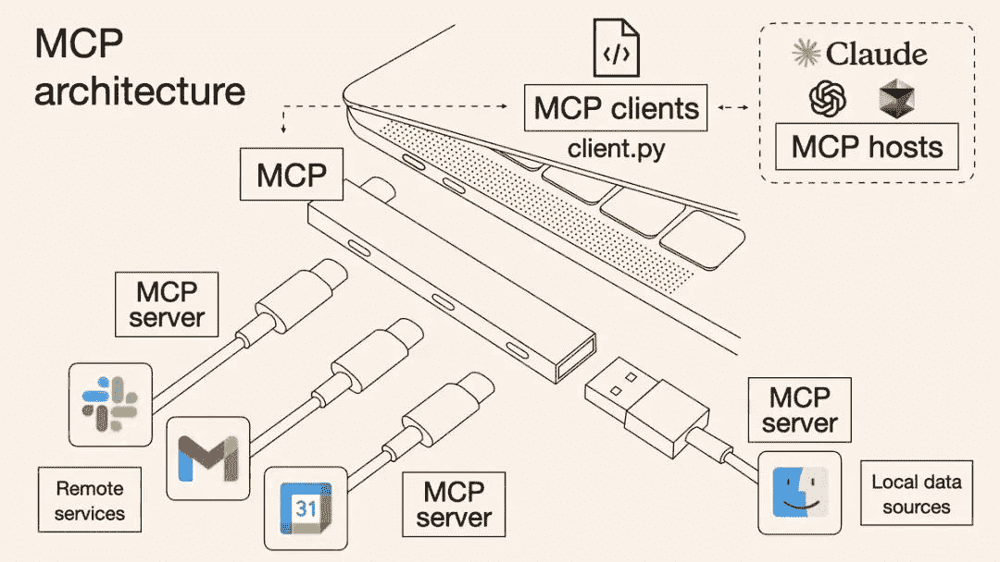
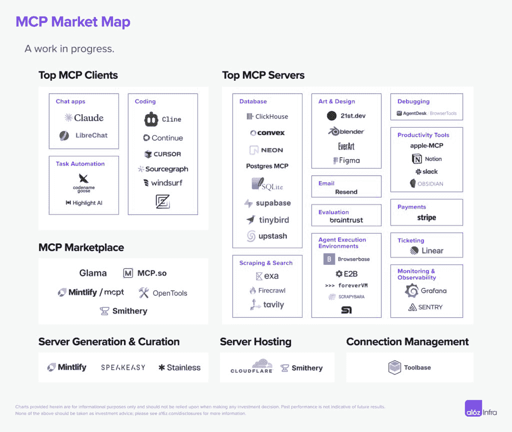
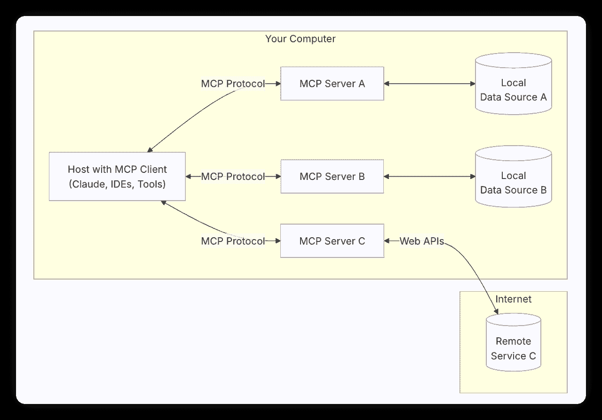
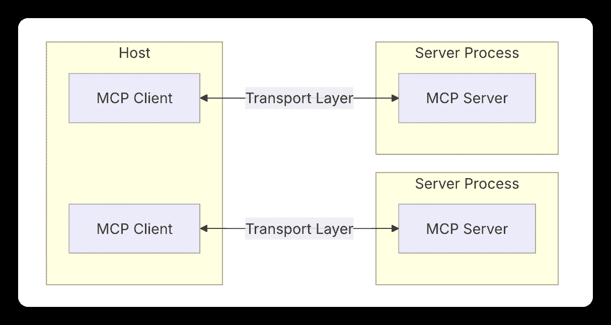
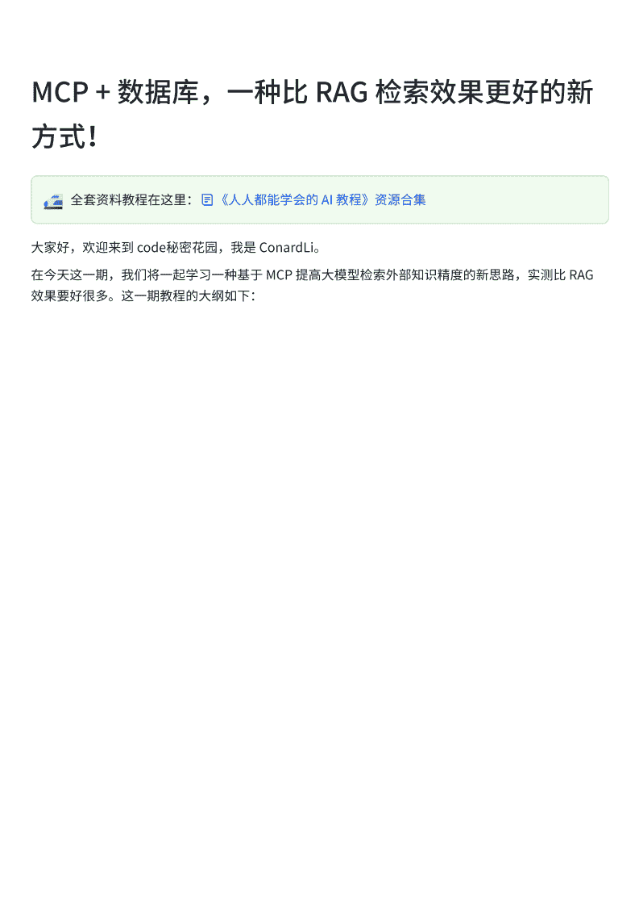

# 关于 MCP 的一切

> 来源：[https://leonzhang.feishu.cn/docx/WoTfd9CLYoJ2iNxBfdHcTr25nic](https://leonzhang.feishu.cn/docx/WoTfd9CLYoJ2iNxBfdHcTr25nic)

## MCP：AI 时代的超级接口？

> 把 LLMs 类比为电脑，Apps 是外设（键盘、鼠标），而 `MCP` 就等同于 USB 接口，通过 USB 将外设接口标准化、统一化。

`模型上下文协议`（`Model Context Protocol`，简称 `MCP`）是由 Anthropic 公司开源的一种协议标准，旨在建立 AI 模型（如 `Claude`）与各种数据源、工具和系统之间的标准化连接方式。`MCP` 被形象地比喻为"AI 应用的 `USB-C` 接口"，为 AI 系统提供了一个通用的连接标准。



`MCP` 于 2024 年 11 月 25 日由 Anthropic 正式开源，其核心价值在于解决 AI 模型与外部数据源、工具系统集成时的碎片化问题，提供了一种统一的标准化方法。

简单说：`MCP` 是一种让 AI 模型能“理解它所处环境”的标准接口协议。就像一个人干活时要知道当前的任务、可用的资料、约束条件、角色定位，`MCP` 就是把这些“上下文信息”打包传给模型的标准方法。

## MCP 的本质是什么？

`MCP` 是一种结构化的“上下文容器格式”，用于把各种知识输入喂给模型，并告诉它「这些信息来自哪里、在什么情况下使用、重要性如何」。

之前我们给模型发一堆文字，它只是「读到了这些文字」而已；接入 `MCP` 后，模型能够理解「文件上下文、应用上下文、用户上下文」。

`MCP` 赋予模型的核心能力是，让模型知道「它自己在哪儿、在干嘛」；让模型持续记忆和利用上下文信息，而不是每次重头再来。

### MCP 的核心结构

`MCP` 将上下文组织为一个或多个上下文块（context blocks），每个块都可以包括：

| 字段 | 含义 |
| --- | --- |
| `role` | 信息来源：比如是“user”、“system”、“retriever” |
| `name` | 上下文名称，用于模型内部引用 |
| `content` | 实际内容，可以是文本，也可以是 `JSON`、`Markdown` 等 |
| `metadata` | 附加信息，比如重要性评分、来源链接、时效性等 |

```json
{
  "role": "retriever",
  "name": "project_docs",
  "content": "这是一份关于 ABC 项目的技术文档摘要。",
  "metadata": {
    "source": "notion",
    "importance": "high"
  }
}
```

### MCP 主要应用场景

1. **RAG 系统（检索增强生成）**

   - 将检索来的多个文档用 `MCP` 封装传给模型
   - 模型能知道：哪些文档可信？哪些是背景？哪些是直接回答用？

2. **多 Agent 协作**

   - 每个智能体可以带着自己的上下文角色参与对话
   - 比如：`市场分析 Agent`、`产品规划 Agent`、`数据分析 Agent` 都能以不同 `role` 加入

3. **长上下文管理（例如 200K tokens 级别）**

   - 把大量信息合理组织，告诉模型哪些是高优先级、哪些可以跳过

## 为什么需要 MCP？

LLMs 的演变：从文本预测到工具使用

- `MCP`（模型上下文协议）是一种在模型和外部服务/工具之间创建统一层的标准
- LLMs 本身仅限于文本预测，如果没有工具则无法执行有意义的任务。
- `MCP` 通过创建标准化通信协议解决了将多个工具连接到 LLMs 的问题
- `MCP` 生态系统由客户端（如 `Cursor`、`Windsurf`）、协议、服务器和服务组成

如何让大语言模型与外部系统交互，是 AI 系统需要解决的问题：

AI 领域的三大「硬伤」

- 数据孤岛：无法直接访问实时数据或本地资源，`MCP` 通过统一协议，在保证数据安全的同时，能够让 AI 直接调用数据库、文件系统等。
- 开发低效：不同模型的协议不同，需重复开发接口。`MCP` 是标准化协议，开发者只需要编写一次服务器代码，即可被所有兼容模型调用。
- 生态割裂：不同模型专属接口（如 `function call`），导致工具生态分散，`MCP` 是开放标准，可以形成类似「插件市场」的工具生态。

从架构上来看，`MCP` 采用客户端-服务器架构，即 `MCP` 客户端发起请求，服务器端响应并提供数据或服务，从而实现高度模块化和可扩展的系统集成。并且 `MCP` 支持多语言和多平台，兼容性强，确保各类应用无缝对接。客户端可以是 `Claude Desktop`、`IDE` 或其他 AI 工具，服务器则可以是企业内部数据库、云服务或第三方 API，通过 `MCP` 协议，数据和服务得以高效流通，极大提升了 AI 应用的灵活性和实用性。

其优势在于，无论是访问本地资源（数据库、文件、服务），还是访问远程资源，都可以用同一个协议。并且支持的数据形式多样，包括数据库记录、`API` 响应、实时系统数据、日志文件等，几乎涵盖了所有类型。

与此同时，`MCP` 还具备强大的安全机制，确保数据传输过程的安全性，内置了安全机制，允许服务器自己控制资源，不用把 `API` 密钥泄露给客户端，有效防止数据泄露和滥用。例如金融客户使用 `MCP` 集成 ERP 系统时，数据处理全程在专网环境运行，避免泄露风险。

从服务来源上看，`MCP` 主要采用通信机制，本地通信采用标准输入输出，而远程通信则通过 `SSE` 进行。同时，这两种通信方式中的消息，都采用了 `JSON` 格式，使得数据交换标准化，简化了开发流程。



## MCP 技术架构详解

`MCP` server is now in the hands of the service provider

`MCP` 服务器现在掌握在服务提供商手中

### MCP 核心架构



`MCP` 遵循客户端-服务器架构，主要组件包括：

1. **`MCP` 主机（`Host`）**：如 `Claude Desktop`、`IDE` 或其他 AI 工具，它们希望通过 `MCP` 访问数据
2. **`MCP` 客户端（`Client`）**：负责维护与服务器的 1:1 连接的协议客户端
3. **`MCP` 服务器（`Server`）**：轻量级程序，通过标准化的模型上下文协议暴露特定功能
4. **本地数据源**：`MCP` 服务器可以安全访问的计算机文件、数据库和服务
5. **远程服务**：通过互联网可用的外部系统（例如，通过 `API`），`MCP` 服务器可以连接到这些系统

### MCP 三大基本元素

`MCP` 协议定义了三种基本元素，这些元素构成了模型与外部世界交互的基础：

1. **提示（`Prompts`）**：
   - 预定义的模板或指令，用于引导语言模型交互
   - 用户控制的元素，通过用户选择来调用
   - 示例：斜杠命令、菜单选项

2. **资源（`Resources`）**：
   - 提供给模型的结构化数据或内容
   - 由应用程序控制和管理的上下文数据
   - 示例：文件内容、`Git` 历史记录

3. **工具（`Tools`）**：
   - 暴露给 `LLM` 的可执行函数，允许模型执行操作
   - 由模型控制的元素
   - 示例：`API` 请求、文件写入

### 通信机制



`MCP` 支持多种传输层机制：

1. 标准输入/输出（`Stdio`）传输：
   - 使用标准输入/输出进行通信
   - 适合本地进程

2. **`HTTP` 与 `SSE` 传输**：
   - 使用 `Server-Sent Events` 进行服务器到客户端的消息传递
   - 使用 `HTTP POST` 进行客户端到服务器的消息传递

所有传输都使用 `JSON-RPC 2.0` 交换消息，这确保了通信的标准化和一致性。

### 开发工具类

`MCP.so` 上提供了大量面向开发者的工具服务器：

1. **代码管理**：
   - `Git`：读取、搜索和操作 `Git` 存储库的工具
   - `GitHub`：存储库管理、文件操作和 `GitHub` API 集成
   - `GitLab`：`GitLab` API，支持项目管理

2. **IDE 集成**：
   - `Neovim`：用于 `Neovim` 会话的 `MCP` 服务器
   - `VS Code` 整合：允许在 `VS Code` 中使用 `MCP` 服务器

3. **代码执行环境**：
   - `E2B`：在 `E2B` 托管的安全沙箱中运行代码
   - `Puppeteer`：浏览器自动化和 `Web` 抓取

### 数据库连接类

多种数据库连接服务器，使 AI 能够访问和查询数据：

- `PostgreSQL`：具有架构检查功能的只读数据库访问
- `MySQL`：带有可配置访问控制的 `MySQL` 数据库集成
- `SQLite`：数据库交互和商业智能功能
- `MongoDB`：`MongoDB` 数据库的 `MCP` 服务器
- `Redis`：与 `Redis` 键值存储交互

### API 集成类

允许 AI 访问各种外部 API 的服务器：

- `Slack`：频道管理和消息功能
- `Linear`：允许 `LLM` 与 `Linear` 的 API 进行项目管理交互
- `Stripe`：与 `Stripe` 支付 API 交互
- `Google Maps`：位置服务、方向和地点详情
- `Spotify`：允许 `LLM` 播放和使用 `Spotify`

### 工具类服务器

提供特定功能的专用工具：

- `EverArt`：使用各种模型的 AI 图像生成
- `Memory`：基于知识图谱的持久记忆系统
- `Sequential Thinking`：通过思维序列进行动态和反思性问题解决
- `Fetch`：用于高效 `LLM` 使用的 `Web` 内容获取和转换
- `Search1API`：用于搜索、爬取和站点地图的统一 API

## 整活

### Leon Zhang - Model Context Protocol（人生配置文件）

```json
[
  {
    "role": "identity",
    "name": "core_self",
    "content": "Leon Zhang，产品经理，AI 爱好者，内容创作者，探索型人格，技术与人文的桥梁角色。",
    "metadata": {
      "priority": "highest",
      "updated": "2025-04",
      "confidence": "strong"
    }
  },
  {
    "role": "work",
    "name": "product_manager_ai",
    "content": "现任 AI 产品经理，关注大模型、智能体（Agent）、RAG 架构、IoT 场景落地。具备硬件+内容+交互系统思维，偏好简约高效的表达方式，强调战略性思考与结构感。",
    "metadata": {
      "context": "专业场景",
      "importance": "high",
      "updated": "2025-04"
    }
  },
  {
    "role": "creator",
    "name": "stay_thinking",
    "content": "独立创作者，经营公众号「Stay Thinking」，擅长输出深度反思与结构化表达内容，使用 flomo 管理知识库。内容风格克制、真诚、带有哲思。",
    "metadata": {
      "medium": "writing",
      "activity_level": "monthly",
      "audience": "思考型用户"
    }
  },
  {
    "role": "learner",
    "name": "cs_ai_student",
    "content": "主动学习计算机科学、AI 工程体系（如 LLM 架构、Prompt 设计、模型调用），目标构建更强的产品技术感知力和底层实现能力。",
    "metadata": {
      "learning_style": "自学+提问+构建",
      "confidence": "in_progress",
      "updated": "2025-03"
    }
  },
  {
    "role": "health",
    "name": "fitness_routine",
    "content": "每日晨跑、控制饮食（间歇性禁食+减碳增蛋白）、目标减脂至健康水平以减轻肾脏负担，提升睡眠质量。",
    "metadata": {
      "goal": "体重 ≤ 80kg",
      "sleep_target": "00:00 前入睡",
      "update_needed": "定期复盘"
    }
  },
  {
    "role": "relationships",
    "name": "connection_curation",
    "content": "珍视深度链接与长期主义关系，不主动社交但重视真诚互动；倾向与有创造力、好奇心与行动力的人共振。",
    "metadata": {
      "social_mode": "高质量小圈子",
      "trust_filter": "持续性+真实感"
    }
  },
  {
    "role": "philosophy",
    "name": "thinking_system",
    "content": "信奉“长期主义 + 概率思维 + 系统感知”，反对碎片化浅层消费，强调「战略性懒惰」与「目标导向的信息摄取」。",
    "metadata": {
      "influences": ["纳瓦尔", "李笑来", "保罗·格雷厄姆"],
      "method": "抽象→对照→迁移"
    }
  },
  {
    "role": "play",
    "name": "hobby_stack",
    "content": "摄影（偏静物/街景），打球（羽毛球、篮球），探索播客、书籍与新技术产品。偶尔社恐，但在喜欢的事物里能量满满。",
    "metadata": {
      "energy_source": "沉浸式体验",
      "social_trigger": "话题共鸣"
    }
  }
]
```

### MCP 人生卡的使用建议

你可以把它想象成你的：

- 🧭 人生导航仪：做决策时，回到这组「上下文块」查查自己是谁、想去哪。
- 🧠 精力调度参考：哪些 `block` 是现在活跃的？哪些可以归档或重启？
- 📥 对外传达名片：别人理解你时，也许可以通过一套结构更清晰地知道你是怎样的组合体。

### 相关文档

1. [For Server Developers - Model Context Protocol](https://modelcontextprotocol.io/quickstart/server)


# MCP 相关资源与学习资料

1. Model Context Protocol (MCP), clearly explained (why it matters): https://www.youtube.com/watch?v=7j_NE6Pjv-E
1. 《20000 颗星！100 多个 Agent 超级工具，开源 MCP 大合集》: https://mp.weixin.qq.com/s/xbWDFydh1LC2xiPa6d-w_A
1. https://github.com/punkpeye/awesome-mcp-servers/blob/main/README-zh.md
1. 《腾讯云开发者｜MCP 协议详解：一文读懂跨时代的模型上下文协议》: https://mp.weixin.qq.com/s/1mwSSSHzkOrYUoaFdG0qJw
1. 《阿里云开发者｜从零开始教你打造一个 MCP 客户端》：https://mp.weixin.qq.com/s/zYgQEpdUC5C6WSpMXY8cxw
1. 《CSDN 技术社区｜一文看懂 MCP：开发者的“新帮手”？它能改变什么》：https://mp.weixin.qq.com/s/QUxvcWihGHMVN1h_UM06rA
1. 《艾逗笔｜开发 Flomo MCP，高效记笔记》: https://mp.weixin.qq.com/s/TouEnHXYRm2PQJ57hK4d2w
1. https://mcp.so/
1. 《6000字+6个案例：写给普通人的MCP入门指南》: https://mp.weixin.qq.com/s/BjsoBsUxCzeqXZq46_nrog

---

## 扩展内容

1. [关于 RAG 及效果优化](https://leonzhang.feishu.cn/wiki/DIO4wS4fIiYlf4ke8eWcZ10RnWc)
1. 【MCP + 数据库，一种比 RAG 检索效果更好的新方式！】 https://www.bilibili.com/video/BV12nRzYPEiK/
1. 
   [MCP + 数据库，一种比 RAG 检索效果更好的新方式！.pdf](https://internal-api-drive-stream.feishu.cn/space/api/box/stream/download/all/QwJDbzqxXofAATxJczFcG5USnih)
1. [《人人都能学会的 AI 教程》资源合集](https://rncg5jvpme.feishu.cn/wiki/U9rYwRHQoil6vBkitY8cbh5tnL9)
1. 👸号《MCP + 数据库，一种比 RAG 检索效果更好的新方式！》： https://mp.weixin.qq.com/s/jV46NMDfcJRiklUG_RLsmQ
1. Cherry Studio 官网：https://cherry-ai.com/
1. 《MCP协议详解：一文读懂跨时代的模型上下文协议》: https://mp.weixin.qq.com/s/1mwSSSHzkOrYUoaFdG0qJw
1. 【AI 进入新阶段？5分钟实战入门百炼MCP+智能体】 https://www.bilibili.com/video/BV1zHdUYEEFm/
1. 《详解 MCP 传输机制》: https://mp.weixin.qq.com/s/gmgo_glOzbvdFwePP1yQ9g
