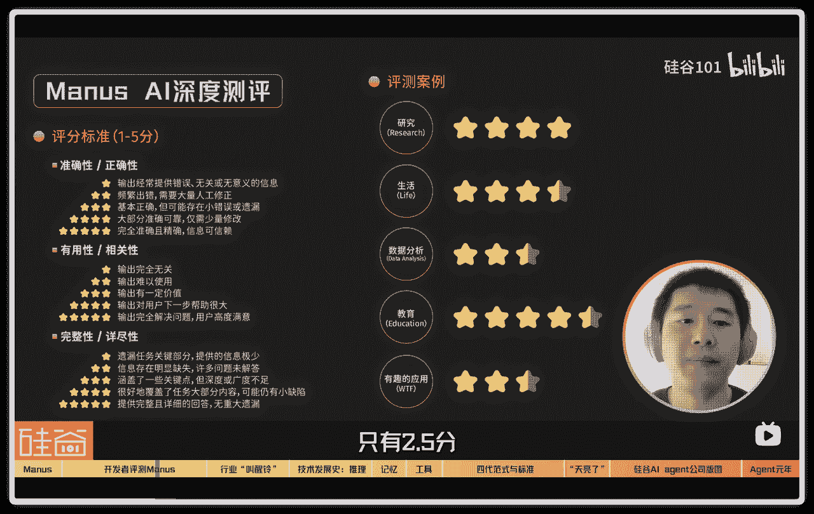
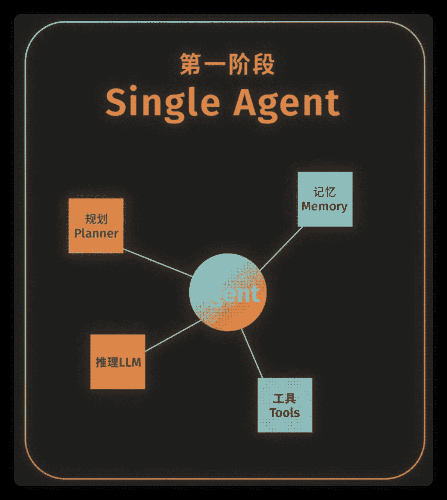
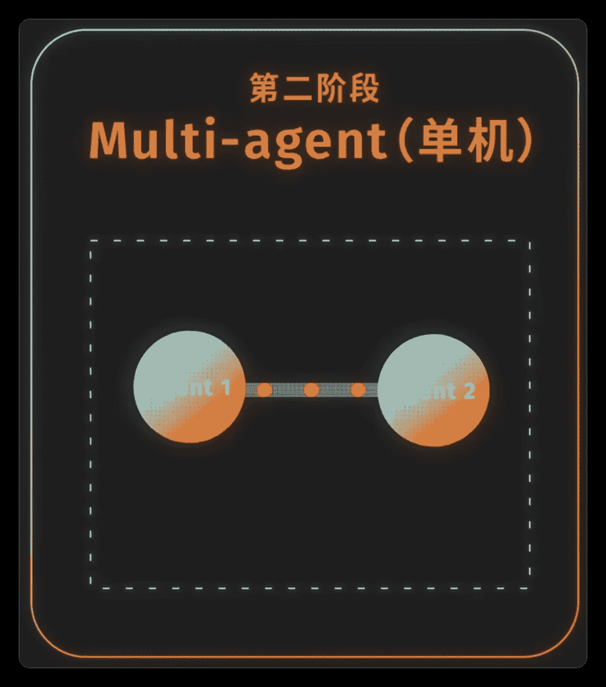
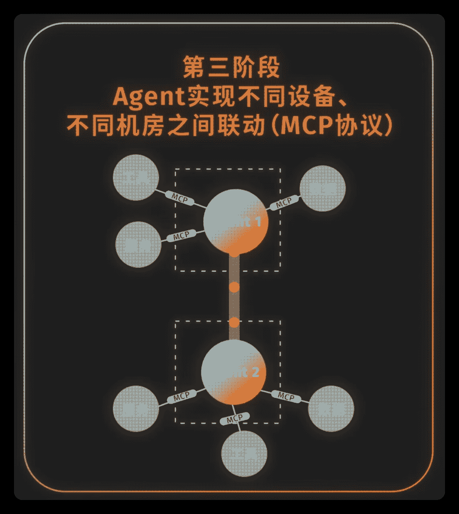
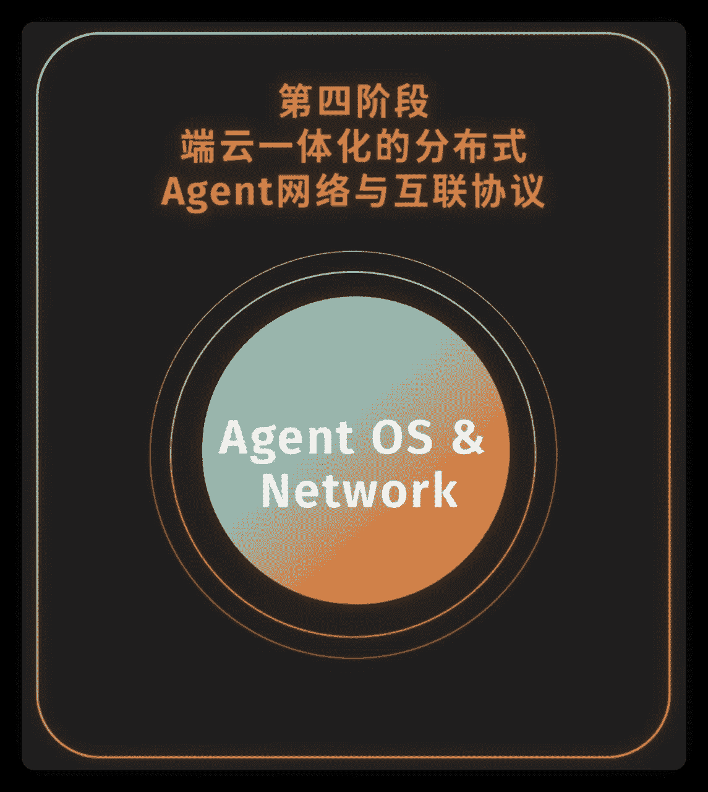

# AI Agent：技术演进及能力解读

> 来源：[https://leonzhang.feishu.cn/docx/XcMCdUkPXo2V4exmvRpc7VADnag](https://leonzhang.feishu.cn/docx/XcMCdUkPXo2V4exmvRpc7VADnag)

**Manus 工程化流程**

1.  根据用户需求，生成 task list（Notepad）

1.  Tools use（调用 search、浏览器、函数）

1.  最后渲染，呈现一个良好的结果。

|  |
| --- |

### AI Agent 产品构建要素

#### 做好 AI Agent 产品的关键因素

1.  模型（model）

1.  工具（tools）

1.  数据（data）

1.  基础设施（infra）

#### AI Agent  核心能力剖析

> 像人一样使用工具，不断学习使用新工具。

1.  逻辑推理能力和决策能力（推理｜reasoning）

1.  记忆能力和上下文理解（记忆｜memory）

1.  工具使用能力（工具｜tools）

1.  新工具的学习能力

### **AI Agent 技术发展脉络**

> ReAct 推理技术，基于 prompt Engineering，赋能 AI “思考” 与 “行动”

### **AI Agent 生态架构变迁**

从 AI Agent 生态角度，可以分为四个阶段：

1.  单 Agent 阶段（Single Agent）：Planner 规划、Memory 记忆、reasoning（逻辑推理，推理 LLM）、Tools 工具

1.  多 Agent（单机）阶段（multi-Agent）： 多 Agent 之间的通信

1.  **跨设备、机房联动阶段**：借助 MCP 协议实现不同设备、机房之间的联动

1.  端云一体化的分布式 Agent 网络与互联协议

|  |  |  |  |
| --- | --- | --- | --- |

### **AI Agent 产品类型**

1.  通用型 AI Agent，如 Manus。

1.  Agent 技术设施与框架层，为开发者搭建 Agent 应用的地基和工具。

1.  垂直化 Agent，面向特定行业的垂直化 Agent，比如编程、客服、销售、科研、商业分析与调研、甚至供应链管理等特定领域。

#### **Agent 架构和开发者工具**

1.  **Agent 架构**

1.  LangChain，让大语言模型调用外部工具与数据库，拥有长期记忆，以及完成多步骤工作流的首选工具包之一。

1.  其他热门工具，

1.  Pinecone，帮助 Agent 高效检索外部知识的向量数据库。

1.  LlamaIndex，让 Agent 能够更好处理私域数据。

1.  **Agent 工具包**，如微软 Semantic Kernel、AWS 的 Bedrock Agents 等，用来组合多种 AI 技能。

#### 垂直化 Agent（垂直赛道的明星公司）

1.  AI 编程 Agent：

1.  首位「AI 软件工程师」 Devin，背后公司是 Cognition AI。被人吐槽「做调研还行，编程能力堪忧」，现实情况是，定位于企业级用户的 Devin，在「庞大冗杂的的代码库、欠缺的技术文档和模糊不清的背景信息」这三大大山前，有些 力不从心。

1.  Github Copilot 的 Agent 模式

1.  AI Coding 工具 Cursor，背后公司是 Anysphere。

1.  Replit，能够通过自然语言指令生成完整的网页端应用。

1.  Windsurf，背后公司是 Codeium

1.  Trae，字节跳动

1.  客服和销售领域的 AI Agent： Decagon AI、Clay

1.  商业调研：Hebbia

1.  科研领域：Elicit

1.  供应链优化：Palantir

1.   医疗健康领域：Epic

### **目前成功的 Agent 方向**

1.  **高重复性任务**：客服、销售等场景，Al 提效明显，风险低

1.  **模块化工作流**：独立的软件开发任务，封闭可控，agent 可无大量背景知识

1.  **信息检索与推理**：调研类任务，依赖自然语言交互，无需复杂外部工具

1.  **辅助而非替代**：稳步整合 AI 至现有工作流，降低过渡风险

### 参考

1.  【AI Agent 爆发前的黎明：Manus 不够好，但天快亮了【硅谷 101】】 https://www.bilibili.com/video/BV1dtXzYrEKx/