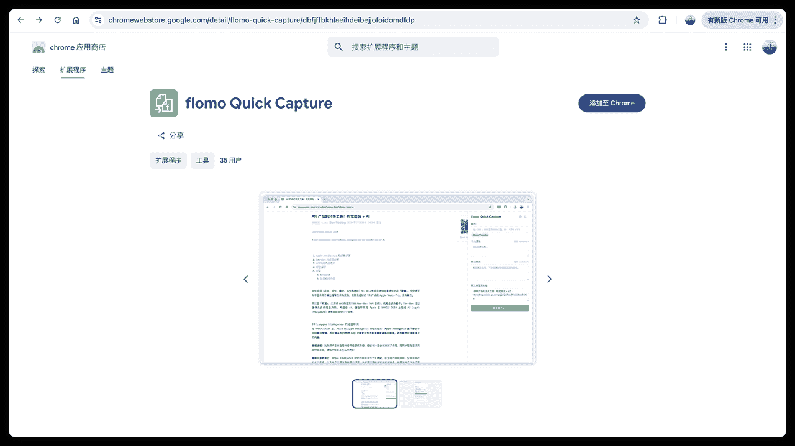
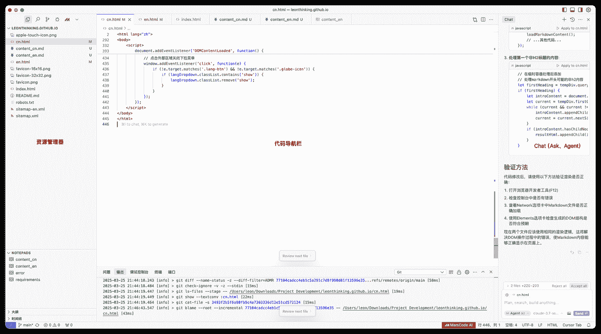
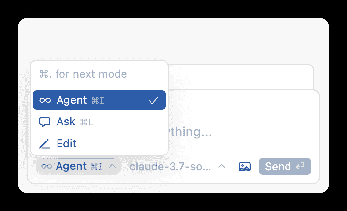
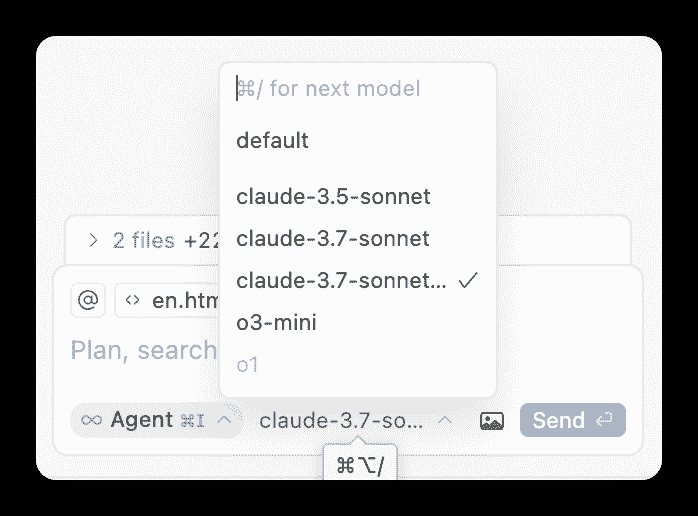

# 一起用 AI 写 Chrome 插件

> 来源：[https://leonzhang.feishu.cn/docx/J7rUd1PrpoPV2kxdpEGc3H1vnle](https://leonzhang.feishu.cn/docx/J7rUd1PrpoPV2kxdpEGc3H1vnle)

### 前言

这篇内容的起因，最早可以追溯到阿珂发我的一篇👸号文章《十年时间，副业转为主业，顺便赚了 2500 万》，👸号名称为「知墨」。

看完文章之后，果断 follow 了👸号。

同样的，我俩都被对方👸号的自动回复感动了，

1.  条理清晰、简明的个人标签。

1.  提供可能有用的资源。

并且，我也打算后续参考这个老哥的内容，重新整理一下我👸号的自动回复。

另外，老哥的《手把手教你用 AI 打造一款 App》 pdf 版本手册，也正是促使我撰写本篇内容的原因之一。

因为无论是 Chrome 插件、小程序，还是 App，都在我未来的规划中，而且不止一个。


这篇内容的目的主要是记录、汇总自己学到关于 AI Coding 工具（下用 Cursor 举例）的使用技巧。

当然**，如果**[**还能顺便帮到其他人**](https://chromewebstore.google.com/detail/dbfjffbkhlaeihdeibejjofoidomdfdp?utm_source=item-share-cb)**，欢迎你** 关注我的🛰️👸号「Stay Thinking」或 下载 Chrome 插件 使用 以示感谢，万分感谢～ ❤️

以下，enjoy～ 😄

### 少啰嗦，先看东西

以下截图是 Chrome Web Store 的截图，是我用 Cursor 从 0 到 1 完成的 Chrome 插件，上架时间为 2025 年 2 月 11 日。

Chrome 名称：flomo Quick Capture

欢迎你下载使用。



**关于需求来源**

首先这个插件是面向我个人的工作流设计的，写好之后就顺手发布了，也希望能帮到别人。

因为我个人经常使用 flomo App 来记录碎片想法，在浏览器浏览内容的时候，希望能够通过插件直接将我的当下想法、原文摘要、当前文档名称及地址发送至 flomo。

> 注：[flomo](https://flomoapp.com/register2/?MzA3MTI5) 是一款笔记产品，能够帮你记录碎片想法，也是少楠、Light 老师的众多产品之一。我使用了 4 年，已累计记录近 100 万字。是的，很不可思议，我自己发现这个数字的时候和你一样惊讶。

对我而言，过程在浏览器与 flomo App 之间反复切换，来写个人想法、原文摘要、当前文档名称及地址的流程比较繁琐，于是这个插件就自然而然地出现了。

### 为什么从 Chrome 插件开始

如标题的问题，为什么从 Chrome 插件开始？

1.  Chrome 插件开发成本低、上架速度快。

1.  上手 AI Coding 工具，建立基本的认识，并增加一定的成就感。

当然，最关键还是上架速度快。

说人话就是「 Chrome 插件不需要备案流程」就能够直接上架。开发完成后，只需要验证无严重问题，就能够上架。

做产品的关键环节之一就是「合规」，相信每个产品人、独立开发者都不陌生这个环节，因为只有产品合规后，才能被允许上架。

不过，及时反馈还是很重要的，不然极其容易“从入门到放弃”。

毕竟，AI 还没有像 Jarvis（电影《钢铁侠》中的 AI 管家「贾维斯」）一样厉害，不过相信那一天不会太远。

你看，两年前的我们还在用 LLM 作为对话、闲聊陪伴的 ChatBot，然后有了像 Cursor（2023 年初）、Windsurf 的 AI Coding 工具（Agent 应用），而后便是 AI 工程师 Devin、AI 实习生 Manus，而三年前的我们，还在用 Siri 定闹钟、加日程。

AI 的发展速度，远比你我想象中的要更快。比如我早前用 Midjourney 类文生图产品时，AI 是没办法画好手指的，当时大家的理由是，人的手部关节比较多，短时间很难用 AI 完成的很好，结果 2023 年底就基本解决了，24 年我在公司做分享的时候，AI 已经完成的很好了。

你看，即便是两个人的手握在一起都完成的很好。


Prompt 提示词

```
### 英文

A pair of lovers look at each other affectionately, surrounded by a dim room and scattered smoke, creating an atmosphere of mystery. 

This photo is a stunning example of Caravaggesque portraiture, capturing the essence of love and passion in a dramatic and evocative style.

### 中文

一对恋人深情对视，他们的周围是昏暗的房间和散落的烟雾，营造出一种神秘的氛围。

这张照片是卡拉瓦格肖像画的一个例子，以戏剧性和令人回味的风格捕捉爱情和激情的本质。
```

### AI 是你的 Agent，还是你是 AI 的 Agent

[Cursor｜ AI 编程助手](https://sm84lfdag7.feishu.cn/wiki/wikcnKoYb7cIb2zQ6AB6VS142Vb)于 Cursor 的介绍，官网（https://www.cursor.com/）有一定的介绍，早些时间我也简单写过关于 Cursor 的介绍：   ，这里不再过多赘述。

我和阿珂还聊过一个话题是关于 AI 是老板还是助理。

她说，「把 AI 当做助理」是一种非常典型产品经理的思维方式，而她及另一位👸号文章的作者同为 HR，提出了完全相反的观点，「把 AI 当做 老板用」。


确实是，产品经理的一部分工作就是与研发沟通技术方案与实现，产品更多是提出需求的那个，而 Cursor 恰好就是「全栈工程师」，你完全可以指挥它做任何需求，从需求确认、确认方案、需求实现，甚至 App 上架，都可以向 Cursor 请教，并让它执行。

工作中，我的习惯是让多个 AI 相互博弈，提出问题后，AI A 来完善方案，AI B 来提出方案，然后再用 AI A 来完善或优化 AI B 的方案，循环往复。

因为我清楚的知道，**AI 远比我的知识储备量更大**，而我「只是它的 Agent」而已，我需要在它不能决策、不能执行的时候，帮助它「下决策，执行确认动作」。

是的，我是 AI 的 Agent，因为我能替它「承担后果」。

这点就是好像自动驾驶的责任判责，你和 AI 的核心区别就是，你需要为它的后果买单。

在最初的 Cursor 版本里，还需要用户手动点击确认与否，而后更新的版本，勾选允许后，关于终端命令的执行将不再经过你，但代码的确认仍然通过你。

至此，你作为 AI 的 Agent 又减少了一个操作步骤。

### 不断学习如何正确给 AI 下指令

1.  **需求确认**

1.  新建 idea.md 文件（而非 notepad），通过与 chat 对话，去**确认、完善**需求。

1.  后续可以完善，并作为模板使用。

1.  **需求分拆**

1.  基于文件分拆需求，分拆为可实现的小步骤，然后基于这个步骤，新建 reference.md 文件。基于这里，一步一步分拆需求并实现。

1.  原理是能力和需求清晰度。**Cursor**/Foundation Model 还没有强到分拆、执行这么多需求（上下文长度）；几句话让 AI 实现和你想象中一模一样的东西。

1.  **步骤执行**

1.  让 **Cursor**** 去编译项目**，并解决问题（减少从 xcode 复制错误代码，再给 Cursor 修复）。

1.  用 html、css、js 的方式生成静态页面。修改、完善需求。

1.  **写代码（耐心）**

1.  写代码 - 改 bug - 调试 - 验证。

1.  **其他 Rules**

1.  如安装依赖时，不断报错。

1.  如果涉及有需要密码验证的环节，请及时打断并详细说明，我应该执行什么步骤。

> 以下是刘⼀峰（Ivone）老哥的 Tips：

1.  跟 AI 沟通，不要把它当成是全能的机器，你说的不清楚它也理解不了，你要把它当成是你的雇员，只有说明⽩了你想要的东⻄，它才能按照你的意思去执⾏。

1.  反复沟通，AI 可以记录下之前沟通的内容，并会根据之前的需求和你新的内容⼀起去理解，反复沟通才能达成双⽅⼀致的理解。

1.  如果 AI 调整了⼤⾯积的代码，或者把之前稳定的功能修改出了 bug ，你可以点击 restore 按钮。恢复到之前的代码，并重新跟 AI 沟通。

1.  AI 也会偷懒，你⼀次性说的太多，它会选择性地挑选它认为重要的去做，所以你要多沟通，每次只说清楚⼀个点即可。

### 构建你的项目，用 AI 写下第 1 行代码

首先，简单认识下 Cursor 的 UI。



没错，就是常见 IDE 工具的 UI，以下是 AI 给出的介绍，

Cursor 是一款由 AI 驱动的智能代码编辑器，它的 UI 设计既简洁又高效，其模块划分充分考虑了开发者的编程习惯和 AI 辅助编码的需求。以下为你详细介绍其主要的 UI 模块：

1.  **菜单栏**

菜单栏位于编辑器窗口的顶部，包含了一系列常用操作的菜单项，具体如下：

+   文件：提供新建文件、打开文件、保存文件、关闭文件以及导入 / 导出项目等基础操作。

+   编辑：支持复制、粘贴、剪切、查找、替换等文本编辑功能，还具备代码格式化和撤销 / 重做操作。

+   视图：用于控制界面的布局，比如显示或隐藏侧边栏、命令面板，以及调整编辑区的缩放比例。

+   运行：可以启动调试功能，配置调试环境，还能直接运行当前文件或项目。

+   工具：提供 AI 模型的选择、主题设置、快捷键配置等编辑器的个性化设置选项。

+   帮助：包含教程、文档、反馈渠道以及版本信息等内容。

1.  **侧边栏**

侧边栏位于编辑器窗口的左侧，集成了多个核心功能模块：

+   项目资源管理器：以树状结构展示当前项目的文件和文件夹，支持快速导航和打开文件，还能对文件进行创建、删除、重命名等操作。

+   搜索：可以在整个项目中进行文本搜索，并且支持智能筛选和正则表达式搜索。

+   版本控制（Git）：集成了 Git 功能，能够查看提交历史、管理分支、解决冲突等。

+   插件市场：提供丰富的插件，可用于扩展编辑器的功能，例如主题包、语言支持、工具集成等。

+   AI 功能面板：显示代码解释、重构建议等 AI 生成的内容。

1.  **编辑区**

编辑区是代码编写的核心区域，具备以下特性：

+   语法高亮：根据不同的编程语言，对代码进行着色，提高代码的可读性。

+   智能代码补全：基于 AI 模型，提供多行代码建议，可通过按下 Tab 键快速插入。

+   代码块预测：根据上下文预测开发者接下来可能要编写的代码，自动补全代码块。

+   实时错误提示：在编码过程中，实时检测代码中的错误，并给出修复建议。

1.  **底部状态栏**

底部状态栏显示当前文件的状态信息，包括：

+   行号和列号：指示当前光标所在的位置。

+   编码格式：如 UTF - 8 等文件的编码方式。

+   文件类型：显示当前文件所使用的编程语言，如 Python、JavaScript 等。

+   Git 状态：提示文件的修改状态，如未提交、已修改等。

+   性能监控：实时显示编辑器的内存占用情况。

1.  **调试面板**

调试面板提供了强大的调试功能：

+   变量监控：可以实时查看变量的值变化。

+   调用栈分析：清晰地展示函数的调用链。

+   断点控制：支持设置、删除断点，通过 F9 键进行切换。

+   调试快捷键：F5 键用于开始调试，F10 键用于单步跳过，F11 键用于单步进入函数。

1.  **AI 交互模块**

+   Composer（快捷键 Ctrl + K）：通过自然语言输入指令，AI 可以生成或修改代码。在输入框中使用 @ 符号可以引用文件、文档或代码库，实现上下文感知。

+   代码解释与重构：选中代码后，通过右键菜单或快捷键 Alt + R，可以获取代码的解释和优化建议，如变量重命名、提取函数等。

+   聊天式代码问答：通过 @Codebase 或快捷键 ⌘ + Enter（Mac）/Ctrl + Enter（Windows），可以直接对整个代码库提问，获取相关答案。

1.  **终端集成**

编辑器内置了终端，可以直接在编辑器中执行命令。还支持通过自然语言输入终端命令，如使用 ⌘ + K（Mac）或 Ctrl + K（Windows）将普通语言转换为终端命令。

1.  **插件扩展**

Cursor 支持安装第三方插件来增强功能，例如：

+   Git 增强插件：提供可视化的分支管理和智能冲突解决功能。

+   主题包：包含多种主题，如暗色、亮色和高对比度主题，还支持自定义主题。

+   语言扩展：增加对特定编程语言的支持和智能建议。

Cursor 的 UI 设计将传统代码编辑器的功能与 AI 深度整合，借助侧边栏 Chat、调试面板等模块，显著提升了开发效率。无论是新手开发者还是专业人士，都能通过其智能补全、代码重构、上下文问答等功能，更高效地完成编码任务。

以下是 Chat 下的模式选择，以及 模型选择。

各 mode 下的 model 推荐：

+   Agent 模式，从强到弱依次推荐 Claude-3.7-sonnet-thinking、 Claude-3.7-sonnet、 Claude-3.5-sonnet

+   Ask 模式，可以选择 o3-mini；关于 UI 设计可以用 DeepSeek-R1





### 先完成，再完美

2022 年对我很有启发的一句话是，「莽撞地开始，拙劣地完成，也好过因为心[2022｜求知若饥，虚心若愚](https://leonzhang.feishu.cn/wiki/Gd7ZwbDPsiz13Ukra5VcNowNnsb)完美主义而迟迟不动手去做」。同样，这句话也被我写在 2022 年的年度总结中：

前段时间看饺子导演的视频，饺子导演说「出来混，最重要的是出来」。

### 确认你的「靶心」，不然每天拉弓的意义是什么

对我而言，最好的产品是下一版本，最好的作品也永远是下一个。

### 产品宣发

平台：👸号、📕、即刻、X 等

### 一切选择都没有对错，只是反馈

前方的道路并不拥挤，因为坚持的人并不多。

### 相关内容

1.  十年时间，副业转为主业，顺便赚了 2500 万：https://mp.weixin.qq.com/s/P7Xtal99Joks_igY-bCM0Q

1.  Chrome 名称：flomo Quick Capture ：https://chromewebstore.google.com/detail/dbfjffbkhlaeihdeibejjofoidomdfdp?utm_source=item-share-cb

1.  关于 flomo App：https://flomoapp.com/register2/?MzA3MTI5

1.  Cursor 官网：https://www.cursor.com/

1.  [Cursor｜ AI 编程助手](https://sm84lfdag7.feishu.cn/wiki/wikcnKoYb7cIb2zQ6AB6VS142Vb)前写的关于 Cursor 的介绍：

1.  2022 年年度总结：[2022｜求知若饥，虚心若愚](https://leonzhang.feishu.cn/wiki/Gd7ZwbDPsiz13Ukra5VcNowNnsb)

1.    ｜作者：刘⼀峰（Ivone）


[手把手教你用AI打造一款App.pdf](https://internal-api-drive-stream.feishu.cn/space/api/box/stream/download/all/TJ91b6LTUoNcE9x46DXcaLv7nab)