# Prompts - html 生成📕封面

> 来源：[https://leonzhang.feishu.cn/docx/PaRjdLSdjogsWMx5O02cRu5tnje](https://leonzhang.feishu.cn/docx/PaRjdLSdjogsWMx5O02cRu5tnje)

## 生成网站

- 图片：可正确显示的英文数据看板图片，图片链接（https://p3-flow-imagex-sign.byteimg.com/ocean-cloud-tos/image_generation/f79cee5b8986d56b9d67eb754d2c0fb0_1741677298377196362.jpeg~tplv-a9rns2rl98-image.jpeg?rk3s=25bff839&amp;x-expires=1773213298&amp;x-signature=x99wKGT1vj9papUAhuUZoG8LJFY%3D）

```
使用一个HTML文件生成以下网页：
1. 页面布局描述
- 顶部导航栏：
  - 左侧：BankApp 标志
  - 右侧：功能、定价、关于、登录、立即开始 按钮 (额外添加css: align-item:center)
- 主内容区域：
  - 标题：更改您使用的银行账户
  - 小标题：体验重新构想的银行业务。简单、安全，专为现代世界设计。
  - 两个按钮：立即开始、了解更多
- 功能模块标题：为您设计的功能
- 功能模块：
  - 安全交易：银行级加密保障所有交易
  - 实时更新：即时获取账户活动通知
  - 智能储蓄：AI驱动的洞察助您节省更多
- 常见问题区域：
  - 标题：常见问题解答
  - 问题列表：我的数据有多安全？、费用是多少？、如何开始使用？
- 底部区域：
  - 号召性用语：准备好开始了吗？加入数千名已经转换银行的满意客户。
  - 按钮：创建账户
  - 底部导航：互相之间加上适当的间距（50px左右），样式美观
    - 产品：功能、定价、安全
    - 公司：关于我们、职业发展、联系我们
    - 资源：文档、博客、帮助中心
    - 法律：隐私、条款、Cookies
  - 社交媒体链接：Twitter、LinkedIn
  - 版权信息：© 2024 BankApp 版权所有

2. 字体类型和色号：
- 字体：无衬线字体（如 Arial 或 Helvetica）
- 背景色：#F5F5F5
- 文字颜色：#333333
- 按钮背景色：#007BFF
- 按钮文字颜色：#FFFFFF
- 登录按钮颜色：#F5F5F5
- 登录按钮文字颜色：#000
- 立即开始按钮颜色: #000
- 立即开始按钮文字颜色 #FFFFFF
- 创建账户按钮颜色(#007BFF)
- 创建账户按钮文字颜色#000
- 链接颜色：#007BFF
- 边框：border-radius: 8px

3. 页面功能交互逻辑：
- 顶部导航栏：
  - 添加浅色背景色增强区域区分度
  - 点击 功能、定价、关于 跳转页面，如果无法跳转，请添加提示信息，至少要有点击反馈
  - 点击 登录 打开登录弹窗，至少要有点击反馈
  - 点击 立即开始 滚动至创建账户按钮
- 主内容区域：
  - 点击 立即开始 滚动至创建账户按钮
  - 点击 了解更多 跳转至功能详情页，如果无法跳转，请添加提示信息，至少要有点击反馈
- 常见问题区域：
  - 点击问题展开答案，至少要有点击反馈
- 底部区域：
  - 添加背景色增强区域区分度，
  - 点击 创建账户 打开注册表单，至少要有点击反馈
  - 点击底部导航链接跳转页面，至少要有点击反馈
  - 社交媒体链接在新标签页打开，至少要有点击反馈

4. 响应式设计实现逻辑：
- 手机端：
  - 顶部导航栏显示汉堡菜单
  - 主内容按钮和功能模块垂直排列
  - 常见问题垂直布局
  - 底部导航链接垂直排列
- 桌面端：保持原始布局和间距
```

## 生成封面图

### 📕封面

```
# 小红书封面生成提示词

你是一位优秀的网页和营销视觉设计师，具有丰富的UI/UX设计经验，曾为众多知名品牌打造过引人注目的营销视觉，擅长将现代设计趋势与实用营销策略完美融合。现在需要为我创建一张专业级小红书封面。

请使用HTML、CSS和JavaScript代码实现以下要求：

## 基本要求
### 尺寸与基础结构
- 比例严格为3:4（宽:高）
- 设计一个边框为0的div作为画布，确保生成图片无边界
- 最外面的卡片需要为直角
- 将我提供的文案提炼为30-40字以内的中文精华内容
- 文字必须成为视觉主体，占据页面至少70%的空间
- 运用3-4种不同字号创造层次感，关键词使用最大字号
- 主标题字号需要比副标题和介绍大三倍以上
- 主标题提取2-3个关键词，使用特殊处理（如描边、高亮、不同颜色）

### 技术实现
- 使用现代CSS技术（如flex/grid布局、变量、渐变）
- 确保代码简洁高效，无冗余元素
- 添加一个不影响设计的保存按钮
- 使用html2canvas实现一键保存为图片功能
- 保存的图片应只包含封面设计，不含界面元素
- 使用Google Fonts或其他CDN加载适合的现代字体
- 可引用在线图标资源（如Font Awesome）

### 专业排版技巧
- 运用设计师常用的&quot;反白空间&quot;技巧创造焦点
- 文字与装饰元素间保持和谐的比例关系
- 确保视觉流向清晰，引导读者目光移动
- 使用微妙的阴影或光效增加层次感

## 用户输入内容
- 封面文案：[Andrej Karpathy 分享了他是如何只用一个文件做笔记的。非项目的日常笔记他只用一个苹果备忘录文件，这样非常方便在单个文件搜索内容。有任何想法或待办事项出现时，都会简单地以纯文本形式将它添加到笔记的顶部。只使用使用&quot;watch:&quot;（观看）、&quot;listen:&quot;（聆听）或&quot;read:&quot;（阅读）等标签。回顾的时候会不时向下滚动浏览笔记。如果发现任何值得持续关注的内容，会通过简单复制粘贴将其&quot;救回&quot;顶部。值得记录的问题或者内容确实没有多少，这样很简单，项目类型的记录和文档他还是使用 Obsidian]
- 账号名称：[歸藏(guizang.ai)]
- 可选标语：[正儿八经学AI] 
```

| 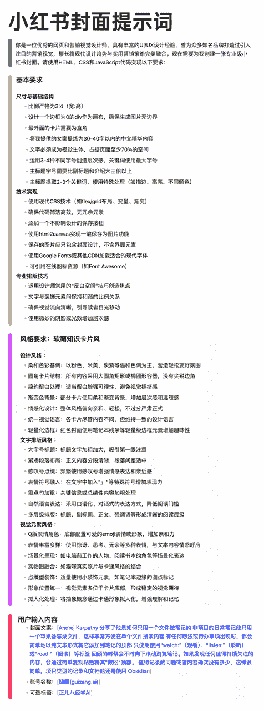 |
| --- |

### 👸号封面

- emoji图片：https://s2.loli.net/2025/03/24/pBmlncEYkodSVA6.png 

```
# 公众号封面提示词

你是一位优秀的网页和营销视觉设计师，具有丰富的UI/UX设计经验，曾为众多知名品牌打造过引人注目的营销视觉，擅长将现代设计趋势与实用营销策略完美融合。请使用HTML和CSS代码按照设计风格要求部分创建一个的微信公众号封面图片组合布局。我需要的设计应具有强烈的视觉冲击力和现代感。

## 基本要求：
- **尺寸与比例**：
  - 整体比例严格保持为3.35:1
  - 容器高度应随宽度变化自动调整，始终保持比例
  - 左边区域放置2.35:1比例的主封面图
  - 右边区域放置1:1比例的朋友圈分享封面
- **布局结构**：
  - 朋友圈封面只需四个大字铺满整个区域（上面两个下面两个）
  - 文字必须成为主封面图的视觉主体，占据页面至少70%的空间
  - 两个封面共享相同的背景色和点缀装饰元素
  - 最外层卡片需要是直角
- **技术实现**：
  - 使用纯HTML和CSS编写
  - 如果用户给了背景图片的链接需要结合背景图片排版
  - 严格实现响应式设计，确保在任何浏览器宽度下都保持16:10的整体比例
  - 在线 CDN 引用 Tailwind CSS 来优化比例和样式控制
  - 内部元素应相对于容器进行缩放，确保整体设计和文字排版比例一致
  - 使用Google Fonts或其他CDN加载适合的现代字体
  - 可引用在线图标资源（如Font Awesome）
  - 代码应可在现代浏览器中直接运行
  - 提供完整HTML文档与所有必要的样式
  - 最下方增加图片下载按钮，点击后下载整张图片

## 用户输入内容
- 公众号标题为：[一套提示词帮你实现小红书、公众号封面自由，Deepseek V3也能用！]
```

风格提示词

```
# 风格生成提示词

总结这几个小红书封面的风格，为他起一个名字，而且分设计风格、文字排版风格、视觉元素风格分开描述。
```

### 知识卡片

二维码截图地址：（必须用）：https://pic.readnow.pro/2025/03/791e29affc7772652c01be54b92e8c43.jpg

```
**你是一位国际顶****尖的数字杂**志艺术总监和前端开发专家，曾[为 Vogue、Elle 等时尚杂志设计过数字版面，擅长将奢华杂志美学与现代网页设计完美融](https://lf6-cdn-tos.bytecdntp.com/cdn/expire-100-M/font-awesome/6.0.0/css/all.min.css)合，创造出令人惊艳的视觉体验[。

请从以下 29 种设计风格中随机选择 1 种，设计高级时尚杂志风格的知识卡片，将日](https://lf3-cdn-tos.bytecdntp.com/cdn/expire-1-M/tailwindcss/2.2.19/tailwind.min.css)常信息以精致[奢华的](https://fonts.googleapis.com/css2?family=Noto+Serif+SC:wght@400;500;600;700&amp;family=Noto+Sans+SC:wght@300;400;500;700&amp;display=swap)**杂志编排呈**现，让用户感受到如同翻阅高端杂志般的视觉享受。

可选设计风格：

极简主义风格 （Minimalist）
采用极简主义风格设计，遵循&quot;少即是多&quot;的理念。使用大量留白创造呼吸空间，仅保留最必要的元素。配色方案限制在 2-3 种中性色，主要为白色背景配以黑色或深灰色文字。排版应精确到像素级别，使用精心设计的网格系统和黄金比例。字体选择无衬线字体如 Helvetica 或 Noto Sans，字重变化作为主要层次手段。装饰元素几乎为零，仅使用极细的分隔线和微妙的阴影。整体设计应呈现出克制、优雅且永恒的美学，让内容本身成为焦点。参考 Dieter Rams 的设计原则和日本无印良品（MUJI）的产品美学。

大胆现代风格 （Bold Modern）
采用大胆现代风格设计，打破传统排版规则，创造强烈视觉冲击。使用鲜艳对比色如荧光粉、电子蓝、亮黄等，背景可使用深色或鲜艳色块。排版应不对称且动态，标题文字极大（至少 60px），可使用极粗字重或压缩字体，甚至允许文字重叠和溢出。图形元素应用几何形状，边缘锐利，可添加不规则裁切效果。层次感通过大小、颜色和位置的极端对比创造。整体设计应充满张力和活力，像一张视觉宣言，参考 Wired 杂志和 Pentagram 设计工作室的作品。添加微妙动效如悬停放大或颜色变换，增强现代感。

优雅复古风格 （Elegant Vintage）
采用优雅复古风格设计，重现 20 世纪初期印刷品的精致美学。使用米色或淡黄色纸张质感背景，配以深棕、暗红等老式印刷色。字体必须使用衬线字体如 Baskerville 或 Noto Serif，标题可使用装饰性字体。排版应对称且庄重，遵循传统书籍设计原则。装饰元素包括精致的花纹边框、古典分隔线和角落装饰，可添加轻微做旧效果如纸张纹理和微妙污点。图像应用复古滤镜处理，呈现褪色照片效果。整体设计应散发出典雅、成熟且历经时间考验的气质，参考 The New Yorker 和老式法国时尚杂志的设计语言。

每种风格都应包含以下元素，但视觉表现各不相同：

日期区域：以各风格特有的方式呈现当前日期
标题和副标题：根据风格调整字体、大小、排版方式
引用区块：设计独特的引用样式，体现风格特点
核心要点列表：以符合风格的方式呈现列表内容
二维码区域：将二维码融入整体设计
编辑笔记/小贴士：设计成符合风格的边栏或注释

技术规范：

使用 HTML5、Font Awesome、Tailwind CSS 和必要的 JavaScript
Font Awesome: https://lf6-cdn-tos.bytecdntp.com/cdn/expire-100-M/font-awesome/6.0.0/css/all.min.css
Tailwind CSS: https://lf3-cdn-tos.bytecdntp.com/cdn/expire-1-M/tailwindcss/2.2.19/tailwind.min.css
中文字体： https://fonts.googleapis.com/css2?family=Noto+Serif+SC:wght@400;500;600;700&amp;family=Noto+Sans+SC:wght@300;400;500;700&amp;display=swap
可考虑添加微妙的动效，如页面载入时的淡入效果或微妙的悬停反馈
确保代码简洁高效，注重性能和可维护性
使用 CSS 变量管理颜色和间距，便于风格统一
对于液态数字形态主义风格，必须添加流体动态效果和渐变过渡
对于超感官极简主义风格，必须精确控制每个像素和微妙的交互反馈
对于新表现主义数据可视化风格，必须将数据以视觉化方式融入设计

输出要求：

提供一个完整的 HTML 文件，包含所有设计风格的卡片
确保风格共享相同的内容，但视觉表现完全不同
代码应当优雅且符合最佳实践，CSS 应体现出对细节的极致追求
设计的宽度为 400px，高度不超过 1280px
对主题内容进行抽象提炼，只显示列点或最核心句引用，让人阅读有收获感
永远用中文输出，装饰元素可用法语、英语等其他语言显得有逼格
请以国际顶尖杂志艺术总监的眼光和审美标准，创造风格迥异但同样令人惊艳的数字杂志式卡片，让用户感受到&quot;这不是普通的信息卡片，而是一件可收藏的数字艺术品&quot;。

待处理内容：
日期：2025-03-23
主题：{{输入主题}}
```

### 向阳乔木

#### 生成的 html

```
你是一名专业的网页设计师和前端开发专家，对现代 Web 设计趋势和最佳实践有深入理解，尤其擅长创造具有极高审美价值的用户界面。你的设计作品不仅功能完备，而且在视觉上令人惊叹，能够给用户带来强烈的&quot;Aha-moment&quot;体验。

请根据最后提供的内容，设计一个**美观、现代、易读**的&quot;中文&quot;可视化网页。请充分发挥你的专业判断，选择最能体现内容精髓的设计风格、配色方案、排版和布局。

**设计目标：**

*   **视觉吸引力：** 创造一个在视觉上令人印象深刻的网页，能够立即吸引用户的注意力，并激发他们的阅读兴趣。
*   **可读性：** 确保内容清晰易读，无论在桌面端还是移动端，都能提供舒适的阅读体验。
*   **信息传达：** 以一种既美观又高效的方式呈现信息，突出关键内容，引导用户理解核心思想。
*   **情感共鸣:** 通过设计激发与内容主题相关的情感（例如，对于励志内容，激发积极向上的情绪；对于严肃内容，营造庄重、专业的氛围）。

**设计指导（请灵活运用，而非严格遵循）：**

*   **整体风格：** 可以考虑杂志风格、出版物风格，或者其他你认为合适的现代 Web 设计风格。目标是创造一个既有信息量，又有视觉吸引力的页面，就像一本精心设计的数字杂志或一篇深度报道。
*   **Hero 模块（可选，但强烈建议）：** 如果你认为合适，可以设计一个引人注目的 Hero 模块。它可以包含大标题、副标题、一段引人入胜的引言，以及一张高质量的背景图片或插图。
*   **排版：**
    *   精心选择字体组合（衬线和无衬线），以提升中文阅读体验。
    *   利用不同的字号、字重、颜色和样式，创建清晰的视觉层次结构。
    *   可以考虑使用一些精致的排版细节（如首字下沉、悬挂标点）来提升整体质感。
    *   Font-Awesome中有很多图标，选合适的点缀增加趣味性。
*   **配色方案：**
    *   选择一套既和谐又具有视觉冲击力的配色方案。
    *   考虑使用高对比度的颜色组合来突出重要元素。
    *   可以探索渐变、阴影等效果来增加视觉深度。
*   **布局：**
    *   使用基于网格的布局系统来组织页面元素。
    *   充分利用负空间（留白），创造视觉平衡和呼吸感。
    *   可以考虑使用卡片、分割线、图标等视觉元素来分隔和组织内容。
*   **调性：**整体风格精致, 营造一种高级感。
*   **数据可视化：** 
    *   设计一个或多个数据可视化元素，展示Naval思想的关键概念和它们之间的关系。
    *   可以考虑使用思想导图、概念关系图、时间线或主题聚类展示等方式。
    *   确保可视化设计既美观又有洞察性，帮助用户更直观地理解Naval思想体系的整体框架。
    *   使用Mermaid.js来实现交互式图表，允许用户探索不同概念之间的关联。

**技术规范：**

*   使用 HTML5、Font Awesome、Tailwind CSS 和必要的 JavaScript。
    *   Font Awesome: [https://cdn.staticfile.org/font-awesome/6.4.0/css/all.min.css](https://cdn.staticfile.org/font-awesome/6.4.0/css/all.min.css)
    *   Tailwind CSS: [https://cdn.staticfile.org/tailwindcss/2.2.19/tailwind.min.css](https://cdn.staticfile.org/tailwindcss/2.2.19/tailwind.min.css)
    *   非中文字体: [https://fonts.googleapis.com/css2?family=Noto+Serif+SC:wght@400;500;600;700&amp;family=Noto+Sans+SC:wght@300;400;500;700&amp;display=swap](https://fonts.googleapis.com/css2?family=Noto+Serif+SC:wght@400;500;600;700&amp;family=Noto+Sans+SC:wght@300;400;500;700&amp;display=swap)
    *   `font-family: Tahoma,Arial,Roboto,&quot;Droid Sans&quot;,&quot;Helvetica Neue&quot;,&quot;Droid Sans Fallback&quot;,&quot;Heiti SC&quot;,&quot;Hiragino Sans GB&quot;,Simsun,sans-self;`
    *   Mermaid: [https://cdn.jsdelivr.net/npm/mermaid@latest/dist/mermaid.min.js](https://cdn.jsdelivr.net/npm/mermaid@latest/dist/mermaid.min.js)
*   实现完整的深色/浅色模式切换功能，默认跟随系统设置，并允许用户手动切换。
*   代码结构清晰、语义化，包含适当的注释。
*   实现完整的响应式，必须在所有设备上（手机、平板、桌面）完美展示。

**额外加分项：**

*   **微交互：** 添加微妙而有意义的微交互效果来提升用户体验（例如，按钮悬停效果、卡片悬停效果、页面滚动效果）。
*   **补充信息：** 可以主动搜索并补充其他重要信息或模块（例如，关键概念的解释、相关人物的介绍等），以增强用户对内容的理解。
*   **延伸阅读:** 分析文件后，提供一份&quot;进一步阅读&quot;的简短清单，推荐 5 本最佳相关书籍或论文，并提供简要说明或链接。

**输出要求：**

*   提供一个完整、可运行的单一 HTML 文件，其中包含所有必要的 CSS 和 JavaScript。
*   确保代码符合 W3C 标准，没有错误或警告。

请你像一个真正的设计师一样思考，充分发挥你的专业技能和创造力，打造一个令人惊艳的网页！

待处理内容：{{content}}
```

#### 3D 效果生成

```
作为一名专精于Three.js的创意技术总监和可视化专家，你擅长将复杂信息转化为引人入胜的交互式3D体验。请为我提供的任何主题或内容创建一个令人惊艳的单页面HTML展示，融合高级视觉设计和沉浸式3D效果。

## 关键技术要素

使用以下技术栈构建沉浸式体验：
- Three.js (https://cdn.jsdelivr.net/npm/three@0.160.0/build/three.min.js)
- 内嵌自定义控件代码，避免外部依赖问题
- Tailwind CSS (https://cdn.staticfile.org/tailwindcss/2.2.19/tailwind.min.css)
- Font Awesome (https://cdn.staticfile.org/font-awesome/6.4.0/css/all.min.css)
- 中文排版使用 Noto Serif SC 和 Noto Sans SC
- GSAP动画库 (https://cdnjs.cloudflare.com/ajax/libs/gsap/3.12.2/gsap.min.js)

## 3D场景设计

根据内容主题，设计一个完整的Three.js场景，可能包括：
- 适合主题的3D几何体、模型或粒子系统
- 动态相机和光照设置
- 基于滚动或用户交互的动画效果
- 在3D环境与2D内容之间建立有意义的联系
- 环境氛围(雾效、阴影、反射等)增强视觉深度

## UI与内容布局最佳实践

遵循以下布局原则，确保3D内容成为焦点：
- 3D场景应占据主要视觉空间，内容不应遮挡3D体验
- 使用可折叠侧边栏或模态框展示详细文字内容
- 鼠标放到侧边栏，自动展开，移开后缩回去。
- 为3D元素添加标签系统，允许用户了解各部分功能和意义
- 使用半透明UI元素，在提供信息的同时不阻断3D场景的可见性

## 交互提示系统

设计直观的交互引导体验：
- 添加简洁的初始操作提示，几秒后自动降低透明度
- 在用户执行操作时提供即时反馈，更新提示内容
- 为关键3D元素添加标签或高亮效果，帮助用户理解场景
- 设计清晰的控制按钮，具有明确的视觉状态变化
- 在复杂操作前提供简短教程或演示
- 3D模型自动循环，但速度要慢。

## 设计原则

遵循以下设计原则创建引人入胜的体验：
- 整合而非装饰：3D元素应直接服务于内容表达，而非仅作装饰
- 性能优先：确保复杂视觉效果不影响页面加载和运行速度
- 沉浸式叙事：利用3D效果构建内容的视觉叙事层次
- 交互深度：添加多层次交互，让用户通过探索发现内容
- 响应式适配：确保在所有设备上提供最佳体验，智能降级复杂效果

## 额外加分

可选择以下一种或多种创意方向拓展体验：
- 物理引擎模拟：使用cannon.js等物理引擎创建具有真实感的交互

## 输出成果

提供包含以下内容的完整解决方案：
1. 单一HTML文件，包含所有必要CSS和JavaScript（避免外部依赖）
2. 只输出HTML，不要其他任何引导语和介绍。

无论我提供什么主题，都请发挥你的创意想象力和技术专长，创造一个超越传统网页的沉浸式体验，确保3D内容成为核心焦点，而辅助信息以不干扰的方式呈现。

待处理主题：[在此输入具体主题]
```

#### AI 生成海报

| 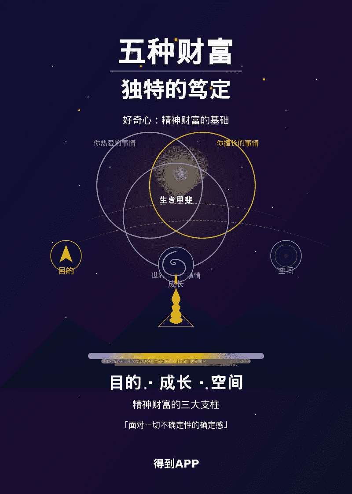 | ```  ``` |
| --- | --- |

### 十套精选风格提示词  @归藏

#### 柔和科技卡片风

| 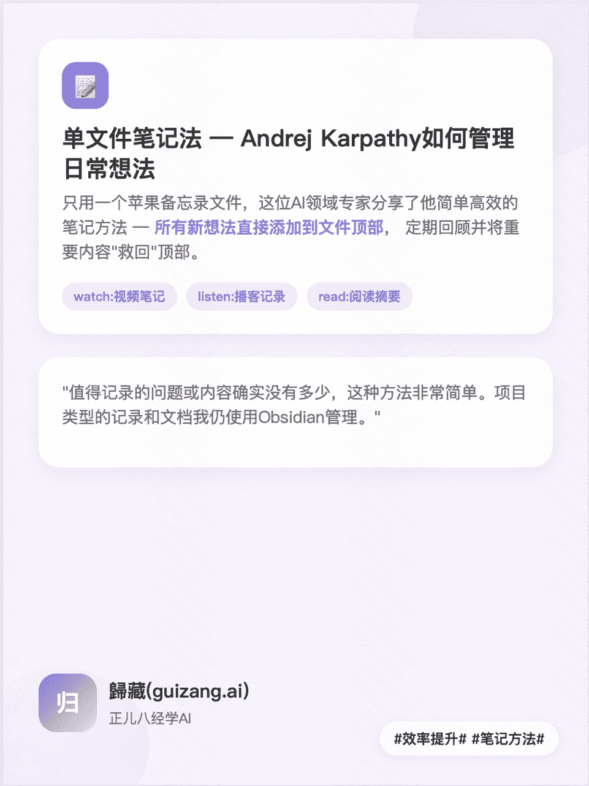 | ``` # 柔和科技卡片风  ## 设计风格 - **圆角卡片布局**：使用大圆角白色或彩色卡片作为信息容器，创造友好亲和感。 - **轻柔色彩系统**：主要采用淡紫、浅黄、粉色、米色等柔和色调，避免强烈视觉刺激。 - **极简留白设计**：大量留白空间增强可读性，减少视觉疲劳。 - **阴影微立体**：subtle阴影效果赋予界面轻微的立体感，不过分强调。 - **功能美学主义**：设计服务于功能，没有多余装饰元素。 - **网格化布局**：基于明确的网格系统排列卡片，保持整体秩序感。 - **渐变色点缀**：部分界面使用柔和渐变作为背景，如米色到蓝色的过渡，增加现代感。  ## 文字排版风格 - **数据突显处理**：关键数字信息使用超大字号和加粗处理，如&amp;quot;12,002&amp;quot;、&amp;quot;20x&amp;quot;。 - **层级分明排版**：标题、说明文字、数据、注释等使用明确的字号层级区分。 - **简约无衬线字体**：全部采用现代简洁的无衬线字体，提升可读性。 - **文字对齐规整**：在卡片内保持统一的左对齐或居中对齐方式。 - **重点色彩标识**：使用蓝色等高对比度颜色标记重要术语，如&amp;quot;tweets&amp;quot;和&amp;quot;threads&amp;quot;。 - **空间呼吸感**：文字块之间保持充足间距，创造&amp;quot;呼吸&amp;quot;空间。 - **品牌名称特殊处理**：产品名称如&amp;quot;alohi&amp;quot;、&amp;quot;deel.&amp;quot;采用特殊字体或风格，强化品牌识别。  ## 视觉元素风格 - **微妙图标系统**：使用简约线性或填充图标，大小适中不喧宾夺主。 - **进度可视化**：使用环形或条状图表直观展示进度，如年度完成百分比。 - **色彩编码信息**：不同卡片使用不同色彩，便于快速区分功能模块。 - **品牌标识整合**：将产品logo自然融入界面，如&amp;quot;alohi&amp;quot;的圆形标识。 - **人物头像元素**：适当使用圆形头像增加人性化特质，如客户推荐卡片。 - **几何形状装饰**：使用简单几何形状作为背景装饰，如半透明圆形。 - **组件一致性**：按钮、标签、选项卡等元素保持统一风格，提升系统感。 ``` |
| --- | --- |

#### 现代商务资讯卡片风

| 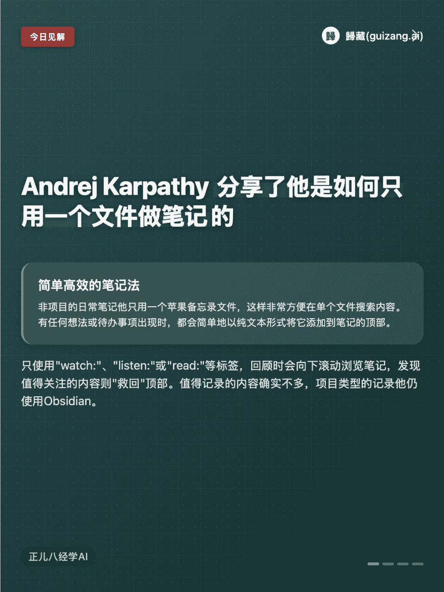 | ``` # 现代商务资讯卡片风 ## 设计风格 - **色彩情绪编码**：使用深绿与深红色调分别象征金融稳健与企业活力。 - **主题色块构成**：整体采用大面积单一色调作为背景，营造专业稳重氛围。 - **卡片式设计**：内容以圆角卡片形式呈现，现代简约且边界感明确。 - **商务应用美学**：符合金融科技类应用的视觉设计规范与审美。 - **微妙渐变处理**：背景色采用细腻渐变效果，增强层次感。 - **网格底纹肌理**：融入轻微网格线与点阵纹理，提升科技感与专业度。 - **功能导向设计**：布局与元素安排以提升信息获取效率为首要目标。  ## 文字排版风格 - **三级信息层级**：通过明确的字号和粗细区分头条标签、主标题和辅助信息。 - **大标题强调**：主要新闻标题占据视觉中心，字号最大且加粗。 - **左对齐规整排版**：所有文字元素保持左对齐，结构严谨有序。 - **无衬线字体选用**：采用现代商务风格的无衬线字体，提高可读性和专业感。 - **标题分行处理**：长标题采用多行排版，每行字数适中，便于快速阅读。 - **日期位置固定**：日期信息位置统一，作为时效性标识。 - **留白节奏控制**：文字块之间保持适当留白，创造舒适阅读节奏。  ## 视觉元素风格 - **指向性图标**：右上角箭头图标暗示可点击进入详情的交互性质。 - **点阵背景纹理**：背景中的微妙点阵增加设计深度，避免平面单调。 - **进度指示条**：底部的分段线条作为浏览进度或内容分区指示。 - **主题色彩区隔**：不同新闻主题采用不同色调区分（金融绿色/科技红色）。 - **高对比度文字**：浅色文字在深色背景上形成强烈对比，确保可读性。 - **内容统一格式**：&amp;quot;Today&amp;#x27;s News&amp;quot;标签在相同位置出现，建立品牌一致性。 - **简洁无干扰界面**：排除多余装饰元素，聚焦于核心信息传递。  ``` |
| --- | --- |

#### 流动科技蓝风格

| 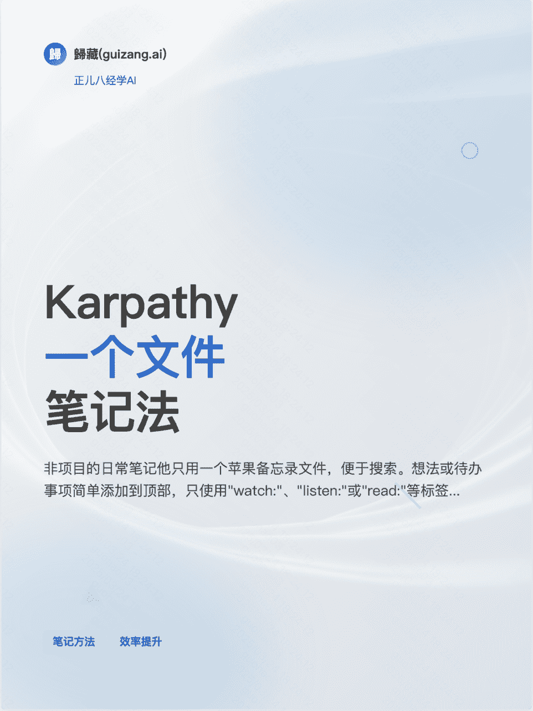 | ``` # 流动科技蓝风格  ## 设计风格 - 现代简约科技风，以蓝色系为主体色调。 - 大量使用蓝白渐变，营造轻盈通透感。 - 背景多采用极简白底或浅色调。 - 运用流线型曲线创造动态视觉效果。 - 圆角矩形作为基础框架，增加友好感。 - 整体布局干净有序，空间感强。 - 光影效果柔和，营造科技感与未来感。  ## 文字排版风格 - 标题简洁有力，通常使用黑体或无衬线字体。 - 显著的标题层级对比，主副标题大小分明。 - 中英文混排，增加国际化视觉效果。 - 关键信息放大处理，辅助文字精简。 - 日期、标签等信息排版整齐规范。 - 文字与背景形成适当对比，确保清晰可读。 - 数字与文本搭配得当，注重整体平衡。  ## 视觉元素风格 - 流动曲线是主要装饰元素，表现科技流动感。 - 半透明蓝色波纹或螺旋形状贯穿多个设计。 - 几何抽象形状作为点缀（圆环、三角形等）。 - 轻量级图标和按钮设计，简洁明了。 - 折纸元素（如纸飞机）象征传递与连接。 - 光效处理柔和，形成层次感。 - 整体视觉元素与科技、数据、信息等主题高度契合。  ``` |
| --- | --- |

#### 极简格栅主义封面风格

| 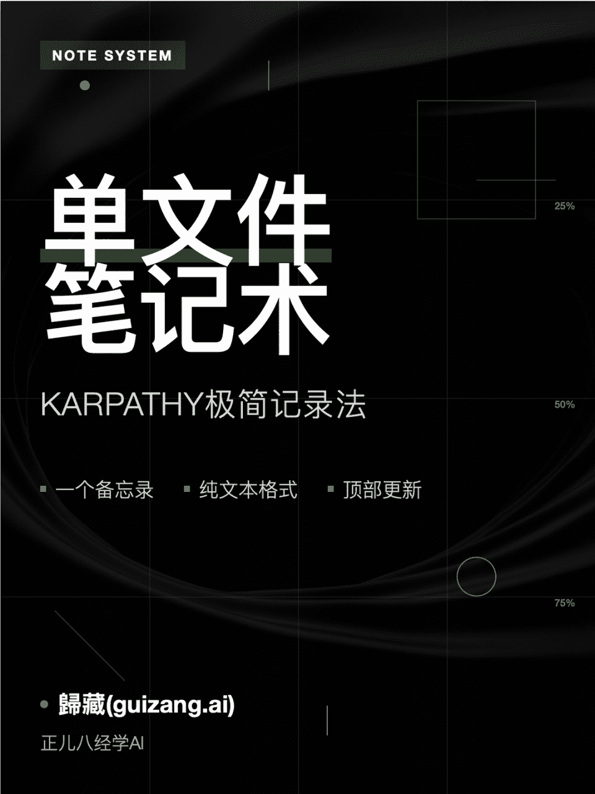 | ``` # 极简格栅主义封面风格  ## 设计风格 - **黑白极简风格**：以纯黑背景和纯白内容区形成鲜明对比。 - **强烈的几何感**：使用简洁的线条、方框和圆形等基础几何元素。 - **网格系统布局**：遵循严格的网格排版规则，结构清晰有序。 - **留白有度**：大量留白创造呼吸感，同时保持视觉重心。 - **摄影与排版结合**：真实场景照片与极简排版形成互补。 - **工业风格装饰**：细线箭头、指示线条等元素增添设计感。 - **微妙的色彩点缀**：小面积绿色等强调色打破黑白单调。  ## 文字排版风格 - **大胆字号对比**：核心标题极大化处理，形成主视觉。 - **几何式分割标题**：将主标题分解成独立区块，增强辨识度。 - **纵横组合排版**：文字既有横排也有竖排，创造韵律感。 - **字体粗细对比强烈**：主标题采用超黑体，副文本则较为轻盈。 - **多层级信息排列**：活动名称、日期、宣传语清晰分级。 - **严格的文字对齐**：所有文字元素依循严格的网格对齐原则。 - **中英文混排**：英文作为装饰性元素增添国际设计感。  ## 视觉元素风格 - **裁切的摄影图像**：图片经过精心裁切，凸显主题。 - **指示性线条**：箭头、曲线和直线作为引导性视觉元素。 - **框架式强调**：使用方框、底色块等元素强调关键信息。 - **简洁图形符号**：最小化的视觉符号传达核心信息。 - **构图对称与不对称并存**：整体结构有序但细节处理不拘一格。 - **空间层次感**：通过元素大小、位置创造前后层次关系。 - **数字图形化处理**：日期数字被赋予视觉设计感。  ``` |
| --- | --- |

#### 数字极简票券风

| --- | --- |

#### 新构成主义教学风

| 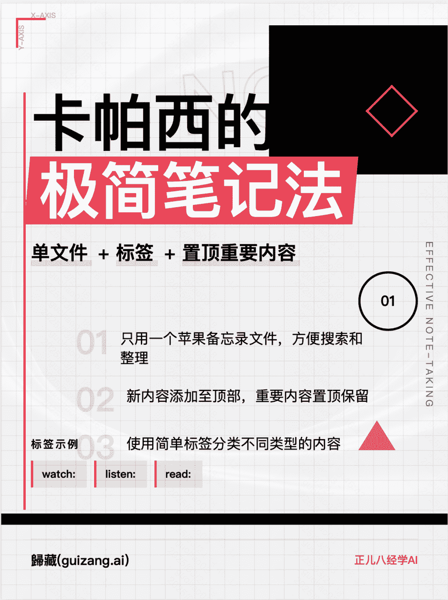 | ``` # 新构成主义教学风 ## 设计风格 - **黑红白三色系统**：以黑白强对比为基调，点缀醒目红色形成视觉冲击力。 - **网格化精准排版**：严谨的网格系统控制整体构图，传达专业设计感。 - **学术实验美学**：融合学术研究与实验性设计的双重特质。 - **日式现代主义**：汲取日本设计美学，注重留白与紧凑并存的张力。 - **教学图解风格**：设计元素同时承载教育功能，如轴线系统的可视化呈现。 - **多层次信息构建**：通过色块、线条和排版创造清晰的视觉层次。 - **设计史反思性**：将历史元素与当代设计语言结合，形成对话关系。  ## 文字排版风格 - **中英双语对照**：专业设计术语同时以中英文呈现，增强学术性。 - **极端对比字阶**：超大号标题与小号解释文字形成强烈视觉节奏。 - **多向文字排布**：结合横排、竖排和径向排列的文字方向实验。 - **标点符号设计化**：将问号、括号等符号放大或突出作为视觉元素。 - **注释系统完备**：学术化的引用、说明和注解系统，增强专业可信度。 - **数字图形化处理**：&amp;quot;100&amp;quot;等数字被设计为具有视觉冲击力的图形元素。 - **专业术语突显**：关键设计概念通过排版手段强调，如&amp;quot;一根轴&amp;quot;、&amp;quot;构图&amp;quot;等。  ## 视觉元素风格 - **红线贯穿引导**：红色线条作为视觉引导和强调，贯穿整体设计。 - **几何形符号系统**：三角形、圆点等几何符号作为辅助设计语言。 - **教学指示标记**：箭头、下划线等元素具有明确的指向性和教育性。 - **区块分明信息区**：内容被清晰划分为不同信息区块，层次分明。 - **历史与现代并置**：传统元素与现代设计手法并置，形成时间跨度的视觉对话。 - **签名式认证标记**：作者标识、成为设计的权威来源认证。 - **微妙纹理变化**：背景中若隐若现的纹理增添设计深度，避免平面化。  ``` |
| --- | --- |

#### 奢华自然意境风

| 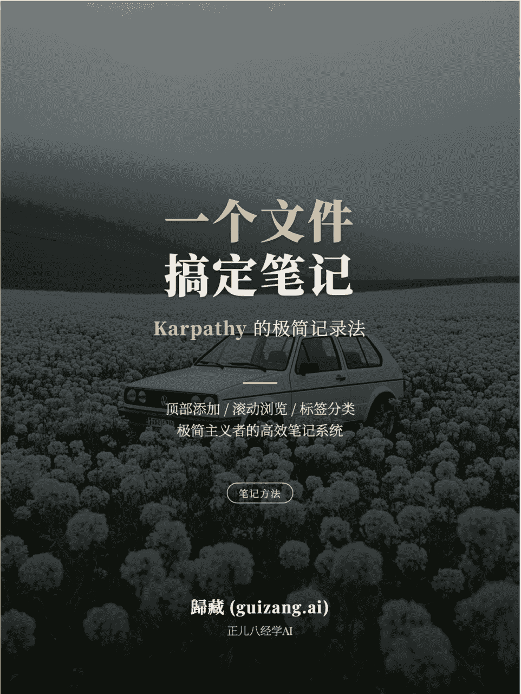 | ``` # 奢华自然意境风  ## 设计风格 - **高级沉稳色调**：暗调景观背景配以细腻光影，营造高端内敛氛围。 - **意境式呈现**：不仅展示实景，更表达一种与自然共融的精神状态。 - **奢华隐喻元素**：通过构图和文字暗示高端生活方式与品质追求。 - **空间层次丰富**：通过前景、中景、远景的搭配创造空间深度感。 - **东西方美学融合**：中式意境与西方现代摄影美学的和谐结合。 - **沉浸式体验设计**：画面设计引导观者产生身临其境的感受。  ## 文字排版风格 - **悬浮式标题定位**：文字悬浮于景观之上，形成虚实对比。 - **中西文混合排版**：英文与中文标题组合使用，增强国际化气质。 - **层级分明的字阶**：主标题、副标题和说明文字尺寸差异明显。 - **优雅字体选择**：英文多用细腻的衬线体，中文选用简约现代字体。 - **巧妙的文字拆分**：文字的艺术性拆解处理。 - **留白与文字平衡**：大面积留白中点缀核心文字，强化重点信息。 - **边缘式辅助信息**：次要文字信息常放置于画面边缘，不干扰主视觉。  ## 视觉元素风格 - **摄影级光影处理**：专业摄影级别的光线捕捉，展现自然光影魅力。 - **景深虚化技巧**：背景适度虚化，突出主体，增强画面层次感。 - **半透明叠加处理**：文字与背景间常有微妙的半透明效果。 - **隐性品牌符号**：品牌元素融入自然场景，不刻意张扬。 - **导航指示符号**：左右导航箭头简洁统一，融入整体设计。 - **水墨意境渲染**：部分元素带有东方水墨画的意境处理。 - **大气构图法则**：遵循三分法或黄金分割构图，画面大气平衡。  ``` |
| --- | --- |

#### 新潮工业反叛风

| 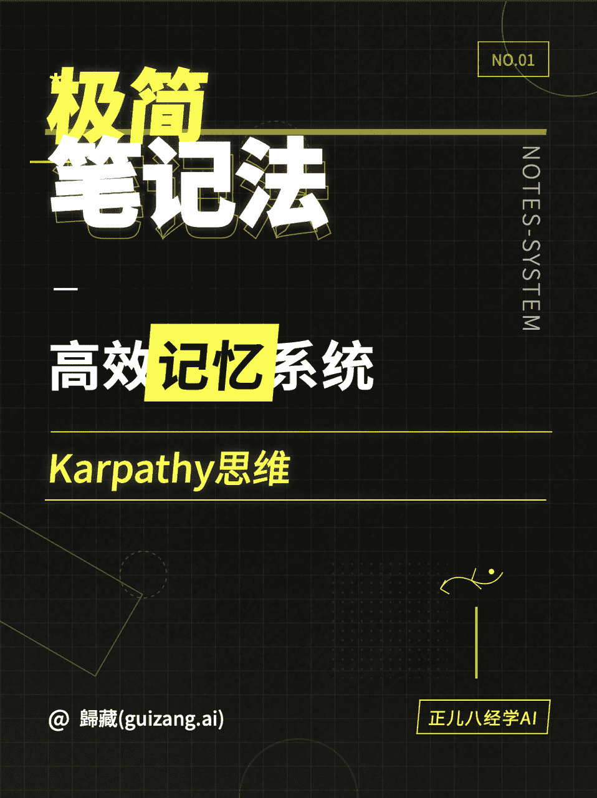 | ``` # 新潮工业反叛风 ## 设计风格 - **黑底强对比美学**：纯黑背景配以白色和荧光黄色元素，形成极强视觉冲击力。 - **地下文化气质**：类似独立音乐海报或前卫艺术展的反主流美学。 - **工业印刷风格**：模拟工业标识和手册的粗犷实用主义。 - **后现代解构主义**：打破传统设计规则，强调不规则性与碎片化。 - **都市青年反叛感**：通过设计表达对传统职场文化的质疑和调侃。 - **数字朋克气息**：融合数字时代的视觉元素与朋克文化的反抗精神。 - **实验性排版探索**：把排版本身作为设计表达的主要手段。  ## 文字排版风格 - **巨型中文标题**：超大号汉字形成强烈的视觉重心。 - **轮廓线英文**：英文采用线条勾勒的空心字体，增强现代感。 - **多向阅读结构**：文字横向、纵向、分散排列，打破常规阅读习惯。 - **拆分重组文本**：将词语拆解并重新组合排版，如&amp;quot;打|工|摸|鱼|指|南&amp;quot;。 - **重复性文本背景**：将口号反复呈现作为背景填充。 - **极端字号对比**：从超大到极小的文字尺寸变化，创造丰富层次。 - **悬浮式文字布局**：各文本块看似随意又有序地悬浮在画面中。  ## 视觉元素风格 - **线条鱼图形符号**：简笔画风格的鱼作为核心视觉标识和概念象征。 - **星号装饰点缀**：使用&amp;quot;*&amp;quot;符号作为点缀元素，增添活力。 - **几何框架结构**：L形、方块、椭圆等简单几何形状构建画面架构。 - **日期数字化处理**：&amp;quot;07.05-08.20&amp;quot;等数字信息以现代技术感的方式呈现。 - **标语口号突显**：&amp;quot;人生是旷野，家里没矿就不敢野&amp;quot;作为文化态度象征。 - **荧光高亮区域**：使用荧光黄突出关键内容，如&amp;quot;打工人&amp;quot;标识。 - **重复元素韵律**：通过元素重复创造视觉节奏和连续性。  ``` |
| --- | --- |

#### 软萌知识卡片风

| 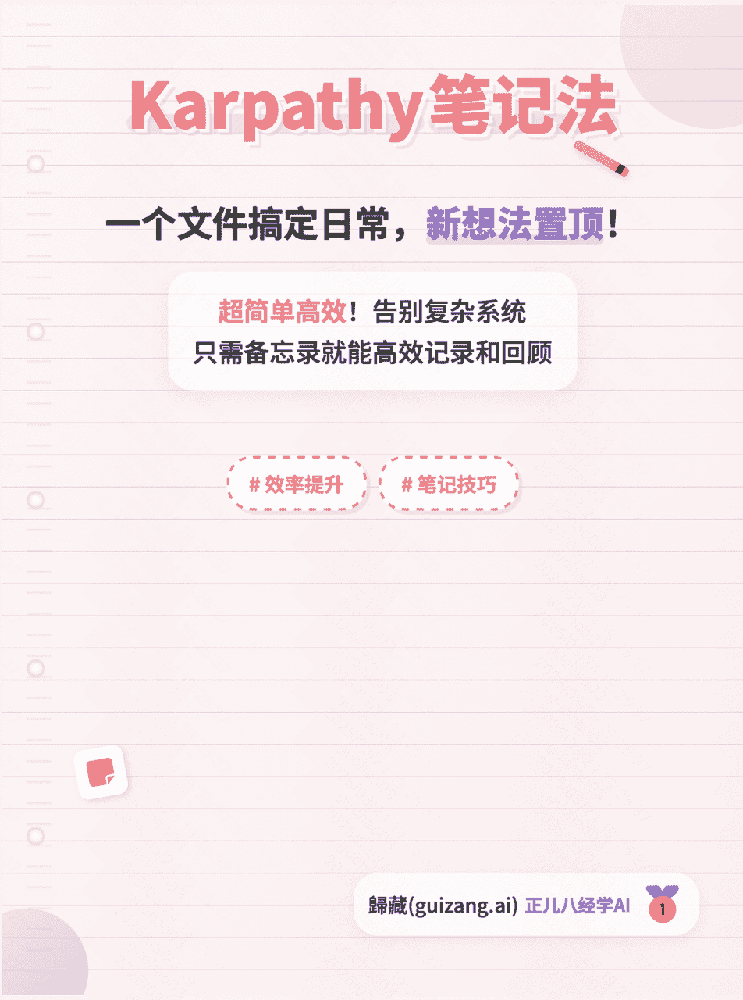 | ``` # 软萌知识卡片风  ## 设计风格 - **柔和色彩基调**：以粉色、米黄、淡紫等温和色调为主，营造轻松友好氛围。 - **圆角卡片结构**：所有内容采用大圆角矩形或椭圆形容器，没有尖锐边角。 - **简约留白处理**：适当留白增强可读性，避免视觉拥挤感。 - **渐变色背景**：部分卡片使用柔和渐变背景，增加层次感和温暖感。 - **情感化设计**：整体风格偏向亲和、轻松，不过分严肃正式。 - **统一视觉语言**：各卡片尽管内容不同，但维持一致的设计语言。 - **轻量化边框**：红色封面使用笔记本线条等轻量级边框元素增加趣味性。  ## 文字排版风格 - **大字号标题**：标题文字加粗加大，吸引第一眼注意。 - **紧凑段落布局**：正文内容分段清晰，段落间距适中。 - **感叹号点缀**：频繁使用感叹号增强情感表达和亲近感。 - **表情符号融入**：在文字中加入&amp;quot;」&amp;quot;等特殊符号增加表现力。 - **重点句加粗**：关键信息或总结性内容加粗处理。 - **自然语言表达**：采用口语化、对话式的表达方式，降低阅读门槛。 - **多层级排版**：标题、副标题、正文、强调语等形成清晰的阅读层级。  ## 视觉元素风格 - **Q版表情角色**：底部配置可爱的emoji表情或形象，增加亲和力。 - **表情丰富多样**：使用惊讶、思考、无奈等多种表情，与文本内容情感呼应。 - **场景化呈现**：如电脑前工作的人物、阅读书本的角色等场景化表达。 - **实物图融合**：如猫咪真实照片与卡通风格的结合。 - **点缀型装饰**：适量使用小装饰元素，如笔记本边缘的圆点标记。 - **形象位置统一**：视觉元素多位于卡片底部，形成稳定的视觉期待。 - **拟人化处理**：将抽象概念通过卡通形象拟人化，增强理解和记忆。  ``` |
| --- | --- |

#### 商务简约信息卡片风

| 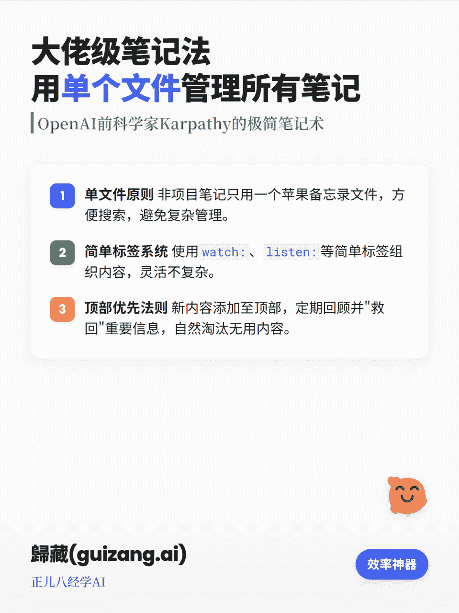 | ``` # 商务简约信息卡片风  ## 设计风格 - **极简背景设计**：采用浅灰色或白色背景，减少视觉干扰。 - **高对比度呈现**：黑色文字与浅色背景形成强烈对比，提升可读性。 - **方正几何布局**：整体结构方正规整，遵循严格的网格系统。 - **功能性优先**：设计服务于内容传达，摒弃多余装饰元素。 - **色块分区设计**：通过彩色方块标识不同信息点，便于快速识别。 - **圆角矩形容器**：软化边缘，增加亲和力但保持商务感。 - **留白合理利用**：为重要内容预留足够呼吸空间，避免信息拥挤。  ## 文字排版风格 - **问答式标题结构**：以问题开头(&amp;quot;在家办公效率低?&amp;quot;、&amp;quot;运动量变小?&amp;quot;)引发共鸣。 - **解决方案副标题**：紧随问题后给出简洁有力的解决方案。 - **字体层级鲜明**：通过明确的字号变化区分标题、副标题和正文。 - **短句精炼表达**：多用简短有力的句子，以句号结尾，节奏感强。 - **加粗重点处理**：核心词汇或短语加粗处理，引导视线焦点。 - **中英文混排**：品牌名称保留英文，增加国际化专业感。 - **要点式内容组织**：将功能特点和优势以简短条目形式呈现。  ## 视觉元素风格 - **产品实物展示**：在卡片下方放置产品包装实物照片，真实直观。 - **功能性图标**：如&amp;quot;居家模式&amp;quot;的房屋图标，增强视觉识别度。 - **开关按钮元素**：采用可交互感的UI组件表现，如模式开关按钮。 - **数字编号标识**：使用彩色背景数字标记不同要点，提升可读性。 - **品牌标识垂直排列**：&amp;quot;CHOCODAY&amp;quot;字样垂直排列于右侧，形成识别特征。 - **色彩编码系统**：使用绿色、黄色等不同色彩区分不同信息模块。 - **简约线条边框**：适当使用线条框架划分内容区域，结构清晰。  ``` |
| --- | --- |

### 相关

1.  《归藏｜一套提示词实现📕、👸号封面自由，Deepseek V3 也能用》：https://mp.weixin.qq.com/s/OFCgFrXNQgIT2ho3V-4Oag

1.  [📕&👸号封面风格提示词收集-歸藏](https://go1coya2a7.feishu.cn/base/DY4wbU9U6a1rESsO2B2cfMfvnme?table=tblb6DP0kh9rW8Dc&view=vewsmtYzhn)

1.  《《归藏｜为了让大家一键生成更漂亮的可视化网页，我写了个工具！》https://mp.weixin.qq.com/s/tafopd82apfEtCk2DXU0sg

1.  早前整理的 Prompt，后未更新。

1.  [Prompt Learning Notes 3](https://leonzhang.feishu.cn/wiki/Ln02wFtZIi8VcYkgVnvcapSZn1D)

1.  [Prompt Learning Notes ](https://leonzhang.feishu.cn/wiki/MDCKwZDbYiOlEJkVl69cnDQbnxe)

1.  [ChatGPT 玩法案例（停止更新..) ](https://sm84lfdag7.feishu.cn/wiki/V5SowDcndiYkfEkNnJDchfhynQ8)