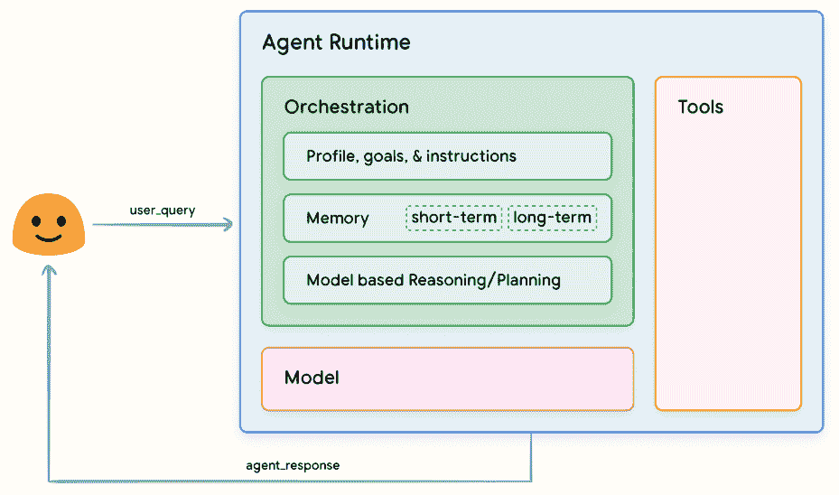

# Notes｜AI Agent（智能体）技术白皮书（Google，2024）

> 来源：[https://leonzhang.feishu.cn/docx/YAvbdim6BoJWhtxqaDScet51n7g](https://leonzhang.feishu.cn/docx/YAvbdim6BoJWhtxqaDScet51n7g)

> 通过让 LLM 调用 AI Agent 来实现任务规划、任务拆分、任务执行等操作，进而完成其目标。

> 疑问

1.  LLM 调用 Agent，然后 Agent 再调用 LLM？

### 什么是 Agent？

在人工智能和计算机科学领域，**Agent（智能体）** 是一个常见的术语，用来描述能够感知环**境、处理信**息、并采取行动以达到某种目标的系统或程序。它可以是一个简单的算法，也可以是一个复杂的人工智能系统。

**Agent** 是一个具备自主性（autonomy）的系统或应用程序，可以根据输**入（例如用户查询或环境变化**）**进行感知、**决策和**行动。通常**通过多个模块（如图所示的 Orchestration、Model 和 Tools）协作来完成复杂任务。

|  |
| --- |

**Agent 的主要特征**

+   **自主性（Autonomy）**：能独立运行，不需要持续的外部干预。

+   感知能力（Perception）：能够理解用户的输入或环境中的信号。

+   推理与规划（Reasoning & Planning）：通过模型和记忆进行逻辑推理或任务规划。

+   **执行能力（Action）**：根据计划采取行动，如生成响应或调用工具完成任务。

**Agent 的常见应用场景**

**对话式 AI**：如虚拟助理（ChatGPT、Siri 等）。

+   **自动化任务处理**：如智能客服、自动化运维助手。

+   多代理协作（Multi-Agent Systems）：多个 Agent 协作完成复杂任务（例如模拟经济系统、分布式计算）。

这篇文章介绍了 AI Agent（智能体）的概念和工作原理。主要包括以下几个方面：

1. **什么是 Agent？** Agent 是一个应用程序，通过观察周围世界并使用可用的工具来实现其目标。它具有自主性，可以根据模糊的人类指令推理并采取行动。

2. **Agent 的架构和组件** Agent 的核心架构包括三个组件：模型、工具和编排层。模型是用于核心决策的语言模型，工具用于连接外部系统和数据，编排层负责管理记忆、状态、推理和规划。

3. **Agent 的推理框架** Agent 可以使用 ReAct、Chain-of-Thought、Tree-of-Thoughts 等推理技术来指导其决策和行动。

4. **工具的作用** 工具是将基础模型与外部世界连接的桥梁，包括 Extensions、Functions 和 Data Stores 等类型。工具使 Agent 能够访问实时信息并在现实世界中采取行动。

5. **提升模型性能的方法** 通过 In-context learning、Retrieval-based in-context learning 和 Fine-tuning based learning 等方法，可以让模型学会在特定任务中选择合适的工具。

6. 基于 LangChain 快速创建 Agent 介绍了如何使用 LangChain 和 LangGraph 快速构建 Agent 原型。

总的来说，本文详细介绍了 Agent 的概念、架构和工作原理，为开发基于生成式 AI 的应用程序提供了指导。

### 参考

1.  https://arthurchiao.art/blog/ai-agent-white-paper-zh/

1.  Google 团队的 [Agent 白皮书](https://drive.google.com/file/d/1oEjiRCTbd54aSdB_eEe3UShxLBWK9xkt/view?pli=1)