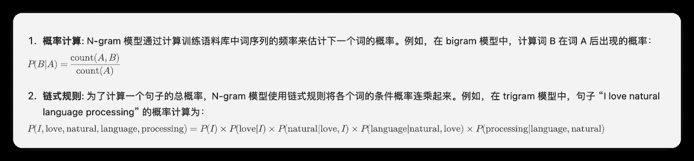

# N-gram 语言模型、向量模型、大语言模型，三者的区别

> 来源：[https://leonzhang.feishu.cn/docx/Hw8gdNcYsohm77xTOVrcGGFWnZO](https://leonzhang.feishu.cn/docx/Hw8gdNcYsohm77xTOVrcGGFWnZO)

## N-GRAM 语言模型

> N-gram 模型的原理很简单，它认为一个单词的出现概率是与该单词前面的 N-1 个单词有关的。

N-gram 语言模型是一种基于统计的方法，用于预测自然语言中的词序列。它通过分析词语在文本中出现的频率和相互关系来估计一个词在特定上下文中的概率。下面是关于 N-gram 语言模型的详细介绍：

### 基本概念

1.  **N-gram**: N 表示一组连续词的数量。例如，unigram 表示一个词，bigram 表示两个连续的词，trigram 表示三个连续的词，以此类推。

1.  **上下文窗口**： 在预测一个词时，N-gram 模型考虑前面的 N-1 个词作为上下文。例如，在 trigram 模型中预测一个词时，会参考前两个词。

### 工作原理

1.  **概率计算**：`N-gram` 模型通过计算训练语料库中词序列的频率来估计下一个词的概率。例如，在 bigram 模型中，计算词 B 在词 A 后出现的概率：

```
P(B|A) = \frac{\text{count}(A, B)}{\text{count}(A)}
```

1.  **链式规则**： 为了计算一个句子的总概率，N-gram 模型使用链式规则将各个词的条件概率连乘起来。例如，在 trigram 模型中，句子 "I love natural language processing" 的概率计算为：

```
P(I, \text{love}, \text{natural}, \text{language}, \text{processing}) = P(I) \times P(\text{love}|I) \times P(\text{natural}|\text{love}, I) \times P(\text{language}|\text{natural}, \text{love}) \times P(\text{processing}|\text{language}, \text{natural})
```



### 优点

1.  **简单直观**： N-gram 模型简单易懂，且计算方便。

1.  **计算效率高**： 相对于复杂的模型，N-gram 计算效率较高。

### 缺点

1.  **稀疏性问题**： 由于 N-gram 模型依赖于固定长度的上下文窗口，可能会遇到数据稀疏性问题，即某些 N-gram 在训练数据中很少出现或未出现。

1.  **局部依赖**： N-gram 模型只考虑固定长度的上下文窗口，不能捕捉长距离的依赖关系。

### 平滑技术

为了缓解数据稀疏性问题，N-gram 模型常常使用平滑技术，如：

1.  加法平滑 （Laplace Smoothing）: 在计算概率时给所有可能的 N-gram 加上一个固定的平滑因子。

1.  **Kneser-Ney 平滑**： 一种更复杂的平滑方法，通过重新分配概率质量来改进罕见词的概率估计。

### 应用

N-gram 模型广泛应用于自然语言处理的多个领域，包括但不限于：

1.  **机器翻译**： 通过预测目标语言中的词序列来生成翻译结果。

1.  **语音识别**： 通过预测词序列来提高语音转文本的准确性。

1.  **文本生成**： 基于上下文生成自然流畅的文本。

N-gram 语言模型虽然简单，但在很多自然语言处理任务中都发挥了重要作用。随着更复杂模型（如神经网络语言模型）的出现，N-gram 模型的局限性逐渐显现，但它仍然是理解和实现语言模型的重要基础。

## 什么是向量模型？与这个模型的区别是什么？

向量模型（Vector Space Model， VSM）是一种用于表示文本和文档的方法，它将文本中的词语映射到高维向量空间中，从而可以进行文本比较和计算相似度。向量模型广泛应用于信息检索、自然语言处理和机器学习领域。

### 向量模型基本概念

1.  **向量表示**： 文本被表示为向量，向量的每个维度对应一个词。常见的向量表示方法包括词袋模型（Bag of Words， BOW）和词嵌入（Word Embeddings）。

1.  **词袋模型**： 每个文档被表示为一个词频向量，其中向量的每个维度表示该词在文档中出现的频率。

1.  **词嵌入**： 通过神经网络训练得到的词向量表示，如 `Word2Vec`、`GloVe` 和 `FastText`，这些方法将词语映射到一个低维的连续向量空间中，使得语义相似的词在向量空间中距离较近。

### N-gram 语言模型与向量模型

N-gram 语言模型和向量模型是两种不同的模型，它们在原理和应用上有一定的区别：

1.  **N-gram 语言模型**： 基于统计的方法，通过计算词语序列的条件概率来预测下一个词。它关注的是词语的顺序和上下文关系。

1.  **向量模型**： 基于几何的方法，将文本表示为向量，通过计算向量之间的相似度来比较文本的相似性或进行其他操作。它关注的是词语在向量空间中的表示和距离。

### 向量模型的应用

向量模型在自然语言处理和信息检索中有广泛的应用：

1.  **文档检索**： 通过计算查询向量和文档向量之间的相似度（如余弦相似度），可以检索出与查询最相关的文档。

1.  **文本分类**： 将文本表示为向量，然后使用机器学习算法进行分类任务。

1.  **文本聚类**： 将文本向量化后，可以使用聚类算法将相似的文本分组。

1.  **词语相似度计算**： 通过词嵌入方法，可以计算词语之间的语义相似度，应用于同义词发现、词类扩展等任务。

### 向量模型的优缺点

**优点**：

1.  **高效计算相似度**： 向量表示使得计算文本相似度和距离变得简单高效。

1.  **语义表示**： 特别是词嵌入方法，能够捕捉词语的语义信息，使得语义相似的词在向量空间中距离较近。

**缺点**：

1.  **词序信息丢失**： 词袋模型不考虑词语的顺序，只关注词频信息。

1.  **稀疏性问题**： 词袋模型可能会产生高维稀疏向量，导致计算复杂度增加。

### 总结

N-gram 语言模型和向量模型是两种不同的模型，各自有不同的应用场景和优缺点。N-gram 语言模型主要用于词序列的概率预测，而向量模型则用于表示和计算文本相似度。它们可以相互补充，共同用于解决自然语言处理中的各种任务。

## N-GRAM 语言模型 与大语言模型的区别是什么？

N-gram 语言模型和大语言模型（例如，基于 `Transformer` 的 `GPT-3`、`BERT` 等）在原理、复杂性和应用上有显著区别。以下是两者的主要区别：

### 原理和结构

1.  **N-gram 语言模型**：

+   **原理**： 基于统计方法，通过计算词语序列的条件概率来预测下一个词。它假设一个词的出现仅依赖于前面 N-1 个词。

+   **结构**： 简单且直接，通常只需记录和计算词序列的出现频率。

+   **上下文窗口**： 固定长度的上下文窗口（即 N-1 个前置词），不能捕捉长距离依赖关系。

1.  **大语言模型**：

+   **原理**： 基于神经网络，尤其是深度学习中的 `Transformer` 架构，通过大规模语料库训练，捕捉语言的复杂结构和语义关系。

+   **结构**： 复杂且深层，由多层神经网络组成，如自注意力机制、多头注意力等，能够处理长距离依赖关系和复杂的上下文信息。

+   **上下文窗口**： 能够处理更长的上下文，并且在生成过程中可以考虑整个句子的结构和语义。

### 训练和计算

1.  **N-gram 语言模型**：

+   **训练数据**： 训练过程较简单，只需统计词序列的出现频率。

+   **计算复杂度**： 计算复杂度低，存储需求较小，但随着 N 增大，数据稀疏性问题会加剧。

+   **平滑技术**： 为了缓解稀疏性问题，通常使用平滑技术，如加法平滑、`Kneser-Ney` 平滑等。

1.  **大语言模型**：

+   **训练数据**： 需要大规模语料库和强大的计算资源进行训练，训练过程复杂且时间较长。

+   **计算复杂度**： 计算复杂度高，参数数量巨大（如 `GPT-3` 有 1750 亿参数），需要大量存储和计算资源。

+   **优化技术**： 使用先进的优化技术和硬件加速（如 `GPU`、`TPU`）来加速训练和推理过程。

### 性能和应用

1.  **N-gram 语言模型**：

+   **性能**： 在短文本和简单任务上表现尚可，但在处理复杂语义和长文本时效果有限。

+   **应用**： 主要用于早期的自然语言处理任务，如简单的文本生成、拼写纠错、初级的机器翻译等。

1.  **大语言模型**：

+   **性能**： 在多种自然语言处理任务上表现优异，包括文本生成、问答系统、机器翻译、情感分析等。能够生成更加自然流畅的文本，捕捉复杂的语义关系。

+   **应用**： 广泛应用于现代自然语言处理任务和产品，如智能助手、聊天机器人、内容生成、自动摘要等。

### 总结

+   **N-gram 语言模型**： 基于简单统计方法，适用于处理短文本和简单任务，训练和计算复杂度较低，但在处理复杂语义和长距离依赖关系时存在局限。

+   **大语言模型**： 基于深度神经网络，能够捕捉语言的复杂结构和语义关系，适用于多种自然语言处理任务，性能优异但训练和计算复杂度高。

两者在不同的时代和技术背景下各有优势，随着计算能力和数据资源的提升，大语言模型逐渐成为现代自然语言处理的主流方法。

## 大语言模型不也是猜字词的概率嘛？一个词一个词生成这样？

> 大语言模型

> 上下文窗口： 能够处理更长的上下文，并且在生成过程中可以考虑整个句子的结构和语义。

大语言模型（如 `GPT-3`、`BERT` 等）确实是基于词语概率的生成模型，但与传统的 `N-gram` 模型相比，它们在上下文处理、复杂性和生成质量上有显著提升。虽然它们也通过预测下一个词的概率来生成文本，但其方式和效果有以下几个重要区别：

### 上下文处理

1.  **`N-gram` 模型**：

+   **上下文窗口**： 只考虑固定长度的上下文（N-1 个前置词），无法捕捉长距离的依赖关系。

+   **局部依赖**： 只能处理局部上下文，无法理解整个句子的全局结构和语义。

1.  **大语言模型**：

+   **上下文窗口**： 能够处理更长的上下文，通常可以捕捉整段文本甚至更长文本的依赖关系。例如，`GPT-3` 可以考虑到数千个词的上下文。

+   **全局依赖**： 使用自注意力机制（`Self-Attention`）能够捕捉长距离的依赖关系，理解整个句子甚至段落的结构和语义。

### 生成方式

1.  **`N-gram` 模型**：

+   **生成方式**： 基于固定长度的上下文预测下一个词，通过链式规则生成文本。

+   **局限性**： 由于上下文窗口有限，生成的文本在处理复杂语义和长距离依赖时效果较差。

1.  **大语言模型**：

+   **生成方式**： 依赖于复杂的神经网络结构（如 `Transformer`），通过自注意力机制考虑整个上下文，逐词生成文本。

+   **动态调整**： 能够动态调整上下文窗口的大小，根据上下文的变化调整生成策略。

+   **复杂语义处理**： 能够捕捉和理解复杂的语义关系，使生成的文本更加自然和连贯。

### 预测质量

1.  **`N-gram` 模型**：

+   **预测质量**： 基于简单的统计方法，无法处理稀疏数据，生成的文本质量有限。

+   **平滑技术**： 需要依赖平滑技术来处理数据稀疏性问题。

1.  **大语言模型**：

+   **预测质量**： 通过大规模预训练和深层网络结构，能够生成高质量、自然流畅的文本。

+   **预训练与微调**： 通过预训练和微调，模型能够适应不同的任务，提高生成质量和适应性。

### 总结

虽然大语言模型和 `N-gram` 模型都是基于概率预测的生成模型，但大语言模型在上下文处理、生成方式和预测质量上有显著的提升。大语言模型通过复杂的神经网络结构和自注意力机制，能够捕捉长距离依赖关系和复杂语义，使得生成的文本更加自然、连贯和高质量。它们不仅仅是逐词生成，而是能够考虑整个上下文，动态调整生成策略，以达到更好的效果。

## 通过 Prompt 为大模型定义角色的方式，是否利用了大模型的“全局依赖中的自注意力机制”？

> 通过 Prompt 为大模型定义角色的方式，比如“假设你是心理咨询师，...”，然后大模型会按照 Prompt 要求“心理咨询师”的角色进行回复。

> 这个是不是就利用了，大模型的“全局依赖中的自注意力机制”？

通过 `Prompt` 为大模型定义角色的方式，比如“假设你是心理咨询师，...”，确实利用了大语言模型的全局依赖和自注意力机制，但更确切地说，这种方式利用了大模型的以下几个特点：

### 1. 全局依赖和自注意力机制

大语言模型，如基于 `Transformer` 架构的模型，能够处理长距离的上下文依赖关系。自注意力机制允许模型在生成每个词时参考整个上下文，而不仅仅是固定长度的前置词。这使得模型在理解和生成过程中能够更好地捕捉上下文中的重要信息。

### 2. 上下文理解和条件生成

通过在 `Prompt` 中定义角色（如“假设你是心理咨询师”），模型能够在生成过程中持续参考这个角色设定。模型在处理这个 `Prompt` 时，会在其记忆和生成过程中考虑这个角色的特定行为和语言模式。这样，即使在生成较长的对话或文本时，模型也能保持一致的角色特性。

### 3. 预训练知识和条件响应

大语言模型在预训练过程中，已经学习了大量关于各种角色、语境和情境的知识。当给定一个特定角色的 `Prompt` 时，模型可以利用其预训练过程中学到的知识，结合当前上下文，生成符合该角色特征的回复。

### 4. 自适应生成

大语言模型具备高度的自适应性。通过在 `Prompt` 中提供明确的指示（如角色设定），模型能够调整其生成策略，以符合特定的角色行为和语言风格。这种自适应性依赖于模型在自注意力机制下的上下文处理能力，使其能够在整个生成过程中保持一致性。

### 举例

当你提供一个 `Prompt` 如“假设你是心理咨询师，和一个感到焦虑的客户对话”，模型会利用以下机制：

1.  **全局依赖**： 模型在生成每一句话时，会参考整个对话的上下文，包括你设定的角色和对话的具体内容。

1.  **自注意力机制**： 在生成过程中，模型会不断地关注和调整当前生成内容，使其符合心理咨询师的特征和对话目标。

1.  **预训练知识**： 模型会调取其预训练过程中学到的关于心理咨询的知识，生成专业且符合情境的回复。

1.  **自适应生成**： 模型会根据对话的进展，自适应地调整其语言和行为，以保持角色的一致性和对话的连贯性。

### 总结

通过 `Prompt` 定义角色的方式确实充分利用了大语言模型的全局依赖和自注意力机制，但更重要的是，它利用了模型的上下文理解、条件生成、自适应生成和预训练知识等多方面的能力。这使得大模型能够在给定的角色和情境下生成高质量、连贯且符合预期的文本。

## 从大模型的底层设计而言，应该是不存在“上下文理解”的吧？

从大模型的底层设计而言，“上下文理解”并不是一种独立的明确机制，而是一个 emergent property（涌现属性），即模型通过大量数据的训练和复杂的网络结构自然地表现出的能力。我们可以更具体地看一下大模型的底层设计，尤其是基于 `Transformer` 的架构，来理解这一点。

### 1. 自注意力机制（Self-Attention Mechanism）

自注意力机制是 `Transformer` 架构的核心部分，它使模型能够在生成或理解一个词时，考虑整个输入序列的其他词。这种机制允许模型在处理每一个词时，计算该词与其他所有词的相关性（或注意力权重），并基于这些权重调整输出。

+   **计算注意力权重**： 每个词通过 `Query`、`Key` 和 `Value` 向量相互计算注意力权重，这些权重决定了每个词对当前词的影响力。

+   **加权求和**： 注意力权重用于对输入序列中的其他词进行加权求和，从而生成一个新的词表示。

这种机制虽然没有明确地“理解”上下文，但通过这种方式，模型能够捕捉到长距离的依赖关系和上下文信息。

### 2. 预训练和微调（Pre-training and Fine-tuning）

大语言模型通过预训练阶段在大规模语料库上学习语言模式、词汇关系和语法规则。预训练任务如语言模型（例如，`GPT` 系列的自回归语言模型任务）让模型学会预测下一个词，从而在训练过程中捕捉到大量的上下文信息。

+   **语言模型预训练**： 模型学习如何基于上下文预测下一个词，这一过程中，模型会学习到许多关于语言和语境的统计信息。

+   **微调阶段**： 在特定任务上微调模型，使其能够更好地应用预训练中学到的知识。

### 3. 涌现的理解能力

虽然从技术上说，模型并不具备“理解”能力，但它通过处理大量数据和复杂的网络结构，可以表现出类似于理解的能力。以下是一些关键点：

+   **上下文依赖**： 通过自注意力机制，模型能够在生成文本时依赖整个上下文，而不仅仅是前几个词。

+   **模式学习**： 预训练阶段，模型通过大量数据学习语言模式，这些模式包含了丰富的语法、语义和上下文信息。

+   **条件生成**： 当给定一个 `Prompt` 时，模型能够基于上下文和条件进行生成，表现出对上下文的敏感性和一致性。

### 总结

从底层设计来看，大语言模型通过自注意力机制和预训练阶段的模式学习，展现出对上下文信息的高度敏感性和依赖性。虽然这些模型并不真正“理解”上下文，但它们通过统计和模式识别，表现出一种似乎理解上下文的能力。这种能力使得模型在生成文本时能够保持一致性、连贯性，并适应特定的角色或任务需求。

## 附录

+   自然语言处理中的N-Gram模型：原理与应用 - 百度智能云

N-Gram模型在自然语言处理中的应用和优缺点

✏️ 模型原理 基于统计的语言模型，预测下一个单词的概率分布

📕 模型应用 语言翻译、文本分析、情感分析等任务


## ❗️ 模型优缺点

简单易用、灵活性高，但泛化能力较弱、数据稀疏性严重
