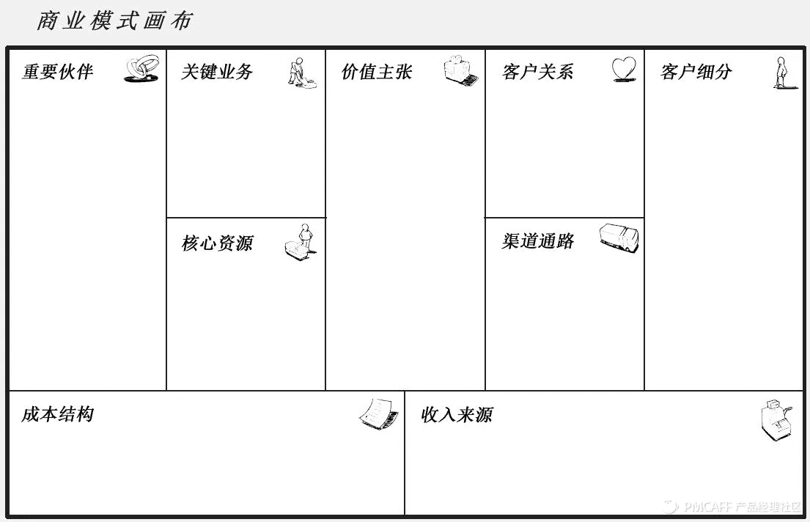

# AIGC 研究：业务与商业分析

> 来源：[https://leonzhang.feishu.cn/docx/KSLzd6iQEocPCJxK8kdcnIUBn6b](https://leonzhang.feishu.cn/docx/KSLzd6iQEocPCJxK8kdcnIUBn6b)

### 行业研究

> 上下左右，古今中外。 [ChatGPT 玩法案例（停止更新..) ](https://sm84lfdag7.feishu.cn/docx/CW9LdwxwhoUrKPx8btWcoEqmnXe#QUgOdcm6qoEeQAxK47Ic68C0nKg)

#### 如何了解一个行业

明确产业全局、明确企业定位、瞄准竞争对手。

+   行业：是具有高度相似性和竞争性的，提供同质性产品或服务的企业群体。

+   产业：具有某种同类属性的经济活动的集合体，概念范围比行业大。比如：第一产业、第二产业、第三产业。

#### 互联网商业

+   生产生活：信息、社交、娱乐、工具

+   商业服务：电商、外卖、出行、生活、健康

+   基础设施：金融支付、云计算、5G 基建、企业服务、城市政务

#### **AIGC 产业链**

| **AIGC 产业链介绍：** |  |
| --- | --- |

### 洞察业务

> 业务流程、业务主要场景、业务与组织关系

业务洞察能力的层级：

+   经济社会：宏观经济条件和市场变化、宏观政治环境和政策

+   所在行业：公司所在行业环境、上下游行业、竞争对手

+   公司业务：公司的主营业务和创新业务、核心的业务链路、组织和价值观

+   所在的业务：业务线和业务定位、业务核心价值链路、关联合作方

+   业务需求：需求核心要解决的问题、痛点和价值本质

### 战略分析

#### 市场趋势

+   市场容量/规模

+   市场趋势（发展阶段）

+   初创期、成长期、成熟期、衰退期

+   产品细分和产品满足

+   买家需求

+   **细分市场**（越细分越好）**、供需关系**（<>=）

+   卖家产品

+   用户/客户痛点（市场机会）

+   用户画像

+   产品机会

#### 商业分析模型

1.  **宏观环境分析：PEST  **[PM Maps](https://sm84lfdag7.feishu.cn/docx/BAhhd3MXFoJ523x4IgDcTQM8nT2#HlvzdmnVxoOXSHxJwsRckRuxnJf)** **

PEST分析模型帮助组织或项目团队评估外部环境对组织或项目影响的关键因素，从而预测和适应环境变化，并制定相应的战略决策。

+   **政治（Political）**：政府政策、法律法规、政治稳定性等因素对组织或项目的影响。

+   **经济（Economic）**：经济条件、市场趋势、通货膨胀率、汇率等经济因素对组织或项目的影响。

+   **社会（Social）**：人口统计、文化价值观、社会趋势、消费者行为等社会因素对组织或项目的影响。

+   技术（Technological）：技术发展、创新趋势、数字化转型等技术因素对组织或项目的影响。

1.  **竞争态势：波特五力模型**

波特五力分析（Porter's Five Forces Analysis）是由迈克尔·波特（Michael Porter）提出的一种常用的战略分析工具，用于评估行业竞争和确定组织在特定市场中的竞争力，帮助企业了解所处市场的竞争环境，并确定合适的竞争策略。

+   行业内竞争力（Industry Rivalry）：评估当前行业中已存在的竞争程度。这包括竞争对手的数量、规模、市场份额、产品差异化、竞争策略等。

+   供应商谈判能力（Supplier Bargaining Power）：评估供应商对组织的影响力。这包括供应商的数量、供应稀缺性、品牌知名度、交易成本等。

+   顾客谈判能力（Buyer Bargaining Power）：评估顾客对组织的影响力。这包括顾客的数量、顾客集中度、产品替代品可用性、价格敏感度等。

+   潜在进入者威胁（Threat of New Entrants）：评估新竞争者进入市场的难易程度。这包括市场准入壁垒、资本需求、技术门槛、品牌认知度等。

+   替代品威胁（Threat of Substitutes）：评估替代产品或服务对组织的影响力。这包括替代品的可用性、性能比较、价格差异等。

#### 竞品分析维度

> 分析目标、竞品选择、分析维度、收集信息、优势、劣势、机会、威胁

### 商业分析及模式

#### 商业画布 [PM Maps](https://sm84lfdag7.feishu.cn/docx/BAhhd3MXFoJ523x4IgDcTQM8nT2#VNhed1b5boUY9WxpK18cHT3Tneb)

**商业画布（Business **Canvas）是一种用于描述和分析商业模型的工具。商业画布以一个简洁而全面的图形化模型来呈现企业的核心要素，帮助理解企业如何创造、交付和捕获价值。

#### Midjourney 商业画布