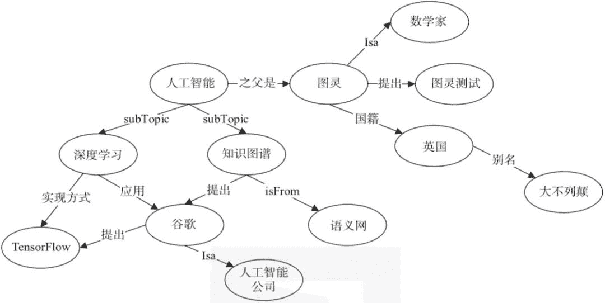

# AIGC 研究：知识图谱与大模型

> 来源：[https://leonzhang.feishu.cn/docx/P0AtdeCP5otfIExjfR3c1h4Xnah](https://leonzhang.feishu.cn/docx/P0AtdeCP5otfIExjfR3c1h4Xnah)

### 知识图谱

#### 定义、特征及局限

1.  定义

**知识图谱**（Knowledge Graph），是结构化的语义知识库，用于以符号形式描述物理世界中的概念及其相互关系。其基本组成单位是“实体-关系-实体”三元组，以及实体及其相关属性-值对，实体间通过关系相互联结，构成网状的知识结构。将互联网的信息表达成更接近人类认知世界的形式，提供一种更好地组织、管理和理解互联网海量信息的能力。

1.  特征

知识图谱对比传统知识库，具有三大特征：图结构化、高效的检索能力、智能化推理能力。

1.  局限

+   语料数据标注效率低、主观性强

+   知识抽取质量，难以保证

+   语义理解和自然语言处理难度大

+   本体构建难度大

+   知识通用性不足

+   知识完备性不足

#### 处理知识/信息的手段

自然语言以文字序列的方式来表示知识，而知识图谱（KG）利用图结构来描述世界万物之间的关系，代表一类结构化的知识表示方法。典型结构表示包括：层次结构（如概念图谱）、关联结构（实体关系图谱）、时序结构（如事理图谱）、逻辑结构（如逻辑规则）等。知识图谱中既包含自然的文字语义，也包含结构化关联关系。

在传统符号 Al 中，知识表示的逻辑结构水平越高，推理能力越强，但知识获取代价越大。现代大模型技术印证了获取的知识要达到一定规模，推理能力才能涌现。知识图谱是通过简化知识表示形式来换取知识规模，但仍然面临知识覆盖度的困境。

#### 知识图谱与大模型的对比

知识图谱=文字语义＋结构知识

知识图谱接近自然语言、接近人脑认知、易于扩展增加、易于神经网络化。

### 知识图谱、大模型优势与不足的互补

#### 知识图谱**的优势**

+   可解释性：基于明确的语义结构进行查询和分析，具有较好的可解释性。

+   可信赖性：由专家创建和维护，可信赖性高。

+   可溯源性：每个实体和关系都可以追溯到其来源。

+   可校验性：知识图谱的信息均可通过专家进行校验。

+   可评价性：知识图谱的质量可通过查询的准确性和完整性来评价。

+   领域能力：具有较强的领域知识支持，支撑了其领域服务能力。

+   推理能力：可根据图谱中的精确知识内容和关联结构，进行高可信度的推理。

#### **知识图谱的不足**

+   通用性：知识图谱通常面向特定领域，在通用性上可能较弱。

+   可生成性：知识图诺主要用于查询和分析，而非生成新的内容。

+   学习能力：缺乏自主学习能力。

+   创作能力：缺乏自主创作能力。

+   常识能力：局限于知识图诺中的信息，常识能力较弱。

+   语义理解能力：语义理解能力主要局限于知识图谱中的知识内容，理解能力较弱。

#### **大模型的优势**

+   通用性：模型具有指令遵循能力，能处理多种任务，并支持多语言、多模态、多领域的应用。

+   可生成性：模型能生 成各种形式和风格的文本，也能生 成多模态的内容，如图像、音频等。

+   学习能力：基于大量语料的训练，能对新输入产生合理的响应，也能从多模态数据中进行学习。

+   创作能力：能生成新颖、连贯和通顺的文本，也能生成多模态作品，如图片、歌曲等。

+   常识能力：基于海量通用训练数据中的知识，具有常识理解能力。

+   语义理解能力：能根据文本、多模态数据中出现的内容，理解其含义和关系。

#### 大模型的**不足**

+   可解释性：模型的决策过程是黑箱的，难以解释。

+   可信赖性：模型的输出可能存在错误或有偏见的信息

+   可湖源性：模型的输出；是基于训练的数据，而不是特定的数据点或知识点，较难追湖其输出的来源。

+   可校验性：模型的输出和推理结果有赖于通过人 工或者其他系统进行校验。

+   可评价性：横型的性能和输出可通过一些标准任务进行评价，尚不成熱。

+   常识能力：无法处理超出训练语料范围的常识问题。

+   领域能力：缺乏丰富全面的领域知识，领域服务能力一般。

+   语义理解能力：可能出现理解错误或歧义等问题。

### 知识图谱与大模型的融合

#### **知识图谱与大模型的协同收益**

+   提高可解释性：知识图谱的显性知识与大模型的隐性知识相结合，可提高知识应用的可解释性。

+   实现交叉验证：知识图谐的输出与大模型的输出相结合，可为知识应用提供交叉验证/比对的手段，提高服务的可信軟性。

+   优化知识存储：知识图诺的结构化信息存储和大模型的非结构化信息处理相结合，可优化知识存储和检索效率。

+   提高决策能力：知识图谱推理结果与大模型推理结果的结合，可进一步丰富辅助决策的知识背景，并提供更精准的决策建议。

+   增强隐私保护：知识因谱中数据加密和保护能力与大模型数据调用能力相结合，可降低大模型对个人隐私数据的依赖，有利于保障隐私安全。

+   确保知识产权保护：知识管理机制与本地化部署方式相结合，可更好地保护知识产权，防止知识的滥用或盗用。

+   增强伦理边界：通过优化知识图谱中的知识结构及大模型训练样本结构，枸建约束规则类知识并降低数据偏见，强化输出边界。

#### **知识图谱与大模型融合的好处**

+   降低算力：可減少大模型对无结构化文本的依赖，从而降低大模型的预训 1 练或推理所需的算力和时间。

+   提高知识可信度：依托知识图谱中经质量评估的知识，可帮助大模型提高信息的质量和可信度，并保障知识的正确性和时效性。

+   增强通用性、领域能力、认知能力：可帮助大模型获得跨领域和跨语言的知识，井更好地适应不同的领域任务和场景。

+   降低构建成本：依托知识圈谐中的结构化知识，可减少大模型对标注效据或专家知识的需求，从而降低大模型的构建成本和难度。

+   提高可生成性：可帮助大模型可生成更贴近实际、吏具有解釋性的内容。

+   提高创作能力：通过知识因谱的知识增强，可帮助大模型创作内容更具逻辑、一致性和创新性等。

+   增强理解能力：大模型的语义理解能力可帮助知识图诺更好地理解和分类非结构化信息。

+   降低构建成本：大模型的上下文理解能力、基础常识支持能力等可帮助知识图谱提升非结构化数据的知识获取、知识建模、知识融合等能力，降低其构建和维护成本。

+   丰富输出形式：大模型的生成能力可帮助知识图谱获得多元化的知识输出和服务形式，增强知识图谱系统的服务效果，并提升人机交互水平。

+   提高知识完备性：大模型中涵盖的知识及其对新数据的理解能力，可帮助知识图谱进行知识补全和知识校验，提高知识的完备性。

### 知识图谱的技术

知识图谱技术主要指构建知识图谱所需要使用的技术，这是融合了机器学习、信息抽取和检素、知识表达等的综合性技术。整个知识图谱的构建是一个从知识获取和表达到知识的关联构建，再到知识的存储和利用的过程，因此可以从知识图谱表征、 知识图谱构建、知识图谱存储三方面介绍知识图谱技术。

+   **知识图谱的表征**：核心是通过向量表达知识图谱中的实体和关系。

+   **知识图谱的构建**：知识图谱的构建一般是利用自动化技术对结构化、半结构化、非结构化数据进行知识抽取，并将数据存储到模式层和数据层。 根据先构建数据层还是模式层，知识图谱自顶向下的构建方式是先构建模式层， 构建数据层。模式层的构建可以通过从人 工构建的高质量数据中抽取本体和模式信息，然后再根据已构建好的模式层，从更大规模的数据中抽取数据来构建数据层。

+   **知识图谱的存储**：根据逻辑结构，知识图谱可以分为数据层和模式层。数据层包括由大量事实（ Fact ）组成的基本信息，如 （实体、关系、实体）或（实体、属性、属性值）这样的三元组数据，而这些数据一般存储在图数据库中。

### 知识图谱设计原则

+   需要那些实体、关系、属性？

+   哪些属性可以作为实体？哪些实体可以作为属性？

+   哪些信息不需要放在知识图谱？

#### BEAR 原则

+   业务原则 （Business Principle） ：一切要从业务逻辑出发，也就是说通过观察知识图谱的设计也很容易推测其背后业务的逻辑，而且设计时也要想好未来业务的变化。

+   分析原则（ Analytics Principle ）：知识图谱中任何一个实体都是为关系分析而服务，如果一个实体对分析网络结构没有帮助，则可以设置成属性甚至不要放在知识图谱里面。

+   冗余原则（ Redundancy Principle ）:知识图谱设计中，避免把超级节点放入到知识图谱当中，这会导致系统的性能急剧下降，并且避免存放任何重复信息。

+   效率原则（Efficiency Principle）：知识图谱尽量轻便的存储关键信息，剩下的可以存储在传统数据库中。

### 参考

+   大模型时代的知识处理：新机遇与新挑战  https://www.secrss.com/articles/58455