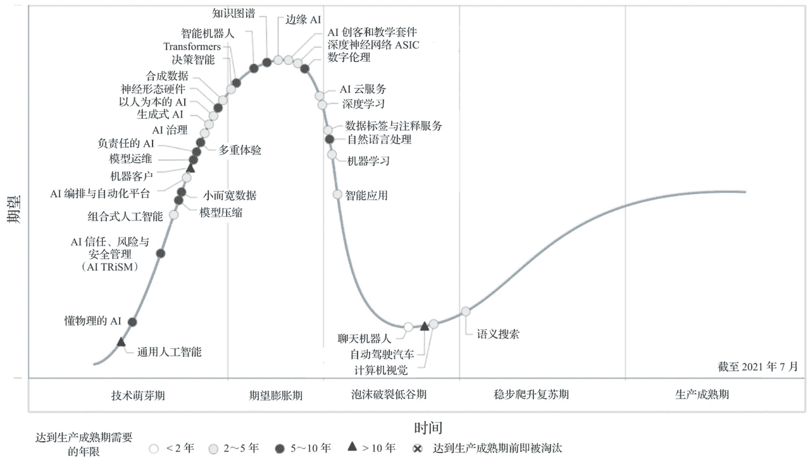

# AIGC 研究：通往 AI 的道路

> 来源：[https://leonzhang.feishu.cn/docx/Lr3xdoRgvoUhBaxroyHcaNDCn2f](https://leonzhang.feishu.cn/docx/Lr3xdoRgvoUhBaxroyHcaNDCn2f)

#### 从决策式 AI 向感知式 AI 迈进

人工智能（AI），像人一样思考和行动的系统。

+   弱人工智能（ANI）：仅擅长单个场景的程序化处理（ChatGPT，弱人工智能）。

+   强人工智能（AGI）：可在多个场景进行工作处理与自我学习。

+   超人工智能（ASI）：在所有领域均超越人类水平的人工智能。

#### AI 技术成熟度曲线

|  |
| --- |

#### 主流人工智能的分类

决策式 AI 和生成式 AI 的区别主要在于其目标和应用领域。生成式 AI 侧重于从数据中生成新的内容，而决策式 AI 则专注于基于已有信息做出最优决策。

+   决策式 AI（也称为决策模型）则专注于问题的决策过程。它基于已知的输入和事先定义的规则或算法，选择最佳的行动或决策。决策式 AI 更关注如何做出准确的决策，而不仅仅是生成新的数据。这种方法通常用于游戏 AI、自动驾驶和推荐系统等领域，其中模型需要在给定的环境中做出明智的选择。

+   生成式 AI（也称为生成模型）是一种基于概率模型的方法，旨在通过学习数据的分布来生成新的数据。生成式 AI 可以从给定的训练数据中学习并理解数据的结构和规律，然后使用这些知识生成类似的、但与训练数据不完全相同的新数据。这种方法通常用于图像生成、自然语言处理和音频合成等任务，其中模型可以生成具有逼真度和创造性的新样本。

#### 决策式 AI 和生成式 AI 的区别

**无论是哪**种类型的模型，它的基础逻辑是一致的：从本质上来说是一个函数，要想找到函数准确的表达式，要想找到函数准确的表达式，只靠逻辑是很难推导的，这个函数其实是被训练出来的。

|  | 决策式 AI | 生成式 AI |
| --- | --- | --- |
| 技术路径 | 将数据分类打标签，从而区分不同类别的数据，例如区分猫和狗的照片 | 分析归纳已有数据后生成新的内容，比如生成逼真的狗的图片 |
| 成熟程度 | 底层技术相对成熟，在各领域有广泛的商业应用 | 2014 年开始迅速发展，近期呈指数级爆发，并且出现多个现象级应用 |
| 应用方向 | 人脸识别、推荐系统、风控系统、机器人、自动驾驶等 | 内容创作、人机交互、产品设计等 |

#### AI 的三大学派

> 符号主义、连接主义、行为主义

+   **符号主义（逻辑主义）**，认为 AI 源于数理逻辑，并可以通过使用符号和逻辑推理来模拟人类的思考过程。主要挑战是如何将符号与世界进行有效的对应，以及如何获取和表示知识，如专家系统、知识图谱、决策树等。

+   **连接主义（仿生学派）**，认为 AI 源于仿生学，并可以通过模仿大脑中的神经元之间的连**接和学习过程来实现智能行为，**代表性研究如神经网络、深度学习、强化学习。主要挑战是如何训练复杂的神经网络结构以实现高质量的学习和推理。

+   **行为主义（进化主义学派）**，认为 AI 源于行为控制/生物进化论，即基于感知、控制和行为反馈的系统，模拟生物进化的过程**。将信息论、神经系统、**逻辑和计算机联系在一起，模拟人类在控制过程中的智能行为，如自寻优、自适应、自学习。

#### AGI 的研究方向

#### AIGC 商业化产品（国内）

+   AI 视频生成/处理工具：奥创光年、Fancy Tech

+   AI 图像生成/处理工具：爱设计、即时设计

+   AI 文字生成/处理工具：讯飞星火、文心一言、火山写作、聆心智能

+   AI 虚拟机器人：硅基智能、黑镜科技、小冰、Chato

+   AI 音频生成/处理工具：百宝音、火山引擎

+   AIGC 其他（3D 空间、代码生成、人格化 AI 互动等）：心识宇宙

#### AIGC 应用场景

+   客户服务（Chato）：客服沟通、知识库管理、客服质检（关键词检测）

+   互动娱乐：游戏内容生成（动画、关卡和设计、背景音乐、声音效果）、NPC 内容生成、创新型 AI 游戏（arrowmancer）

+   文化传媒：剧本创作（DeepMind Dramatron）、角色和场景创作、后期制作（高清视频修复）

+   研发设计：外观设计（时装设计产品 CALA）、结构设计（生成结构并 3D 打印）、药物研发（谷歌 AI-Med-PaLM）

+   生产制造：机器人控制、多机器人协同（Optimus，擎天柱）、工业质检

+   供应链管理：需求预测（seq2seq 模型，商品历史销量、季节因素、促销活动）、智能仓库、库存管理

+   市场营销：营销方案（Adobe、蓝色光标）、营销文案与图片（Adobe、Midjourney、SD）、营销沟通（电话外呼、直播带货）