# ChatGPT 玩法案例（停止更新..)

> 来源：[https://leonzhang.feishu.cn/docx/Xj8vdXiYHo4hKZx1tgLcqfqBnzb](https://leonzhang.feishu.cn/docx/Xj8vdXiYHo4hKZx1tgLcqfqBnzb)

> #Prompt  #ChatGPT #AI

> 随着技术和文明的发展，我们需要不断适应和学习新事物。当汽车取代了马匹成为更快、更方便的交通工具时，我们也需要学会使用和驾驶汽车。

## 一、ChatGPT

+   如果你有英文基础，建议使用英文直接对话，对比中文效果会要好很多（客观原因，毕竟英文语料丰富）；

+   以下问答基于 GPT-3（有条件使用 GPT-4 的同学，建议优先使用 GPT-4，或者 GPT3.5 也行）；

### 1.1 关于自我提升

#### 1.1.1 如何快速阅读一本书

**Prompt**

1.  **版本一**

1.  你知道 XX（作者）的 XX（作品名称）嘛？（减少误判为不同作者的重名作品）

1.  总结这本书的核心观点以及各部分的内容总结，最后给出观点，如何看待这本书？

1.  **版本二**

1.  请你用《如何阅读一本书》中"分析阅读"的方法，写一篇《金字塔原理》这本书的读书笔记。

1.  **版本三**

1.  找出文章中的重点段落和关键句子。

1.  确定文章的中心思想，即作者试图向读者传达的主要信息。

1.  根据文章的主题和结构，将其分成不同的部分，并为每个部分总结出主要内容。

1.  如果文章包含图表、图片或其他可视化元素，请注意这些元素，并确定它们对文章主题的重要性。

1.  重点突出，使用加粗、斜体或下划线等格式标记文章中的关键词和短语。

| 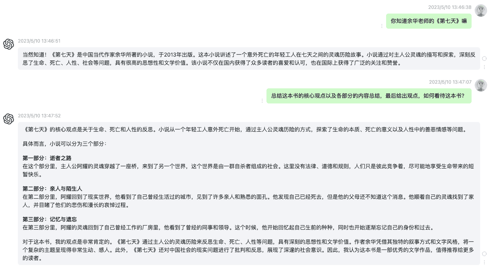 | 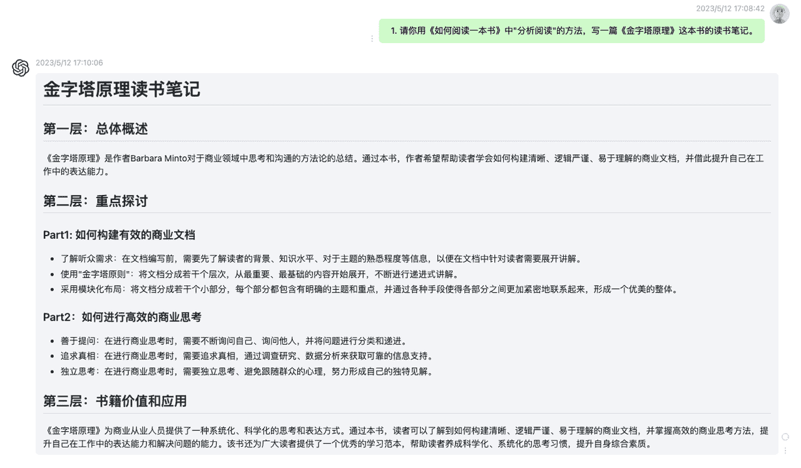 |
| --- | --- |

#### 1.1.2 了解作者生平以及作品

**Prompt**

+   我想了解一下 XX（作者）这个人，出版过哪些书籍，以及简单概括一下每本书的主要内容。

+   （可能会有胡诌的可能，需要辩证来看哈）

| 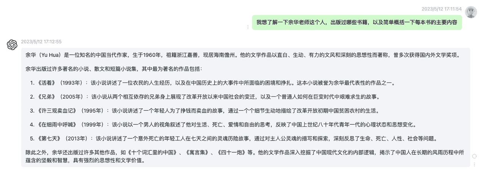 |
| --- |

#### 1.1.3 按照自己的节奏“读书”

> 主动阅读的效率提升，借助 AI 按照自己的节奏来阅读和理解书籍内容

**Prompt**

+   如图

| 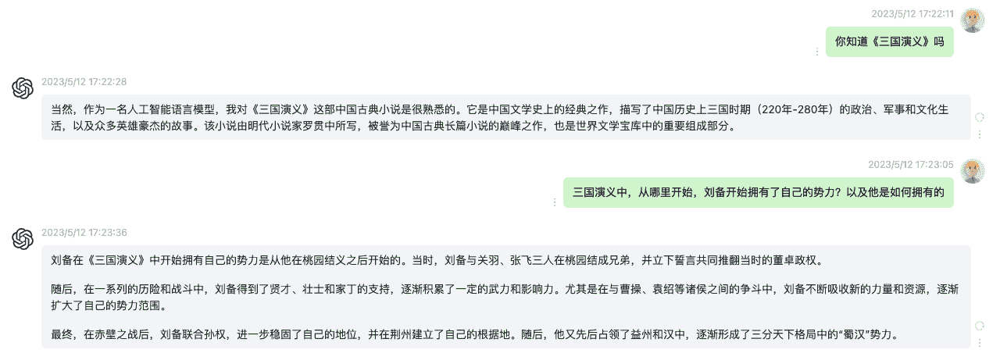 |
| --- |

#### 1.1.4 扩展视野

**Prompt**

+   你知道 XX（书本名称）吗？

+   还有哪些书与 XX（书本名称）中的科技革命的观点或结论持有相反观点的？

| 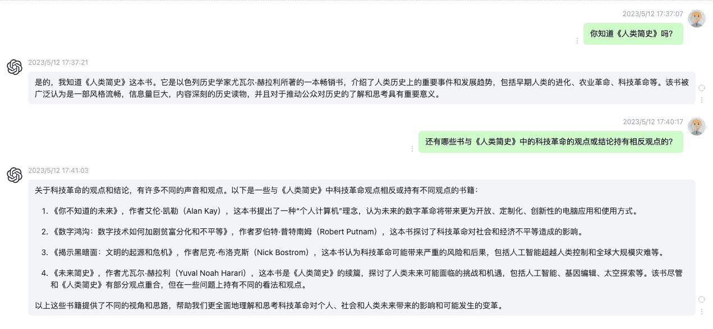 |
| --- |

#### 1.1.5 练习英语口语

+   【免费口语老师：如何用 ChatGPT 练习英语口语】

<https://player.bilibili.com/player.html?bvid=1iy4y1Q7Fh&share_source=copy_web&vd_source=672ec070780ce29c890256a5fabe799b>

### 1.2 关于工作提效

#### 1.2.1 模拟你需要对接的人/团队

**Prompt**

+   定义它的身份；

+   描述你的需求；

| 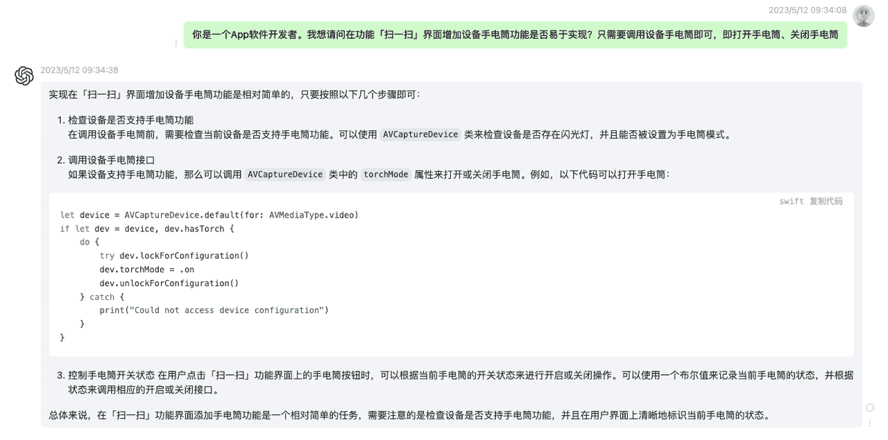 | 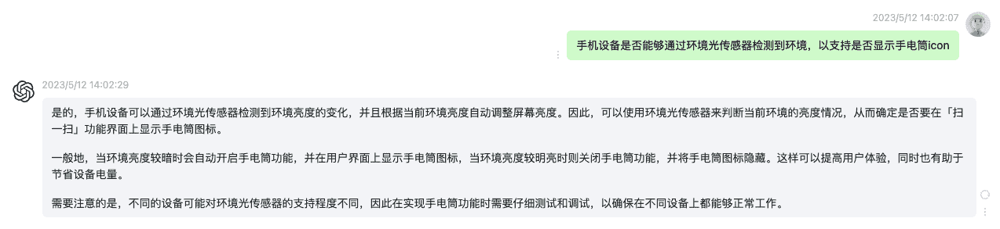 |
| --- | --- |

#### 1.2.2 语言语法

+   [Mermaid](https://zhuanlan.zhihu.com/p/355997933) 流程图语法

+   Mermaid 是一种基于 Javascript 的绘图工具，使用类似于 Markdown 的语法，使用户可以方便快捷地通过代码创建图表。

**Prompt**

+   定义它身份，用 Mermaid 语法写一下 XX（需求）的流程图。

| 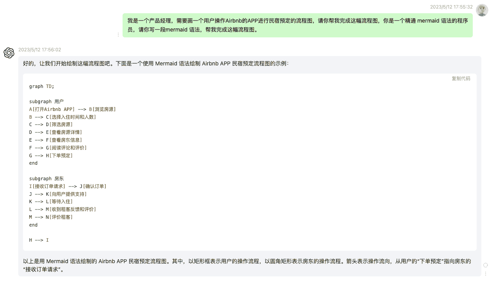 |  |
| --- | --- |

#### 1.2.3 设计产品

> [P](https://www.pm-ai.cn/)MAI — 产品经理的 AI 助手，让你工作更轻松。一键生成 PRD、解决方案、流程图、sql 等功能 __  PM-AI

| 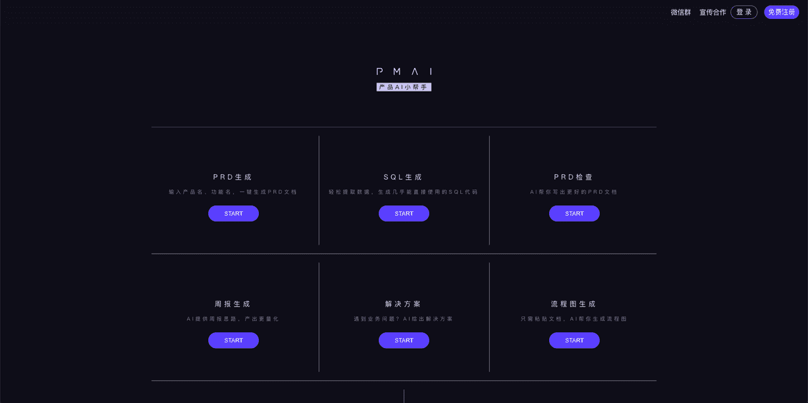 |
| --- |

#### 1.2.4 出创意或补充思维盲点

> 如果你擅长使用 Midjourney，你也可以让它帮你生成 Prompt

| 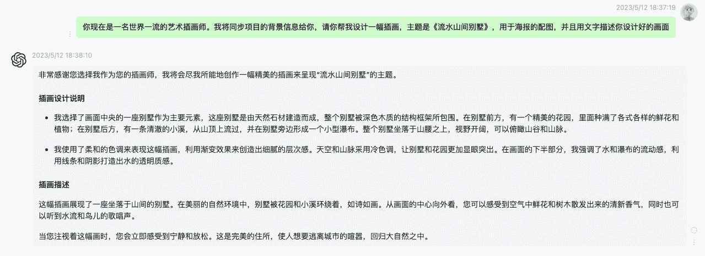 |
| --- |

#### 1.2.5 模拟用户场景和操作

> Prompt

+   定义它身份、描述场景、举例说明你的要求。

| 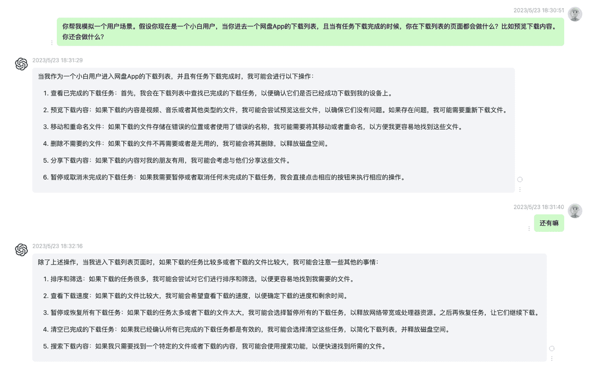 |
| --- |

## 二、New Bing / You

> 建议优先使用 New Bing（因为 New Bing 是最新的 GPT-4），另外，建议使用「精确」模式。

### 2.1 行业研究

> 「**上下左右，古今中外**」

#### 2.1.1 上下，上下游及相关产业

| 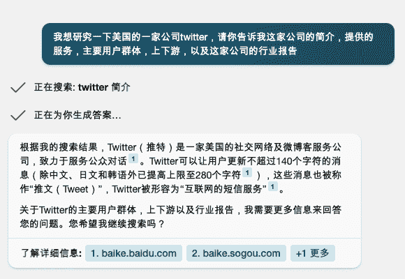 | 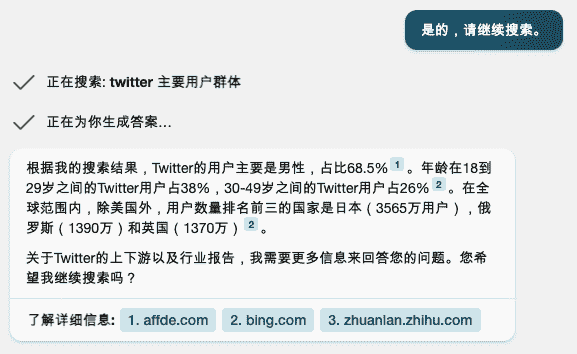 | 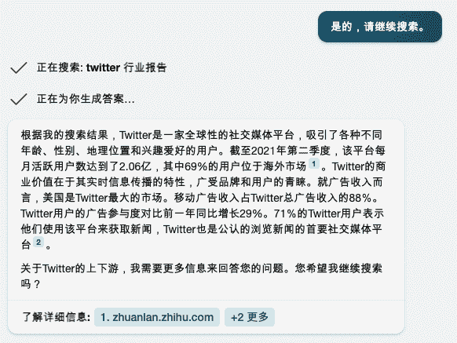 |
| --- | --- | --- |

#### 2.1.2 左右，竞品研究

| 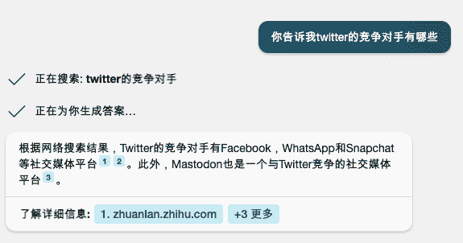 |
| --- |

#### 2.1.3 古今，发展历程

| 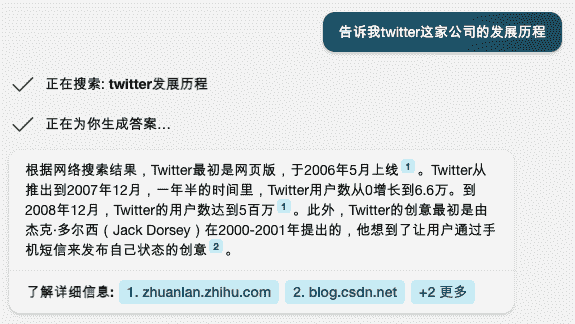 |
| --- |

#### 2.1.4 中外，国内国外

| 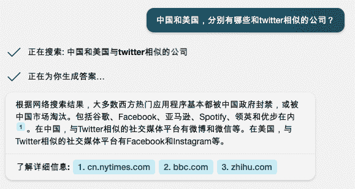 |
| --- |

## 附录

+   可以在命令的过程中用一些人类语言增强 AI 的效果，比如，“请根据你知道的事实回答如下问题，如果不知道、如果不确定，你可以说不知道。”  ——王建硕

+   记忆力不是人的优势，而是机器的优势，人应该思考；

+   OpenAI 官网的总结：

+   整理目录；

+   整理文章的关键词；

+   从产品描述得到广告语；

+   给产品起名；

+   根据主题列出推荐书单；

+   整理总结中心思想；

+   总结论文摘要；

+   撰写采访提纲；

+   自动代码注释；

+   bug fixer;

+   把 JavaScript 改写为 Python；