# AI Product Manager 2

> 来源：[https://leonzhang.feishu.cn/docx/TTSvdBxlQozNVSxzTCmcoaRGnBM](https://leonzhang.feishu.cn/docx/TTSvdBxlQozNVSxzTCmcoaRGnBM)

## AI

### 认识 AI

[**人工智能**](https://zh.wikipedia.org/wiki/%E4%BA%BA%E5%B7%A5%E6%99%BA%E8%83%BD)**（A**rtificial Intelligence，AI），指由人制造出来的机器所表现出来的智能。通常人工智能是指通过普通计算机程序来呈现人类智能的技术。

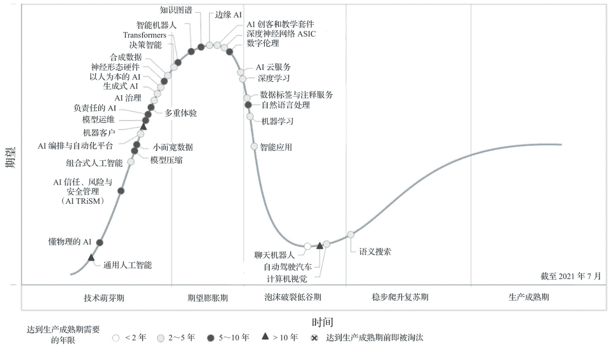

#### AI 的三大学派

> 分别为符号/逻辑主义、连接/仿生学主义、行为/进化主义。

+   符号主义（逻辑主义），认为 AI 源于数理逻辑，并可以通过使用符号和逻辑推理来模拟人类的思考过程。主要挑战是如何将符号与世界进行有效的对应，以及如何获取和表示知识。

+   连接主义（仿生学派），认为 AI 源于仿生学，并可以通过模仿大脑中的神经元之间的连接和学习过程来实现智能行为，代表性研究如神经网络、深度学习、强化学习。主要挑战是如何训练复杂的神经网络结构以实现高质量的学习和推理。

+   行为主义（进化主义学派），认为 AI 源于行为控制/生物进化论，即基于感知、控制和行为反馈的系统，模拟生物进化的过程。将信息论、神经系统、逻辑和计算机联系在一起，模拟人类在控制过程中的智能行为，如自寻优、自适应、自学习。

#### AI 的发展历程以及智能化的形态

1.  AI 的概念始于 19 世纪 50 年代，而后经历了三个大的发展阶段，这三个阶段也是 AI 不同学派、研究路径、算法兴起和发展交替的过程。

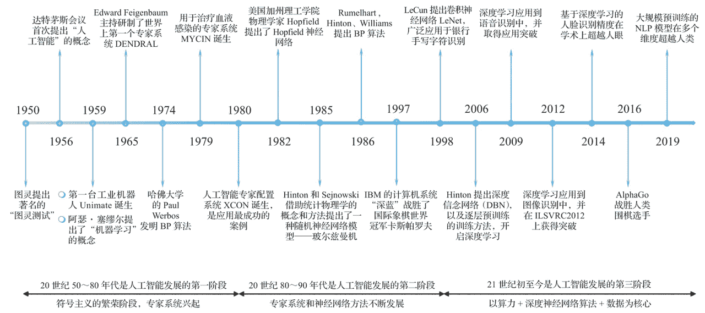

1.  从智能化的程度来看，智能化的形态可以通过计算、感知、认知、意识这 4 个阶段来划分。

+   计算：逻辑表示、存储、计算、交互；

+   感知：图像、语音、文本识别；

+   认知：知识图谱、推理、规划、决策；

+   意识：自学习、意识模型；

### AI 产品

AI 产品是指利用人工智能技术和算法来实现特定功能或解决特定问题的产品。它们通过使用机器学习、深度学习、自然语言处理等 AI 技术，使产品具备认知、学习和决策能力，以更好地满足用户需求和提供个性化的体验。

AI 产品可以是**软件应用、硬件设备或服务**的组合，例如智能助手 Siri、语音识别系统、图像识别系统、自动驾驶汽车、机器人等。

AI 产品的定义主要有以下几个方面：

1.  自主学习与决策能力：AI 产品可以根据大量的数据进行学习和优化，从而不断提高其性能和效果。它们能够自主决策、解决问题，并根据用户反馈和环境变化做出相应的调整。

1.  智能感知和理解：AI 产品能够感知和理解人类的语言、图像、声音等信息，以便更好地与用户进行交互和沟通。它们能够理解上下文、意图和情感，并作出相应的响应和推荐。

1.  自适应和个性化体验：通过学习用户的行为和偏好，AI 产品可以提供个性化的服务和体验。它们能够根据用户的需求和特定情况，自动调整算法、推荐内容或执行任务，以满足用户的个性化要求。

1.  解决复杂问题和提供创新解决方案：AI 产品可以应用在各种复杂问题的解决上，如数据分析、预测和优化等。它们能够利用大数据和深度学习等技术，挖掘隐藏的模式和关联，并提供更准确、高效的解决方案。

综上所述，AI 产品利用人工智能技术赋予产品认知和学习能力，以实现智能感知、自适应和个性化体验，并解决复杂问题，为用户带来创新的解决方案。

#### AI 产品产业化

AI 产业链可以划分为**基础、技术和应用**三个层次。

1.  基础层提供 AI 所需的基础算力，涉及 AI 芯片、大数据处理模块、云计算模块等。

1.  技术层位于基础层之上，利用机器学习平台、数据、算法、算力提供计算机视觉、语音识别、自然语言处理等模态的算法技术和模型。

1.  应用层主要包括融合多种技术和基础能力的 AI 产品，以及产品落地到行业的解决方案，其核心是完成商业化闭环，真正为行业带来效率提升和价值。

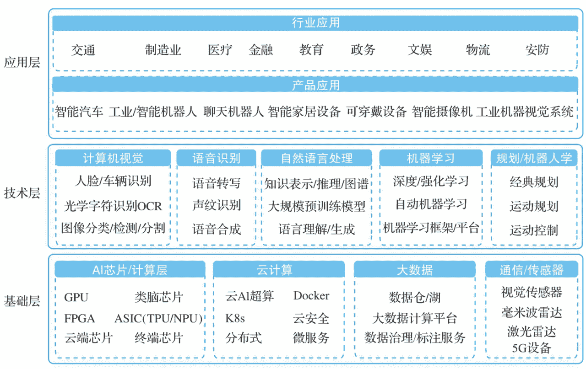

#### AI 产品落地的价值与难题

1.  AI 产品落地的价值

+   第一类，以降本增效为主的产品，比如特斯拉自动驾驶 FSD（Full Self-Driving）、擎天柱（Optimus）机器人、Chat+PDF 的 Claude 2、New Bing（GPT+Search）等；

+   第二类，以增加愉悦度为主的产品，比如数字分身 Bot、妙鸭相机；

1.  AI 产品落地的难题

除技术实现外，成本、隐私、安全也是不可或缺的考虑项。

+   成本：人力成本（大规模数据标注、算法工程师人才稀缺）、算力（GPU、NPU）与功耗成本；

+   隐私：企业私有化数据、律所合同材料、银行和保险的客户信息、安防监控视频、各类互联网平台的用户数据、电商消费数据、用户人脸信息；

+   安全：人身财产安全，自动驾驶（事故责任判定）；

## AI 产品经理

### 是否要“懂技术”？

1.  定义

顾名思义，即 AI+产品经理，基于 AI 能力打造的业务应用或产品进行管理的人员或职位，且 AI 产品经理在不同产业链层级需要对 AI 相关技术的了解深度不同。

1.  是否要“懂技术”？

> 这点同产品经理是否要懂技术一致，有需要学习的话，推荐书籍《产品经理必懂的技术那点事儿》，作者唐韧。

+   懂技术不是目的，目的是如何让技术更好地辅助产品经理做出决策，进而做出更好的产品。

+   **懂技术不是懂代码，对于产品经理**来说，要**懂的是产品实**现的核心技术逻辑、流程、路径和边界，目的是界定产品范围。

1.  懂技术的好处：

+   更了解技术的局限性；

+   更懂如何利用技术创新为产品创新提供弹药；

+   更好的与研发同学沟通、更专业、更可靠；

### 成为优秀 AI 产品经理

> 基本素质和定位。

1.  基本素质

> 4 个维度：技术、产品、项目、行业。

+   技术，即在深度学习相关技术或 AI 技术方面的认知和经验；

+   产品，指的是与产品相关的能力及经验；

+   项目，是指在 AI 产品落地到项目时对解决方案、模式和应用闭环的认识；

+   行业，是指对 AI 落地业务场景或行业业务的理解。

1.  定位

> 确定定位是在基础层、技术层还是应用**层，是希望成为技术型 AI** 产品经理还是行业应用型 AI 产品经理。

#### AI 产品经理的职业规划

> 4 个维度：技术栈、行业业务、职能、平台。

1.  技术栈，是某一类技术的集合，比如依托于 5G 通信、AI、物联网、云计算等技术来打造产品和商业模式；

1.  行业业务，是一个行业的痛点、知识、规则、产业链条、商业模式、标准等的集合。如安防监控、交通等；

1.  职能，指的是工作和岗位类型，比如产品经理在产品类型上，可选择做 C 端、B 端或是 G 端产品经理；

1.  平台，指企业或单位。

**既要关注上述每个**维度上的纵深发展，又要横向成长为多维度复合型人才。

#### AI 产品经理的知识体系

> **产品生命周期过程管理知识、AI 技术认知、A**I 项目管理知识和 AI 行业业务知识。

1.  AI 技术认知主要包含**理论性内容、工程应用**两大方面。

+   理论性内容主要包括机器学习、计算机视觉、语音识别、自然语言处理等算法的应用知识；

+   工程应用主要包括算法任务的定义、模型训练和评价、落地部署应用等相关内容。

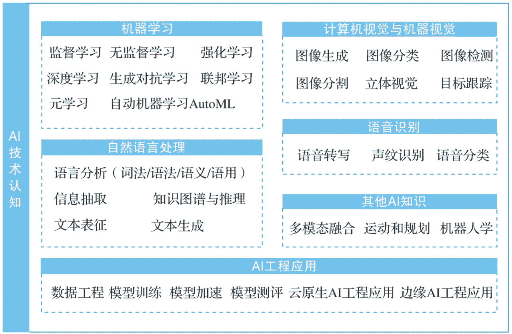

1.  产品生命周期过程管理关注产品全生命周期中每个环节的基本打造方法，其中涉及的知识是产品经理工作的基础。完整的知识应包括市场感知、产品定义、需求管理、产品设计、产研协同、产品运营及营销等多个维度。

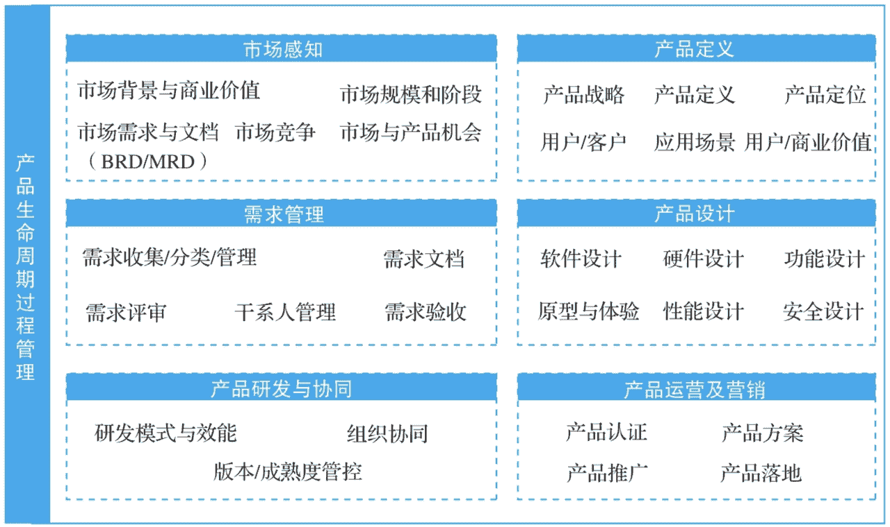

1.  项目管理知识和行业业务知识覆盖特定行业中项目从商机、订单、交付、验收到上线运行的完整过程，涉及行业政策标准、业务理解、项目管理等。

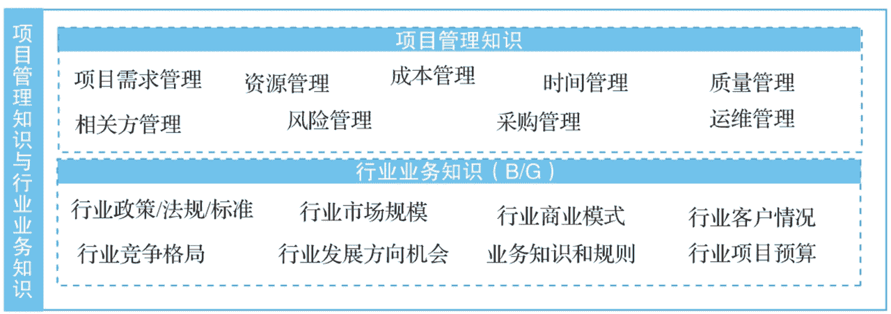

## AI 技术

+   AI 理论及算法：机器学习、多模态感知及理解（视觉、语音、语言）、机器人学与运动规划；

+   AI 工程应用：云原生的 AI 应用

### 机器学习

> 机器通过经验和数据提高自身的感知、认知、思考和行动能力的科学，是来自计算机科学、统计学、心理学、神经科学、控制理论等的交叉学科。

**定义**

> 机器学习由三个部分组成，分别是**表示、评价和优化**。

1.  表示是指**建立问题与数据的抽象模型**。

“问题抽象”是对待解决的问题进行抽象化处理，即将问题转换成一道逻辑题或者数学题。比如，判断一张图片中的动物是否为猫，结果无外乎“是”或“不是”两种，那在算法上就可将它看成一个二分类问题，输出就可定义为 0 或 1。

“数据抽象”即用数据来刻画物理世界中的事物。仍以判别猫为例，判断一张图片中的动物是否为猫，需要关注动物的脸、毛发、身体等方面的特征，将这些信息用数学方式表征，然后经过综合评估，就能完成判断。在对问题、现实情况有了充分的理解之后才能进行算法的选择，再之后机器才有机会参与进来，执行具体任务。

1.  评价是指**设定目标函数及评价模型性能**。

设计好模型之后，最重要的一步就是评价模型的好坏，这个时候就需要设定一个目标函数，该函数用于评估模型的优化目标和模型指标。

以对猫的判别为例，在目标函数上，可通过特征向量距离来评价一个图像目标是否像猫。在数据集的准确率上，可以通过“错误率”等指标来评价分类模型。

1.  优化是指求解目标函数在模型下的参数最优解。

目**标函数中存在许多未知**参数，求解这些参数，让模型目标函数得到最优结果，即让模型能够获得最小错误率或者最小均方误差。算法优化的过程即逐步调整数据、算法或参数来达到最优目标的过程。

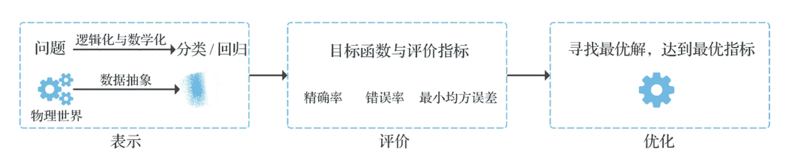

> 机器学习的分类

+   按照函数的复杂度，机器学习可以分为线性模型和非线性模型；

+   按照学习准则的差异，可以分为统计方法和非统计方法；

+   按照数据样本提供的信息和反馈方式，可以分为监督学习、无监督学习和强化学习，

#### 监督学习

1.  定义

监督学习是一种机器学习方法，即机器通过人工给定的标注。

比如告知机器某张图片中的是猫，另外一张图片中的是狗，学习数据特征以及标注信息中一一对应的映射关系，从而在部署应用中，根据一定的策略把数据特征预测出来。

1.  训练过程

由**信息输入**（如图片、文本等）和**预期输出**（标签）组成。标签可以是连续的数值，也可以是离散的分类项。

**根据输出标签的不同**，监督学习要处理的任务可以分为回归任务和分类任务两种。

+   回归任务主要指预测某一实数结果的任务，如预测产品市场价格、股票价格等，使用的主要方法是线性回归。

+   分类任务主要指预测某种样本所属类别的任务，如预测动物的分类、物品的分类等。

1.  常用算法：K 邻近、决策树、朴素贝叶斯。

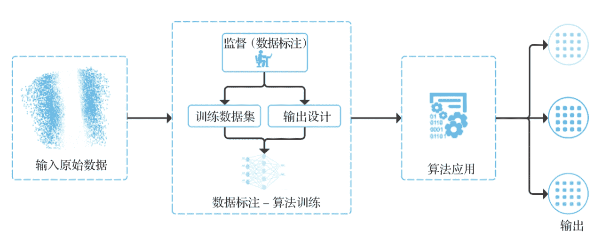

#### 无监督学习

监督学习与无监督学习最大的不同是，后者不需要人工标注。

在现实世界中，大部分数据也是没有**被标注的，**机器可以根据算法（如常用算法：聚类、降维等）对数据进行处理，实现机器视角的特征归类。

在无监督学习中，不需要对数据进行人工标注，而是由机器对数据进行解析，得到特征之类的机器可理解的表征，再通过聚类算法等获得数据的分布，从而得到数据类别。无监督学习可依靠算法找到数据内在的监督信息。

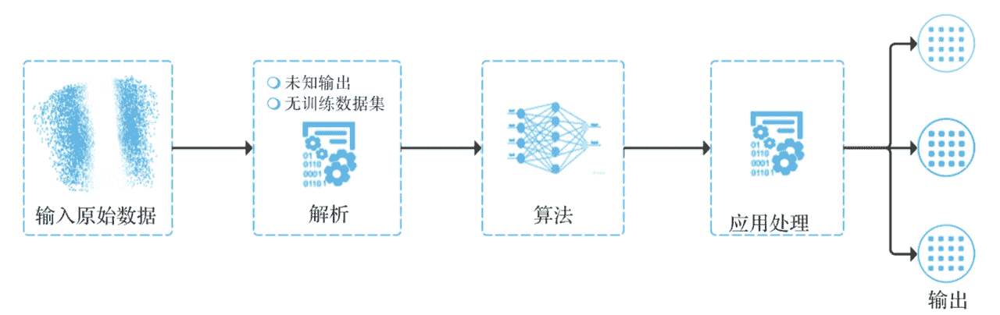

#### 强化学习

又称增强学习，是智能体与环境通过交互完成序列化的过程，一般由系统环境、智能体（Agent）、状态、行动和奖励五个部分组成。在这个过程中，智能体通过不同的行动，作用到系统环境中，系统环境根据行动的结果，给予智能体奖励或者惩罚，同时反馈当前系统环境的状态。

通过**不断试错**和**追求最大化长期回报**这两个特征来实现的，突破了监督学习标注数据的局限，也突破了非监督学习无法与环境动态交互的局限，为机器学习拓展了实现路径。

**强化学习十分适合用于决策类**的场景，如训练控制算法和游戏 AI 等。

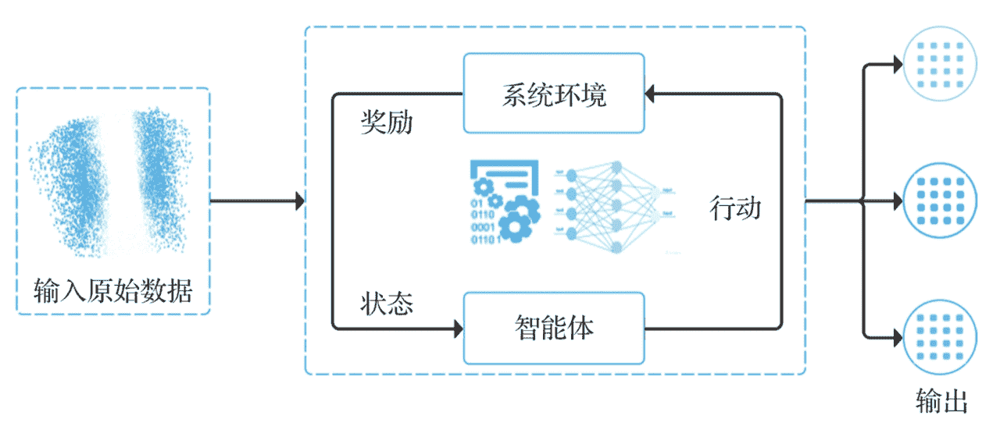

#### 半监督学习

> 半监督学习是一种弥补标记数据不足的有效方法，可以在数据量有限的情况下提高模型的性能和泛化能力。

通过结合有标签和无标签的数据来提高模型的性能。即在人工标注的数据不够的情况下，选用少量未标注的数据以及大量未标注的数据进行学习。

一种常见的半监督学习方法是自学习（Self-Training）。自学习通过先使用标记数据训练一个初始模型，然后利用该模型对未标记数据进行预测并将预测结果作为伪标签，将这些伪标签与真实标签一起用于重新训练模型。这个过程可以迭代多次以提高模型性能。

其他半监督学习方法包括生成模型（如生成对抗网络）、图半监督学习（基于图结构的标签传播）和协同训练（使用多个模型进行训练并相互利用）等。

#### 自监督学习

通过数据本身的标签或者变换得到的标签进行学习的，不需要专门的人工标注的标签。

**自监督学习通过使用数据本身来生成“假”**的标签，从而避免了对人工标注数据的依赖。

+   无需人工标注数据

+   大规模数据（从未标记的大规模数据集中学习到有价值的表示）

+   迁移学习，提升泛化性能

从大规模数据中挖掘或者构造自身的监督信息，利用这些内在监督信息对网络的表征进行学习，从而在下游任务应用中，只需要少量的监督数据就可以获得较好效果。

> "泛化能力"（Generalization Ability）指的是一个模型对未见过的样本或新数据的适应能力。它衡量了模型在训练集之外的数据上的性能和预测能力。

> Leon：也就是说当我们在与 ChatGPT 等这类模型沟通时发现其在“编造内容”，这可能就是模型泛化能力太强的表现。

### 深度学习

> 深度学习是**深度神经网络及其训练方法**的统称。

神经网络是由神经元组成的，人工神经元是模仿人的大脑的神经元细胞的基本模型。

生物神经元包含了**树突、细胞体、轴突、突触**这 4 个主要部分，神经元有**抑制和兴奋**两种状态，当处于激活状态时，神经元处于兴奋状态，会产生电信号并将电信号传递给下一个神经元。

在神经元中，树突用于接收信号，信号经过细胞体处理之后若满足激活条件，则通过轴突和后面的突触向另一个神经元输出。多个神经元之间的连接和层级组合构成了神经网络。

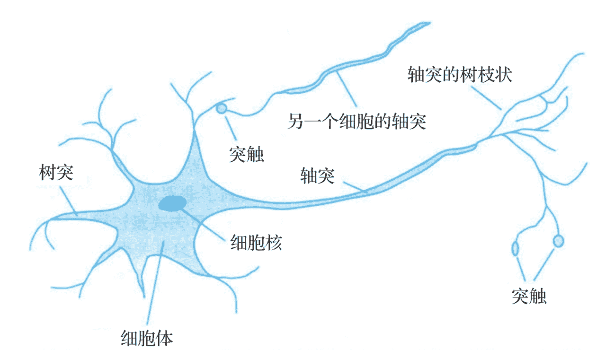

人工神经元包含了**输入、处理、激活、输出** 4 个部分。

输入可以是原始信号，也可以是经过神经元处理的信号，信号经过不同神经元连接加权后会得到信号数值（加权和），该数值再经过激活函数的判断，就会得到输出信号。

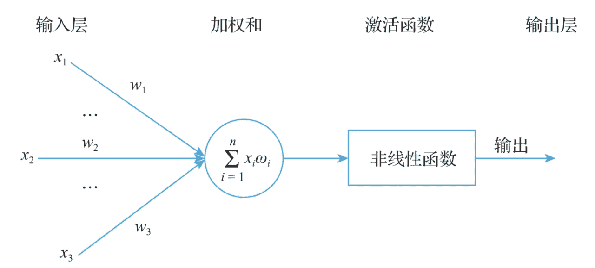

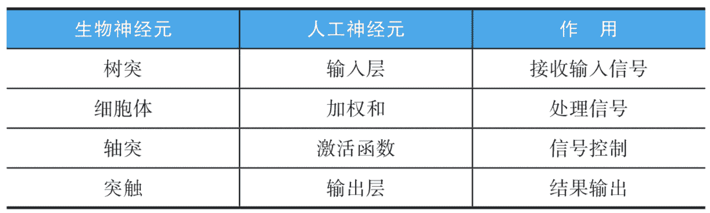

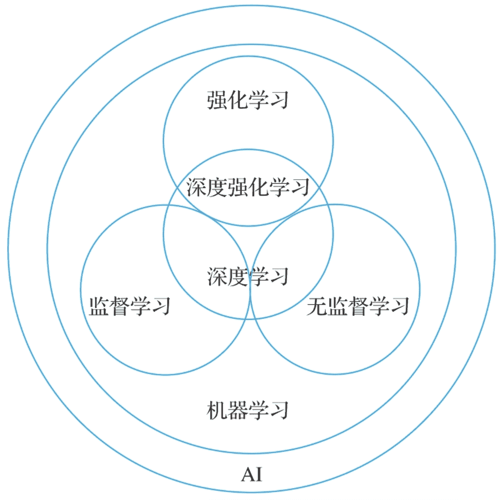

#### 深度学习的发展和局限

**1、深度学习的发展**

> 深度学习的改良发展可总结为两大路线：一类是“大”路线，即大模型、大算力、大数据；另一类是“小”路线，即小模型、小算力、小样本。同时代表两大应用场景，即云和端。

1.  模型维度

+   “大”路线最具代表性的就是基于 Transformer 技术路线的超大规模预训练模型（如 GPT-3 等），该模型追求强大的表征能力；

+   “小”路线最具代表性的是包括 MobileNet 等在内的一系列用于端场景的模型，该模型关注如何在保持精度的情况下对算力和存储要求更小，并更快得到结果。

> [MobileNet](https://arxiv.org/abs/1704.04861) 是一种用于移动和嵌入式视觉应用的高效模型。

> 它基于一种简化的架构，使用深度可分离卷积来构建轻量级深度神经网络。MobileNet 引入了两个简单的全局超参数，可以有效地在延迟和准确性之间进行权衡。

> 这些超参数允许模型构建者根据问题的约束选择适合其应用程序的大小模型。MobileNet 在 ImageNet 分类中表现出色，并且在对象检测、细粒度分类、面部属性和大规模地理定位等广泛的应用和使用场景中都证明了其有效性。

1.  算力纬度

+   “大”路线追求如何利用大规模算力快速实现分布式训练、推理；

+   “小”路线追求如何极致利用小算力。

1.  样本维度

+   “大”路线追求用更多的数据让机器泛化能力更强；

+   “小”路线追求小样本学习，可以举一反“百”。

**2、深度学习的局限性**

1.  **数据贪婪性**

+   为达到足够高的准确度，深度学习通常需要非常大的数据量，这导致在数据收集、标注、管理、计算等各个环节都会产生极高的成本。在一些对精度要求高的场景，大数据量依然是保证高精度的基础。

+   长尾问题，对处于长尾状态的 20%样本数据，模型没见过，导致识别效果大幅下降。

1.  **可解释性问题**

一直以来，神经网络都是以“黑箱”的形式存在的，通过“喂”数据会得出一个模型，当通过该模型对一个样本进行预测时，是由哪一层帮模型得到最终的判断，难以得知。

1.  **泛化能力弱**

深度学习可以在特定的场景中达到极高的精度，但是当模型迁移到相似场景的时候，效果却大大下降，甚至在面对两张相同的图片时，对第一张图片识别效果很好，在识别加入特定小扰动的第二张图片时，算法会立刻失效。

#### 迁移学习

人类会对知识和能力进行迁移，比如学会了骑自行车，学骑摩托车就非常容易，能力的迁移和复用是人类基础学习能力之一。

从大批量的标注或未标注的数据中学习到强大的表征能力，基于大规模 PTM 对少量数据做进一步微调，即可复用和迁移其强大的表征能力，这在下游任务中表现更好。

使用大规模 PTM 而不是从零开始学习，已经是在应用深度学习技术时人们的共识。

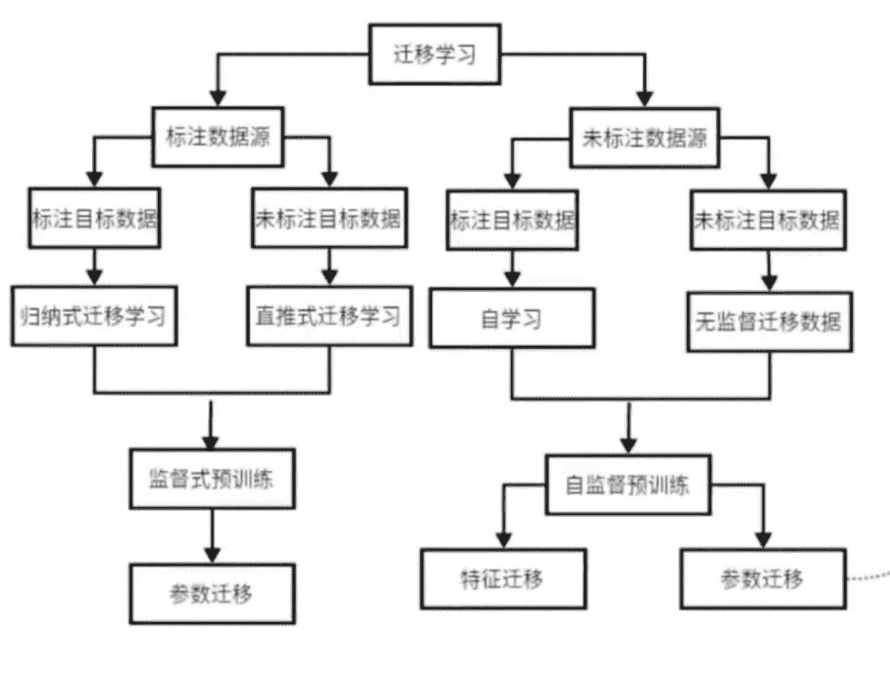

#### 感知机

感知机是一种二元线性分类器。最小可学习的神经网络被称为感知机，多个感知机进行层级连接组合就可以得到多层感知机。多层感知机一般有一个输入层、一个输出层，还有一个或多个隐藏层，多层感知机所有层之间是全连接的，故这些层统称为全连接层。

多层感知机也就是我们说的人工神经网络，而随着隐藏层的增加，网络深度也在增加，我们称具有两个以上隐藏层的神经网络为深度神经网络。对于深度神经网络的训练，一般会使用反向传播（BackPropagation，BP）算法。

编码器-解码器 （Encoder-Decoder ）是深度学习模型的抽象概念。

1.  编码器 （Encoder ）：负责将输入 （Input ） 转化为特征（Feature）；

1.  解码器（Decoder ）：负责将特征 （Feature ）转化为目标（Target ）。

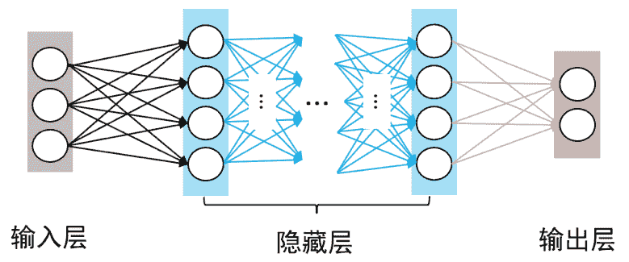

#### 经典模型

##### 卷积神经网络 CNN

> 局部感受和全局共享。

卷**积神经网络（Convo**lu**tional N**eural Network，CNN）是一种深度学习模型，主要用于处理具有网格结构的数据，如图像、音频和文本等。

对卷积神经网络的研究出现于 20 世纪 80 至 90 年代，到了 21 **世纪，随着科**学家们对深度学习的深入研究，卷积神经网络也得到了飞速的发展，该网络在图像处理领域表现出色，并在许多计算机视觉任务中取得了巨大成功。

**卷积神经网络共分为以下几个层级部分：输入层（inputlayer）、卷积层（con**volutionlayer）、池化层（poolinglayer）、全连接层（fullyconnectedlayer）。

+   输入层（inputlayer）：输入层通常用于接收具有特定形状（如图像大小或文本序列长度）的输入数据。对于图像，输入层会接收原始像素值，并将其转换为适合进入下一层的张量形式。对于文本，输入层可以接收单词或字符编码，并应用相应的嵌入层以进行表示学习。

+   卷积层（Convolutional Layer）： 卷积层是 CNN 的基础组件，它使用一组可学习的滤波器（也称为卷积核）对输入进行卷积操作。每个滤波器通过滑动窗口在输入上移动，计算局部区域的加权和，从而生成输出特征图。这样可以有效地捕捉到输入数据的空间局部性和平移不变性。

+   池化层（Pooling Layer）： 池化层用于减小特征图的空间尺寸，并降低参数数量和计算量。常见的池化操作包括最大池化（Max Pooling）和平均池化（Average Pooling），它们分别选择局部区域的最大或平均值作为输出。

+   激活函数（Activation Function）： 在卷积层后面，通常会添加一个非线性的激活函数，如 ReLU（Rectified Linear Unit），用于引入非线性特征和增强模型的表达能力。

+   全连接层（Fully Connected Layer）： 在经过多个卷积层和池化层之后，通常会使用全连接层来进行分类或回归任务。全连接层将前一层的所有神经元与当前层的每个神经元相连接，通过学习权重来进行更高级别的特征组合和输出预测。

CNN 的训练过程通常涉及反向传播算法，通过优化损失函数来更新网络中的参数。为了增加模型的鲁棒性和避免过拟合，还可以使用正则化技术，如 dropout 和 L2 正则化。

**CNN 在计算机视觉领域广泛**应用于图像分类、目标检测、语义分割等任务，并在这些任务上取得了显著的性能提升。它的设计使其能够自动学习从原始输入中提取有意义的特征，无需手动设计特征提取器。

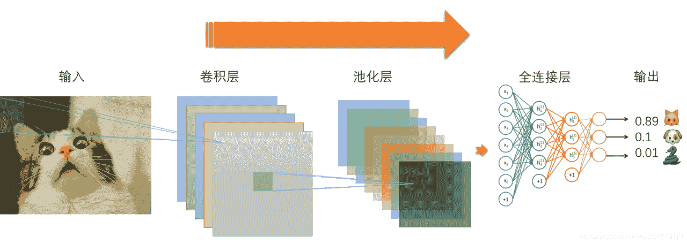

##### 循环神经网络 RNN

循环神经网络（Recurrent Ne**ural Ne**twork，RN**N）是一种具有自**反馈**连接的神经网络，主要**用于处理序列数据，如语音、文本和时间序列等。

与其他神经网络不同，RNN 具有在时间上的持续性。它通过将前一个时刻的输出作为当前时刻的输入来构建记忆和上下文。这使得 RNN 能够对序列中的任意位置进行信息传递和处理。

以下是 RNN 的关键概念和组件：

隐藏状态（Hidden State）： RNN 中的隐藏状态是网络在每个时间步骤中的内部表示，类似于网络的记忆单元。隐藏状态接收输入和前一个时刻的隐藏状态，并生成当前时刻的输出和传递到下一个时刻的隐藏状态。

循环连接（Recurrent Connection）： RNN 的核心是循环连接，它允许信息在网络中以迭代的方式传递。具体而言，隐藏状态会在每个时间步骤中被重复使用，并通过时间上的连接将信息从一个时刻传递到下一个时刻。

时间展开（Time Unrolling）： 为了便于理解和计算，RNN 可以通过展开多个时间步骤来显示其结构。这样，网络可以被表示为多个相同结构的层的堆叠，每个层对应一个时间步骤。

**短期记忆和长期记忆（Short-term Memory an**d Long-term Memory）： RNN 具有一定的记忆能力，可以捕捉到输入序列中的短期和长期依赖关系。通过自反馈和循环连接，RNN 可以保留和利用先前的信息，从而更好地理解和处理序列数据。

RNN 的训练过程通常涉及使用反向传播算法来最小化预测输出与目标之间的差异。为了缓解梯度消失问题和增强长期依赖的处理能力，还有一些改进的 RNN 架构，如长短期记忆（LSTM）和门控循环单元（GRU）等。

RNN 在自然语言处理、语音识别、机器翻译等领域取得了显著的成果。它的设计使其能够有效地处理具有时序性质的数据，并捕捉到序列中的上下文信息。

#### 大规模预训练模型

> BERT、GPT 等大规模预训练模型（Pre-Trained Model， PTM）在自然语言处理领域获得巨大成功。

从大批量的标注或未标注的数据中学习到强大的表征能力，基于大规模 PTM 对少量数据做进一步微调，即可复用和迁移其强大的表征能力。使用大规模 PTM 而不是从零开始学习，已经是在应用深度学习技术时人们的共识。

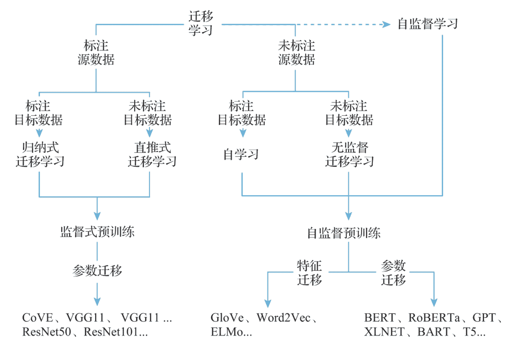

监督式预训练是早期的深度学习任务常用的方法，可以加快模型训练速度，对于小样本集来说可以更好地提升模型精度。而自监督训练取得了更加亮眼的效果，自监督预训练成功的关键是自监督学习与 Transformer 的整合，最具代表性的就是 BERT 模型和 GPT 模型。

**大规模 PTM 的核心是****网**络架构、大规模数据的设计和利用、高效的计算。大规模 PTM 的思想与人类学习知识有诸多一致性，都是期望掌握强大的基础表征或学习能力之后，便可以触类旁通，用更少的信息就可以举一反三。

### 生成对抗网络（GAN）

> 生**成对抗网络（G**enerative Adversarial Networks， GAN）是一类无监督的机器学习模型，包含了生成器和判别器两部分。

生成器和判别器都可以是神经网络，生成器生成仿真样本，判别器判别样本好坏，两者形成一种竞争对抗的关系，在竞争中两部分都不断优化提升。GAN 的一般结构，生成器将噪声向量作为输入并生成假的图像，然后提供给判别器，判别器对真图像和假图像进行鉴别，判断数据是否为真。

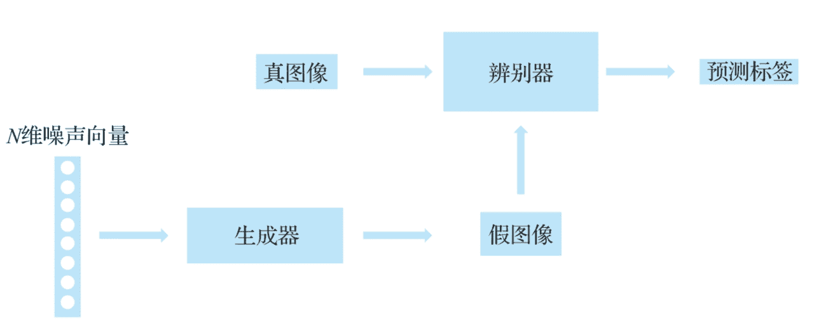

在图像和语音等领域广泛应用，如：

+   **条件生成**。GAN 可以基于一段文宇生成一张图片，或者基于一段文字生成一段视频；

+   **数据增强**。GAN 可以学习训练集样本的分布，然后进行采样，生成新的样本，并使用 这些样本来增强训练集；

+   **风格迁移**。GAN 可以将一张图片的风格转移到另外一张图片上；

利用生成网络和判别网络之间的相互对抗，GAN 可自发学习输入数据的规律，确保生成结果接近训练集中的真

实样本，从而实现无标注数据的学习；

GAN 和所有的生成式模型都一样，目标就是**拟合训练数据的分布**，对于图片生成任务来说，就是拟合训练集图

片的像素概率分布。

### 联邦学习

联邦学习（Federated Learning）是一种分布式机器学习方法，通过在本地进行模型训练，并聚合各个设备上的模型参数来实现全局模型训练，以解决数据隐私和安全性的问题。

在传统的机器学习中，通常需要将数据集集中到一个中心服务器上进行训练，但这样做可能涉及到敏感信息的泄露风险。联邦学习采用了一种不同的方法，它允许在分散的设备上进行本地训练，而不需要将原始数据发送到中心服务器。具体而言，联邦学习的过程如下：

1.  选择参与方：确定参与联邦学习的设备或实体，并将其称为「客户端」。

1.  模型初始化：在每个客户端上初始化一个初始模型。

1.  本地训练：每个客户端使用本地数据对模型进行训练。

1.  模型聚合：将各个客户端上训练得到的模型参数进行聚合，得到一个全局模型。

1.  更新和迭代：将全局模型再次分发给各个客户端，重复执行第 3 和第 4 步，直至模型达到预期性能。

通过在设备本地进行训练和仅共享模型参数，而不是原始数据，联邦学习可以保护用户隐私并减少数据传输量。此外，联邦学习还具有一些其他优点，如减少计算资源的需求和降低通信成本。

### 元学习

> 一般来说，我们使用机器学习来学习一个任务，是学习一个从 X 到 Y 的映射。

元学习是机器学习的一个子领域，其思想是让机器学会学习。学习是一种基础能力，在这种基础能力的加持下，机器可以在已有知识的基础上快速学习其他领域的知识。元学习在方法上可划分为三种：基于模型的方法、基于度量的方法和基于优化的方法。

### AutoML/AutoDL

+   自动化机器学习（Automated Machine Learning， AutoML）

+   自动化深度学习（Automated Deep Learning，AutoDL）

自动化机器学习（Automated Machine Le**arning， Au**toML），是一种将自动化和机器学习结合的系统方法，包括使用机器学习技术等寻求最优的训练方法及模型等，以提高算法生产效率。

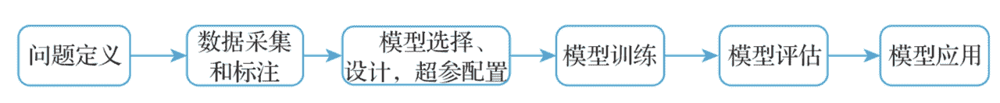

在深度学习方法中，AutoML 的内容主要包括自动数据处理与增强、自动化模型选择、自动化超参优化、自动模型压缩等。

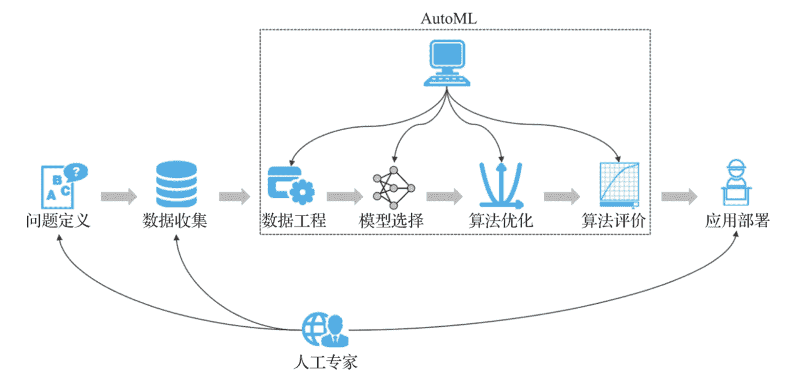

#### 自动化数据处理与增强

数据增强指使用各种数据变换方法，在原来数据的基础上，变换生成更多有效的标注数据，从而增加可供模型学习的数据量，从而提高模型的泛化性能。

自动数据增强，则是针对不同的数据集自动化搜索对应的数据增强方法，在不同的任务上都能使用最优的方法获得最好的数据增强效果。

自动化数据增强的方法还包括 GAN 方法，比如在人脸识别应用中，为提升在遮挡情况下人脸的识别精度，通过 GAN 生成眼镜、口罩、妆容等数据，辅助提升人脸识别精度。相似的应用还有通过 GAN 生成行人重识别的数据，用于辅助行人重识别。

#### 自动模型生成——神经架构搜索

神经架构搜索（Neural Architecture Search， NAS）的核心是利用搜索算法来寻找对任务来说最优的神经网络结构。NAS 研究的问题主要包括构建搜索空间、研发搜索算法以及进行模型评估。

对深度神经网络进行搜索的难点在于，如何拼接不同的结构以及如何提升模型评估效率。

#### 自动模型压缩

模型生成即从无到有建立一个模型，而模型压缩是在已有的高精度模型的基础上，再对模型进行压缩。模型压缩是在计算资源有限、能耗预算紧张的移动设备上落地部署应用的重要技术。

例如，在移动机器人、自动驾驶等应用场景中，因受到延迟、功耗和模型大小的限制，深度神经网络在部署上需要对运行速度、应用大小、参数等进行考虑。尽管硬件算力和存储等在不断提升，但是获取一个兼具快、准、小的模型仍是模型压缩领域不断研究的方向。

目前常用的人工压缩方法包括**剪枝、知识蒸馏、量化**等。

1.  剪枝

剪枝即**去除训练好的模型中的冗余参数**，以减小模型参数量和计算量，提升模型推理速度。剪枝包含了对神经元的修剪和对通道的修剪。

1.  知识蒸馏

在模型参数问题上，一般来说，**参数量越多则结构越复杂**，但模型可以学习到的深层特征越多。参数过多会造成计算消耗变大，知识蒸馏就是解决大网络有效参数往小网络迁移的一种方法。

核心思想是将训练度大的、精度效果好的模型作为教师（Teacher）模型，然后用教师模型指导和训练学生（Student）模型。

1.  量化

在深度神经网络模型中参数数量巨大，且一般使用 FP32，也就是 32 位编码的数据类型，更高精度的参数理论上可以表达更加细微的特征。

1.  自动模型压缩

自动模型压缩（AutoML for Model Compession， AMC）技术，面对任意网络，机器可自动找到压缩策略并实现比人为的基于规则的模型压缩方法更好的性能。

## 多模态感知与理解

> 人与人之间可以通过视觉信息、语音信息、文字信息等进行交流，而交流的过程可以视为针对不同模态的信息进行沟通和理解。

> 计算机视觉、语音识别、自然语言处理、多模态内容理解。

### 计算机视觉

计算机视觉（Computer Vision， CV）是研究计算机如何模拟人或生物视觉系统的学科，是使用计算设备（如摄像机、计算机等）代替人眼进行环境感知和理解的技术，具体地说是计算机通过感知获得成像数据，并对成像数据中的目标进行识别、跟踪、测量、理解等。

计算机视觉包括**图像**生成、图像处理、立体视觉、图像分类、图像检测（应用：人脸、行人、车辆）、图像分割（应用：自动驾驶、媒体娱乐、工业质检）、目标跟踪（安防监控、人机交互与娱乐、机器人视觉导航）。

### 语音识别

语音是由物体振动产生的声波，是一种搭载着信息的模拟信号。

语**音信号可以通过麦**克风采集，通过模拟/数字（A/D）转换之后，得到音频数字信号。语音信号的 A/D 转换需要经过采样、量化和编码三个步骤。

### 自然语言处理

> 自然语言处理是研究人与计算机如何通过自然语言进行交流的融合学科。

自然语言处理根据**应用过程中理解和回应**两个环节，可以分为**自然语言理解**（Natural Language **Unders**tanding， NLU）和自然语言生成（Natural Language Generation， NLG）。

+   NLU 主要解决机器如何理解自然语言的问题，包括文本分类、实体识别、语句分析、机器阅读理解等。

+   NLG 则关注机器在理解自然语言之后如何做出回应，并将回应转换成人类可理解的语言，包括自动摘要、机器翻译、自动问答。

可以说，NLU 是 NLG 的基础，可以帮助机器更有效地生成人类可理解的语言。

从应用方向上看，NLP（Natural Language Processing）主要用于信息抽取、信息检索、文本分类、文本挖掘、信息过滤、舆情分析、文本摘要、文本生成、机器翻译、对话/问答系统、知识库、知识图谱等。

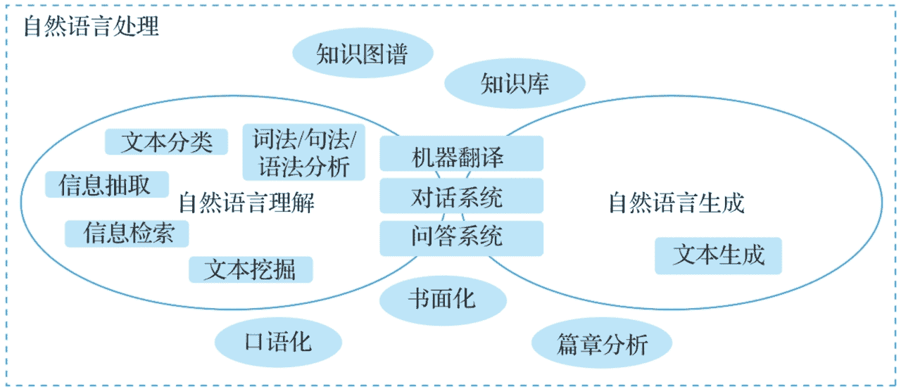

#### NLP 的分析层次

1.  词法分析

词法分析是 NLP 的基础性工作，包括分词、新词发现、词性标注、拼写矫正等。

1.  句法分析

句法分析也叫语法分析，主要是分析句子中的语法结构以及单词之间的依存关系。分为两类，依存句法分析和句法结构分析。

1.  语义分析

语义分析属于 NLP 高层次的分析，核心目的是挖掘文本中单词、句子、篇章等所传达的真实含义。从分析粒度上，语义分析可以划分为词语级、句子级和篇章级。

#### 信息抽取

信息抽取（Information Extraction）是指将篇章语句中非结构化信息自动提取为实体（Entity）、关系（Relation）、事件（Event）等机器可理解的结构化信息的过程。

信息抽取一般包括命名**实体识别、关系抽取、事件提取**等。

#### 知识图谱

> 认知图谱=知识图谱+认知推理+逻辑表达

> 认知图谱（Cognitive Graph）旨在结合认知心理学、脑科学和人类知识等，研发集知识图谱、认知推理、逻辑表达于一体的新一代认知引擎，实现 AI 从感知智能向认知智能的演进。

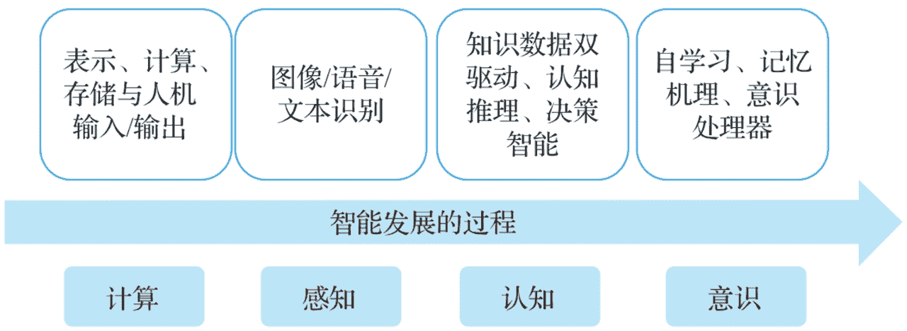

1.  知识图谱定义

知识图谱（Knowledge Graph）是一种用于表示和组织结构化知识的图形化知识库。它包含了实体（如人、地点、事物）、概念、关系以及它们之间的连接。知识图谱旨在捕捉现实世界中的实体和它们之间的语义关系，以便计算机可以理解和推理这些关系。

1.  知识图谱技术

知识图谱技术主要指构建知识图谱所需要使用的技术，这是融合了机器学习、信息抽取和检索、知识表达等的综合性技术。整个知识图谱的构建是一个从知识获取和表达到知识的关联构建，再到知识的存储和利用的过程，即知识图谱表征、知识图谱构建、知识图谱存储。

+   知识图谱表征也叫知识图谱嵌入，核心是通过向量表达知识图谱中的实体和关系。

+   知识图谱的构建一般是利用**自动化技术对结构化、半结构化、非结构化数据进**行知识抽取，并将数据存储到模式层和数据层。

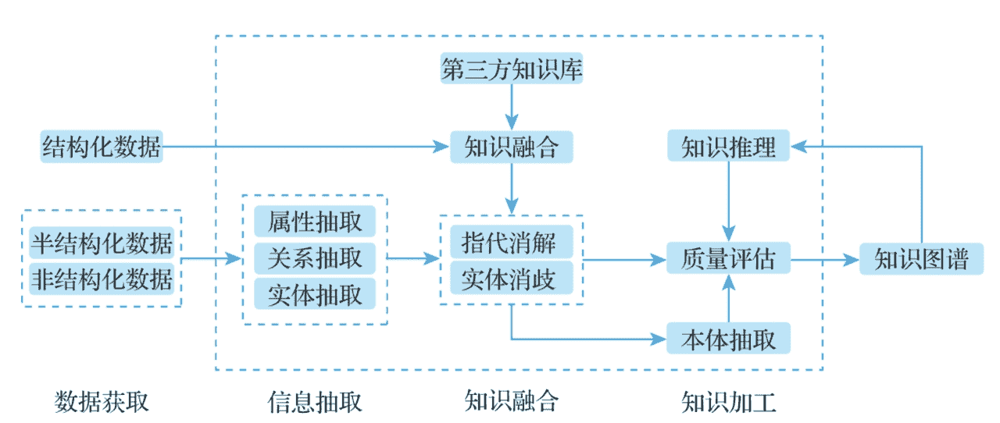

+   知识图谱存储对于知识图谱的存储，主要关注数据模型、存储机制和查询语言等。

1.  知识图谱应用

常见的语义搜索、知识问答（AI 智能客服）、推荐系统的实现均需要知识图谱技术的支持，知识图谱的性能决定了这类应用的性能以及智能化程度。

1.  知识推理

在 AI 系统中，感知信息之后是认知信息，认知推理类似人脑推理的过程，是对数据和知识进一步加工，以解决复杂的阅读理解和少数据的知识图谱推理问题。

#### 机器翻译

机器翻译是 NLP 中最常见的应用，也是备受关注的研究方向，机器翻译是将源语言文本通过机器转换为目标语言的过程，谷歌翻译、百度翻译、AI 同传等应用都是基于机器翻译技术实现的。

#### 对话系统

对**话系统广泛**应用在聊天机器人、各行业的智能客服、智能音箱中，对话系统也是最接近图灵测试形态的系统。一直以来，基于规则和统计这两种思路的技术不断突破。

在对话系统中，一般会包括自然语言理解（Natural Language Understanding， NLU）、对话状态追踪（Dialogue State Tracking， DST）、对话策略（Dialogue Policy， DP）、自然语言生成（Natural Language Generation， NLG）等模块，如果需要进行语音输入和输出，还会包括自动语音识别（Automatic Speech Recognition， ASR）、文本转语音（Text To Speech， TTS）等模块。

1.  生成式和检索式

主流的实现方法是生成式（问答题）、检索式（选择题）两大类。

1.  对话系统的评价

对话系统的评价是评判系统在对话反馈上的效果的好坏，有定量和定性两种评价手段。定性评价是通过人工进行判别，定量是由机器对提供的参考内容进行量化评估。定量评估通过优化算法更加便捷地实现目标。

### 多模态内容理解

**在多模态技术的研究中，主要包含五类任务：表征（Representation**）、转换（Translation）、对齐（Alignment）、融合（Fusion）和协同学习（Co-learning）。

#### 多模态融合应用

多模态融合有非常多的应用，包括视觉问答（Visual Question Answer， VQA）、视觉常识推理（Visual Commonsense Reasoning， VCR）等，在更上层的业务应用上还包括自动驾驶、机器人、虚拟数字人等。

+   VQA：针对视觉图像使用自然语言进行问答，连接视觉和语言，模型需要在理解图像的基础上，根据具体的问题做出回答，简单讲就是“看图回答问题”。

+   VCR：旨在结合图像和自然语言理解能力，验证多模态模型的多模态推理能力。

+   自动驾驶：在自动驾驶领域，经常会使用激光雷达、毫米波雷达、摄像机等传感设备融合方案进行路侧感知，进而做出最终的自动驾驶决策。

+   机器人：在机器人应用中，经常需要识别语音、视觉信息，并在理解之后生成对应的语音或者执行对应的行为。

+   虚拟数字人：虚拟数字人有非常丰富的行为，在理解上更依赖语音信息，其中还会涉及多模态内容生成。

### 大语言模型（LLMs）

#### 大语言模型的进化树

仅解码器模型和开源模型在近年来占据主导地位，OpenAl 和 Meta 在推动语言模型创新和开源方面做出了重大贡献。与此同时，编码器-解码噐模型和闭源模型也在一定程度上推动了发展。

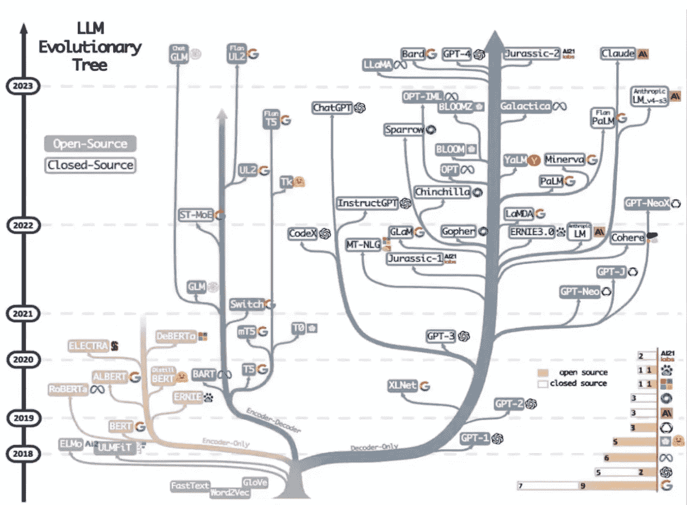

#### Transformer与GPT模型

Transformer和GPT模型都属于自然语言处理（NLP）领域中的重要模型。

**Transformer：**

Transformer是一种基于注意力机制（Attention Mechanism）的神经网络架构，由Vaswani等人在2017年提出。它在机器翻译任务中取得了突破性的成果，并成为许多NLP任务的首选模型。

Transformer的设计主要目的是解决传统循环神经网络（RNN）在处理长序列时的计算效率问题以及对长距离依赖建模的困难。相比于RNN，Transformer采用了完全并行化的结构，使得每个位置的输入可以同时与其他位置进行交互。

Transformer的核心组件是多头自注意力机制（Multi-Head Self-Attention），它能够对输入序列中的不同位置之间建立权重关系，并根据这些权重来调整每个位置的表示。通过多头机制，模型能够捕捉到不同粒度的关系。

除了自注意力机制，Transformer还包括前馈神经网络和残差连接等组件，以增强模型的表达能力和优化梯度流动。

**GPT模型：**

GPT（Generative Pre-trained Transformer）是基于Transformer架构的预训练语言模型，由OpenAI开发。它在大规模无标签数据上进行预训练，然后在特定任务上进行微调，以实现优秀的性能表现。

GPT模型通过使用自回归的方式，即根据之前的生成结果来预测下一个词，来进行语言建模。它可以生成连贯的文本，并有着极高的生成能力。

GPT模型的预训练阶段使用了大量的互联网文本数据，并采用了Transformer的架构。预训练过程中，模型学习到了大量的语言知识和规律，包括词汇、句法、语义等。

在微调阶段，GPT模型通过在特定任务上进行训练，如文本分类、命名实体识别等，将其预训练的语言理解能力应用到具体的应用领域中。

GPT模型取得了在多项NLP任务上的出色成果，如文本生成、机器翻译、问答系统等。它的强大生成能力和对上下文的理解使得GPT成为NLP领域的重要里程碑和研究热点。

#### 序列到序列（Seq2Seq）任务

序列到序列（Sequence-to-Sequence，Seq2Seq）是一种常见的NLP任务，它涉及将一个输入序列映射到一个输出序列。例如，机器翻译任务中，将源语言句子翻译为目标语言句子；文本摘要任务中，将长篇文章摘要为简洁的几句话。

以下是序列到序列任务的关键概念和组件：

+   **编码器（Encoder）：** 编码器负责将输入序列转换为一个固定长度的向量表示，该向量包含了输入序列的语义信息和上下文。编码器通常由一系列神经网络层组成，例如循环神经网络（RNN）或Transformer等。

+   **解码器（Decoder）：** 解码器接收编码器生成的向量表示，并使用它来生成输出序列。解码器通常也由一系列神经网络层组成，其结构可以与编码器相似或不同。解码器通过逐步生成输出序列的每个元素，根据先前生成的内容和输入序列的信息来产生下一个元素。

+   注意力机制（Attention Mechanism）： 注意力机制在序列到序列任务中起着重要作用，它能够让模型更加关注输入序列中与当前输出位置相关的部分。通过注意力机制，模型可以动态地调整对不同输入位置的关注程度，从而提升序列生成的准确性和连续性。

+   **训练过程：** 在训练阶段，给定一组已配对的输入-输出序列，模型通过最小化预测序列与目标输出序列之间的差异来进行优化。通常使用交叉熵损失函数，并结合反向传播算法来更新模型参数。

序列到序列任务在自然语言处理中有广泛应用，如机器翻译、文本摘要、对话系统等。它使得机器能够理解输入序列的语义和上下文，并以相应的方式生成输出序列。该任务的成功应用为自动化翻译、内容生成和智能对话等领域带来了重大影响。

#### Seq2Seq与Transformer、GPT模型的关系

**Transformer模型**对序列到序列任务非常有效。它通过自注意力机制和编码-解码结构，在处理输入序列时能够捕捉到全局上下文信息，并根据这些信息生成输出序列。Transformer的编码器用于对输入序列进行编码，而解码器则用于生成输出序列。

在序列到序列任务中，Transformer的编码器负责将输入序列转换为高维表示，其中每个位置的表示代表了该位置的信息以及与其他位置的关系。然后，解码器使用注意力机制来对输入序列的表示进行加权汇总，并生成输出序列的各个位置的表示。

类似地，**GPT模型**也可以应用于序列到序列任务。GPT模型采用了基于Transformer的架构，具有强大的语言生成能力。在序列到序列任务中，GPT模型可以将输入序列作为条件或上下文，并生成相应的输出序列。

无论是Transformer还是GPT模型，在序列到序列任务中都能够有效地处理输入和输出序列之间的依赖关系，从而生成准确和连贯的结果。它们通过自注意力机制和大规模预训练来捕捉语言结构和上下文信息，为序列到序列任务的成功提供了强大的基础。

## 机器人学与运动规划

机器人通过结合软件和硬件来完成物理世界中的任务。物理形态的机器人大致可以分为三类：机械手、移动机器人、人形机器人。

### 机器人硬件

机器人硬件体系结构包含四个核心部分——传感器、执行机构、动力源和处理器。

+   传感器是感知外部信息的装置，如视觉传感器（摄像机）、声音传感器（麦克风）、定位传感器等；

+   执行机构是对外运动的执行器，如轮子、机械臂、传动装置等；

+   动力源是驱动的源头，一般使用燃油机、电动机等；

+   处理器是软件处理的核心，是机器人的大脑和控制中枢，一切软件的调度控制命令都由处理器发出。

### 机器人感知

传感和信号处理：感知外界信息并对传感得到的杂乱信号进行信号处理。

### 运动规划与控制

#### 运动规划

运动规划是机器人移动中的一个重要环节，在机器人完成定位和地图构建之后，从起始点向终点运动的路径设计就是运动规划。

运动规划一般包括**路径规划和轨迹规划**两部分，路径规划研究机器人从起点到终点的路径策略。轨迹规划是根据路径、机器人运动学模型、约束信息等规划一组控制策略，关注机器人执行任务时的速度、加速度等。

#### 运动控制

运动是一个不断调整的过程，而控制器是调整过程中提供决策的部件。控制器可利用从环境中得到的反馈实时控制机器人。控制器的工作过程是一个“目标-控制-观察-控制”的过程，属于控制论的研究范畴。

### 应用领域

机器人技术在众多领域都有广泛的应用，如工业、物流、交通、特种应用、个人服务等。

+   工业：工业机器人。

+   物流：物流分拣领域，有潜伏机器人、码垛机器人等。

+   交通：自动驾驶。

+   特种应用：地下矿井作业机器人、矿用消防机器人、灾区侦测机器人、水下探测机器人等。

+   个人服务：扫地机器人、擦窗机器人、送菜机器人、服务机器人（酒店、商超）。

## AI 云原生工程应用

任何应用都具备**功能和非功能**两种特性：

+   功能特性是指应用可以直接为业务带来价值，如 AI 应用中的人脸检测、比对、属性识别、库管理等；

+   非功能特性是指没有为业务直接带来价值，但可间接保障系统可用，如容灾、安全、运维等。

云技术的出现，特别是云原生技术的出现，使得开发者不再需要过度关注底层的非功能特性，可更加专注功能特性的开发。

### 云原生

云原生是原生为“云”设计的新的云技术，也是一套思想、技术体系和方法论，云原生技术和方法仍在不断发展和丰富中。

#### 概述

企业的 IT 建设经历了从**服务器**到**云化**再到**云原生化**三个阶段。

+   服务器阶段的核心特点是以硬件设备为中心，业务的定制化应用依赖于硬件，设备安装、部署和运维的自动化程度低，人力成本高，缺乏统一管理能力。

+   云化阶段的核心是实现硬件资源的池化，使用软件虚拟化技术，为上层业务软件提供统一的资源管理接口，应用部署以资源为中心。

+   在云原生化阶段，企业服务的关注点为“应用”，包括持续集成交付、弹性扩展业务应用。

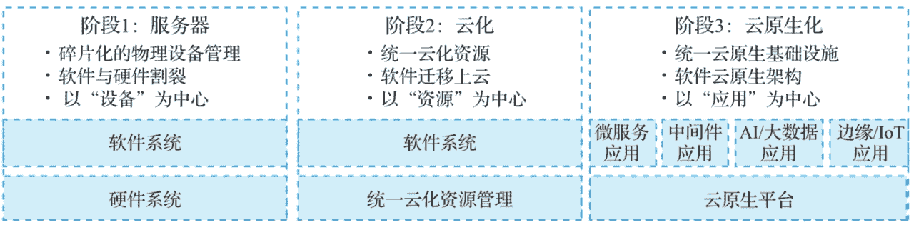

云原生架构在整体上遵循一些原则，包括服务化、弹性、可观测、韧性、自动化、零信任、持续演进等。

+   服务化：业务架构可拆分为微服务架构、小服务架构等，从而使不同业务模块解耦剥离，在做业务迭代时，这可减少因单一业务问题而影响应用整体的稳定性。

+   弹性：系统部署服务的规模应根据业务量的大小而变化，目的是快速响应业务。

+   可观测：在很多业务中，软件规模不断增长，单体系统拆分为微服务、分布式架构之后，服务之间通信、信息关联难度随之增大，系统出现故障的影响范围、定位的难度也会变大。

+   韧性：用于评估在系统软硬件出现各种异常时，比如在部分硬件故障、大业务流量冲击、出现缺陷、受到攻击等情况下，软件依然可以正常处理业务的能力大小。

+   自动化：大规模、分布式的非功能特性和第三方组件的应用，整体增加了软件技术的复杂度。

+   零信任：零信任的核心思想是在默认情况下信任是基于认证和授权访问控制的，本质上是以身份为中心进行访问权限控制。

+   持续演进：当今技术发展速度非常快，知识传递的速度也非常快，数年时间就可以实现众多技术的更新迭代。

#### 容器技术

容器是云原生的标准化软件单元，容器将应用和依赖环境打包，使应用脱离环境限制，可帮助快速实现软件部署和运行。

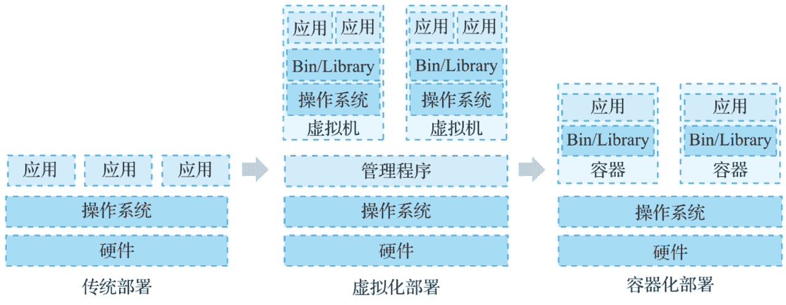

#### 微服务

微服务是将统一的后端服务拆解为多个松耦合的子应用，每个子应用独立负责系统的一部分功能。系统内的多个子应用形成微服务级的分布式体系。

#### Service Mesh

Service Mesh 即服务网格，是在分布式的微服务架构上发展起来的基础技术，其核心目标是将微服务中的连接、通信、安全、流控等非业务特性能力沉淀为平台基础设施，进一步减少开发者在开发微服务时对服务治理问题的关注，使之聚焦于业务逻辑开发。

#### Serverless

Serverless 可直接翻译为无服务，Serverless 既是一种架构模式，也是一种产品形态。

Serverless 旨在让用户专注于业务逻辑，无须考虑服务器、存储类型、网络带宽、自动扩缩容等问题。Serverless 通过云函数等方式，降低了用户的运维时间、运营成本，大大缩短了应用上线周期。

Serverless 的典型应用是云函数或函数计算，即 FaaS。它将业务应用逻辑拆分为多个函数，每个函数均通过事件驱动的方式执行，如上传图片或视频时，会触发云函数来对图片或视频进行处理，并且处理的方式是高可用和弹性的。如果遇到大数据量，集成消息中间件和函数计算，可以实现实时大规模消息处理。

## AI 产品从定义到落地

### 从用户诉求出发，以用户为中心

1943 年马斯洛提出“人们需要动力实现某些需求，需求是有优先性的”，进而提出马斯洛需求层次理论模型。

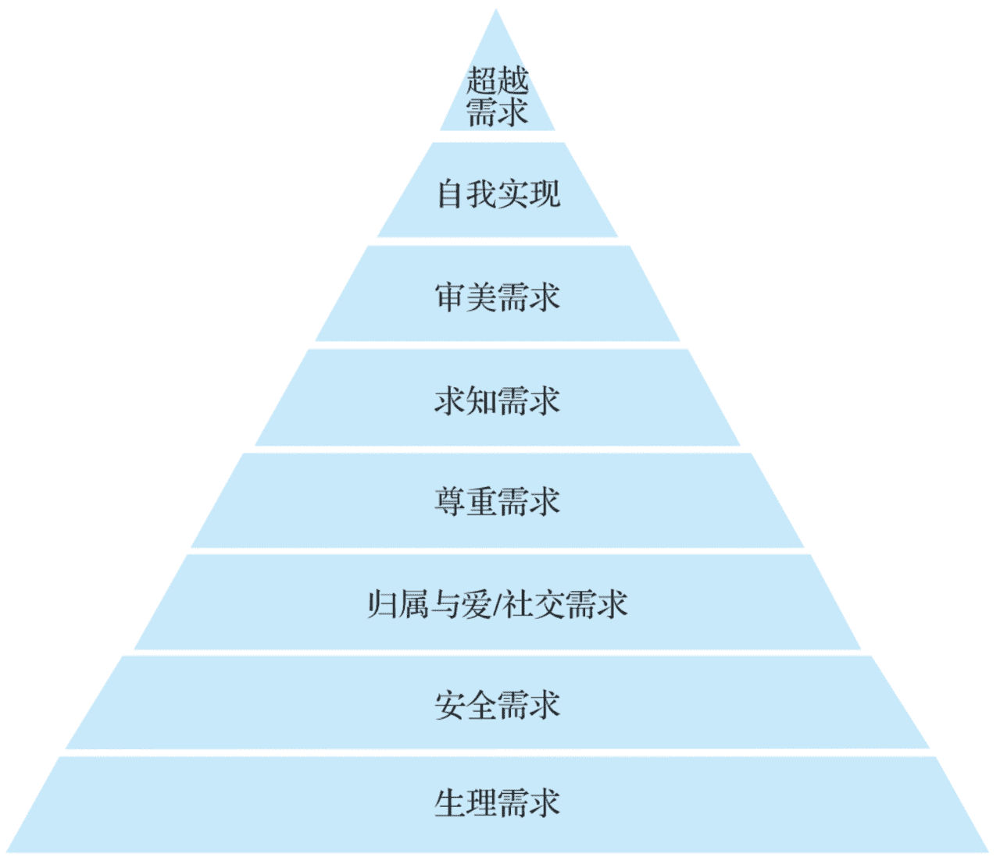

1.  **做产品应该从用户需求出发。**

+   产品需求：用户、场景导向，以用户为中心。

+   避免技术导向，拿着锤子找钉子，拿着产品找场景；

+   避免“意想”，不考虑用户、不考虑场景，只从自己的角度出发做需求。

1.  产品设计应从用户需求出发，而不是转发用户需求

> 一定要过滤诉求，不是照单全收，根据自己产品主线拒绝不合理的需求；

1.  产品经理是连接需求和产品的桥梁。

> AI 产品经理需要通俗化 AI 能力边界和应用案例，深入了解用户业务痛点，并提供认可的解决方案，以实现用户对 AI 的认知提升与业务需求的匹配。

### 一款产品的 8 个要素

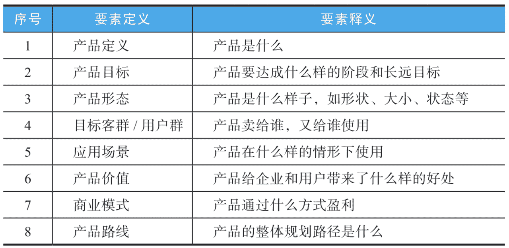

1.  产品定义：用清晰简洁的语句、最鲜明的功能特征、形态、应用场景等描述一个产品。

1.  产品目标：产品是企业组织盈利的重要载体，但并不是所有产品都是为了盈利。产品的成功也不能以盈利情况作为标准，而是以满足战略目标的程度作为标准。

1.  产品形态：产品形态由产品外观表现形式和内在传递理念组成。

1.  目标客户群/用户群：在不少情况下客户并非用户，例如 G 端和 B 端业务中常常购买者和使用者并非同一群人。客户关注的是买卖是否值得，用户关注的是产品是否好用。

1.  应用场景：产品最终要落地到应用场景中，而应用场景是时间、地点、人物、事件、行为的融合，产品关注的是什么人在什么时间和地点、在什么情况下会做出什么行为，目的是嵌入到应用场景中。

1.  产品价值：作为商业的载体，好的产品，无论对团队还是对用户和客户，都会有巨大的价值。产品价值评价一般会从内外两个维度进行，即产品的用户价值和商业价值。

+   产品的用户价值是指产品为用户带来的价值，比如帮助用户提升了工作效率、获得了更好的体验、解决了以往的某些问题、给用户带来了经济价值等。

+   一款产品可给企业带来的商业上的价值即为产品的商业价值。产品的商业价值和用户价值密切联系，足够高的用户价值会带动资本和技术的聚集，从而降低实施成本，推动商业化。

1.  商业模式：商业模式关注产品如何赚钱，这是整合各要素让产品实现盈利的方案。

1.  产品路线：产品路线是产品实现的多阶段目标图。一个产品往往难以一次就做到完善和完美，需要不断迭代。做产品一般会提到最小可行产品（Minimum Viable Product， MVP）概念，即早期为了快速落地，可以提炼最核心的特性加以实现得到 MVP，目的是快速打入市场。

### AI 产品设计框架详解

软件产品的设计应关注功能设计、结构与流程设计、交互与用户体验三个维度。

#### 软件设计要点详解

1.  功能设计

在产品功能设计中，常用模块化、用户故事进行需求拆解，利用原型、思维导图和图形化工具表达功能。

1.  结构与流程设计

结构与流程设计是对业务的流程、产品内部逻辑关系和逻辑顺序、产品使用路径等进行整体规划，从宏观视角讲就是让开发人员对工作项所处的环节、所具有的价值和所能起的作用有更深刻的理解。

无论何种工具，都是从**静态图和动态图**两种角度，对**结构和流程**两大类的内容进行表达。

+   静态图表达产品的定义、属性、结构性，比如是什么、由什么组成等，这类图包括产品功能结构图、信息结构图、系统架构图（对整个系统基于某种视角进行构建，形成的模块化、层次化、一体化的结构图）、用例图等；

+   动态图表达产品的行为特性，比如业务是如何流转的、数据是如何流转的，这类图包括业务流程图、数据流程图、状态图等。

| 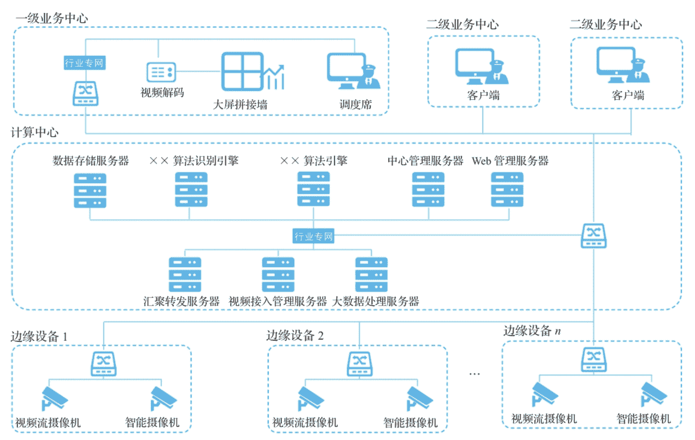 | 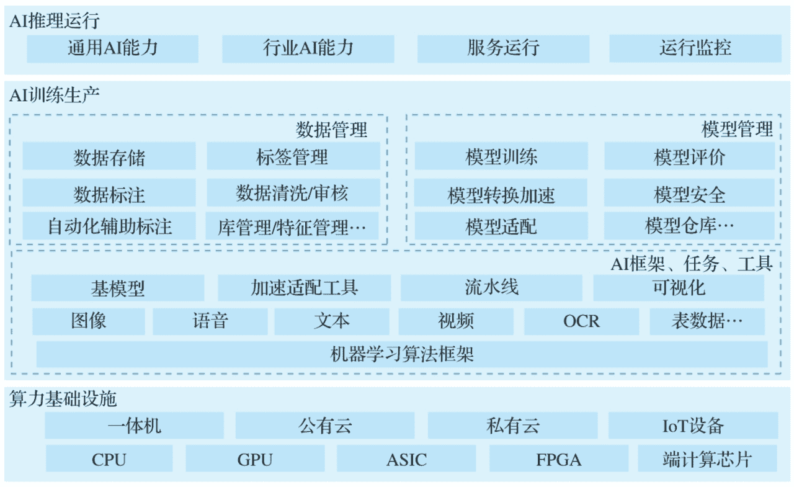 |
| --- | --- |

1.  交互与用户体验

用户体验五要素：战略层、范围层、结构层、框架层、表现层。

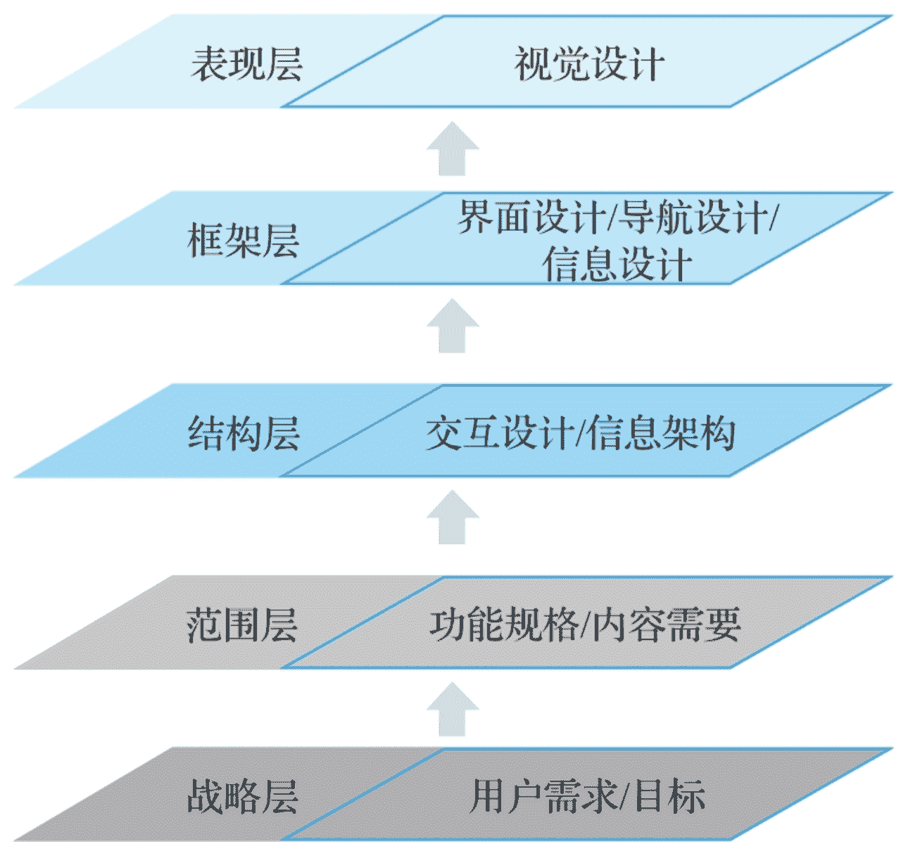

1.  战略层：解决产品目标和用户需求的问题。

1.  范围层：解决需求、功能的边界范围问题。

1.  结构层：结构层关注的是交互设计和信息架构。

1.  框架层：框架层是比结构层更加细粒度的具体化的设计，主要包括界面设计、导航设计、信息设计三部分。

1.  表现层：表现层是对功能、内容、交互、视觉等进行汇总后的最终设计，是对上述四层所涉信息的集中体现。

#### 硬件设计要点详解

除了软件部分，智能硬件一般需要经过工业设计、结构设计、开模、芯片选型、PCB 方案设计、整机验证、包装设计与生产、验证和测试认证、产品内测、备料、小批量试产、大批量生产等过程。

1.  工业设计：追求的是产品在可行性、外观、经济性、安全性等各个维度上达到平衡。

1.  结构设计：

+   产品内部结构，如芯片、PCBA、散热装置等内部模块进行整体设计，并兼顾外部工业设计与内部模块配置问题。

+   对产品经理来说，选型是 PCBA 设计中非常关键的工作，产品经理需要充分考虑目标场景、成本预算、算力、网络、存储、解码、输入输出接口、功耗、散热等元素，这些直接决定了产品的整体功能、性能。

1.  OEM 与 ODM

> OEM（Original Equipment Manufacture，原始设备制造）

> ODM（Original Design Manufacture，原始设计制造）

两者的区别：OEM 模式下仅将生产外包，ODM 模式下将设计、研发、生产都外包。

#### 整体性能设计要点详解

**用于描述产品的性能常见参**数包括各类速度、精度、功耗、稳定性等。

1.  速度：最常见的产品性能参数，在不同的产品中会关注不同的速度，比如网络传输速度、文件读写速度、算法处理速度、特征提取速度、搜索速度等。

1.  精度：在用到算法的产品中，精度是常用的评价指标。很多时候决定产品可行性的就是产品的算法精度。比如在图像识别产品中常用的召回率、精准率，语音识别产品中的唤醒率、词句错误率等，地图产品中的定位精度、出行路线规划用时的偏差程度等都是精度。

1.  功耗：是系统完成目标行为的功率损耗。对于芯片级产品，还需要从更细的粒度来拆解功耗指标，比如动态功耗和静态功耗。动态功耗是设备运行时或者信号改变时所需的功耗，静态功耗是设备上电但是信号没有改变时所需的功耗。

1.  稳定性：通常是指产品可以持续正常稳定工作的能力。

####  安全性与 AI 伦理

系统的安全性也是产品需要考虑但常常忽略的内容，安全性包含外力下的安全性、软件攻击方面的安全性等。

1.  数据安全

1.  代码漏洞

1.  加密与授权：加密通常有两个部分：一个部分是在软件内部进行信息传递时对通信、数据处理过程加密；另一个部分是从整体的角度对产品进行加密，目的是确保产品不被盗版侵权。加密和授权在产品设计阶段可关注三部分：加密算法、加密形式和授权激活方式。

1.  知识产权

1.  AI 算法攻击

1.  AI 伦理

### 产品需求流转

#### 需求收集

需求收集渠道众多，包括客户反馈、销售和售前人员反馈、竞品调研、自发优化与创新等。对于产品经理来说，最真实的需求还是来源于市场和用户，而不是靠自己闭门造车。

#### 需求管理

> 需求池：一般会按照定义、详细内容、时间、重要性、来源、类型、状态等对需求进行统一管理。

需求管理需要关注**紧急性、可行性、重要性和优先级**四个维度。

1.  紧急性是要求响应需求的紧急程度。

1.  可行性用于衡量需求的实现是否可行。

1.  重要性代表需求的意义，如需求是否符合战略方向、需求对项目是否有决定性影响、需求被满足后是否会带来巨大的经济收益等。

1.  优先级是综合考虑紧急性、可行性、重要性后做出决策，是最后执行顺序的依据。对于十分重要且紧急的项目需求，应调整紧急性以快速响应；对于普通需求，应根据需求的共性和战略意义，按优先级排序来逐一消化；对于完全不可行的需求，则应该在早期就过滤掉。

## 算法类 AI 产品落地详解

在基于深度学习的技术框架下，一个深度学习算法模型的生产一般需要经过以下几个基础环节：任务定义、数据工程、模型训练、模型加速和适配、模型评价。

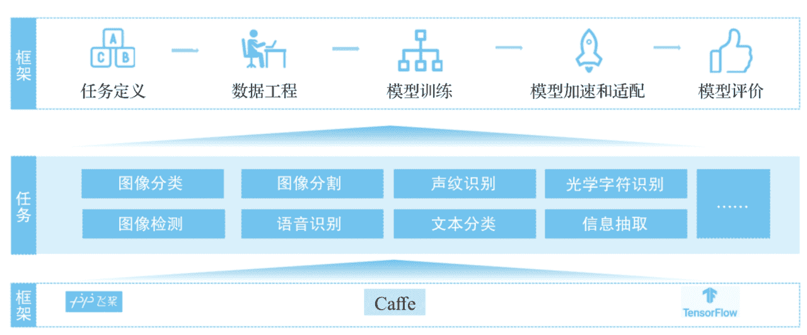

### 任务定义——AI 算法产品的真实需求与目标

任务定义是模型开发流程中的第一步，任务定义直接影响后续模型精度。任务定义应该由 AI 产品经理和算法人员共同完成。

#### 明确算法需求

AI 产品经理在任务定义中起着重要的作用。在任务定义中，业务规则可能直接影响到算法实现，而且业务规则是客观存在的，AI 产品经理需要架起业务定义和算法任务定义之间的桥梁。

除了一些交互的需求外，AI 产品经理还需要对算法需求刨根问底，以获得更细致的信息，从而使得需求更容易被算法研究人员理解。

产品经理还要关注任务中的争议边界。任务可被定义为简单任务和困难任务，简单任务的边界清晰，比如猫和狗的分类，非常容易划分。

#### 用样例描述算法需求

从客户处获取需求仅是任务定义的一个方面，很多时候，客户并不知道场景的复杂性。对此 AI 产品经理除了应与客户进行深入沟通外，还应查看数据样本。

### 数据工程——用数据定义功能边界

**在当前的 AI **算法框架中，离不开的三个核心要素依然是数据、算法、算力。

数据工程一般包含数据采集、数据生成、数据预处理、数据标注、数据清洗/质检等几个环节。

#### 数据采集

数据采集是数据工程的第一步，原始数据的好坏直接影响训练模型的效果。

1.  获取数据的成本

1.  获取数据的渠道

1.  隐私数据安全

#### 数据标注

按照不同模态，数据的标注包括对图像、语音、文本的标注。

+   图像的标注包括拉框、标签分类、关键点标注、语义分割、3D 点云等；

+   语音的标注包括对说话内容、说话人等的标注；

+   文本的标注则包括对文本分类、情感等任务的标注。

#### 数据生成

数据的生成方式大致可分为两种：

+   第一种是简单的数据生成，可以是对已有的标注数据进行简单的数据变换，如对图像增加噪声、转换图像风格等。通过转换图像风格获取数据，可提升训练数据的扰动性，降低模型过拟合的可能性。简单的数据生成有很多是在训练模型的过程中直接实现的。

+   第二种是较为复杂的数据生成，如通过深度生成对抗网络的方式生成数据，这类数据可以用于模型训练，然后通过真实数据迁移到实际应用场景。

### 算法生产——获得最小可行的 AI 产品

#### 训练模型

1.  算法框架：对于算法框架，相信所有涉足 AI 的人多少都有所耳闻，常见的算法框架有 Caffe、TensorFlow、PyTorch、PaddlePaddle 等。算法框架涵盖很多基础算子、算法训练的工具以及可视化的工具链等，为算法开发提供了底层支持。

1.  算子/操作：在深度神经网络中，算子指的是一个操作（Operator/OP），比如图像算法中的卷积（Covolution）就是一个算子，其通过一个核矩阵实现对像素空间数值的计算。

1.  网络结构：AI 产品中，最常见的网络结构是神经网络。神经网络是对神经元进行连接，构造从输入、中间多层处理到最后输出的结构。

1.  主干网络（Backbone）：随着深度学习技术的不断突破，过去几年已经出现许多经典的基础网络结构，被称为主干网络。

1.  参数：上述网络结构和主干网络本质上都是数学公式，比如 ax+bx2+cx3=y。在训练过程中，x 是我们在实际业务中“喂”给公式（网络）的数据，y 是我们的标注结果，而 a、b、c 是我们要学习的网络参数。训练本质上就是求解拟合业务数据的最优解的过程。

1.  超参数：训练模型时所使的训练，可以理解为我们学习时使用的学习方法，比如“学习 1 小时休息 10 分钟”。另外在训练陷入局部最优的时候，给一些跳出局部最优的办法。无论是训练方法还是跳出局部最优，都是通过配置超参数实现的。比如配置以什么方式给模型提供初始化参数，使用什么方法控制网络参数的更新（如使用随机梯度下降的优化方法）等。

1.  模型：训练完成后，我们会得到一个带参数和网络结构的输出，我们常称之为模型，比如 Caffe 中的 caffemodel 文件、PyTorch 中的 pth 文件。

1.  流水线（Pipeline）：在实现一个业务任务的时候，往往无法只用一个模型，比如识别车辆是否在路口闯红灯，在这个业务任务中，不仅要识别车辆，还要识别信号灯和路上的标线。每一个子任务都由单独的模型完成，识别效果会更好。那么，如何将多个模型串成流水线是算法开发的一项重要工作，可以理解为业务算法架构。

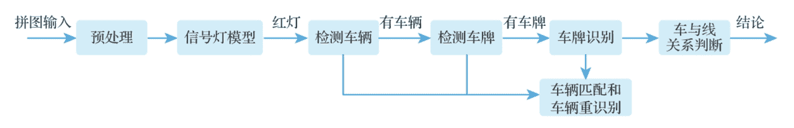

### 算法评估——获得算法能力边界

对于 AI 产品来说，算法的指标是产品指标的重要组成，评价一个 AI 产品的好坏，很多时候是评价核心算法的好坏。

#### 两种评估方法

一般来说，评估算法或者 AI 产品，都要从功能、速度、精度等维度开始，功能、精度、速度在一定程度上可以反映产品的性价比。

通常会使用**定量评估和定性评估**两种方式进行速度和精度评估。

#### 视图识别的精度指标

精度一般指算法或系统检测、识别的准确率的大小。

算法模型的精度测试定义了三类概念，第一类是基础概念，第二类是基础指标，第三类是二级指标。

1.  基础概念包括度量基准、测试集、真实值、预测值、置信度、阈值、正样本、负样本、真正类、真负类、假正类、假负类和混淆矩阵。

1.  基础指标精度的基础指标由基础概念计算得出，包括准确率、错误率、精确率、召回率、误报率。

1.  二级指标由基础指标计算得出，包括 F 值（或 F1 值）、ROC 曲线等。

> ROC 曲线（Receiver Operating Characteristic Curve）是在统计学和机器学习中常用的一种评估分类模型性能的工具。它以灵敏度（True Positive Rate，又称为召回率或检出率）和特异度（1 减去 False Positive Rate）为横纵坐标，绘制出模型在不同阈值下的表现。

#### 确定合理的速度指标

如果说精度指标的好坏决定的是概念或者方案是否可行，那么速度指标的好坏决定的是系统或者产品的成本，更高的性能意味着更低的成本。

速度一般是对算法或者系统的推理速度进行考察，针对不同的技术应用，有不同的评价指标。如针对图像识别类产品进行评价，通常采用 QPS，而针对视频、语音、文本识别类产品进行评价又有不同指标。

衡量速度的指标一般包括，QPS（吞吐量）、支持的路数、倍速、时延。

> QPS（Queries Per Second）是一个衡量系统或服务性能的指标，表示系统每秒能够处理的请求数量或查询次数。较高的 QPS 值表示系统具有更快的响应速度和更高的吞吐量，即系统能够处理更多的请求。

## AI 中台

> AI 中台，可以理解为是算法生产管理的工厂。

### AI 中台的需求及整体方案

#### AI 中台及体系架构

AI 中台是“智能”的基础设施，是实现 AI 技术和应用快速研发、共享复用和高效管理的智能基础设施。AI 中台是企业中台的重要组成部分，结合数据中台、知识中台为用户的业务提供智能化支持。

AI 中台提供了从构建算法到运行算法的能力。从算法生产流程看，AI 中台包含了训练和运行两大部分：

+   训练通过构建算法任务，得到一个可运行的算法；

+   运行（或推理）是将算法部署上线，并自动化完成对应的任务。从过程上看，训练是生产，运行是使用。

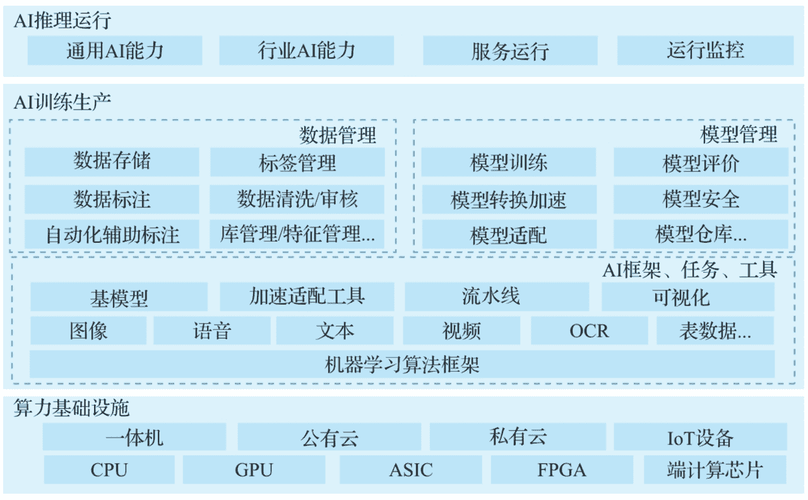

### AI 中台下的三大功能模块设计

> 算力、数据、算法

#### 算力管理类功能设计

以深度学习技术框架为核心的 AI，计算是最基础的内容，芯片是计算的载体，除了芯片，还需要工具链、生态等的支撑。

1.  集中式和分布式

1.  端云协同

1.  算力多元化

1.  算力的精细化管理

#### 数据管理类功能设计

#### 算法管理类功能设计

> 算法用户、生产过程、应用

1.  算法用户

1.  算法生产过程管理：调参、训练、评价、应用部署

+   调参是对生产要素的配置，这里的生产要素是指模型、技术参数、数据，以及训练用的超参数等。

+   训练是模型学习的过程。对大模型和大数据量的训练，过程往往非常冗长，在训练中要关注是否满足预期，如果不满足，要尽早停止。因此训练过程需要丰富的过程可视化、过程排查工具，以保证模型朝着正确的方向学习，降低训练代价。

+   评价的对象是模型表现，包括精确度、速度等。

+   应用部署是将模型部署上线使用，是应用上架的过程。

1.  算法应用管理

算法完成生产过程，就会成为可被部署使用的 App， App 可以被存储和流转，也可以被发布上线。流转场景可以分为封闭式和开放式。

> 本文主要以书籍《AI 产品经理：方法、技术与实战》（作者王泽楷）的内容框架做梳理，一来作为工具书了解和学习他人工作方法（作者是商汤的 AI 产品大佬）；二来对自己已有 AI 相关的知识体系查漏补缺、吐故纳新。

> 推荐阅读原著，同时也希望本文能给你带来一些启发和帮助。