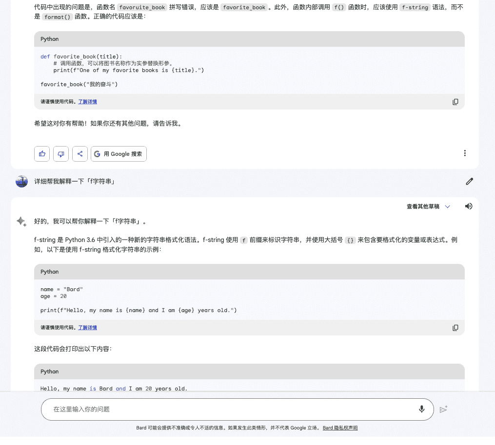

# Python Learning Notes

> 来源：[https://leonzhang.feishu.cn/docx/GACFdiADRoHSVCxAhvYcTcFwnVf](https://leonzhang.feishu.cn/docx/GACFdiADRoHSVCxAhvYcTcFwnVf)

> 了解基本规则即可，毕竟大模型写的比一个初学者（我）可好太多啦～

### 感谢 Google Bard

> 感谢 Google Bard 为我的代码学习提供了指导，感谢 LLMs、Google、感谢 Bard，嘿嘿 😁

|  |
| --- |

### 学习教程

> 【【官方随书视频】最热门编程入门书《Python编程：从入门到实践（第2版）》】 https://www.bilibili.com/video/BV1Sd4y1a7Us/?p=27&share_source=copy_web&vd_source=672ec070780ce29c890256a5fabe799b

### 手敲代码（练习用）

```
# 打印
print(&quot;hello!! 你好呀！！&quot;)
print(&quot;=====&quot;)


# 什么是赋值
# 定义字符串变量 name
name = &quot;Eric&quot;
# 用f字符串打印一句打招呼的话
print(f&quot;Hello {name}, would you like to learn some Python today?&quot;)

# 把 name 转化成小写
name = &quot;Eric&quot;.lower()
print(f&quot;Hello {name}, would you like to learn some Python today?&quot;)

name = &quot;Eric&quot;.upper()
print(f&quot;Hello {name}, would you like to learn some Python today?&quot;)

name = &quot;Eric zhang&quot;.title()
print(f&quot;Hello {name}, would you like to learn some Python today?&quot;)
print(&quot;=====&quot;)


&#x27;&#x27;&#x27;
日期：2023年8月17日
题目要求：分别用加减乘除得到数字8，并且打印出来。
&#x27;&#x27;&#x27;
print(1 + 1 + 6)
print(2 * 4)
print(10 -2)
print(16 / 2)
print(&quot;注意：python3 里除法结果为浮点数；加减乘取决于参与运算的数值。如：&quot;)
print(1 + 1.0 + 6)
print(&quot;=====&quot;)


print(&quot;- 注释&quot;)
# 我是一行注释
# 快捷键 control + /
&#x27;&#x27;&#x27;
你这么聪明，相信也看出来了，
这个是多行注释。
&#x27;&#x27;&#x27;
print(&quot;=====&quot;)

# 数据类型
# 对字符串求长度 str
s = &quot;Hello world!&quot;
print(len(s))

# 通过索引获取单个字符（记住：索引是从0开始的）
print(s[0])
print(s[11])
print(s[len(s) - 1])

# 布尔类型 bool
b1 = True
b2 = False

# 空值类型
n = None

# type函数
# 整数为 int，浮点数为 float
print(type(s))
print(type(b1))
print(type(n))
print(type(1))
print(type(1.5))
print(&quot;=====&quot;)

# 列表及操作
&#x27;&#x27;&#x27; 练习3-1：姓名
将一些朋友的姓名存储在一个列表中，并将其命名为names。
依次访问该列表中的每个元素，从而将每个朋友的姓名打印出来。 &#x27;&#x27;&#x27;
# names = [&quot;小王&quot;,&quot;小郝&quot;,&quot;小刘&quot;]
# print(names[0])
# print(names[1])
# print(names[2])

&quot;&quot;&quot;练习3-2：问候语
继续使用练习3-1中的列表，但不打印每个朋友的姓名，而为每人打印一条消息。
每条消息都包含相同的问候语，但抬头为相应朋友的姓名。&quot;&quot;&quot;
# names = [&quot;小王&quot;,&quot;小郝&quot;,&quot;小刘&quot;]
# greeting = &quot;你好呀，&quot;
# print(greeting + names[0])
# print(greeting + names[1])
# print(greeting + names[2])

&quot;&quot;&quot;练习3-4：嘉宾名单
如果你可以邀请任何人一起共进晚餐〔无论是在世的还是故去的），你会邀请哪些人？
请创建一个列表，其中包含至少三个你想邀请的人，然后使用这个列表打印消息，邀请这些人来与你共进晚餐。&quot;&quot;&quot;
# names = [&quot;小王&quot;,&quot;小郝&quot;,&quot;小刘&quot;]
# invite = &quot;一块儿吃个饭吧？&quot;
# print(invite + names[0])
# print(invite + names[1])
# print(invite + names[2])

&quot;&quot;&quot;练习3-5：修改嘉宾名单
你刚得知有位嘉宾无法赴约，因此需要另外邀请一位嘉宾。
以完成练习3-4时编写的程序为基础，在程序末尾添加一条print语句，指出哪位嘉宾无法赴约。
修改嘉宾名单，将无法赴约的嘉宾的姓名替换为新邀请的嘉宾的姓名。
再次打印一系列消息，向名单中的每位嘉宾发出邀请。&quot;&quot;&quot;
# names = [&quot;小王&quot;,&quot;小郝&quot;,&quot;小刘&quot;]
# invite = &quot;一块儿吃个饭吧？&quot;
# print(names[2] + &quot;不能参加&quot;)
# names[2] = &quot;小李&quot;
# print(invite + names[0])
# print(invite + names[1])
# print(invite + names[2])

&quot;&quot;&quot;练习3-6：添加嘉宾
你刚找到了一个更大的餐桌，可容纳更多的嘉宾。请想想你还想邀请哪三位嘉宾。
- 以完成练习3-4或练习3-5时编写的程序为基础，在程序末尾添加一条print语句，指出你找到了一个更大的餐桌。
- 使用insert() 将一位新嘉宾添加到名单开头。
- 使用insert() 将另一位新嘉宾添加到名单中间。
- 使用append() 将最后一位新嘉宾添加到名单未尾。
- 打印一系列消息，向名单中的每位嘉宾发出邀请。&quot;&quot;&quot;
# print(&quot;找到了一个更大的餐桌！&quot;)
# names.insert(0,&quot;小林&quot;)
# names.insert(2,&quot;小张&quot;)
# names.append(&quot;小韩&quot;)
# print(names)
# print(invite + names[0])
# print(invite + names[1])
# print(invite + names[2])
# print(invite + names[3])
# print(invite + names[4])
# print(invite + names[5])


# 遍历
&quot;&quot;&quot;练习4-1：比萨
想出至少三种你喜欢的比萨，将其名称存储在一个列表中，再使用for循环
将每种比萨的名称打印出来。
- 修改这个for循环，使其打印包含比萨名称的句子，而不仅仅是比萨的名称。
对于每种比萨，都显示一行输出，下面是一个例子。
I like pepperoni pizza.
- 在程序未尾添加一行代码，它不在for循环中，指出你有多喜欢比萨。
输出应包含针对每种比萨的消息，还有一个总结性句子，下面是一个例子。
I really love pizza! &quot;&quot;&quot;
pizza_list = [&quot;香肠披萨&quot;, &quot;榴莲披萨&quot;, &quot;芝士披萨&quot;]
for pizza in pizza_list:
    print(&quot;我喜欢&quot; + pizza)
print(&quot;I really love pizza！&quot;)

# 创建数值列表
&quot;&quot;&quot; range(1 , 9) 即起始值、结束值（不含）
range(2, 10, 2) 即起始值、结束值、步长 &quot;&quot;&quot;

&quot;&quot;&quot; 练习4-4：一百万
创建一个包含数 1 ~ 1 000 000 的列表，再使用一个for循环将这些数打印出来。
(如果输出的时间太长，按Ctrl ＋ C 停止输出或关闭输出窗口。） 
&quot;&quot;&quot;
numbers = []
for num in range(1, 1000001):
    numbers.append(num)
# for num in numbers:
#     print(num)

&quot;&quot;&quot; 练习4-5：一百万求和
创建一个包含数 1 ~ 1000 000的列表，再使用min()和max()
核实该列表确实是从1开始、到1 000 000结束的。
另外，对这个列表调用函数sum()， 看看Python将一百万个数相加需要多长时间。 
&quot;&quot;&quot;
print(min(numbers))
print(max(numbers))
print(sum(numbers))

# if
&quot;&quot;&quot; 练习5-3：外星人颜色
假设在游戏中刚射杀了一个外星人，请创建一个名为 alien_color 的变量，并将其赋值为 &#x27;green’、&#x27;yellow&#x27;或&#x27;red&#x27;。
- 编写一条if语句，检查外星人是否是绿色的。如果是，就打印一条消息，指出玩家获得了5分。
- 编写这个程序的两个版本，在一个版本中上述测试通过了，而在另一个版本中未通过(未通过测试时没有输出）。
&quot;&quot;&quot;
# alien_color = &quot;green&quot;
# if alien_color == &quot;green&quot;:
#     print(&quot;You got 5 points!&quot;)

&quot;&quot;&quot; 练习5-4：外星人颜色2
像练习5-3那样设置外星人的颜色，并编写一个 if_else 结构。
- 如果外星人是绿色的，就打印一条消息，指出玩家因射杀该外星人获得了5分。
- 如果外星人不是绿色的，就打印一条消息，指出玩家获得了10分。
- 编写这个程序的两个版本，在一个版本中执行 if 代码块，在另一个版本中执行else代码块。
&quot;&quot;&quot;
# alien_color = &quot;green&quot;
# if alien_color == &quot;green&quot;:
#     print(&quot;You got 5 points!&quot;)
# else:
#     print(&quot;You got 10 points!&quot;)
#
# alien_color = &quot;yellow&quot;
# if alien_color == &quot;green&quot;:
#     print(&quot;You got 5 points!&quot;)
# else:
#     print(&quot;You got 10 points!&quot;)

&quot;&quot;&quot; 练习5-5：外星人颜色了
将练习5-4中的 if_else 结构改为 if_elif-else 结构。
- 如果外星人是绿色的，就打印一条消息，指出玩家获得了5分。
- 如果外星人是黄色的，就打印一条消息，指出玩家获得了10分。
- 如果外星人是红色的，就打印一条消息，指出玩家获得了15分。
编写这个程序的三个版本，分别在外星人为绿色、黄色和红色时打印一条消息。
&quot;&quot;&quot;
# alien_color = &quot;red&quot;
# if alien_color == &quot;green&quot;:
#     print(&quot;You got 5 points!&quot;)
# elif alien_color == &quot;yellow&quot;:
#     print(&quot;You got 10 points!&quot;)
# else:
#     print(&quot;You got 15 points!&quot;)


# 逻辑运算 and（一个错都错） or（一个对都对） not（逆反）
# 优先级 not &gt; and &gt; or

# 字典 dictionary 键值对 == 键 key ：值 value
# 元组 tuple

&quot;&quot;&quot; 练习6-1：人
使用一个字典来存储一个熟人的信息，包括名、姓、年龄和居住的城市。
该字典应包含键first_name、last_name、age和city。
将存储在该字典中的每项信息都打印出来。
&quot;&quot;&quot;
# friend = {&quot;first_name&quot;: &quot;小美&quot;, &quot;last_name&quot;: &quot;王&quot;, &quot;age&quot;: &quot;24&quot;, &quot;city&quot;: &quot;杭州&quot;}
# print(&quot;姓名：&quot; + friend[&quot;last_name&quot;] + friend[&quot;first_name&quot;])
# print(&quot;年龄：&quot; + friend[&quot;age&quot;])
# print(&quot;城市：&quot; + friend[&quot;city&quot;])

&quot;&quot;&quot; 练习6-5：河流
创建一个字典，在其中存储三条重要河流及其流经的国家。
例如，一个键值对可能是 &#x27;nile&#x27; ：&#x27;egypt&#x27; 。
- 使用循环为每条河流打印一条消息，下面是一个例子。
The Nile runs through Egypt.
- 使用循环将该字典中每条河流的名字打印出来。
- 使用循环将该宇典包含的每个国家的名字打印出来。
&quot;&quot;&quot;
# rivers = {&quot;Nile&quot;: &quot;Egypt&quot;, &quot;yangtze river&quot;: &quot;China&quot;, &quot;Amazon river&quot;: &quot;Brazil&quot;}
# for river, country in rivers.items():
#     print(&quot;The &quot; + river + &quot;runs through &quot; + country + &quot;.&quot;)
# for river in rivers.keys():
#     print(river)
# for country in rivers.values():
#     print(country)


&quot;&quot;&quot; 本期遇到问题：1. 未切换为英文半角的冒号;
2. 代码如何区分字典中的键或值为 river还是 country？ &quot;&quot;&quot;

&quot;&quot;&quot; 练习7-3：10的整数倍
让用户输入一个数，并指出该数是否是10的整数倍。&quot;&quot;&quot;

# number = int(input(&quot;请输入一个数字: &quot;))
# if number % 10 == 0:
#     print(&quot;你输入的数字是10的整数倍&quot;)
# else:
#     print(&quot;你输入的数字不是10的整数倍&quot;)


# 在条件何时结束未知的情况下，while循环比for循环（循环次数未知）更适合使用。
&quot;&quot;&quot; 练习7-4：比萨配料
编写一个循环，提示用户输入一系列比萨配料，并在用户输入&#x27;quit&#x27;时结束循环。
每当用户输入一种配料后，都打印一条消息，指出我们会在比萨中添加这种配料。
&quot;&quot;&quot;
# user_input = input(&quot;请输入你想要输入的披萨配料：&quot;)
# while user_input != &quot;quit&quot;:
#     print(&quot;好的，披萨中会为你添加&quot; + user_input)
#     user_input = input(&quot;请输入你想要输入的披萨配料：&quot;)

# 本期遇到问题：未切换为英文半角的冒号

# 软件开发原则之一：DRY原则，Don&#x27;t Repeat Yourself.
&quot;&quot;&quot; 练习8-2：喜欢的图书
编写一个名为favorite_book()的函数，其中包含一个名为title的形参。
这个函数打印一条消息，下面是一个例子。
One of my favorite books is Alice in Wonderland.
调用这个函数，并将一本图书的名称作为实参传递给它。
&quot;&quot;&quot;
# def favorite_book(title):
#     # 调用函数，可以将图书名称作为实参替换形参。
#     print(f&quot;One of my favorite books is {title}.&quot;)
#
# favorite_book(&quot;我的奋斗&quot;)

&quot;&quot;&quot; 练习8-6：城市名
编写一个名为city_country()的函数，它接受城市的名称及其所属的国家。
这个函数应返回一个格式 类似于下面的字符串：
&quot;Santiago, Chile&quot;
至少使用三个城市国家对来调用这个西数，井打印它返回的值。
&quot;&quot;&quot;
# def city_country(city, country):
#     return f&quot;{city}, {country}&quot;
#
# print(city_country(&quot;杭州&quot;,&quot;中国&quot;))
# print(city_country(&quot;柏林&quot;,&quot;德国&quot;))
# print(city_country(&quot;纽约&quot;,&quot;美国&quot;))
#
# # 问题：因为return也是函数，所以不存在括号啊

&quot;&quot;&quot;面向对象编程（纪传体）与面向过程编程（编年体）  
- 面向对象：一种以对象为基础进行编程的方法。它将程序组织成一个个相互关联的对象，每个对象都有自己的状态（属性）和行为（方法）。
          通过定义类来创建对象的实例，并使用**封装、继承和多态**等特性来实现代码的重用性和灵活性
- 面向过程：注重解决问题的步骤和流程，将程序组织为一系列的函数或过程。
- 下划线命名法则（定义普通变量）、Pascal命名法则（定义类名：首字母大写来分割单词 + 「:」）

- 创建类和使用类、使用类和实例、继承 
- 创建类 class，构造方法、定义属性 __init__，创建新对象 class()，定义方法（在class中） def &quot;&quot;&quot;

&quot;&quot;&quot; 练习9-1：餐馆
创建一个名为 Restaurant 的类，为其方法 __init__() 设置属性 restaurant_name 和 cuisine_type。
创建一个名为 describe_restaurant() 的方法和一个名为 open_restaurant() 的方法，前者打印前述两项信息，而后者打印一条消息，指出餐馆正在营业。
根据这个类创建一个名为 restaurant 的实例，分别打印其两个属性，再调用前述两个方法。 &quot;&quot;&quot;

# class Restaurant:
#     def __init__(self, restaurant_name, cuisine_type):
#         self.restaurant_name = restaurant_name
#         self.cuisine_type = cuisine_type
#
#     def describe_restaurant(self):
#         print(f&quot;餐厅名: {self.restaurant_name}&quot;)
#         print(f&quot;菜系： {self.cuisine_type}&quot;)
#
#     def open_restaurant(self):
#         print(&quot;餐厅正在营业...&quot;)
#
# taotaoju = Restaurant(&quot;陶陶居&quot;, &quot;粤菜&quot;)
#
# print(taotaoju.restaurant_name)
# print(taotaoju.cuisine_type)
# taotaoju.describe_restaurant()
# taotaoju.open_restaurant()
#
# xiaoliuchuancaiguan = Restaurant(&quot;小刘川菜馆&quot;, &quot;川菜&quot;)
#
# print(xiaoliuchuancaiguan.restaurant_name)
# print(xiaoliuchuancaiguan.cuisine_type)
# xiaoliuchuancaiguan.describe_restaurant()
# xiaoliuchuancaiguan.open_restaurant()

&quot;&quot;&quot; 练习9-4：就餐人数
在为完成练习9-1而编写的程序中，添加一个名为 number_served 的属性，并将其默认值设置为0。
根据这个类创建一个名为 restaurant 的实例。打印有多少人在 这家餐馆就餐过，然后修改这个值并再次打印它。
添加一个名为 set_number_served() 的方法，让你能够设置就餐人数。
调用这个方法并向它传递一个值，然后再次打印这个值。
添加一个名为increment_number_served() 的方法，让你能够将就餐人数递增。
调用这个方法井向它传递一个这样的值：你认为这家餐馆每天可能接待的就餐人数。&quot;&quot;&quot;
# class Restaurant:
#     def __init__(self, restaurant_name, cuisine_type):
#         self.restaurant_name = restaurant_name
#         self.cuisine_type = cuisine_type
#         self.number_served = 0
#
#     def describe_restaurant(self):
#         print(f&quot;餐厅名: {self.restaurant_name}&quot;)
#         print(f&quot;菜系： {self.cuisine_type}&quot;)
#
#     def open_restaurant(self):
#         print(&quot;餐厅正在营业...&quot;)
#
#     def set_number_served(self, number_served):
#         self.number_served = number_served
#
#     def increment_number_served(self, increment_number):
#         self.number_served += increment_number
#         # self.number_served = self.number_served + increment_number
#
# taotaoju = Restaurant(&quot;陶陶居&quot;, &quot;粤菜&quot;)
#
# print(taotaoju.restaurant_name)
# print(taotaoju.cuisine_type)
# print(taotaoju.number_served)
# taotaoju.describe_restaurant()
# taotaoju.open_restaurant()
# taotaoju.set_number_served(500)
# taotaoju.increment_number_served(20)
# print(taotaoju.number_served)

&quot;&quot;&quot; 什么时候用继承？  &#x27;A是B&#x27;，即classA(B) 
__init__ :构造函数，用于在创建对象时进行初始化操作。
super :内置函数，用于调用父类的方法。 &quot;&quot;&quot;

&quot;&quot;&quot;&quot; 练习9-6：冰激凌小店
冰激凌小店是一种特殊的餐馆。编写一个名为 IceCreamStand 的类，让它继承为完成练习9-1或练习9-4而编写的 Restaurant 类。
这两个版本的 Restaurant 类都可以，挑选你更喜欢的那个即可。
添加一个名为 flavors 的属性，用于存储一个由各种口味的冰激凌组成的列表。
编写一个显示这些冰激凌的方法。创建一个 IceCreamStand 实例，并调用这个方法。 &quot;&quot;&quot;

# class Restaurant:
#     def __init__(self, restaurant_name, cuisine_type):
#         self.restaurant_name = restaurant_name
#         self.cuisine_type = cuisine_type
#
#     def describe_restaurant(self):
#         print(f&quot;餐厅名: {self.restaurant_name}&quot;)
#         print(f&quot;菜系： {self.cuisine_type}&quot;)
#
#     def open_restaurant(self):
#         print(&quot;餐厅正在营业...&quot;)
#
# class IceCreamStand(Restaurant):
#     def __init__(self, restaurant_name, flavors):
#         super().__init__(restaurant_name, &quot;甜品&quot;)
#         self.flavors = flavors
#
#     def show_flavors(self):
#         print(self.flavors)
#
#
# so_sweet = IceCreamStand(&quot;So Sweet&quot;,  [&quot;香草&quot;,&quot;巧克力&quot;, &quot;草莓&quot;, &quot;西瓜&quot;])
# so_sweet.describe_restaurant()
# so_sweet.show_flavors()

&quot;&quot;&quot; 引入模块
- import 语句
- from...import 语句
- from...import * &quot;&quot;&quot;

&quot;&quot;&quot; 读文件：read(全部字符串） readline(只读一行)  readlines（全部文件内容组成的列表） &quot;&quot;&quot;

&quot;&quot;&quot; 练习10-1：Python学习笔记
在文本编辑器中新建一个文件，写几句话来总结一下你至此学到的Python知识，其中每一行都以&quot;In Python you can“打头。
将这个文件命名为 learning_python.txt，并存储到为完成本章练习布编写的程序所在的目录中。
编写一个程序，它读取这个文件，并将你所写的内容打印三次：
第一次打印时读取整个文件；第二次打印时遍历文件对象；
第三次打印时将各行存储在一个列表中，再在with 代码块外打印它们。 &quot;&quot;&quot;

# f = open(&quot;./Learning_python.txt&quot;, &quot;r&quot;, encoding = &quot;utf-8&quot;)
# content = f.read()
# print(content)
# f.close()

# with open(&quot;./Learning_python.txt&quot;, &quot;r&quot;, encoding = &quot;utf-8&quot;) as f:
#     # 1 print(f.readlines())
# # 遇到问题：with open as 函数，再次未加冒号「:」
#
#     # 2 for line in f.readlines():
#     #     print(line)
#     line_list = f.readlines()
# print(line_list)


# 写入文件
# &quot;&quot;&quot; 练习10-4：访客名单
# 编写一个while循环，提示用户输入名字。用户输入名字后，在屏幕上打印一句问候语，并将一条到访记录添加到文件 guest_book.txt 中。
# 确保这个文件中的每条记录都独占一行。 &quot;&quot;&quot;
# user_input = input(&quot;请输入访客的名字（完成所有名字输入后，请输入q终止程序): &quot;)
# with open(&quot;guest_book.txt&quot;, &quot;a&quot;) as f:
#     while user_input != &quot;q&quot;:
#         f.write(user_input + &quot;\n&quot;)
#         print(f&quot;欢迎{user_input}&quot;)
#         user_input = input(&quot;请输入访客的名字（完成所有名字输入后，请输入q终止程序): &quot;)


&quot;&quot;&quot; 练习10-6：加法运算
提示用户提供数值输入时，常出现的一个问题是，用户提供的是文本而不是数。
在此情况下，当你尝试将输入转换为整数时，将引发 ValueError 异常。
编写一个程序，提示用户输入两个数，再将其相加并打印结果。
在用户输入的任何一个值不是数时都捕获 ValveError 异常，并打印一条友好的错误消息。
对你编写的程序进行测试：先输入两个数，再输入一些文本而不是数。 &quot;&quot;&quot;
# try 函数，通常在可能会出现错误行代码的上一行

# user_input1 = input(&quot;请输入第一个整数：&quot;)
# user_input2 = input(&quot;请输入第二个整数：&quot;)
# try:
#     result = int(user_input1) + int(user_input2)
# except ValueError:
#     print(&quot;请输入整数。 &quot;)
# except NameError:
#     print(&quot;汉字，请输入整数。 &quot;)
# else:
#     print(result)

```