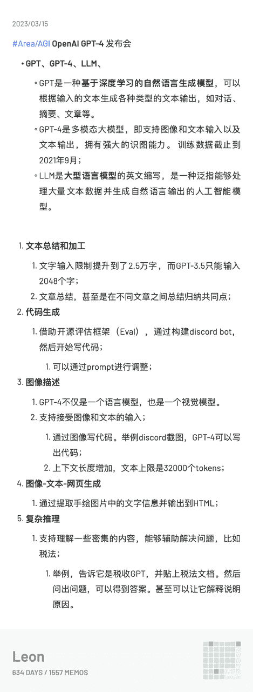

# OpenAI GPT-4 发布会

> 来源：[https://leonzhang.feishu.cn/docx/Qhd6dh0hNoPBL6xXSBTcfy3GnSg](https://leonzhang.feishu.cn/docx/Qhd6dh0hNoPBL6xXSBTcfy3GnSg)

+   **GPT、GPT-4、LLM、**

+   GPT是一种**基于深度学习的自然语言生成模型**，可以根据输入的文本生成各种类型的文本输出，如对话、摘要、文章等。

+   GPT-4是多模态大模型，即支持图像和文本输入以及文本输出，拥有强大的识图能力。 训练数据截止到2021年9月；

+   LLM是**大型语言模型**的英文缩写，是一种泛指能够处理大量文本数据并生成自然语言输出的人工智能模型。

1.  **文本总结和加工**

1.  文字输入限制提升到了2.5万字，而GPT-3.5只能输入2048个字；

1.  文章总结，甚至是在不同文章之间总结归纳共同点；

1.  **代码生成**

1.  借助开源评估框架（Eval），通过构建discord bot，然后开始写代码；

1.  可以通过**prompt**进行调整；

1.  **图像描述**

1.  GPT-4不仅是一个语言模型，也是一个视觉模型。

1.  支持接受图像和文本的输入；

1.  通过图像写代码。举例discord截图，GPT-4可以写出代码；

1.  上下文长度增加，文本上限是32000个tokens；

1.  **图像-文本-网页生成**

1.  通过提取手绘图片中的文字信息并输出到HTML；

1.  **复杂推理**

1.  支持理解一些密集的内容，能够辅助解决问题，比如税法；

1.  举例，告诉它是税收GPT，并贴上税法文档。然后问出问题，可以得到答案。甚至可以让它解释说明原因。

|  |
| --- |