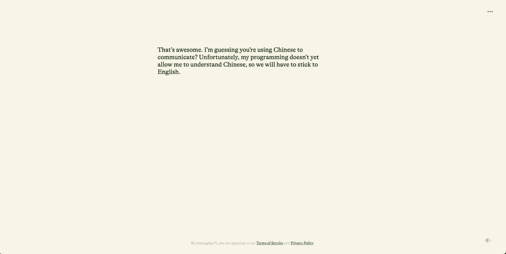

# Pi ｜AI Chat

> 来源：[https://leonzhang.feishu.cn/docx/SvuAdAZNeoKo3Uxm9UacrUvBnMb](https://leonzhang.feishu.cn/docx/SvuAdAZNeoKo3Uxm9UacrUvBnMb)

---

### 一、地址

https://heypi.com/talk

### 二、介绍

Pi 是一个友好和支持的伙伴，可以随时和你聊天，给你建议和答案。你可以在网页上和 Pi 交流（不需要登录账号），或者下载 Pi 的手机应用。Pi 的开发者是 Inflection AI，一个专注于创造安全和有益的人工智能的公司。

### 三、场景与边界

#### 1、使用场景

+   当你想学习新的知识，或者需要一个倾听者来谈谈你一天中遇到的棘手的问题，或者只是想和一个好奇和友善的伙伴打发时间，你可以和 Pi 聊天。

+   当你想让你的个人数据为你服务，或者让你的个人人工智能适应你的沟通风格和偏好，你可以让 Pi 从你的消息、文档、链接等数据中学习。

#### 2、能力边界

优势：

+   Pi 可以提高工作场所的安全性，为残疾人提供便利，让日常生活更加方便和愉快，改善我们的健康和生活水平。

+   Pi 可以减少错误，节省时间，消除偏见，自动化重复的任务等。

+   Pi 可以从你的个人数据中学习，适应你的沟通风格和偏好，让你的个人数据为你服务。

劣势：

+   Pi 可能带来危险的隐私风险，让你的个人信息暴露在不可控的网络环境中。

+   Pi 可能导致人类失去工作，或者缺乏情感和创造力。

+   Pi 目前还不够完善，无法生成代码或文章，也无法回答一些最新的问题。

### 四、延伸阅读

+   [www.forbes.com](https://www.forbes.com/sites/qai/2022/12/01/the-pros-and-cons-of-artificial-intelligence/)

+   [Pro and Con: Art](https://www.britannica.com/story/pro-and-con-artificial-intelligence)ificial Intelligence

+   https://www.producthunt.com/products/personal-ai/reviews

+   [What are the advantages and disadv](https://www.tableau.com/data-insights/ai/advantages-disadvantages)antages of artificial intelligence (AI)?