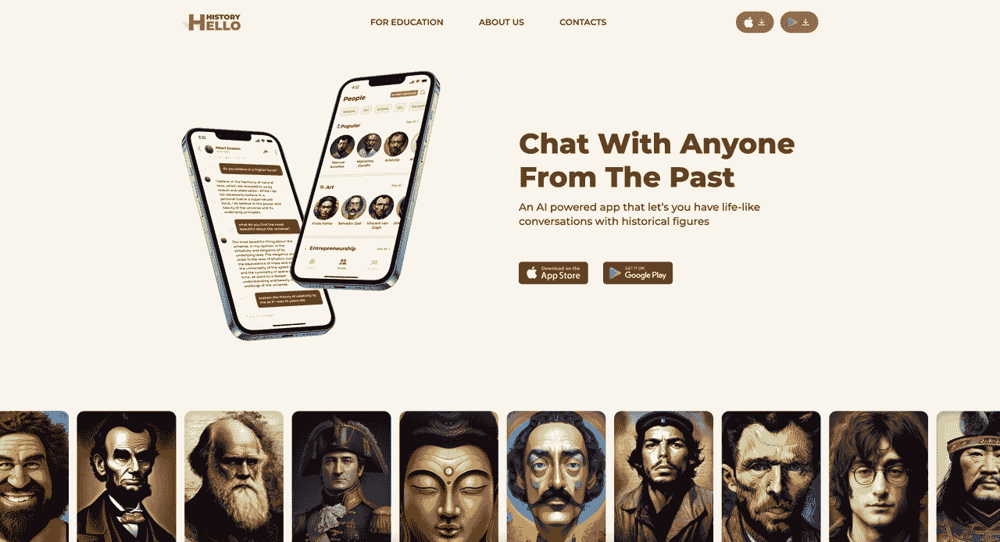

# Hello History｜跨越时间的交流

> 来源：[https://leonzhang.feishu.cn/docx/LAGfdTRqsoAeaNxMTxacZN4RnOu](https://leonzhang.feishu.cn/docx/LAGfdTRqsoAeaNxMTxacZN4RnOu)

---

### 一、地址

https://www.hellohistory.ai/

### 二、简介

一个使用先进的人工智能技术（GPT-3）来模拟历史人物的对话的应用。

你可以选择你感兴趣的历史人物，和他们进行独一无二的交流，了解他们的生活、思想和信念。

目前这个应用有400多个不同的历史人物，已经有4万多人下载，并且发送了超过60万条消息。这个应用也可以用于教育目的，让学生更好地学习历史。

### 三、场景与边界

#### 1、使用场景

+   可以用它来学习历史，和历史人物进行对话，了解他们的生活、思想和信念。

+   可以用它来提高你的外语水平，和不同国家的历史人物用他们的母语交流。

+   可以用它来娱乐，和你喜欢的历史人物聊天，看看他们会说些什么。

+   可以用它来教育，让学生和历史人物对话，增加他们的兴趣和参与度。

#### 2、优劣势

优势：

+   可以让你和历史人物进行有趣和深入的对话，增加你的历史知识和视野。

+   可以让你用不同的语言和历史人物交流，提高你的外语水平。

+   可以让你体验到先进的人工智能技术，感受到历史人物的真实性和个性。

+   可以让你随时随地和不同的历史人物聊天，不会感到无聊或孤独。

缺点：

+   需要付费订阅才能解锁更多的历史人物和消息。

+   不能保证人工智能生成的内容都是准确和可靠的，需要用户自己验证事实。

+   可能会引起一些道德或法律的争议，比如是否侵犯了历史人物的形象权或隐私权。

### 四、延伸阅读

+   https://apps.apple.com/us/app/hello-history-ai-chat/id1659654111

+   https://play.google.com/store/apps/details?id=com.hello.history