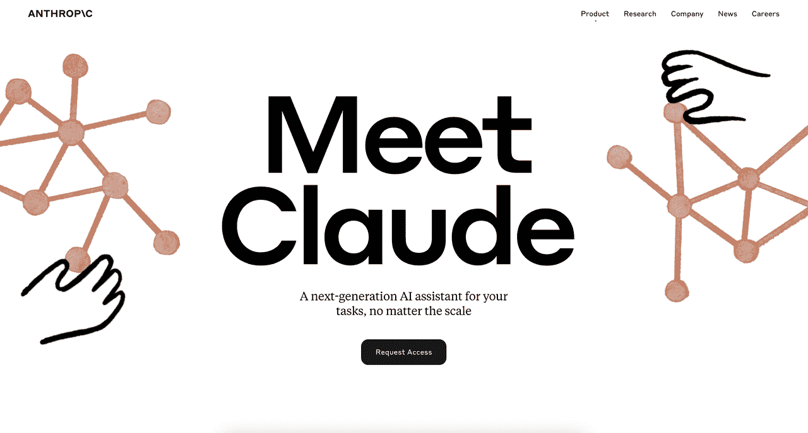
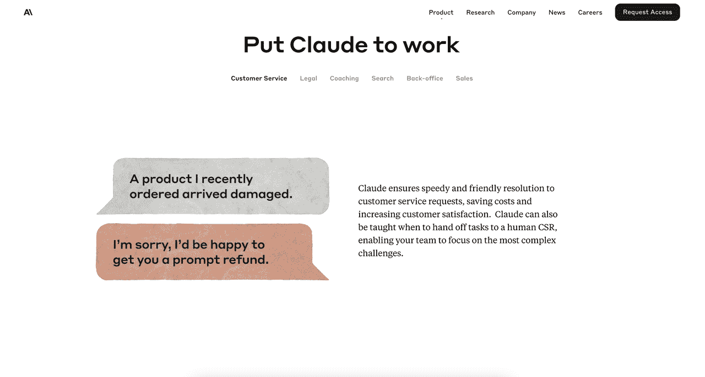

# Claude｜AI Chat

> 来源：[https://leonzhang.feishu.cn/docx/RIl8d5gILo70nbxvbx8cprdEnnc](https://leonzhang.feishu.cn/docx/RIl8d5gILo70nbxvbx8cprdEnnc)

---

### 一、地址

https://www.anthropic.com/product

### 二、介绍

> OpenAI 的员工做的一款产品，已添加至 Slack，现体验中。

Claude 是一款由 Anthropic 开发的人工智能助手，它可以用自然语言回答各种问题和话题。

Claude 的目标是成为一种可靠、可解释和可控制的 AI 系统，它能够遵循一些基本的伦理原则，避免产生不良的结果。Claude 还可以生成复杂的文本，如诗歌、故事、代码等，并且具有较高的准确性。Claude 是一个有趣而强大的 AI 助手，它与 ChatGPT 等其他模型相比具有一定的优势。

### 三、场景与边界

#### 1、使用场景

> 根据官网提供的信息，目前盈利点是两个，不清楚能不能cover住成本（训练、服务器、人工之类的）

1.  支持B端定制

1.  支持API接入

根据官网提供的信息，基本上现在有人做的场景它都做了，客服、律师、陪伴Bot、搜索引擎助手、邮件助手，以及销售。

以上几类工种作为平台部署的话，感觉可行性比较高。期待一下～

#### 2、能力边界

优势：

+   Claude 可以用于多种用途，如客服、法律咨询、教学、搜索、后台管理和销售等，提高效率和满意度。

+   Claude 的性格、语气和行为都可以根据客户的需求进行定制，增加个性化和灵活性。

+   Claude 可以通过标准的 API 轻松地集成到任何产品或工具链中，方便开发和部署。

+   Claude 有自然的对话能力，广泛的常识知识，以及处理文本和逻辑任务的技能，可以应对各种场景和需求。

+   Claude 通过了宪法式人工智能和无害性训练，可以被信任地代表客户的公司和需求，即使遇到不愉快或恶意的对话伙伴也能保持风度。

+   Claude 始终可用，无论客户何时需要，都能提供服务，满足高负载的工作需求。

劣势：

+   Claude 的理论基础是 Shannon 的信息论，这一理论虽然具有普适性，但也有一些局限性，如忽略了信息的语义和语境，以及人类的认知和情感等因素。

+   Claude 的通信模型可能受到各种噪声的干扰，如物理噪声、语义噪声、心理噪声等，影响信息的传输和解码。

### 四、延伸阅读

+   [Claude ｜Anthropi](https://gpt3demo.com/apps/claude-by-anthropic)c’s Rival to ChatGPT

+   [A](https://news.yahoo.com/anthropic-launches-claude-chatbot-rival-160057110.html)nthropic launches Claude, a chatbot to rival OpenAI's ChatGPT

+   [Meet Claude, the ‘Helpful, Honest, and Ha](https://medium.com/@johnny_x87/meet-claude-the-helpful-honest-and-harmless-ai-assistant-challenging-chatgpt-b768935d1d74)rmless’ AI Assistant Challenging ChatGPT