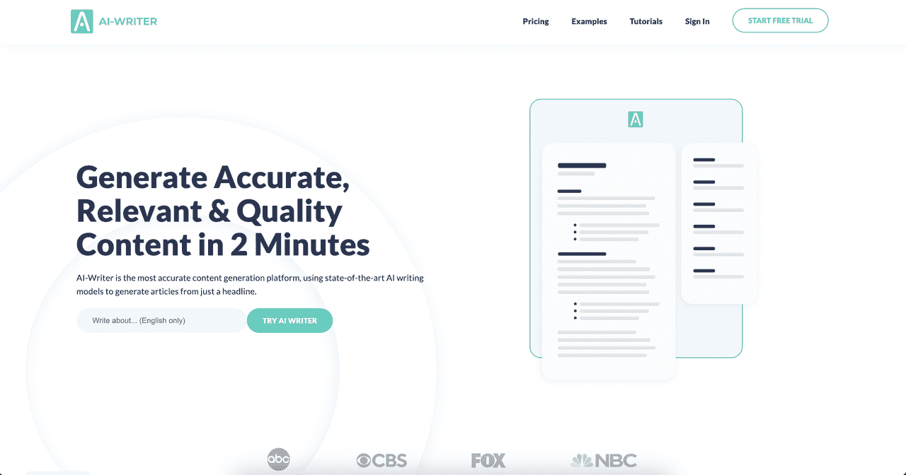
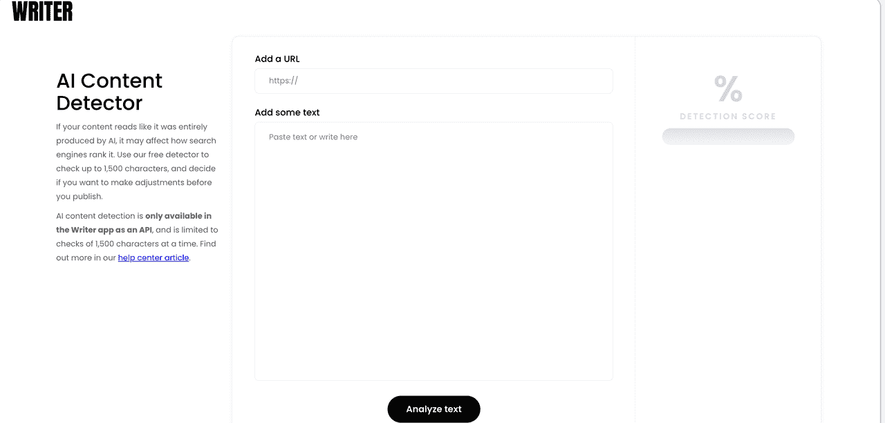

# AI Writer｜标题即文章？

> 来源：[https://leonzhang.feishu.cn/docx/JAg8dTESjoMTc0xny9Jcnskynph](https://leonzhang.feishu.cn/docx/JAg8dTESjoMTc0xny9Jcnskynph)

> 内容框架

+   一、地址

+   二、简介

+   三、场景与边界

+   四、延伸阅读

---

### 一、地址

https://ai-writer.com/

### 二、介绍

AI-Writer 是一个使用先进的 AI 写作模型来生成文章的内容生成平台，它只需要一个标题就可以生成文章。可以帮助用户快速创建高质量的内容，提高效率和利润。

它还提供了一个 AI 内容检测器，可以检测内容是否完全由 AI 生成，以及是否需要在发布之前进行调整。

### 三、场景与边界

#### 1、使用场景

1.  文章生成器；

1.  AI 内容检测器；

#### 2、能力边界

1.  大概率受到 AI 写作模型本身的技术水平和范围的限制，以及用户自己的标题和需求的影响。

### 四、延伸阅读

+   AI content detector