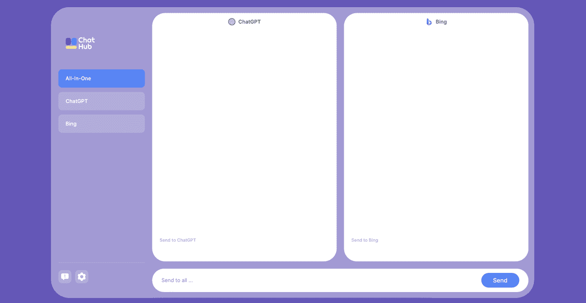
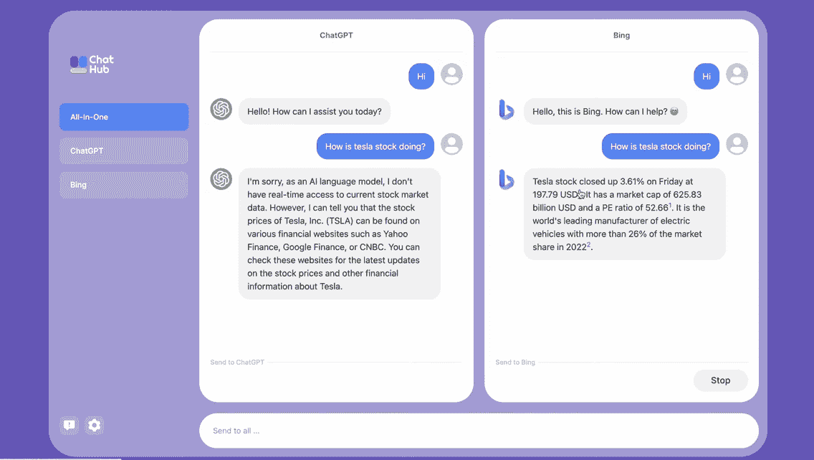

# ChatHub｜支持ChatGPT和Bing的Chrome插件

> 来源：[https://leonzhang.feishu.cn/docx/PjMzdGwYioilHmxNmHsc9Ww8nwd](https://leonzhang.feishu.cn/docx/PjMzdGwYioilHmxNmHsc9Ww8nwd)

+   内容框架

+   一、地址

+   二、简介

+   三、场景与边界

+   四、延伸阅读

---

### 一、地址

https://chathub.gg/

### 二、介绍

> 首次使用需要登录，ChatGPT 还需要设置 API；New Bing 登录账号即可。

ChatHub 是一款 Chrome 浏览器插件，支持同时与 ChatGPT、New Bing 进行对话（如下示意图）。

+   可以在一个窗口里对比多个结果，从而找到更合适的答案。目前支持 ChatGPT、New Bing，据说后面还会集成 Google 的 BERT、以及百度的文心一言；

+   支持在 Chrome 中使用 New Bing，不用另外再开 Edge 浏览器了，同时 New Bing 的搜索结果也支持跳转；

### 三、场景与边界

#### 1、使用场景

1.  大模型不稳定的前提下，通过对比更多模型的回答来获取答案最优解；

#### 2、能力边界

1.  对比现在 GPT-3.5 的 C[hatGPT，New ](https://new.qq.com/rain/a/20230316A0058500)Bing 的模型（搜索定制版 GPT-4）更完备，再加上搜索的实时信息，所以 ChatGPT 更加通用和多样化，New Bing 擅长搜索场景；

1.  期待之后接入 Google Bard 和百度的文心一言，不同的模型应该会有比较好玩的结果；

### 四、延伸阅读

+   [微软：必应聊天 Bing Chat](https://new.qq.com/rain/a/20230316A0058500) 已在 GPT-4 上运行 专为搜索定制

+   AI Pulse 周报#1｜欢迎进入 AI 纪元 - 少数派