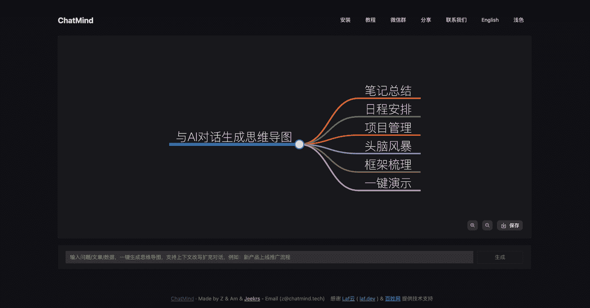

# ChatMind｜AI 自动生成脑图，还能生成 App 信息架构？

> 来源：[https://leonzhang.feishu.cn/docx/Il1IdJUUUowm39x15xIcsO6Bnxh](https://leonzhang.feishu.cn/docx/Il1IdJUUUowm39x15xIcsO6Bnxh)

> 内容框架

+   一、地址

+   二、简介

+   三、场景与边界

+   四、延伸

---

### 一、地址

https://www.chatmind.tech

### 二、介绍

ChatMind 是一个可以与 AI 对话生成思维导图的工具。

它可以帮助你更好地组织和呈现思路，你可以输入任何想做的事，它就能列出步骤。

### 三、场景与边界

#### 1、使用场景

1.  教育：学生可以使用 ChatMind 来组织和呈现学习笔记，老师可以使用 ChatMind 来设计课程大纲和教材。

1.  工作：职场人士可以使用 ChatMind 来组织工作计划、项目进度和会议记录等。

1.  创意：创作者可以使用 ChatMind 来整理和展示自己的创意思路和灵感。

1.  生活：个人可以使用 ChatMind 来规划旅行、健身、购物等生活事项。

##### 主题一：生成杭州旅游攻略

| 生成一份杭州旅游攻略 | 按照游玩路线排序 | 按照游玩路线，生成一份杭州旅游攻略 |
| --- | --- | --- |

##### 主题二：生成抖音 App 的信息架构

> 差点以后就常用了

| 生成一份抖音 App 的信息架构（详见右侧评论） | 这是抖音 App 哪个版本的信息架构 |
| --- | --- |

#### 2、能力边界

1.  体验

1.  生成的时间相对较长，平均 30s+ ；

1.  编辑能力

1.  不支持编辑；

1.  仅支持图片下载，不支持下载 XMind 等脑图文件格式；

1.  信息准确度

1.  来源信息无法提供，同上主题二测试；

1.  上下文改写，可能会出现错误，同上；

1.  信息不可避免的出现误差，P2 提到的「奉化」，并非紧靠杭州，实为宁波市奉化区；

### 四、延伸阅读

+   [ChatMind-一个 AI 自动生成思维导图的工具 ](http://www.keep996.com/?p=531)- Keep996-每天快乐分享一点点！