# Paper

> 来源：[https://leonzhang.feishu.cn/docx/SErHdwrZQoRpBqxQHUTcoGwnne2](https://leonzhang.feishu.cn/docx/SErHdwrZQoRpBqxQHUTcoGwnne2)

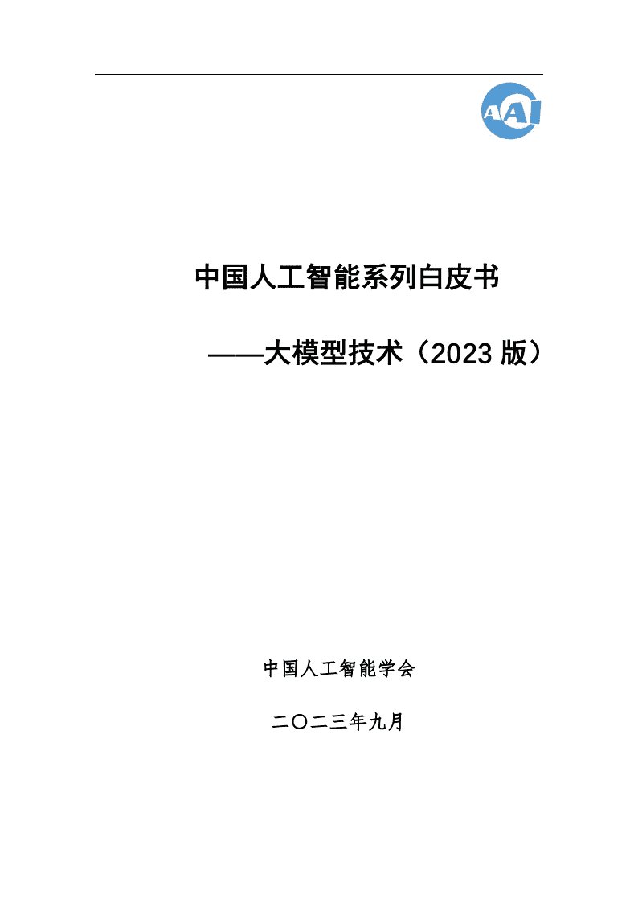

[大模型技术白皮书2023版.pdf](https://internal-api-drive-stream.feishu.cn/space/api/box/stream/download/all/OKNRbtT31ouo1JxctrMcGiednOf)

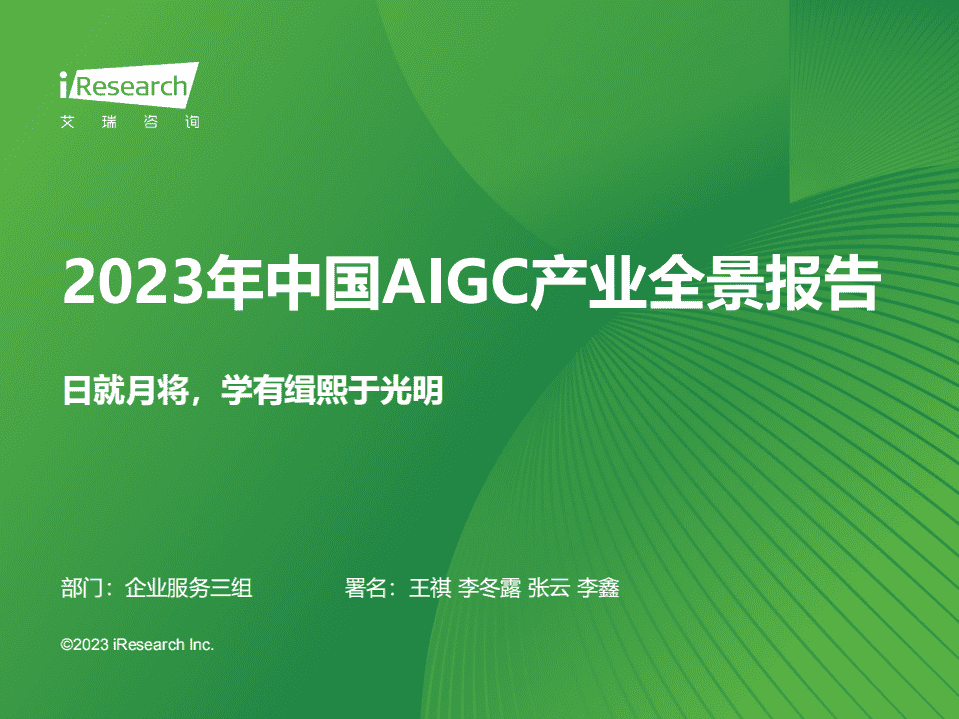

[【艾瑞咨询】2023年中国AIGC产业全景报告【洞见研报DJyanbao.com】.pdf](https://internal-api-drive-stream.feishu.cn/space/api/box/stream/download/all/LO8HbmTPXoR5bNxJ0WCc8aoPnXf)

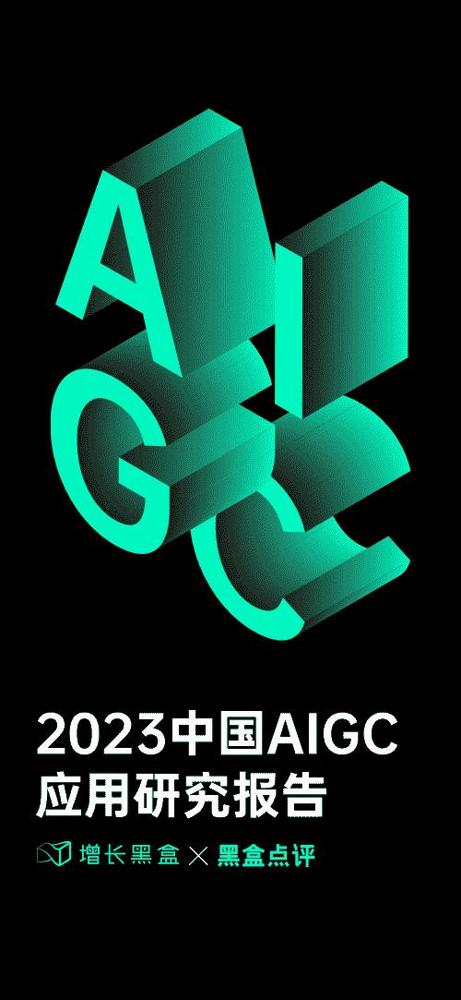

[2. 2023中国AIGC应用研究报告.pdf](https://internal-api-drive-stream.feishu.cn/space/api/box/stream/download/all/JrrwbI4HyoofinxYme8cLuRwnRW)

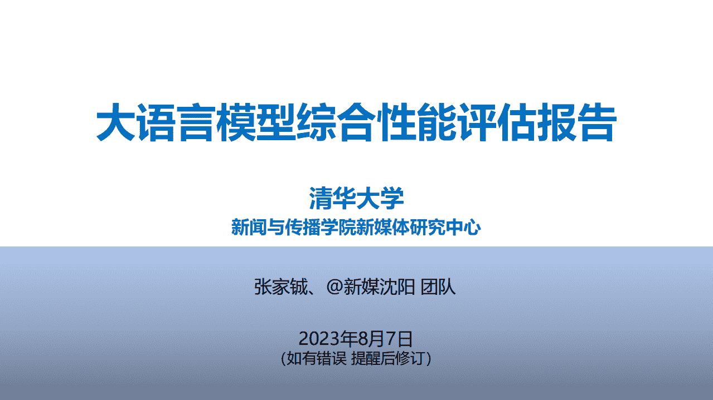

[3. 大语言模型综合性能评估报告（2023.8）.pdf](https://internal-api-drive-stream.feishu.cn/space/api/box/stream/download/all/IP4GbmAVoolKSIxXjsTcIwM8nmb)

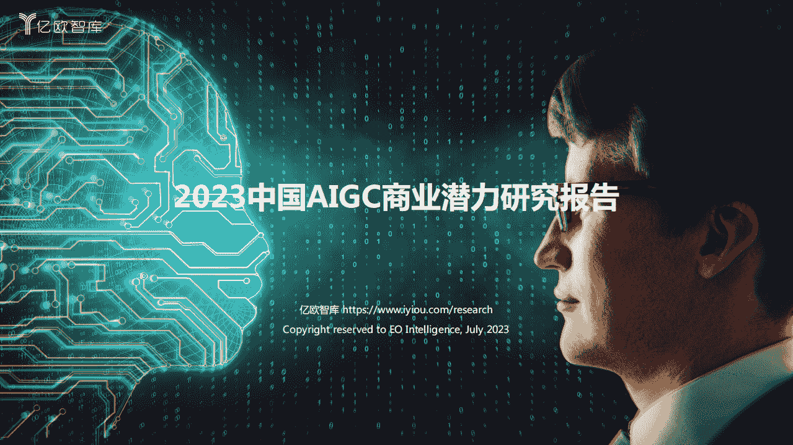

[2023中国AIGC商业潜力研究报告.pdf](https://internal-api-drive-stream.feishu.cn/space/api/box/stream/download/all/YyzMbVuOLoFnnYxA5vbcs7IFntd)

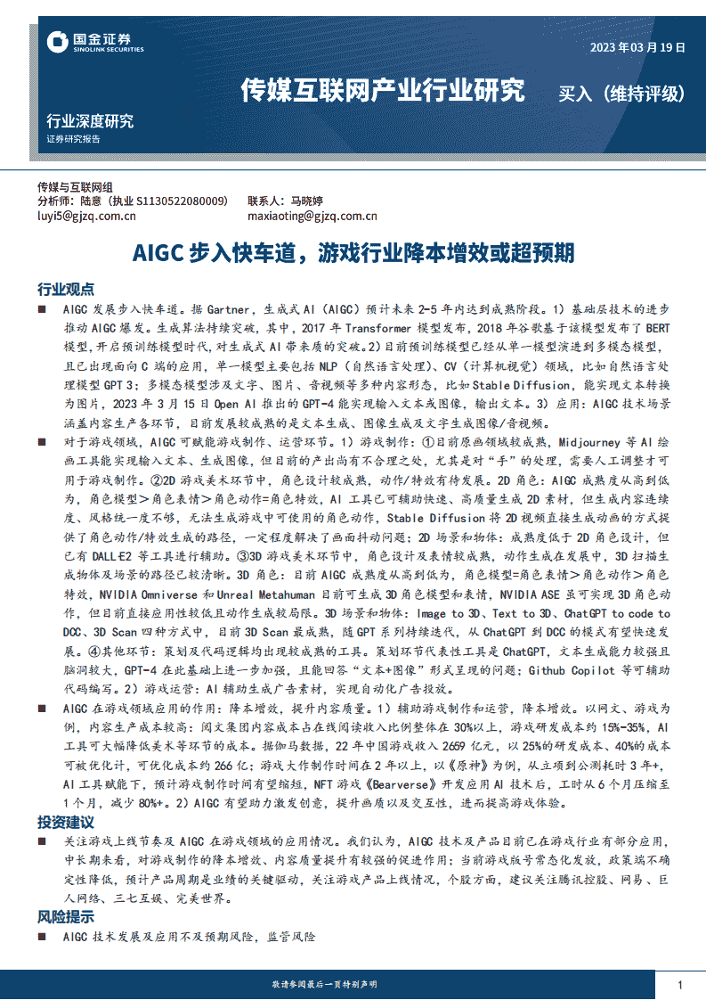

[传媒互联网产业行业深度研究：AIGC步入快车道，游戏行业降本增效或超预期-20230319-国金证券-19页.pdf](https://internal-api-drive-stream.feishu.cn/space/api/box/stream/download/all/RqwjbbF9Xo7OY0xpDJhcSioCnfc)

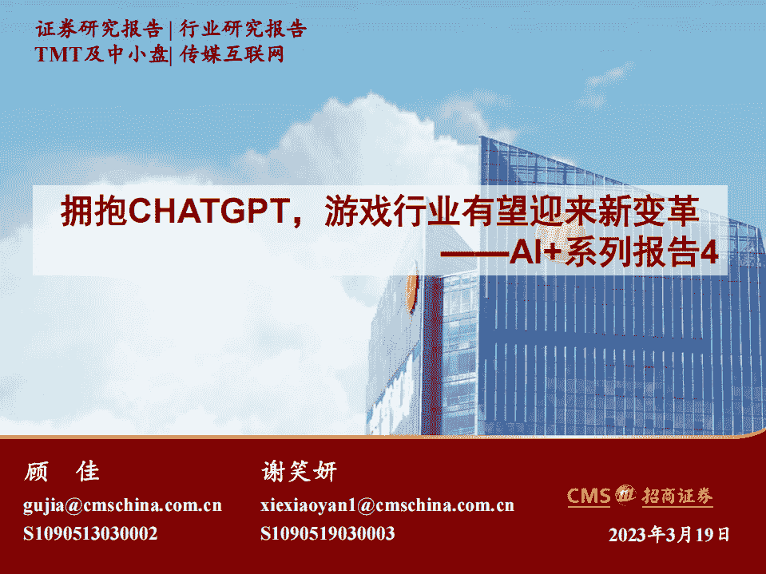

[传媒互联网行业AI+系列报告4：拥抱CHATGPT，游戏行业有望迎来新变革-20230319-招商证券-24页.pdf](https://internal-api-drive-stream.feishu.cn/space/api/box/stream/download/all/KE8FbuPpfo6OiAxB06ecBcXwnVf)

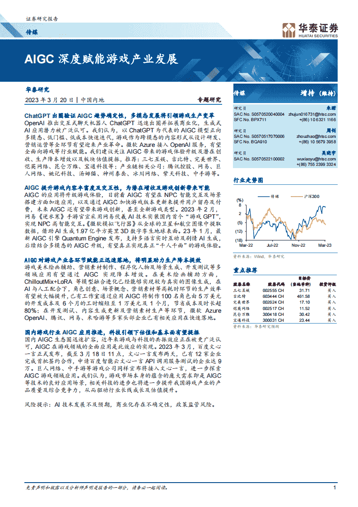

[传媒行业：AIGC深度赋能游戏产业发展-20230320-华泰证券-21页.pdf](https://internal-api-drive-stream.feishu.cn/space/api/box/stream/download/all/LQ08bDiQAoJU2HxgiHScYnAAnlD)

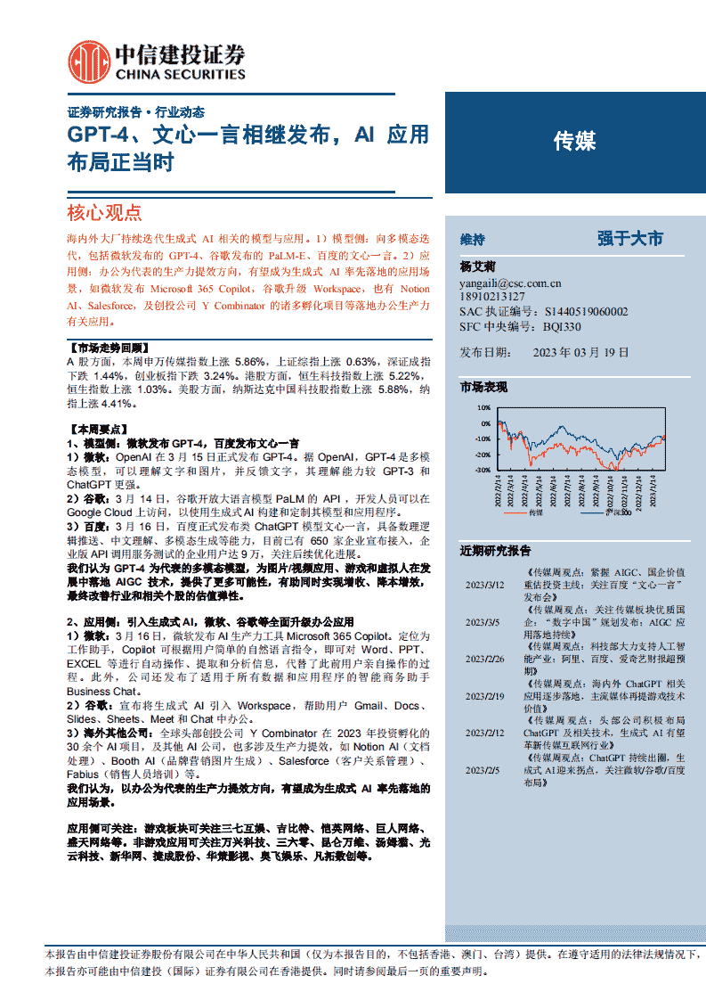

[传媒行业：GPT_4、文心一言相继发布，AI应用布局正当时-20230319-中信建投-26页.pdf](https://internal-api-drive-stream.feishu.cn/space/api/box/stream/download/all/WwnVb4bymogau5xESy7cgeYSnKb)

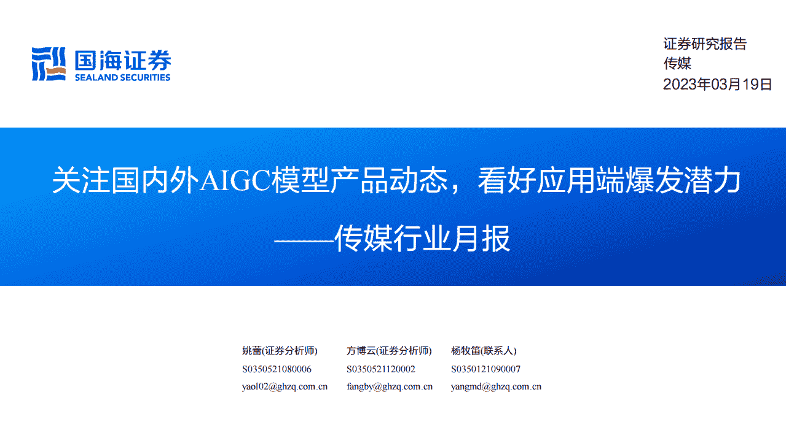

[传媒行业月报：关注国内外AIGC模型产品动态，看好应用端爆发潜力-20230319-国海证券-33页.pdf](https://internal-api-drive-stream.feishu.cn/space/api/box/stream/download/all/SsP5b75kaoDYz4xpViScUm48nje)

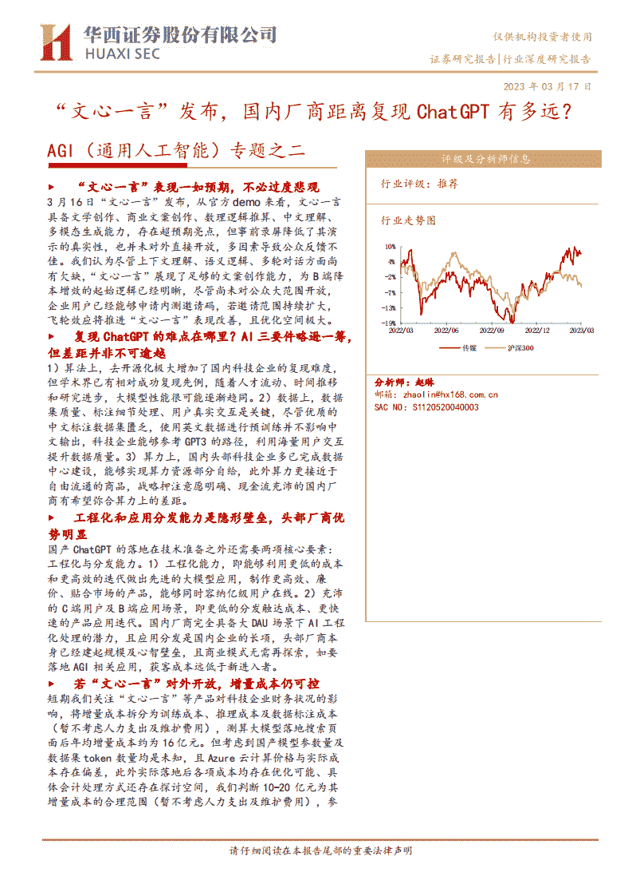

[传媒行业AGI（通用人工智能）专题之二：“文心一言”发布，国内厂商距离复现ChatGPT有多远？-20230317-华西证券-20页.pdf](https://internal-api-drive-stream.feishu.cn/space/api/box/stream/download/all/SCHrbcVLbogCZoxtN7Gc5LvTnUc)

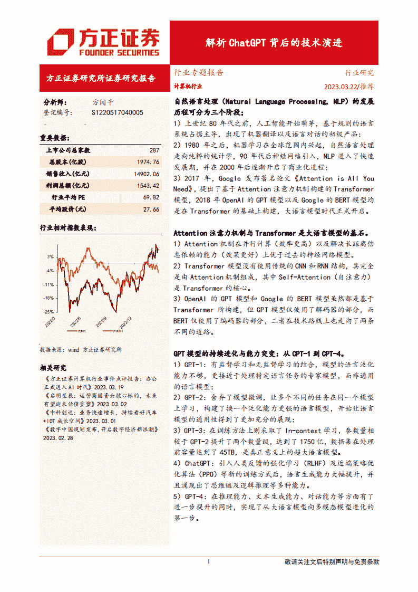

[计算机行业：解析ChatGPT背后的技术演进-20230322-方正证券-39页.pdf](https://internal-api-drive-stream.feishu.cn/space/api/box/stream/download/all/SjkZbNEaCoUAICxjBkxc5Utsnfh)

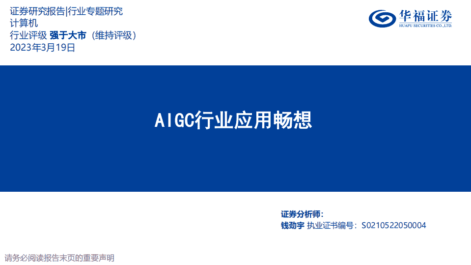

[计算机行业：AIGC行业应用畅想-20230319-华福证券-22页.pdf](https://internal-api-drive-stream.feishu.cn/space/api/box/stream/download/all/KFerbUSxcoH4iqxZpwkcPW8cnYG)

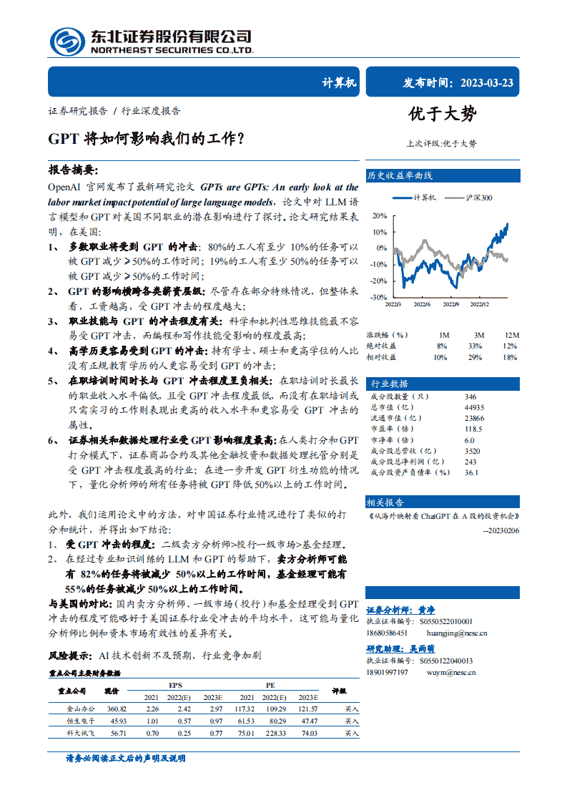

[计算机行业：GPT将如何影响我们的工作？-20230323-东北证券-25页.pdf](https://internal-api-drive-stream.feishu.cn/space/api/box/stream/download/all/M8QubYGZMoEQvmxJxyVcDxDrn4g)

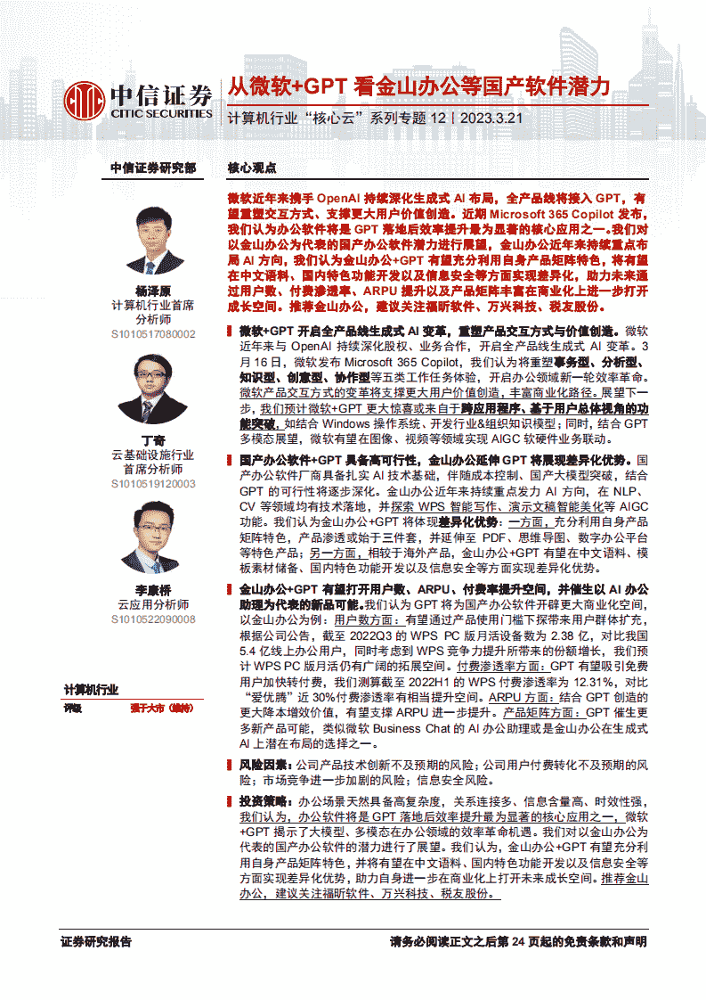

[计算机行业“核心云”系列专题12：从微软+GPT看金山办公等国产软件潜力-20230321-中信证券-24页.pdf](https://internal-api-drive-stream.feishu.cn/space/api/box/stream/download/all/O0vPbWjtYoKr3yxJHH0cvnIDnwc)

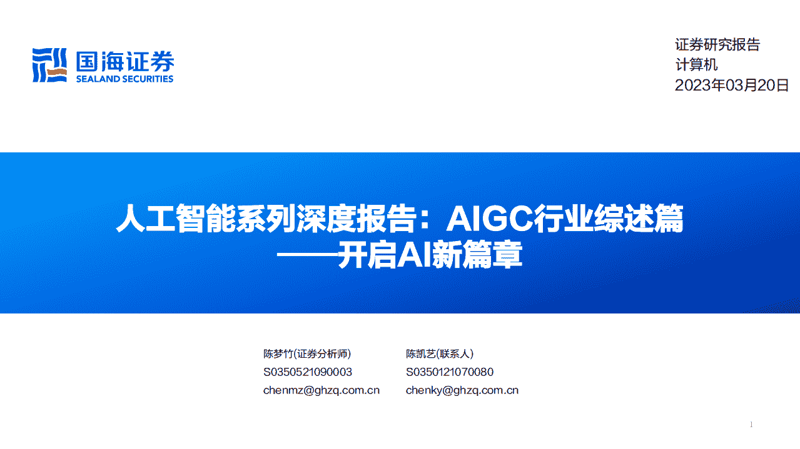

[计算机行业开启AI新篇章：人工智能系列深度报告，AIGC行业综述篇-20230320-国海证券-65页.pdf](https://internal-api-drive-stream.feishu.cn/space/api/box/stream/download/all/Yr7KbXHSzo1TBaxZZMqcLmwYnAc)

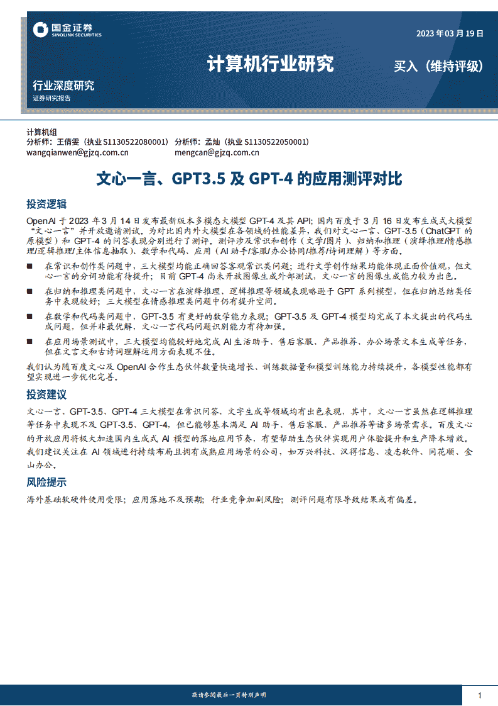

[计算机行业深度研究：文心一言、GPT3.5及GPT_4的应用测评对比-20230319-国金证券-32页.pdf](https://internal-api-drive-stream.feishu.cn/space/api/box/stream/download/all/FQKrb2Kc8owlMTxGOfhc7PH4nuG)

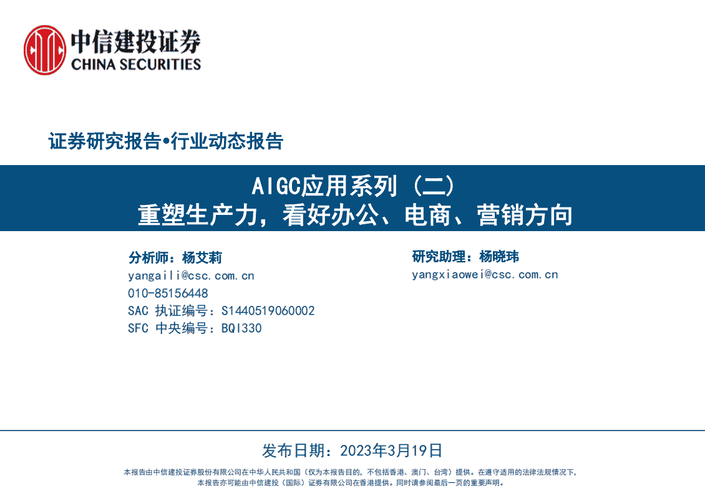

[计算机行业AIGC应用系列（二）：重塑生产力，看好办公、电商、营销方向-20230319-中信建投-47页.pdf](https://internal-api-drive-stream.feishu.cn/space/api/box/stream/download/all/Z29zb1pT2oQEWZxt0qZcp35lnje)

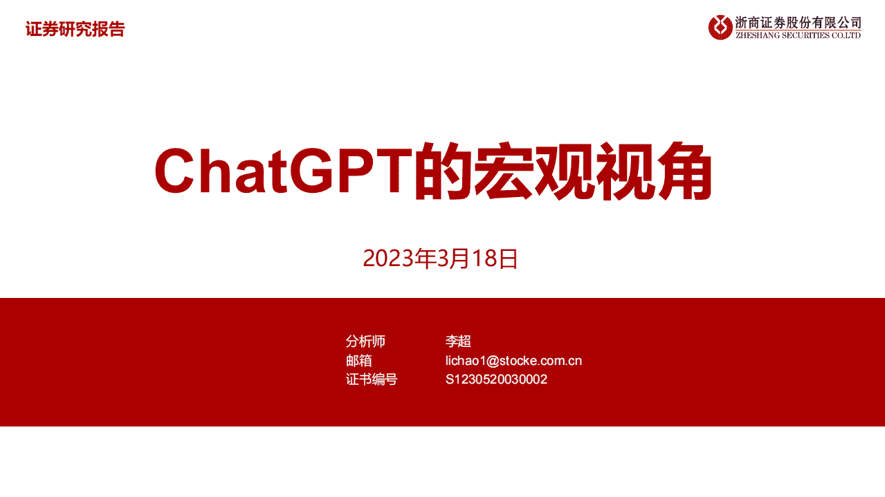

[人工智能行业：ChatGPT的宏观视角-20230318-浙商证券-41页.pdf](https://internal-api-drive-stream.feishu.cn/space/api/box/stream/download/all/BaFbbotZIonHoSxSAMYcArKLn4f)

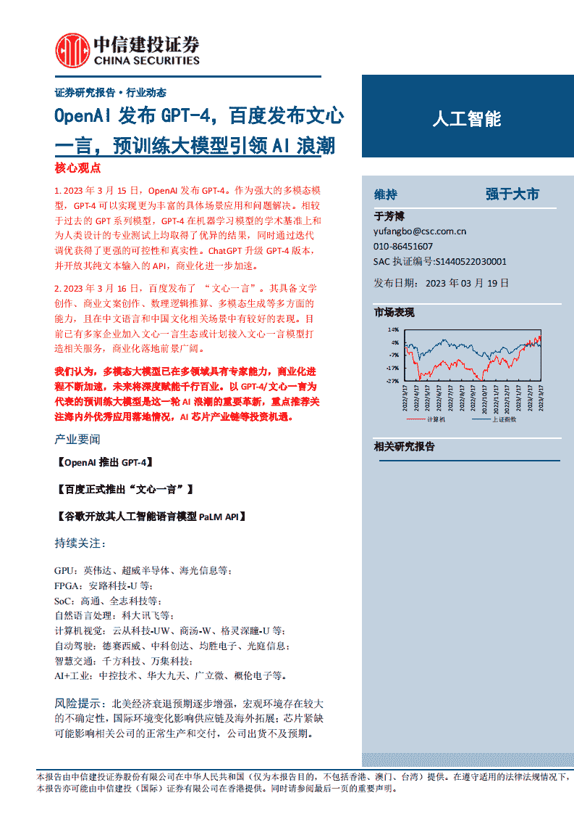

[人工智能行业：OpenAI发布GPT_4，百度发布文心一言，预训练大模型引领AI浪潮-20230319-中信建投-22页.pdf](https://internal-api-drive-stream.feishu.cn/space/api/box/stream/download/all/Xk33bNh7EoDEQSxTlpzcWIBGnjb)

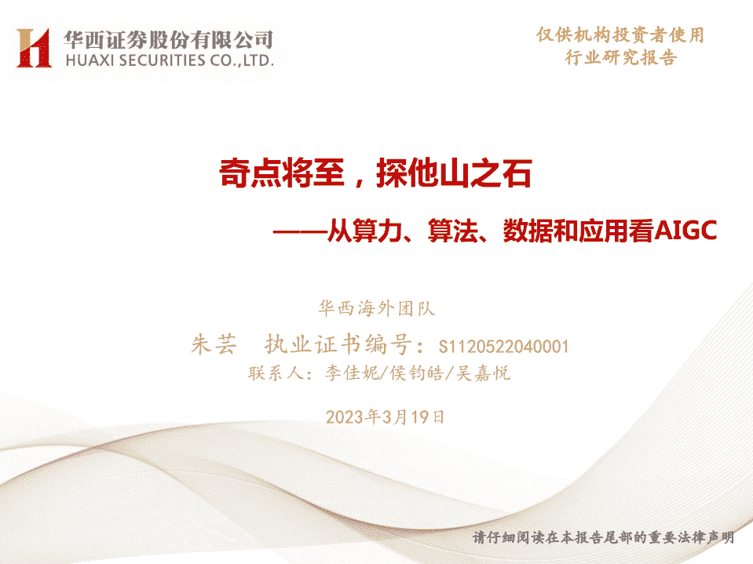

[人工智能行业从算力、算法、数据和应用看AIGC：奇点将至，探他山之石-20230319-华西证券-48页.pdf](https://internal-api-drive-stream.feishu.cn/space/api/box/stream/download/all/IyXvbwVgvoGMx2x0bccc1qESn0I)

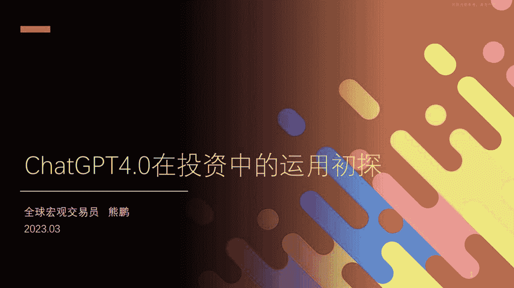

[熊鹏：ChatGPT4.0在投资中的运用初探.pdf](https://internal-api-drive-stream.feishu.cn/space/api/box/stream/download/all/FUiMb2DceokV3AxPna0cFLB4nCc)

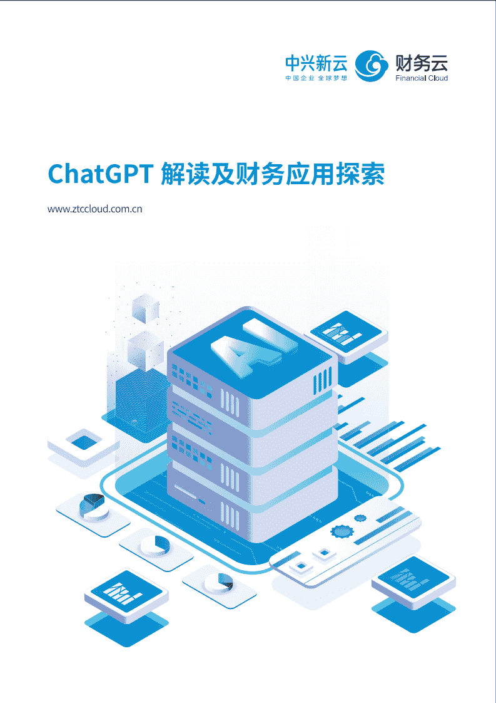

[中兴新云：ChatGPT解读及财务应用探索-32页.pdf](https://internal-api-drive-stream.feishu.cn/space/api/box/stream/download/all/NgZdbfjEio9OnpxH1lVcfig8nDe)

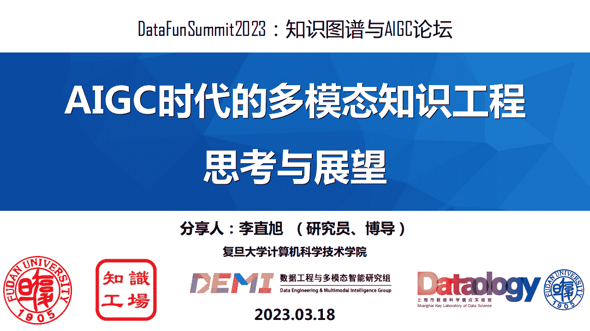

[AIGC时代的多模态知识工程思考与展望-50页.pdf](https://internal-api-drive-stream.feishu.cn/space/api/box/stream/download/all/MPH1b4LMEoLIQSxoAU4c0eLRnJd)

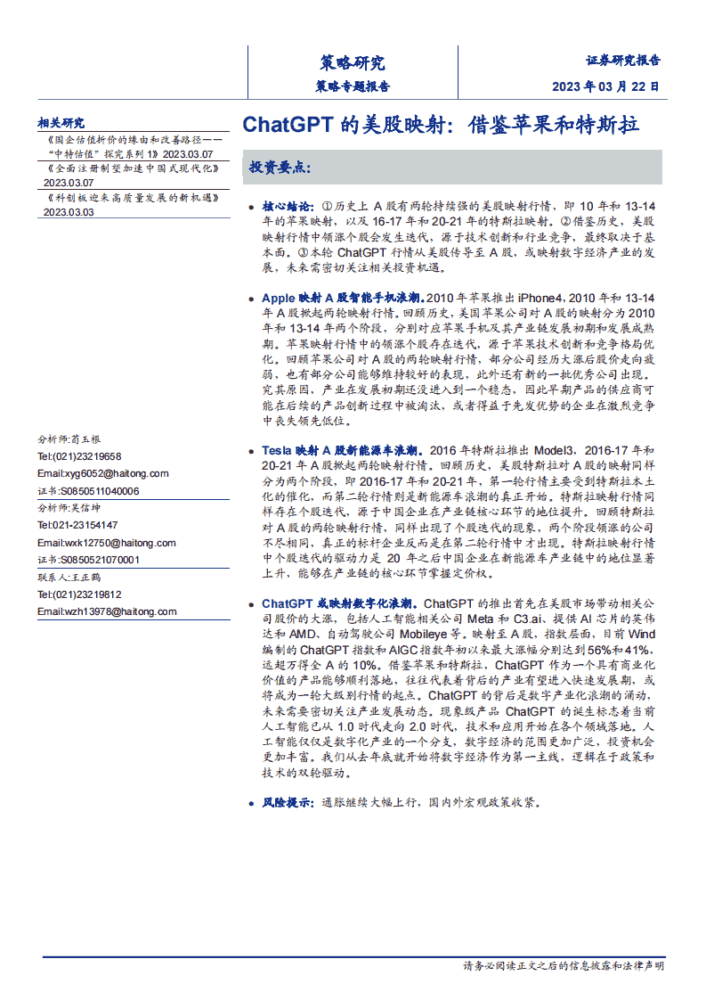

[ChatGPT的美股映射：借鉴苹果和特斯拉-20230322-海通证券-16页.pdf](https://internal-api-drive-stream.feishu.cn/space/api/box/stream/download/all/KGdzbEBAxoTxS6xRXG5ceHn6ngd)

[GPT4及ChatGPT相关应用梳理-中信建投-2023.3.17-33页.pdf](https://internal-api-drive-stream.feishu.cn/space/api/box/stream/download/all/ZaOMbAgBdoUpTOxcN9Qcaeadnce)

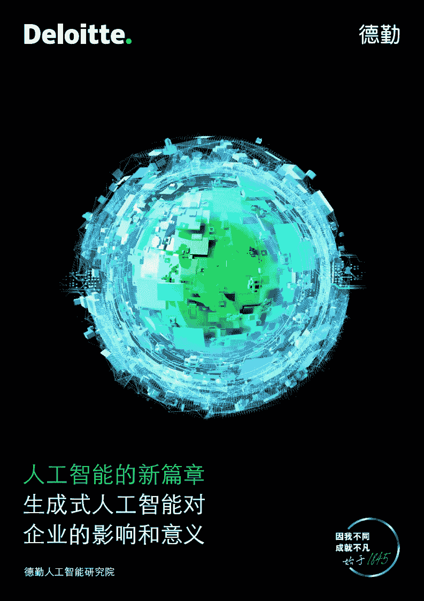

[2023全球人工智能-生成式人工智能对企业的影响和意义-2023-04-宏观大势.pdf](https://internal-api-drive-stream.feishu.cn/space/api/box/stream/download/all/VCdVbIos6oq9Nyx1m38cIXPHn8f)

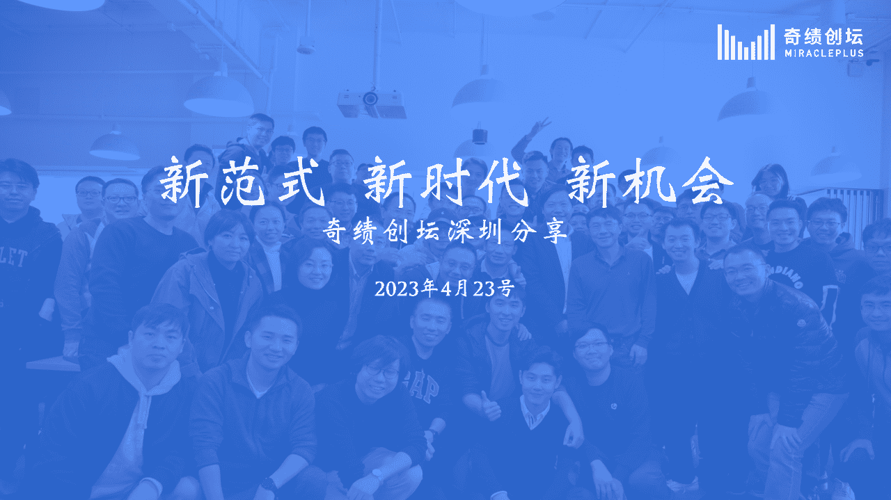

[奇绩论坛（陆奇深圳演讲）-ChatGPT新机遇分享-PPT(1).pdf](https://internal-api-drive-stream.feishu.cn/space/api/box/stream/download/all/SkAubuiO1oLmxhx2xkycwQQVnyf)

[陆奇-ChatGPT新机遇分享.pdf](https://sm84lfdag7.feishu.cn/file/IyapbPksbossHcx18pCceN0pnuc)

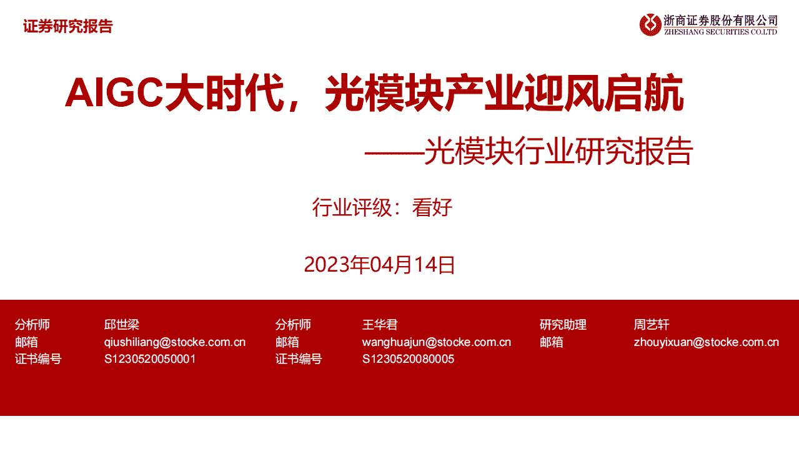

[AIGC大时代，光模块产业迎风启航-浙商证券-2023.4.14-41页.pdf](https://internal-api-drive-stream.feishu.cn/space/api/box/stream/download/all/P0pEb6ZG2oLGY9xLty1cHB5gn2b)

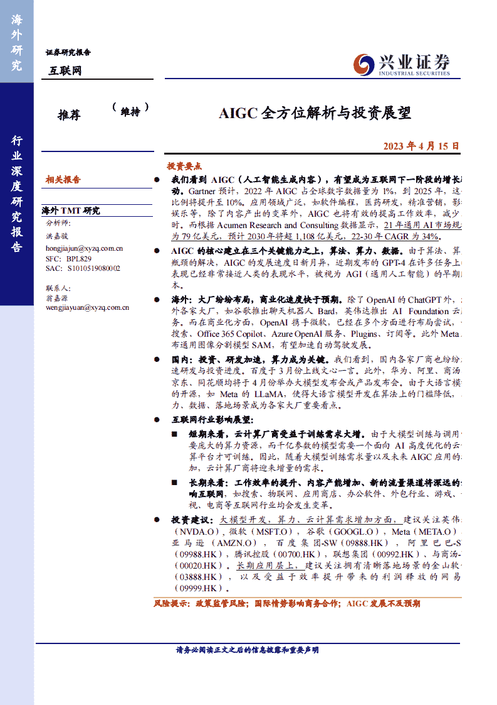

[AIGC全方位解析与投资展望-兴业证券-2023.4.15-53页.pdf](https://internal-api-drive-stream.feishu.cn/space/api/box/stream/download/all/Y4bqbEW9co8bHjxB9YNcMjwKncc)

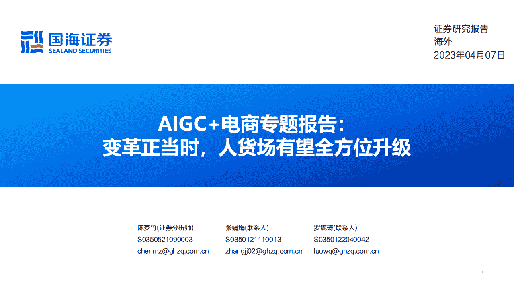

[AIGC+电商行业专题报告：变革正当时，人货场有望全方位升级-国海证券-2023.4.7-57页.pdf](https://internal-api-drive-stream.feishu.cn/space/api/box/stream/download/all/J0ehbbKs5omCATxmwOMcxLrBnWg)

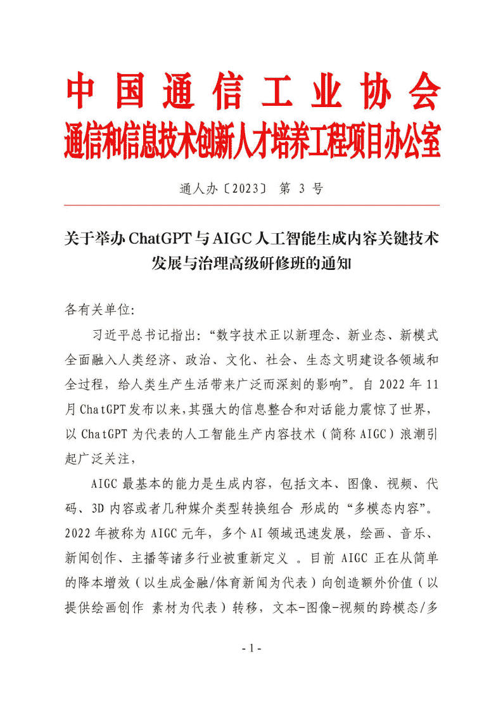

[ChatGPT与AIGC人工智能生成内容关键技术发展与治理.pdf](https://internal-api-drive-stream.feishu.cn/space/api/box/stream/download/all/LBLAbAvhVoLP63xI9HnceQPdnge)

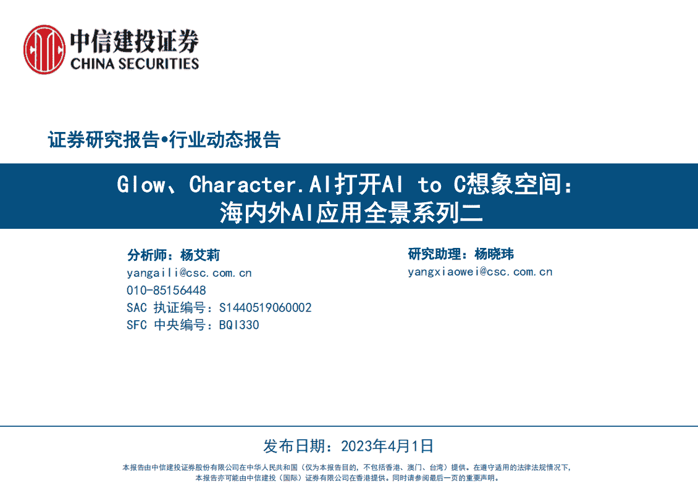

[Glow、Character.AI打开AItoC想象空间，海内外AI应用全景系列二-中信建投-2023.4.1-34页.pdf](https://internal-api-drive-stream.feishu.cn/space/api/box/stream/download/all/AtIwb4xxEoJnyCxgGAtc5g4AnBc)

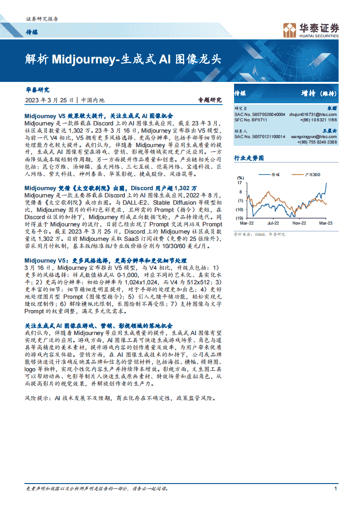

[解析Midjourney-生成式AI图像龙头-华泰证券-2023.3.25-17页.pdf](https://internal-api-drive-stream.feishu.cn/space/api/box/stream/download/all/H83abTtn2oySlmxHUrac16UlnEe)

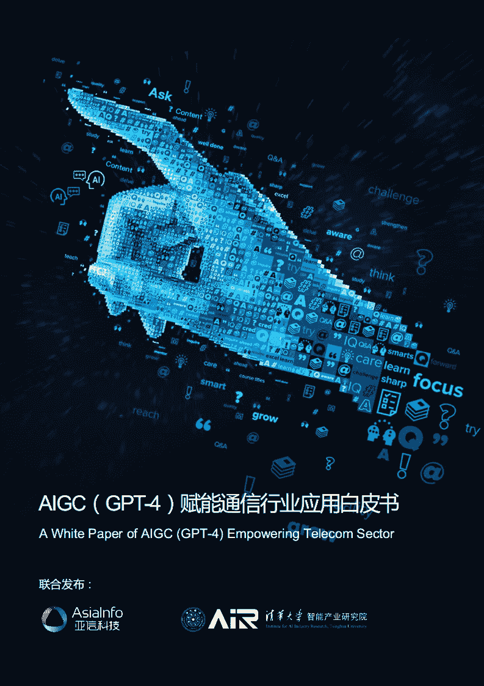

[清华大学-AIGC（GPT-4）赋能通信行业应用白皮书（2023）-清华&亚信科技-2023-132页.pdf](https://internal-api-drive-stream.feishu.cn/space/api/box/stream/download/all/Ug0lbQnsuor6bLxK8HvcNJyTnjb)

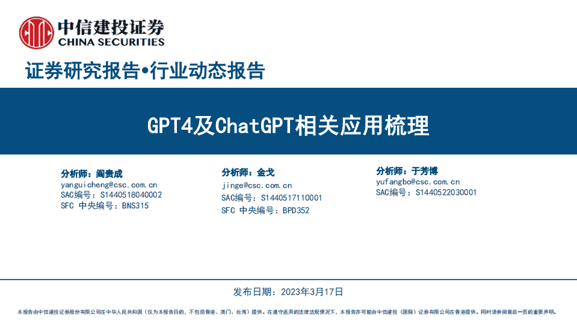

[GPT4及ChatGPT相关应用梳理-中信建投-2023.3.17-33页.pdf](https://internal-api-drive-stream.feishu.cn/space/api/box/stream/download/all/HEaKbfQkTo3s2YxpT9acJIRgnCh)

[人工智能行业：ChatGPT的宏观视角-浙商证券-2023.3.18-41页.pdf](https://internal-api-drive-stream.feishu.cn/space/api/box/stream/download/all/NWENbNbQUojxWJxXKvucXscLn3e)

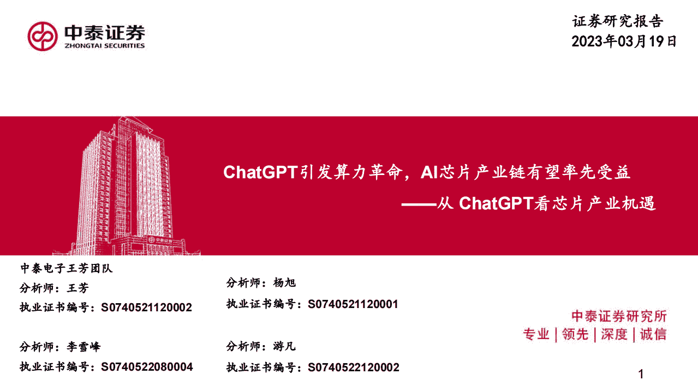

[从ChatGPT看芯片产业机遇，ChatGPT引发算力革命，AI芯片产业链有望率先受益-中泰证券-2023.3.19-58页.pdf](https://internal-api-drive-stream.feishu.cn/space/api/box/stream/download/all/JyS2bZF8Wooz6PxgRCzcT2LNnIb)

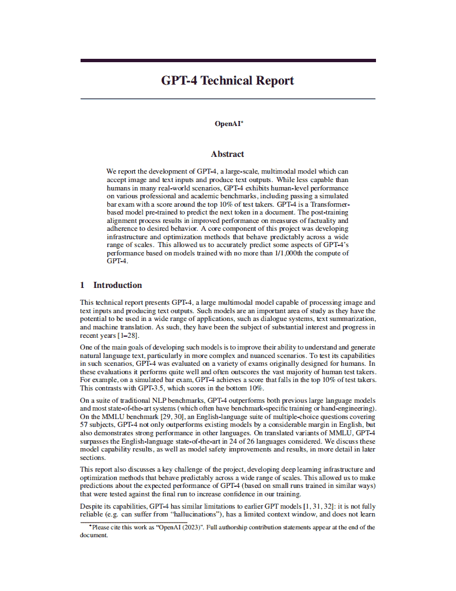

[GPT-4技术报告（英）-2023-98页.pdf](https://internal-api-drive-stream.feishu.cn/space/api/box/stream/download/all/DQG7bq4WlorGcpxsWNUcqDzrnee)

+   中文版

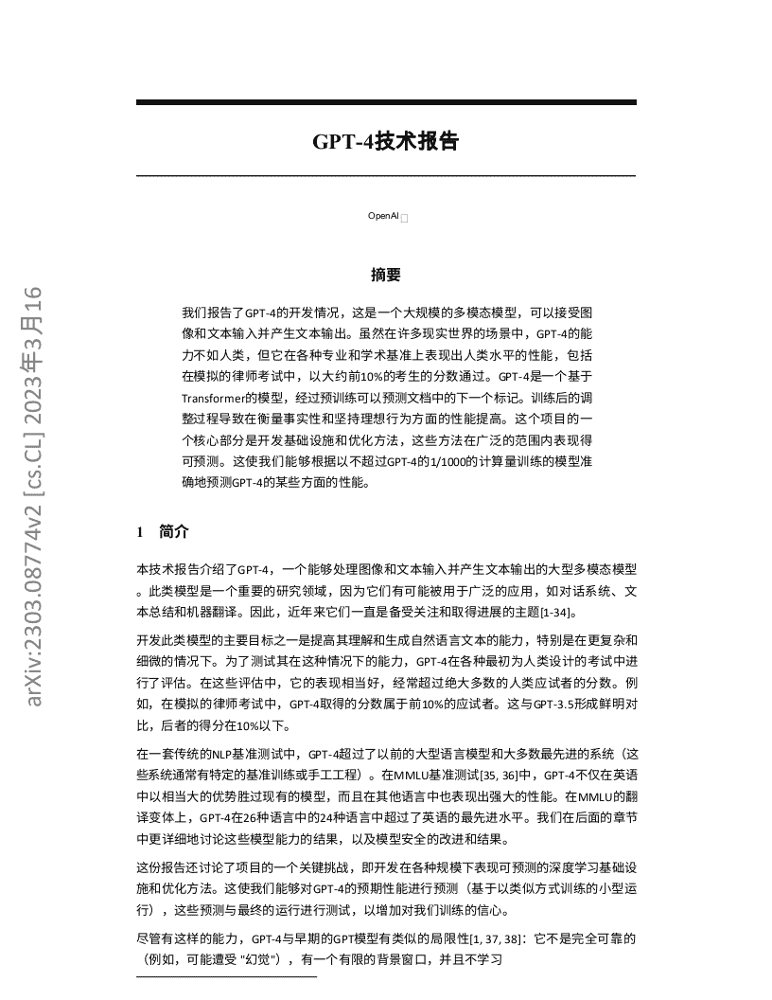

[2303.08774 zh.pdf](https://internal-api-drive-stream.feishu.cn/space/api/box/stream/download/all/ByVWb37eXotwloxx1zAcFhQ8nid)

+   GPT-4 Technical Report

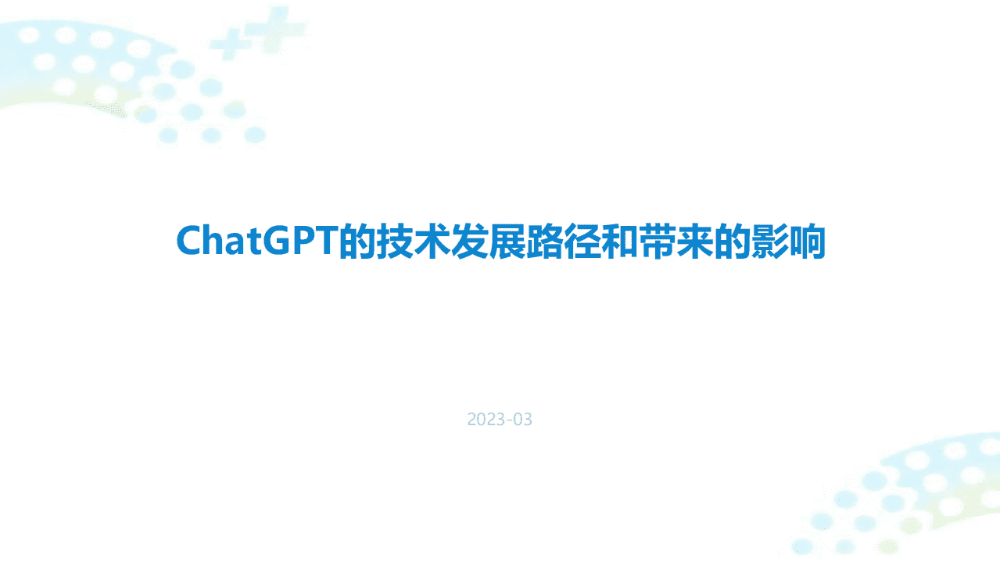

[ChatGPT的技术发展路径和带来的影响-2023.3-31页.pdf](https://internal-api-drive-stream.feishu.cn/space/api/box/stream/download/all/Uzc4bVR0woLS3BxvW41cALUTnzb)

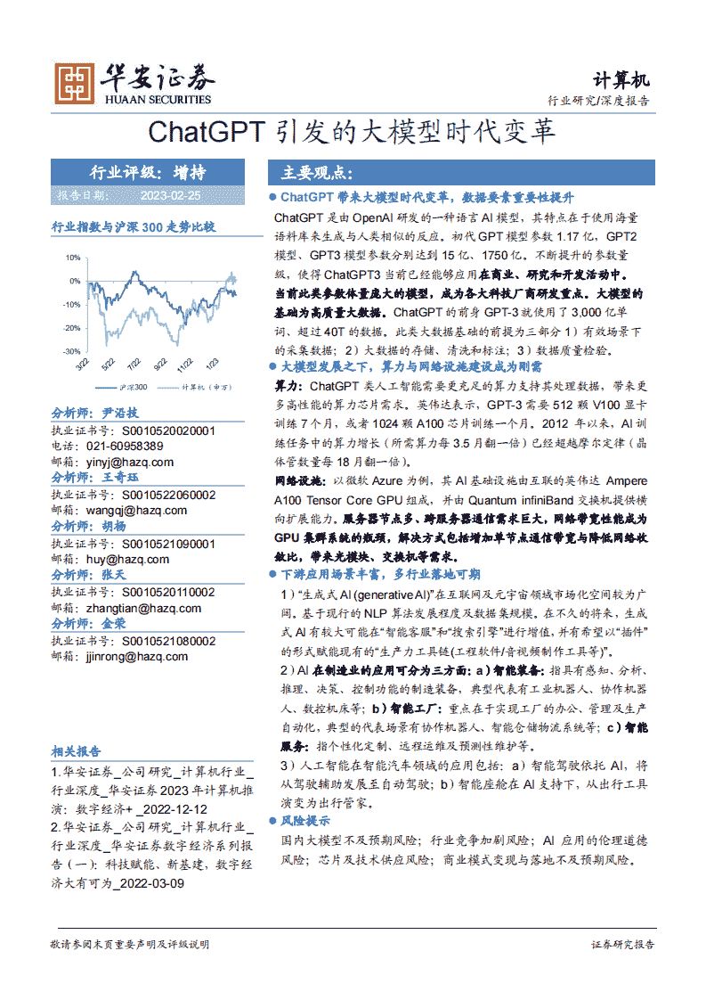

[ChatGPT引发的大模型时代变革-华安证券-2023.2.25-80页.pdf](https://internal-api-drive-stream.feishu.cn/space/api/box/stream/download/all/QHKzbMkt0oPBDyxMfguc58SVn9T)

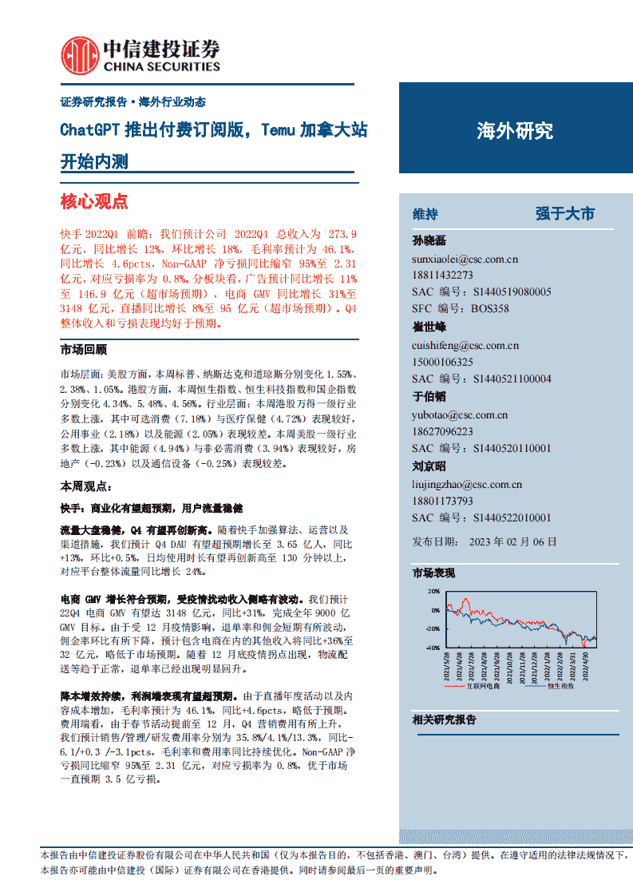

[互联网电商行业：ChatGPT推出付费订阅版，Temu加拿大站开始内测-20230206-中信建投-21页.pdf](https://internal-api-drive-stream.feishu.cn/space/api/box/stream/download/all/QlV7b7VyEo9UEBxZIWdciXCCnie)

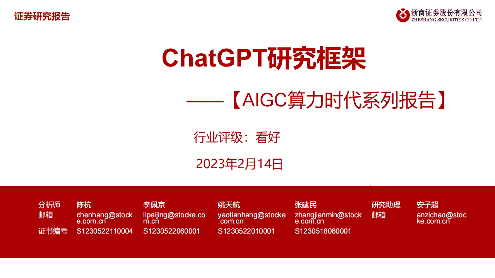

[AIGC算力时代系列报告-ChatGPT研究框架-浙商证券-2023.2.14-64页.pdf](https://internal-api-drive-stream.feishu.cn/space/api/box/stream/download/all/FXvGbBKFkoAytgxiBamcY6EmnEh)

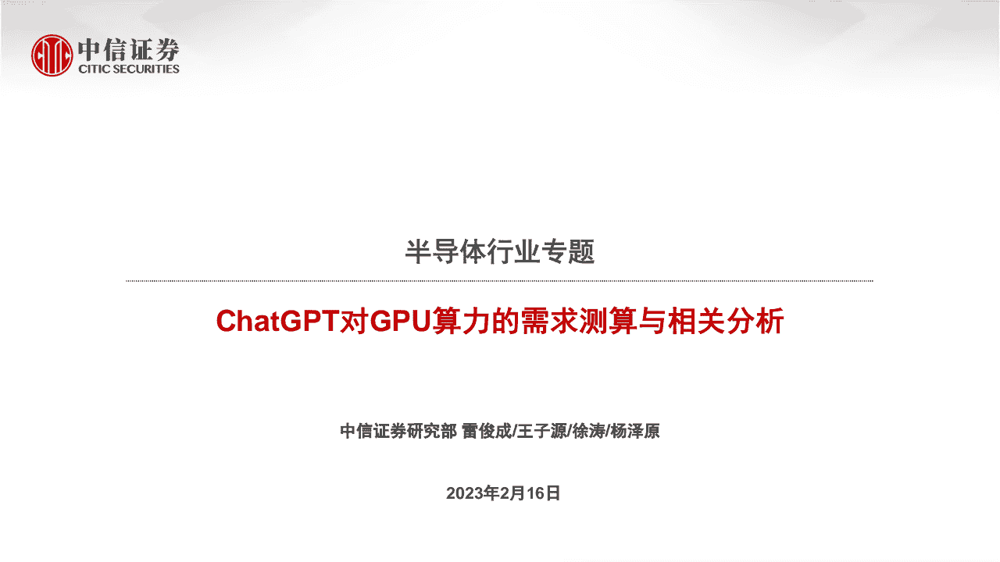

[ChatGPT对GPU算力的需求测算与相关分析-中信证券-2023.2.16-71页.pdf](https://internal-api-drive-stream.feishu.cn/space/api/box/stream/download/all/IXIRbg1FBob7n7xVi7ZclVtGnQg)

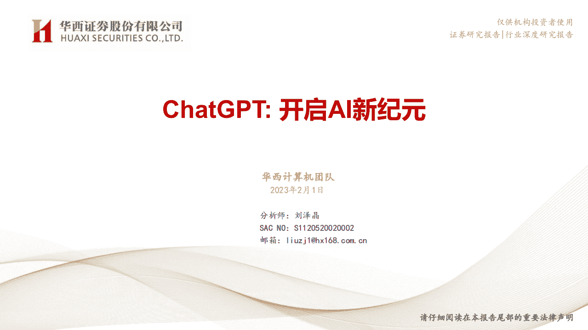

[ChatGPT：开启AI新纪元-华西证券-2023.2.1-31页.pdf](https://internal-api-drive-stream.feishu.cn/space/api/box/stream/download/all/OH8Bbchr0o98FGxV1hzcOJ36nVb)

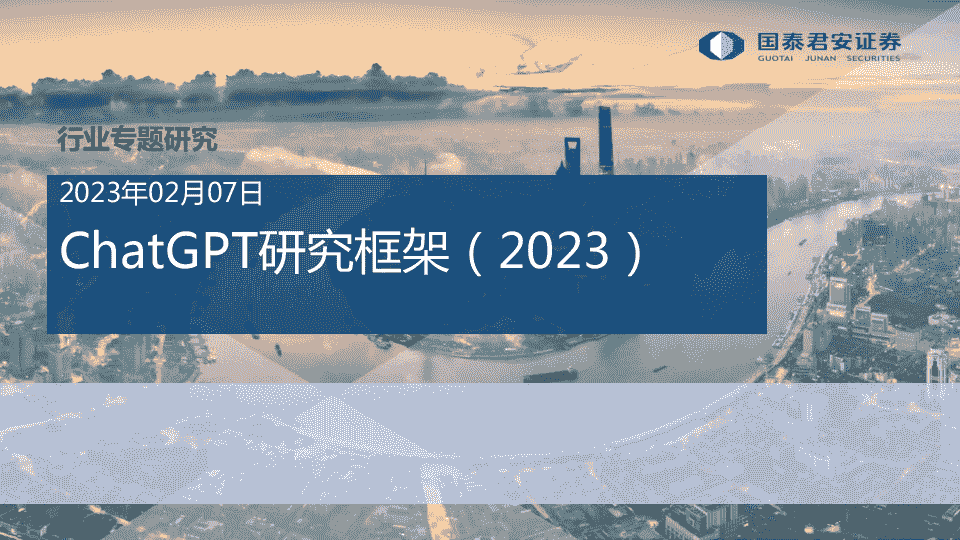

[ChatGPT研究框架（2023）-国泰君安-2023.2.7-72页.pdf](https://internal-api-drive-stream.feishu.cn/space/api/box/stream/download/all/UTKLbwQjpocL3KxNJsmcr1LhnMd)

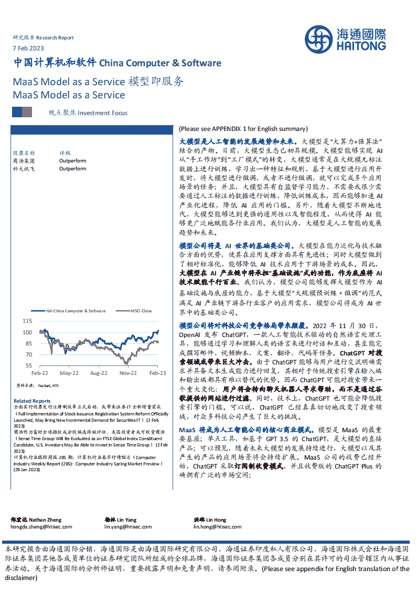

[47页深度研报：揭秘ChatGPT身后的AIGC技术和它的中国同行们.pdf](https://internal-api-drive-stream.feishu.cn/space/api/box/stream/download/all/G4o7bGOSPowTOfxHleUcFn98nug)

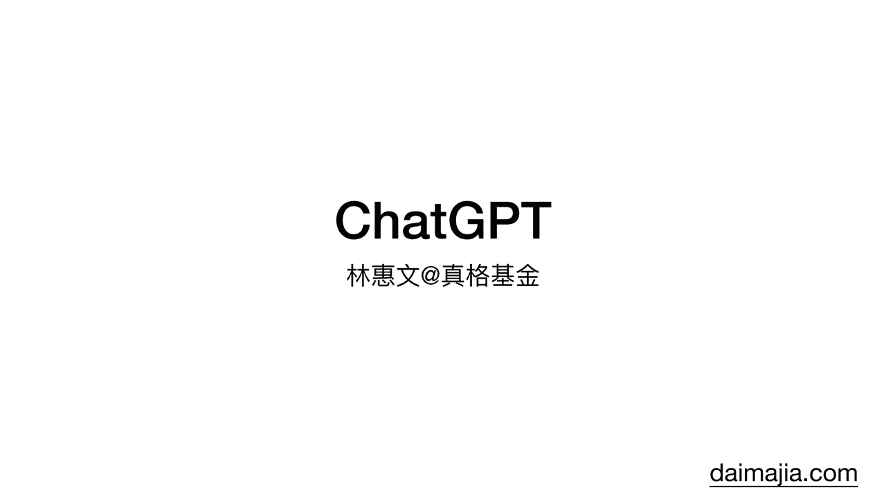

[ChatGPT-真格基金分享-2023.2.3-30页.pdf](https://internal-api-drive-stream.feishu.cn/space/api/box/stream/download/all/C12mbnKieoPDRDxSWt1cQzsdnLf)

[计算机行业深度研究报告：ChatGPT，开启AI新纪元-20230201-华西证券-31页.pdf](https://internal-api-drive-stream.feishu.cn/space/api/box/stream/download/all/KJuabeJwRoMR58xWIk3cbXtvnTf)

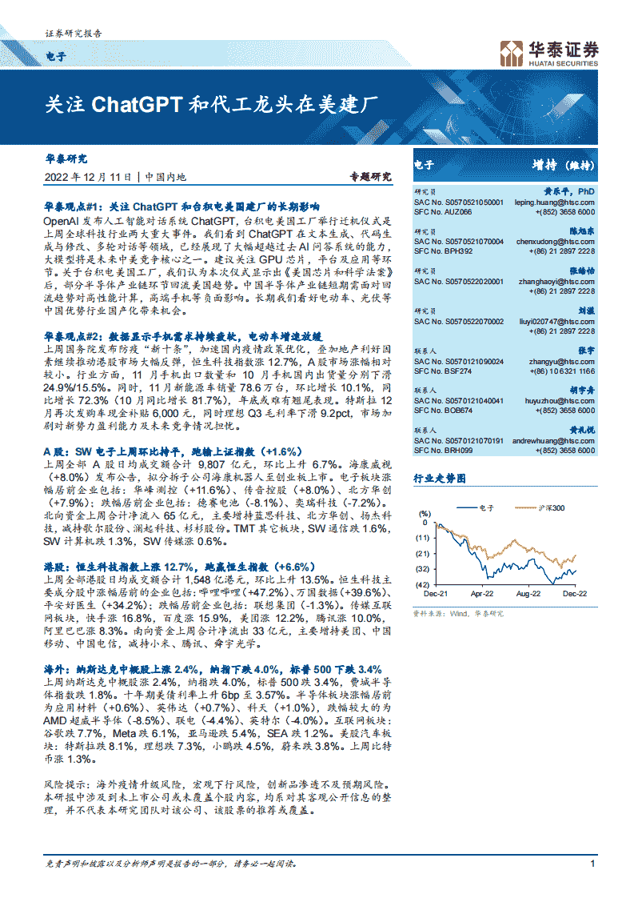

[电子行业专题研究：关注ChatGPT和代工龙头在美建厂-20221211-华泰证券-26页.pdf](https://internal-api-drive-stream.feishu.cn/space/api/box/stream/download/all/YTgIbPcssoGZ4jxg0b2cq7g1ngd)