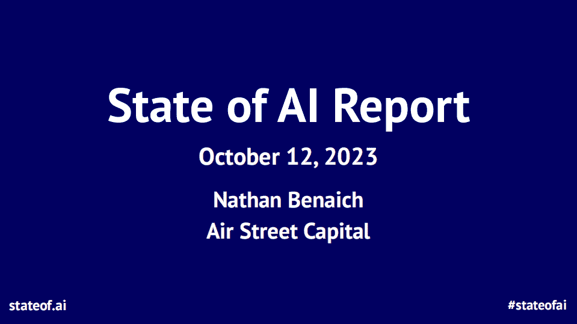

# State of AI 发布的年度 AI 现状报告

> 来源：[https://leonzhang.feishu.cn/docx/A7RuddsdMoTRZ4xowI8cXJljnOb](https://leonzhang.feishu.cn/docx/A7RuddsdMoTRZ4xowI8cXJljnOb)

2023 年报告的关键主题包括：

1.  **GPT-4 目前仍是领域霸主**，它在传统基准测试和人类考试中击败了所有其他大型语言模型（LLM），验证了专有架构（闭源）和通过人类反馈进行强化学习的力量。

1.  人们正加大努力通过较小的模型、更好的数据集和更长的上下文，尝试克隆或超越专有性能（GPT4）。由于人们担忧人类生成的数据可能只能维持 AI 扩展趋势几年，这些努力可能会变得更为紧迫。

1.  LLM 和扩散模型继续推动着实际突破，尤其是在生命科学领域，包括分子生物学和药物发现方面都取得了实质性进展。

1.  算力成为新的石油，NVIDIA 赢得创纪录的收益，初创公司利用他们的 GPU 获得了竞争优势。随着美国加紧对中国的贸易限制并在芯片战争中动员其盟友，NVIDIA、Intel 和 AMD 已开始大规模销售避免出口控制的芯片。

1.  GenAI 拯救了风险投资世界，专注于生成 AI 应用（包括视频、文本和编码）的 AI 初创公司从风险投资和企业投资者那里筹集了超过 180 亿美元。

1.  安全辩论已经成为主流，促使世界各地的政府和监管机构采取行动。然而，这股活动热潮掩盖了 AI 社区内部的深刻分歧，以及在全球治理方面缺乏具体进展，因为世界各国的政府采取了冲突的方法。

1.  评估最先进模型的挑战日益增加，因为标准的 LLM 通常在稳健性方面存在困难。考虑到风险，仅仅依赖“基于感觉”的方法是不够好的。

**原报告文件：**

[State of AI Report 2023 - ONLINE.pdf](https://internal-api-drive-stream.feishu.cn/space/api/box/stream/download/all/QjLYbcaUFobYjjx8qKTcM2TknHc)

Links：

+   2023 年人工智能现状报告：https://www.stateof.ai/