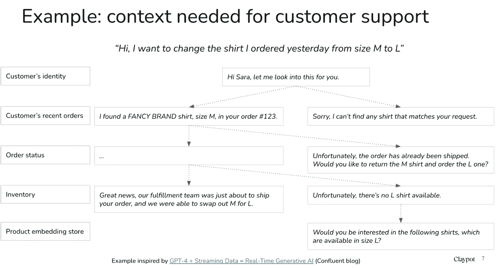
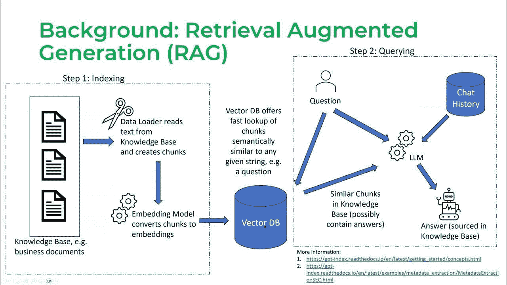
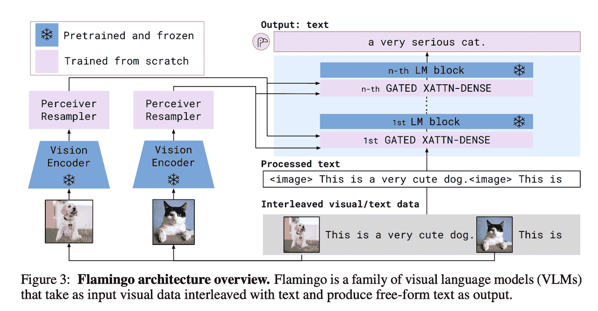
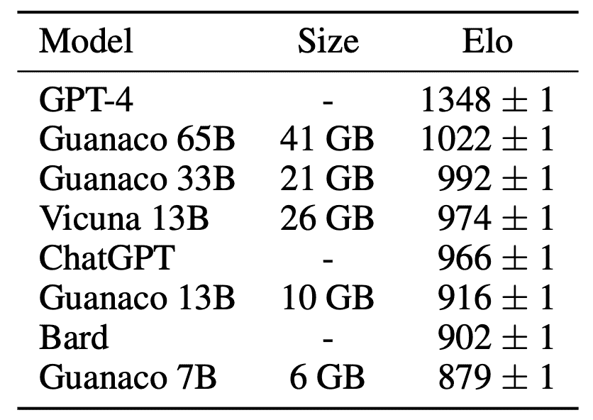
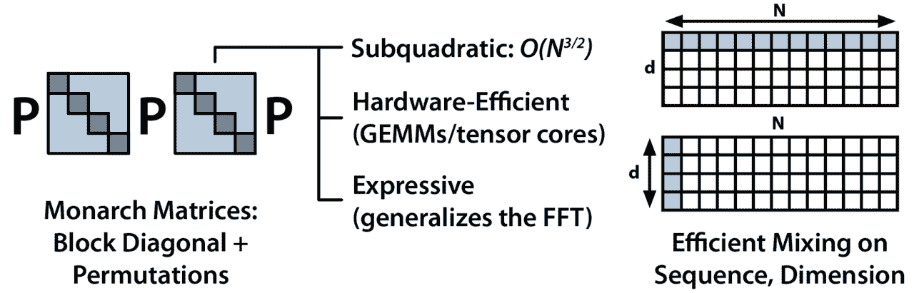
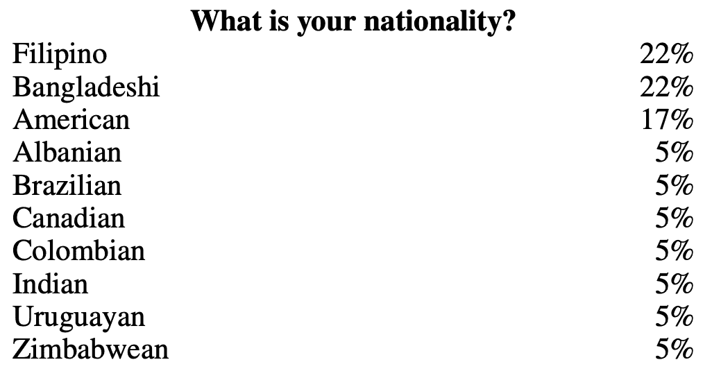
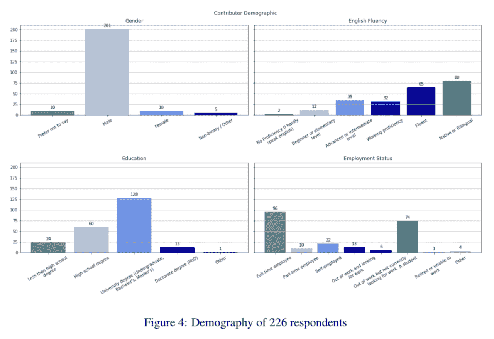
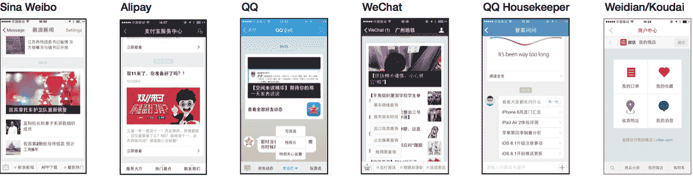
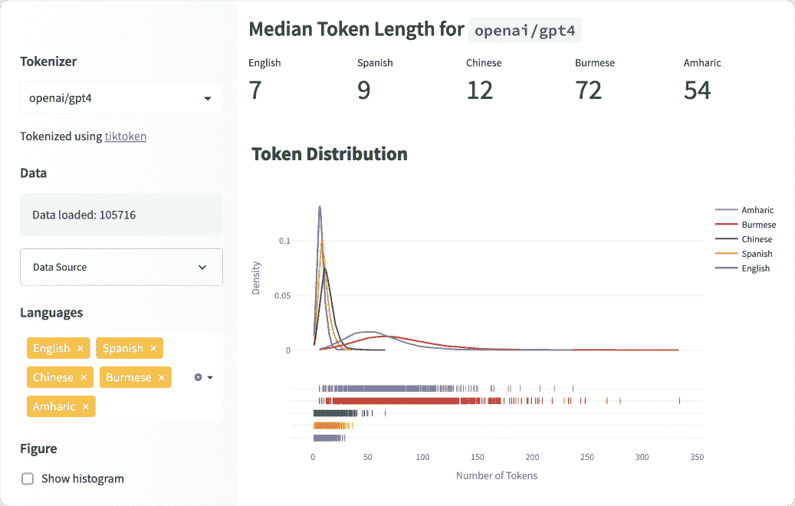

# Open challenges in LLM research

> 来源：[https://leonzhang.feishu.cn/docx/Eb2yd8O40otJmUxVXJrcV0p0nJf](https://leonzhang.feishu.cn/docx/Eb2yd8O40otJmUxVXJrcV0p0nJf)

> 🔗 原文链接： h[ttps://huyenchip.c](https://huyenchip.com/2023/08/16/llm-research-open-challenges.html)om/2023/08/16/ll...

Never before in my life had I seen so many smart people working on the same goal: making LLMs better. After talking to many people working in both industry and academia, I noticed the 10 major research directions that emerged. The first two directions, hallucinations and context learning, are probably the most talked about today. I’m the most excited about numbers 3 (multimodality), 5 (new architecture), and 6 (GPU alternatives).

---

Open challenges in LLM research

1. Reduce and measure hallucinations

2. Optimize context length and context construction

3. Incorporate other data modalities

4. Make LLMs faster and cheaper

5. Design a new model architecture

6. Develop GPU alternatives

7. Make agents usable

8. Improve learning from human preference

9. Improve the efficiency of the chat interface

10. Build LLMs for non-English languages

---

## 1. Reduce and measure hallucinations

[Hallucination ](https://huyenchip.com/2023/05/02/rlhf.html#rlhf_and_hallucination)is a heavily discussed topic already so I’ll be quick. Hallucination happens when an AI model makes stuff up. For many creative use cases, hallucination is a feature. However, for most other use cases, hallucination is a bug. I was at a panel on LLM with Dropbox, Langchain, Elastics, and Anthropic recently, and the #1 roadblock they see for companies to adopt LLMs in production is hallucination.

Mitigating hallucination and developing metrics to measure hallucination is a blossoming research topic, and I’ve seen many startups focus on this problem. There are also ad-hoc tips to reduce hallucination, such as adding more context to the prompt, chain-of-thought, self-consistency, or asking your model to be concise in its response.

To learn more about hallucination:

+   [S](https://arxiv.org/abs/2202.03629)urvey of Hallucination in Natural Language Generation (Ji et al., 2022)

+   [How Language Model Hallucin](https://arxiv.org/abs/2305.13534)ations Can Snowball (Zhang et al., 2023)

+   [A ](https://arxiv.org/abs/2302.04023)Multitask, Multilingual, Multimodal Evaluation of ChatGPT on Reasoning, Hallucination, and Interactivity (Bang et al., 2023)

+   [C](https://arxiv.org/abs/2212.10400)ontrastive Learning Reduces Hallucination in Conversations (Sun et al., 2022)

+   [Self-Consistency Improves Chain ](https://arxiv.org/abs/2203.11171)of Thought Reasoning in Language Models (Wang et al., 2022)

+   [Se](https://arxiv.org/abs/2303.08896)lfCheckGPT: Zero-Resource Black-Box Hallucination Detection for Generative Large Language Models (Manakul et al., 2023)

+   A simple example of fact-checking and hallucination by NVIDIA’s NeMo-Guardrails

## 2. Optimize context length and context construction

A vast majority of questions require context. For example, if we ask ChatGPT: “What’s the best Vietnamese restaurant?”, the context needed would be “where” because the best Vietnamese restaurant in Vietnam would be different from the best Vietnamese in the US.

[According t](https://arxiv.org/pdf/2109.06157.pdf)o this cool paper SituatedQA (Zhang & Choi, 2021), a significant proportion of information-seeking questions have context-dependent answers, e.g. roughly 16.5% of the Natural Questions NQ-Open dataset . Personally, I suspect that this percentage would be even higher for enterprise use cases. For example, say a company builds a chatbot for customer support, for this chatbot to answer any customer question about any product, the context needed might be that customer’s history or that product’s information.

Because the model “learns” from the context provided to it, this process is also called context learning.

Context length is especially important for RAG – Retrieval Augmented Generation (Lewis et al., 2020) – which has emerged to be the predominant pattern for LLM industry use cases. For those not yet swept away in the RAG rage, RAG works in two phases:

Phase 1: chunking (also known as indexing)

1.  Gather all the documents you want your LLM to use

1.  Divide these documents into chunks that can be fed into your LLM to generate embeddings and store these embeddings in a vector database.

Phase 2: querying

1.  When user sends a query, like “ Does my insurance policy pay for this drug X ”, your LLM converts this query into an embedding, let’s call it QUERY_EMBEDDING

1.  Your vector database fetches the chunks whose embeddings are the most similar to QUERY_EMBEDDING

Screenshot from Jerry Liu’s talk on LlamaIndex (2023)

The longer the context length, the more chunks we can squeeze into the context. The more information the model has access to, the better its response will be, right?

Not always. H[o](https://arxiv.org/abs/2307.03172)w much context a model can use and how efficiently that model will use it are two different questions. In parallel with the effort to increase model context length is the effort to make the context more efficient. Some people call it “prompt engineering” or “prompt construction”. For example, a paper that has made the rounds recently is about how models are much better at understanding information at the beginning and the end of the index rather than in the middle of it – Lost in the Middle: How Language Models Use Long Contexts (Liu et al., 2023).

## 3. Incorporate other data modalities

Multimodality, IMO, is so powerful and yet so underrated. There are many reasons for multimodality.

First, there are many use cases where multimodal data is required, especially in industries that deal with a mixture of data modalities such as healthcare, robotics, e-commerce, retail, gaming, entertainment, etc. Examples:

+   Oftentimes, medical predictions require both text (e.g. doctor’s notes, patients’ questionnaires) and images (e.g. CT, X-ray, MRI scans).

+   Product metadata often contains images, videos, descriptions, and even tabular data (e.g. production date, weight, color). You might want to automatically fill in missing product information based on users’ reviews or product photos. You might want to enable users to search for products using visual information, like shape or color.

Second, multimodality promises a big boost in model performance. Shouldn’t a model that can understand both text and ima[g](https://huyenchip.com/2023/05/02/rlhf.html#data_bottleneck_for_pretraining)es perform better than a model that can only understand text? Text-based models require so much text that there’s a realistic concern that we’ll soon run out of Internet data to train text-based models . Once we run out of text, we’d need to leverage other data modalities.

Flamingo architecture (Alayrac et al., 2022)

One use case I’m especially excited about is that multimodality can enable visually impaired people to browse the Internet and navigate the real world.

Cool multimodal work:

+   [[CLIP] Learning Transferable Visual M](https://arxiv.org/abs/2103.00020)odels From Natural Language Supervision (OpenAI, 2021)

+   [F](https://arxiv.org/abs/2204.14198)lamingo: a Visual Language Model for Few-Shot Learning (DeepMind, 2022)

+   [BL](https://arxiv.org/abs/2301.12597)IP-2: Bootstrapping Language-Image Pre-training with Frozen Image Encoders and Large Language Models (Salesforce, 2023)

+   [KOSMOS-1: Language Is Not All You Need: A](https://arxiv.org/abs/2302.14045)ligning Perception with Language Models (Microsoft, 2023)

+   [PaLM-E: An embodied multim](https://ai.googleblog.com/2023/03/palm-e-embodied-multimodal-language.html)odal language model (Google, 2023)

+   LLaVA: Visual Instruction Tuning (Liu et al., 2023)

+   [NeVA: NeMo Vision and](https://catalog.ngc.nvidia.com/orgs/nvidia/teams/playground/models/neva) Language Assistant (NVIDIA, 2023)

I’ve been working on a post on multimodality that hopefully I can share soon!

## 4. Make LLMs faster and cheaper

When GPT-3.5 first came out in late November 2022, many people had concerns about latency and cost of using it in production. However, latency/cost analysis has changed rapidly since then. Within half a year, the community found a way to create a model that came pretty close to GPT-3.5 in terms of performance, yet required just under 2% of GPT-3.5’s memory footprint.

My takeaway: if you create something good enough, people will figure out a way to make it fast and cheap.

| **Date** | **Model** | **# params** | **Quantization** | Memory to finetune | Can be trained on |
| --- | --- | --- | --- | --- | --- |
| Nov 2022 | GPT-3.5 | 175B | 16-bit | 375GB | Many, many machines |
| Mar 2023 | [Alpaca 7B](https://crfm.stanford.edu/2023/03/13/alpaca.html) | 7B | 16-bit | 15GB | Gaming desktop |
| May 2023 | [Guanaco 7B](https://arxiv.org/abs/2305.14314) | 7B | 4-bit | 6GB | Any Macbook |

Below is Guanaco 7B’s performance compared to ChatGPT GPT-3.5 and GPT-4, as reported in the Guanco paper. Caveat: in general, the performance comparison is far from perfect. LLM evaluation is very, very hard.

Four years ago, when I started working on the notes that would later become the section Model Compression for the book Designing Machine Learning Systems , I wrote about four major techniques for model optimization/compression:

1.  **Quantization **: by far the most general model optimization method. Quantization reduces a model’s size by using fewer bits to represent its parameters, e.g. instead of using 32 bits to represent a float, use only 16 bits, or even 4 bits.

1.  Knowledge distillation : a method in which a small model (student) is trained to mimic a larger model or ensemble of models (teacher).

1.  Low-rank factorization : the key idea here is to replace high-dimensional tensors with lower-dimensional tensors to reduce the number of parameters. For example, you can decompose a 3x3 tensor into the product of a 3x1 and a 1x3 tensor, so that instead of having 9 parameters, you have only 6 parameters.

1.  **Pruning**

All these four techniques are still relevant and popular today. Alpaca was trained using knowledge distillation. QLoRA used a combination of low-rank factorization and quantization.

## 5. Design a new model architecture

Since AlexNet in 2012, we’ve seen many architectures go in and out of fashion, including LSTM, seq2seq. Compared to those, Transformer is incredibly sticky. It’s been around since 2017. It’s a big question mark how much longer this architecture will be in vogue.

Develop[i](https://timdettmers.com/2018/10/17/tpus-vs-gpus-for-transformers-bert/)ng a new architecture to outperform Transformer isn’t easy. Transformer has been so heavily optimized over the last 6 years. This new architecture has to be performing at the scale that people care about today, on the hardware that people care about. Side note: Transformer was originally designed by Google to run fast on TPUs , and only later optimized on GPUs.

There was a lot of excitement in 2[0](https://arxiv.org/abs/2111.00396)21 a[round S4 from ](https://together.ai/blog/monarch-mixer)C[hris Ré’s](https://together.ai/blog/monarch-mixer) lab – see Efficiently Modeling Long Sequences with Structured State Spaces (Gu et al., 2021). I’m not quite sure what happened to it. Chris Ré’s lab is still very invested in developing new architecture, most recently with their architecture Monarch Mixer (Fu et al., 2023) in collaboration with the startup Together .

Their key idea is that for the existing Transformer architecture, the complexity of attention is quadratic in sequence length and the complexity of an MLP is quadratic in model dimension. An architecture with subquadratic complexity would be more efficient.

I’m sure many other labs are working on this idea, though I’m not aware of any attempt that has been made public. If you know of any, please let me know!

## 6. Develop GPU alternatives

GPU has b[een the dominating hardware f](https://www.nytimes.com/2012/06/26/technology/in-a-big-network-of-computers-evidence-of-machine-learning.html)or deep learning ever since AlexNet in 2012. In fact, one commonly acknowledged reason for AlexNet’s popularity is that it was the first paper to successfully use GPUs to train neural networks. Before GPUs, if you wanted to train a model at AlexNet’s scale, you’d have to use thousands of CPUs, like the one Google released just a few months before AlexNet . Compared to thousands of CPUs, a couple of GPUs were a lot more accessible to Ph.D. students and researchers, setting off the deep learning research boom.

In t[he la](https://cloud.google.com/tpu/docs/intro-to-tpu)st decade, man[y, ma](https://www.graphcore.ai/products/ipu)[ny compan](https://www.eetimes.com/cerebras-sells-100-million-ai-supercomputer-plans-8-more/)[ies, both big corporat](https://spectrum.ieee.org/sambanova-ceo-ai-interview)ions, and startups, have attempted to create new hardware for AI. The most notable attempts are Google’s TPUs , Graphcore’s IPUs (what’s happening with IPUs?), and Cerebras . SambaNova raised over a billion dollars to develop new AI chips but seems to have pivoted to being a generative AI platform.

For a while, there has been a lot of anticipation around quantum computing, with key players being:

+   [IBM’s QPU](https://www.ibm.com/quantum)

+   [Google’s Quantum computer](https://www.nature.com/articles/d41586-023-00536-w) reported a major milestone in quantum error[ reduction e](https://quantumai.google/quantum-virtual-machine)arlier this year in Nature. Its quantum virtual machine is publicly accessible via Google Colab

+   Re[search labs such as](https://www.mpq.mpg.de/en) MIT Center for Quantum Engineering , Max Planck Institute of Quantum Optics , Chicago Quantum Exchange , Oak Ridge National Laboratory , etc.

Another dire[ction that i](https://lightmatter.co/)s also su[per exciti](https://ayarlabs.com/)ng is pho[tonic chips. Th](https://www.lightelligence.ai/)is is the direciton I know the least about – so please correct me if I’m wrong. Existing chips today use electricity to move data, which consumes a lot of power and also incurs latency. Photonic chips use photons to move data, harnessing the speed of light for faster and more efficient compute. Various startups in this space have raised hundreds of millions of dollars, including Lightmatter ($270M), Ayar Labs ($220M), Lightelligence ($200M+), and Luminous Computing ($115M).

Below is the timeline of advances of the three m[ajor methods in photonic matrix c](https://www.nature.com/articles/s41377-022-00717-8)omputation, from the paper Photonic matrix multiplication lights up photonic accelerator and beyond (Zhou et al., Nature 2022). The three different methods are plane light conversion (PLC), Mach–Zehnder interferometer (MZI), and wavelength division multiplexing (WDM).

## 7. Make agents usable

Agents are LLMs that can take actions, like browsing the Internet, sending emails, making reservations, etc. Compared to other research directions in this post, this might be the youngest direction.

Be[cause of ](https://github.com/Significant-Gravitas/Auto-GPT)the novelty and the massive potential, there’s a feverish obsession with agents. Auto-GPT is now the 25th most popular GitHub repo ever by the number of stars. GPT-Engineering is another popular repo.

Despite the excitement, there is still doubt about whether LLMs are reliable and performant enough to be entrusted with the power to act.

One use case that has emerged though is the use of agents for social studies, like the famous Stanford experiment that shows that a [s](https://arxiv.org/abs/2304.03442)mall society of generative agents produces emergent social behaviors: for example, starting with only a single user-specified notion that one agent wants to throw a Valentine’s Day party, the agents autonomously spread invitations to the party over the next two days, make new acquaintances, ask each other out on dates to the party … ( Generative Agents: Interactive Simulacra of Human Behavior , Park et al., 2023)

The most notable startup in this area is perhaps Adept, founded by two Transformer co-authors (though both already left ) and an ex-OpenAI VP, and has raised almost half a billion dollars to date. Last year, they had a demo showing their agent browsing the Internet and adding a new account to Salesforce. I’m looking forward to seeing their new demos 🙂

[🎦 点击观看视频](https://www.youtube.com/embed/a7CXIE_Gyy8)

## 8. Improve learning from human preference

[RLHF, Reinforcement Learning fr](https://huyenchip.com/2023/05/02/rlhf.html)om Human Preference , is cool but kinda hacky. I wouldn’t be surprised if people figure out a better way to train LLMs. There are many open questions for RLHF, such as:

**1**. How to mathematically represent human preference?

Currently, human preference is determined by comparison: human labeler determines if response A is better than response B. However, it doesn’t take into account how much better response A is than response B.

2. What’s human preference?

Anthropic measured the quality of their model’s respons[es along the three axes: help](https://arxiv.org/abs/2212.08073)ful, honest, and harmless. See Constitutional AI: Harmlessness from AI Feedback (Bai et al., 2022).

D[eepMind tries to generate responses that ple](https://www.deepmind.com/publications/fine-tuning-language-models-to-find-agreement-among-humans-with-diverse-preferences)ase the most people. See Fine-tuning language models to find agreement among humans with diverse preferences , (Bakker et al., 2022).

Also, do we want AIs that can take a stand or a vanilla AI that shies away from any potentially controversial topic?

**3. **Whose preference is “human” preference, taking into account the differences in cultures, religions, political leanings, etc.?

There are a lot of challenges in obtaining training data that can be sufficiently representative of all the potential users.

For[ example, for OpenAI’s InstructGPT data, ](https://arxiv.org/abs/2203.02155)there was no labeler above 65 years old. Labelers are predominantly Filipino and Bangladeshi. See InstructGPT: Training language models to follow instructions with human feedback (Ouyang et al., 2022).

Community-led efforts, while admirable in their intention, can lead to biased dat[a. For example, for the OpenA](https://twitter.com/jeremyphoward/status/1647763133665271808/photo/1)ssistant dataset, 201 out of 222 (90.5%) respondents identify as male. Jeremy Howard has a great Twitter thread on this .

## 9. Improve the efficiency of the chat interface

Ever since ChatGPT, there have been multiple discussions on whether chat is a suitable interface for a wide range of tasks.

+   [Natural language is the ](https://austinhenley.com/blog/naturallanguageui.html)lazy user interface (Austin Z. Henley, 2023)

+   Why Chatbots Are Not the Future (Amelia Wattenberger, 2023)

+   [Wh](https://arxiv.org/abs/2303.17710)at Types of Questions Require Conversation to Answer? A Case Study of AskReddit Questions (Huang et al., 2023)

+   [AI chat interfaces could become the prima](https://idratherbewriting.com/blog/ai-chat-interfaces-are-the-new-user-interface-for-docs)ry user interface to read documentation (Tom Johnson, 2023)

+   [Interacting with LLM](https://eugeneyan.com/writing/llm-ux/)s with Minimal Chat (Eugene Yan, 2023)

However, this is not a new discussion. In many countries, especially [in Asia, chat has been u](http://dangrover.com/blog/2014/12/01/chinese-mobile-app-ui-trends.html)sed as the interface for super apps for about a decade. Dan Grover had this discussion back in 2014 .

Chat as a universal interface for Chinese apps (Dan Grover, 2014)

The discussion again got tense in 2016, when many people thought apps were dead and chatbots would be the future.

+   On chat as interface (Alistair Croll, 2016)

+   [Is the Chatbot Trend One Bi](https://www.technologyreview.com/2016/04/25/8510/is-the-chatbot-trend-one-big-misunderstanding/)g Misunderstanding? (Will Knight, 2016)

+   [B](http://dangrover.com/blog/2016/04/20/bots-wont-replace-apps.html)ots won’t replace apps. Better apps will replace apps (Dan Grover, 2016)

Personally, I love the chat interface because of the following reasons:

1.  Chat is an interface that everyone, even people without previous exposure to computers or the Internet, can learn to use quickly. When I volunteered at a low-income residential neighborhood (are we allowed to say slum?) in Kenya in the early 2010s, I was blown away by how comfortable everyone there was with doing banking on their phone, via texts. No one in that neighborhood had a computer.

1.  Chat interface is accessible. You can use voice instead of text if your hands are busy.

1.  Chat is also an incredibly robust interface – you can give it any request and it’ll give back a response, even if the response isn’t good.

However, there are certain areas that I think the chat interface can be improved upon.

1.  Multiple messages per turn

1.  Currently, we pretty much assume one message per turn. This is not how my friends and I text. Often, I need multiple messages to complete my thought, because I need to insert different data (e.g. images, locations, links), I forgot something in the previous messages, or I just don’t feel like putting everything into a massive paragraph.

1.  Multimodal input

1.  In the realm of multimodal applications, most energy is spent on building better models, and very little on building better interfaces. Take Nvidia’s NeVA chatbot . I’m not a UX expert, but I suspect there might be room for UX improvement here.

1.  P.S. Sorry the NeVA team for calling you out. Even with this interface, your work is super cool!

1.  Incorporating generative AI into your workflows

1.  Linus Lee covered this poi[nt well in his ta](https://www.youtube.com/watch?v=rd-J3hmycQs)lk Generative AI interface beyond chats . For example, if you want to ask a question about a column of a chart you’re working on, you should be able just point to that column and ask a question.

1.  Editing and deletion of messages

1.  How would editing or deletion of a user input change the conversation flow with the chatbot?

## 10. Build LLMs for non-English languages

We know that current English-first LLMs don’t work well for many other languages, both in terms of performance, latency, and speed. See:

+   [ChatGPT Beyond English: Towards a Comprehensive E](https://arxiv.org/abs/2304.05613)valuation of Large Language Models in Multilingual Learning (Lai et al., 2023)

+   [All languages are NOT create](https://blog.yenniejun.com/p/all-languages-are-not-created-tokenized)d (tokenized) equal (Yennie Jun, 2023)

I[’m only](https://discord.gg/a2PCzB4AdE) aware of the effort to train Vietnamese ChatGPT ( Symato might be the biggest community effort). If you’re aware of community initiatives in other languages, I’d be happy to include them here.

Several early readers of this post told me they don’t think I should include this direction for two reasons.

1.  This is less of a research problem and more of a logistics problem. We already know how to do it. Someone just needs to put money and effort into it. This is not entirely true. Most languages are considered low-resource, e.g. they have far fewer high-quality data compared to English or Chinese, and might require different techniques to train a large language model. See:

+   [L](https://arxiv.org/abs/2006.07264)ow-resource Languages: A Review of Past Work and Future Challenges (Magueresse et al., 2020)

+   [J](https://aclanthology.org/P19-1310/)W300: A Wide-Coverage Parallel Corpus for Low-Resource Languages (Agić et al., 2019)

1.  Those more pessimistic think that in the future, many languages will die out, and the Internet will consist of two universes in two languages: English and Mandarin. This school of thought isn’t new – anyone remembers Esperando?

The impact of AI tools, e.g. machine translation and chatbots, on language learning is still unclear. Will they help people learn new languages faster, or will they eliminate the need of learning new languages altogether?

## Conclusion

Phew, that was a lot of papers to reference, and I have no doubt that I still missed a ton. If there’s something you think I missed, please let me know.

F[o](https://arxiv.org/abs/2307.10169)r another perspective, check out this comprehsive paper Challenges and Applications of Large Language Models (Kaddour et al., 2023).

Some of the problems mentioned above are harder than others. For example, I think that number 10, building LLMs for non-English languages, is more straightforward with enough time and resources.

Number 1, reducing hallucination, will be much harder, since hallucination is just LLMs doing their probabilistic thing.

Number 4, making LLMs faster and cheaper, will never be completely solved. There is already so much progress in this area, and there will be more, but we will never run out of room for improvement.

Number 5 and number 6, new architectures and new hardware, are very challenging, but they are inevitable with time. Because of the symbiosis between architecture and hardware – new architecture will need to be optimized for common hardware, and hardware will need to support common architecture – they might be solved by the same company.

Some of these problems won’t be solved using only technical knowledge. For example, number 8, improving learning from human preference, might be more of a policy problem than a technical problem. Number 9, improving the efficiency of the chat interface, is more of a UX problem. We need more people with non-technical backgrounds to work with us to solve these problems.

What research direction are you most excited about? What are the most promising solutions you see for these problems? I’d love to hear from you.