# 吴恩达 2023 年最新演讲：人工智能领域的新机遇

> 来源：https://leonzhang.feishu.cn/docx/Um2YdbcajovlcrxgGUDcjBzfnff

> 🔗 原文链接：https://mp.weixin.qq.com/s?__biz=MzIwODA3MDUwOQ==&mid=2652773227&idx=1&sn=f98496aab7fac2586cd8192c2830d03f&chksm=8ce20969bb95807f78e236cfa5a11b4c2393c72aaace02def7dff3532ad98c44352127b0fc9c&scene=21#wechat_redirect

## 演讲简介

吴恩达（Andrew Ng）是斯坦福大学计算机科学系和电气工程系客座教授，曾任斯坦福人工智能实验室主任，他创立并领导了 Google Brain，全球约有 800 万人，即地球上 1/1000 的人口通过他的课程学习 AI。

十天前网上发布了 AI 大佬 Andrew Ng（吴恩达）于 7 月底在斯坦福大学所做的一次讲座 Opportunities in AI（AI 里的机遇）。

讲座不长只有半小时，但信息密度有些意外的高，在这 30 分钟里，吴恩达 cover 了如下这些主题：

AI 技术和工具的发展趋势，监督学习，生成式 AI，AI 的采用，AI 中的机遇，建立创业公司的过程，AI 风险和社会影响

吴恩达的 Prompt Engineering 系列教程是入门 prompt 工程的必看视频。在这个讲座里，吴恩达一如他的教程视频那样，精炼高密度的做了一次关于 AI 的综述分享，推荐。

完整视频之前已经分享在 B 站：

【AI 里的机遇 - 吴恩达 Stanford 讲座 23.7.26】 https://b23.tv/rEL2VbX

## 文字完整版

### 主持人致辞

主持人：非常荣幸今晚欢迎吴恩达博士。吴恩达是 AI 基金的执行总合伙人，深度学习 AI 和着陆 AI 的创始人，Coursera 的董事长和联合创始人，也是斯坦福大学的计算机科学兼职教授。此前，他创建并领导了谷歌大脑团队，这帮助谷歌采用了现代 AI，他也曾是斯坦福 AI 实验室的主任。约有 800 万人，每 1000 人中就有 1 人，从他那里上过 AI 课程。通过他的教学和 AI 工作，他改变了许多人的生活。让我们欢迎吴恩达博士。

### 吴恩达演讲

#### AI 是新的电力：通用技术

吴恩达：

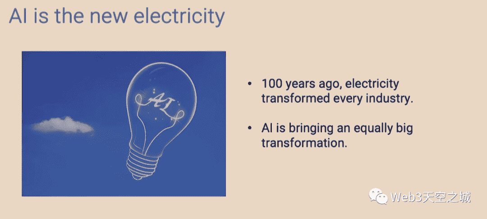

谢谢你，Lisa。很高兴见到各位。所以我今天想要做的就是与你们聊聊 AI 中的一些机遇。所以我一直在说 AI 是新的电力。理解 AI 的难点之一是，它是一个通用技术，这意味着它不仅仅对一件事有用，而是对许多不同的应用都有用，有点像电一样。如果我问你，电有什么用？你知道，它不仅仅对一件事有用，而是对许多事有用。

所以我想首先与你们分享我如何看待技术格局，这将引出一系列机遇。

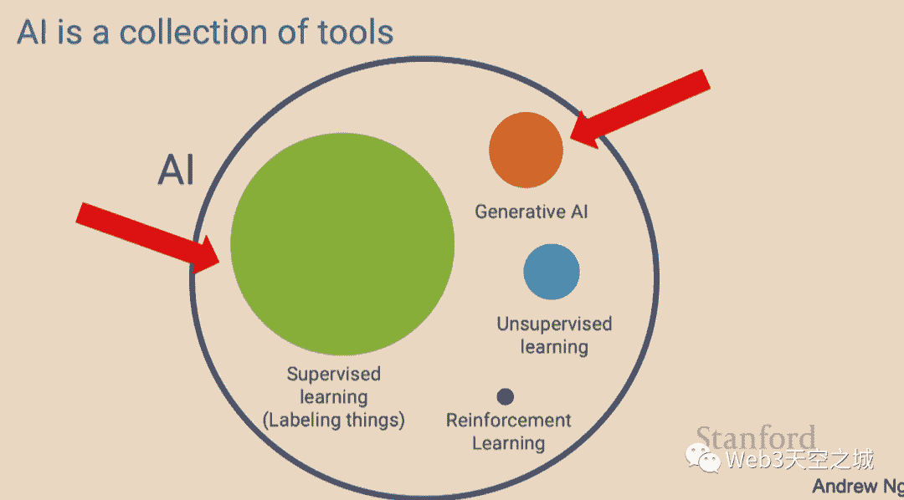

关于 AI 有很多炒作，很多兴奋。

我认为思考 AI 的一个好方法是把它看作一套工具。这包括一种叫监督学习的技术，它非常善于识别或标注事物，还有相对较新的激动人心的发展 – 生成式 AI。如果你熟悉 AI，你可能听说过其他工具，但我今天会少谈这些额外的工具，我将重点谈论我认为目前最重要的两个工具，监督学习和生成式 AI。

#### 监督学习：从输入到输出的映射

监督学习非常擅长标注事物，或者说非常擅长计算输入到输出，或者从 A 到 B 的映射。 给我一个输入 A，给我一个输出 B。 例如，给定一封电子邮件，我们可以使用监督学习来将其标注为垃圾邮件或非垃圾邮件。 我工作过的这个技术中最具价值的应用可能是在线广告，在这里，给定一个广告，我们可以标注一个用户是否可能点击它，从而展示更相关的广告。

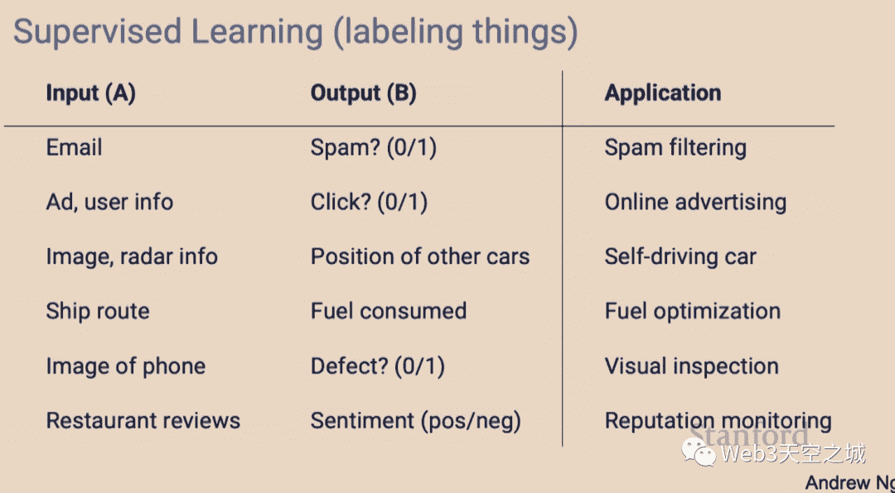

对于自动驾驶汽车，给定汽车的传感器读数，我们可以标注其他汽车的位置。我在 AI 基金的团队做过的一个项目是船舶路线优化，给定一艘船正在采取或考虑采取的路线，我们可以标注我们认为它将消耗多少燃料，并用这来使船舶更省油。

它在工厂的自动视觉检查中做了大量工作。所以你可以拍一张刚制造的智能手机的图片，并标注是否有划痕或其他缺陷。或者如果你想建立一个餐厅点评声誉监测系统，你可以让一个小软件检查在线餐厅点评并将其标注为积极或消极情绪。

监督学习的一个很好的地方，一个很酷的地方是，它不仅对一件事有用，而是对所有这些不同的应用都有用，还有更多。让我具体地跟你们走一遍监督学习标注事物这类项目的一个示例的工作流程。

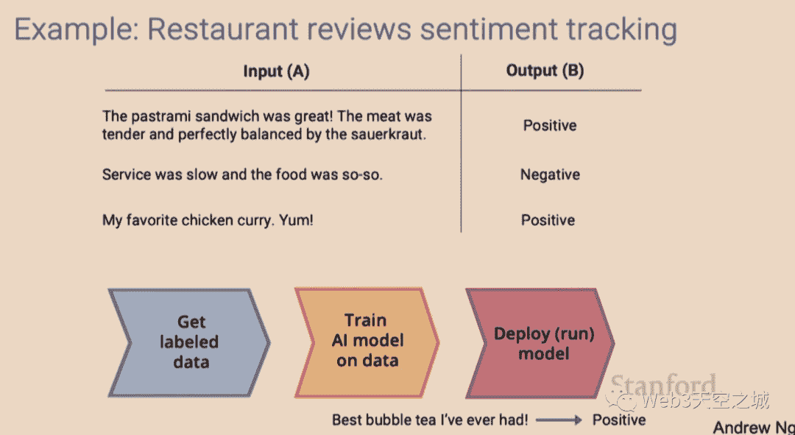

如果你想建立一个对餐厅点评进行标注的系统，你会收集一些数据点或数据集，比如说，帕斯特拉米三明治非常好，你会说这是积极的。服务很慢，这是消极的。我最喜欢的鸡咖喱，这是积极的。在这里我展示了三个数据点，但在构建这个系统时，你可能会得到成千上万这样的数据点或训练样本，我们称之为训练样本。

一个机器学习项目，一个 AI 项目的工作流程是你获得标注过的数据，可能是成千上万的数据点。然后，你会有一个 AI 工程团队，训练一个 AI 模型来从这些数据中学习。最后，你会找到可能是一个云服务来运行训练好的 AI 模型。

我认为过去的十年可能是大规模监督学习的十年。我们大约在 10～15 年前发现，如果你训练一个小的 AI 模型，也就是训练一个小的神经网络或小的深度学习算法，一个小的 AI 模型，可能不在一个非常强大的计算机上，那么当你提供越来越多的数据时，它的表现会稍微变好，但随后会趋于平缓，会达到平台期，它会停止能够利用数据变得越来越好。

但是如果你训练一个非常大的 AI 模型，在可能很强大的 GPU 上用大量计算资源，那么当我们扩大给机器学习模型的数据量时，它的表现会持续变得越来越好。

这就是为什么当我开始并领导谷歌大脑团队时，我指导团队当时要解决的主要任务就是构建非常、非常大的神经网络，我们然后向其提供大量数据。幸运的是这个方法行之有效。我认为推动大规模计算和大规模数据，这些方法真的帮助我们在过去十年取得了很多 AI 进步。

#### 生成式 AI：重复预测下一个词

所以说上个十年是 AI 的十年，我认为这个十年仍在做我们在监督学习中做的一切，但增加了生成式 AI 等令人激动的新工具。你们许多人可能都玩过 ChatGPT 聊天机器人等。你知道，给出一段文本，你称之为提示，比如“我喜欢吃...". 如果你多次运行它，你可能得到百吉饼、奶油乳酪，或者我妈妈的肉饼，AI 系统可以生成这样的输出。

鉴于对生成式 AI 的大量关注和兴奋，我想花半张幻灯片的篇幅，你知道，简单介绍一下它是如何工作的。

事实证明，生成式 AI，至少这种文本生成类型，其核心是使用监督学习中的输入输出映射，重复预测下一个词。所以，如果你的系统在网上读到这样一句话：我最喜欢的食物是奶酪夹心百吉饼，然后，这被转化成几个数据点，如果它看到我最喜欢的食物是，在这种情况下，试图猜测正确的下一个词是百吉饼，或者我最喜欢的食物是百吉饼，试图猜测下一个词，类似地，如果它看到在这种情况下，下一个词的正确猜测应该是奶酪。

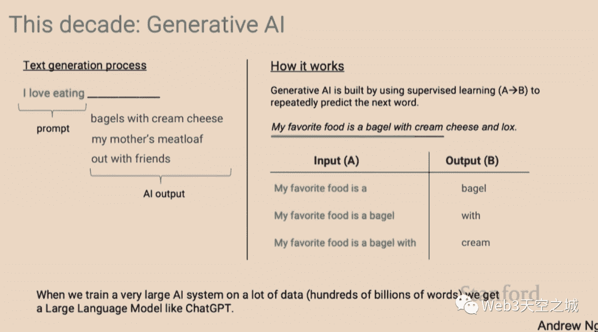

所以通过获取你在网上或其他来源找到的文本，并使用这样的输入输出，监督学习来尝试重复预测下一个词，如果你在数以百亿计的词上训练一个非常大的 AI 系统，或者在现在最大的模型中，超过 1 万亿个词，然后你得到一个像 GPT 这样的大型语言模型。

而且，你知道，还有其他一些重要的技术细节。我谈到了预测下一个词。从技术上讲，这些系统预测的不是词，而是一个叫词元（token）的词的一部分。然后还有一些其他技术，像微调输出使其更有用，更诚实，更无害。但是其核心是使用监督学习来重复预测下一个词元，这才真正启用了在大型语言模型方面的激动人心的进步。

#### 大型语言模型作为开发者工具

所以，尽管许多人将大型语言模型视为极好的消费者工具，你可以去 GPT、Bard 或其他大型语言模型的网站使用它作为极好的工具。我认为还有一个趋势仍被低估，那就是大型语言模型的力量，不仅作为消费者工具，也作为开发者工具。事实证明，过去需要我花数月才能构建的应用，现在很多人可以通过使用大型语言模型来更快地构建。

具体而言，构建餐厅评论系统等监督学习的工作流程将是你需要获取大量标注数据，这可能需要一个月来获取几千个数据点。然后让一个 AI 团队训练、调优并真正获得你的 AI 模型的优化性能，这可能需要 3 个月。然后找到一个云服务来运行它，确保它稳定运行，确保它被识别，这可能再需要 3 个月。所以构建商业级机器学习系统的现实时间表大概是 6 到 12 个月。

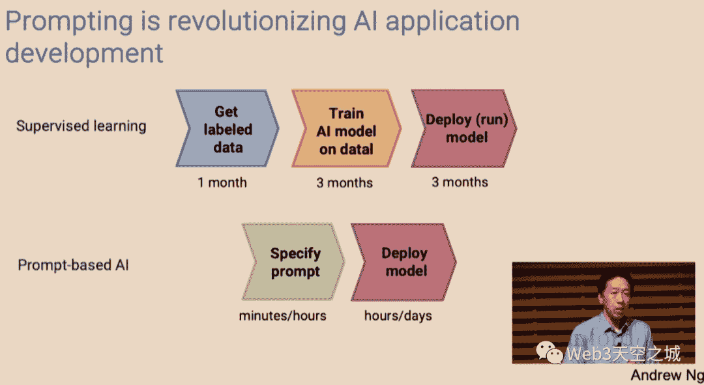

所以我领导的团队通常需要大约 6 到 12 个月来构建和部署这些系统。其中一些被证明非常有价值。但是这就是构建和部署商业级 AI 系统的现实时间表。

相比之下，基于提示的 AI，你只需要编写提示，工作流程如下所示。你可以编写一个需要几分钟或几小时的提示。然后把它部署到云上，这可能需要几小时或几天。所以现在有一些 AI 应用，过去需要我花 6 个月甚至 1 年来构建，现在全球许多团队可以在 1 周内构建。我认为这已经开始，但最好的还在后头。这正在打开大量更多 AI 应用的大门，可以被许多人构建。

所以我认为很多人仍低估了我认为将要出现的大量定制 AI 应用的规模。现在，我知道你们可能没想到我在这个演示中写代码，但我就是要这么做。事实证明，这就是我构建一个情感分类器所需的全部代码。

所以我会导入一些来自 OpenAI 的工具，我猜一些人会知道 Python。然后我有这样一个提示，它说对以下文字进行分类， delimited by three dashes，判断其情感是积极还是消极。“哦不，我在斯坦福商学院度过了美好的时光。学到了很多，也交了很多新朋友。”

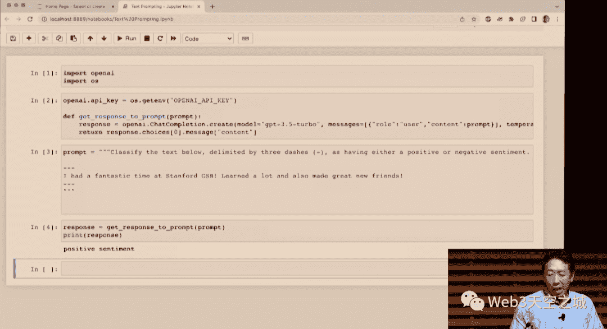

好的，这就是我的提示。现在我只要运行它。我从没运行过，所以我真的希望结果正确。太好了，我们得到了正确的答案。

这字面上就是构建一个情感分类器所需的全部代码。所以今天，世界各地的开发者可能只需要大约 10 分钟就可以构建这样的系统。我认为这是一个非常激动人心的发展。

所以我一直在做的工作之一是。尝试教授在线课程，关于如何使用提示，不仅作为消费者工具，也作为开发者工具。所以关于技术格局，让我现在分享我对 AI 机遇的一些看法。

#### AI 价值分布与三年展望

这显示了我认为不同 AI 技术目前的价值。我会谈三年后的情况。但今天 AI 的绝大部分价值来自我认为的监督学习，对单个公司如谷歌每年价值可能超过 1000 亿美元。而且还有数百万开发者构建监督学习应用。所以它已经非常有价值，并且由于大量努力找到应用和构建应用，后劲也很足。

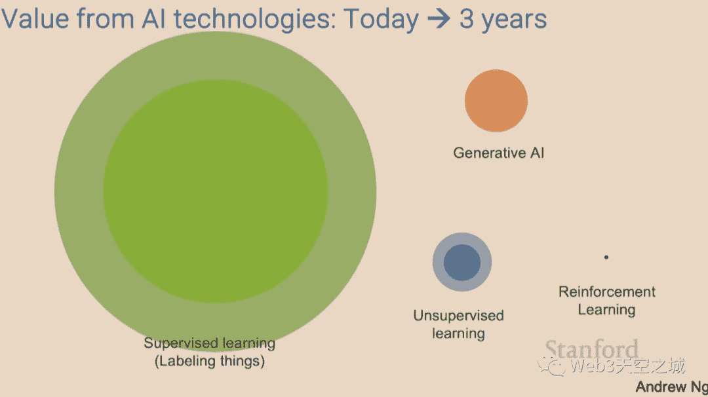

生成式 AI 是真正令人激动的新兴技术，目前还很小。然后为了完整性我也包含了其他工具。如果这些圆圈代表今天的价值，这就是我认为三年后的发展。

监督学习已经非常大，可能在未来三年加倍，从已经非常大变得更大。生成式 AI 今天还很小，但我认为在未来三年会增长两倍以上，由于开发者兴趣、风险投资投资以及大公司探索应用。我也想指出，三年是一个非常短的时间段。如果增长速度保持，那么六年后会更加巨大。

但这个绿色或橙色区域，那个浅色区域，是新的创业公司或大公司可以创造和获得价值的空间。我希望你从这个幻灯片获得的信息是，所有这些技术都是通用技术。

对于监督学习，过去十年所做的大量工作，及未来十年将继续做的，是识别和执行具体的用例。这对生成式 AI 也正在开始。

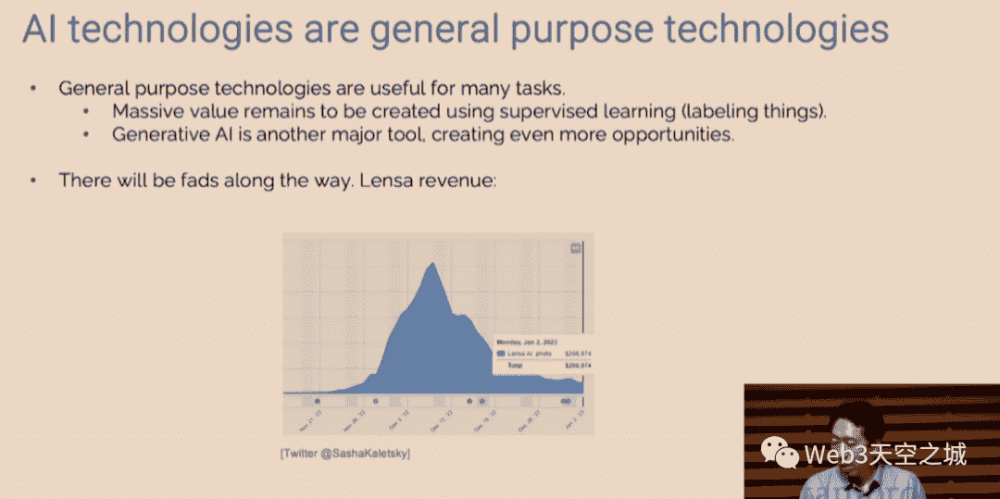

所以我希望你从这个部分获得的信息是，通用技术对许多不同任务都有用。使用监督学习还有很多价值等待创造。尽管我们远未弄清监督学习所有的激动人心的用例，我们有这个新工具生成式 AI，这进一步扩大了我们可以用 AI 做的事情。

但是需要注意，在这个过程中会有短期热潮。

我不知道你们中是否有人还记得名为 Lensa 的应用。这是一款应用，可以让你上传自己的照片，它们会把你渲染成一个酷酷的宇航员或科学家形象。这是一个不错的创意，人们喜欢它。它大致在去年 12 月疯狂流行。然后它就下滑了。那是因为 Lensa 是一个好的创意，人们喜欢它。但它仅仅是建立在其他人非常强大 API 之上的一个相对薄弱的软件层。

所以尽管它是一个有用的产品，但业务上不可防守。当我思考类似 Lensa 的应用时，它让我想起史蒂夫·乔布斯给我们 iPhone。不久后，有人写了一个应用，我花 1.99 美元买了它，打开 LED 灯，把手机变成手电筒。这也是一个不错的创意，写一个打开 LED 灯的应用。但从长远来看，它也不是一个可防守的业务，也没有创造持久价值，因为它很容易被复制和低价替代，最终被整合进 iOS。

但是随着 iOS 和 iPhone 的兴起，有人也想出了如何构建 Uber、Airbnb 和 Tinder 等非常长期且可防守的业务，创造持续价值。我认为随着生成式 AI 或新 AI 工具的兴起，真正令我激动的是创造那些非常深入、非常难的应用的机会，希望它们可以创造长期价值。

#### AI 在各行业的长尾机遇

所以我想分享的第一个趋势是，AI 是一个通用技术，我们面前存在大量工作，那就是找到各种各样的使用案例并构建它们。我想与你分享的第二个趋势与 AI 为何还未被更广泛采用有关。

感觉我们好几个人谈 AI 已经 15 年了，但如果你看 AI 价值目前的分布，大部分仍高度集中在消费软件和互联网界，对吧？一旦你走出科技或消费软件互联网领域，有一些 AI 采用，但很多还处于早期。为什么会这样呢？事实证明，如果你把所有当前和潜在的 AI 项目排序，价值由高到低，则这条曲线左边的头部是那些十亿美元级别的项目，比如广告、网络搜索，或电商产品推荐，或像亚马逊这样的公司。

事实证明，约 10-15 年前，我和一些朋友想出了一个办法，那就是雇佣 100 名工程师来编写一段软件，提供更相关的广告，将这一软件应用到 10 亿用户，产生巨大的财务价值。这是可行的。但是一旦你走出消费软件和互联网领域，几乎没有人拥有 1 亿或 10 亿用户，可以对他们应用一段软件。所以一旦进入其他行业，当我们从这条曲线左边的头部进入长尾部时，我看到了一些令我激动的项目。

我与一家比萨饼制造商合作，他们拍比萨饼的照片，因为他们需要做一些确保奶酪铺展均匀的事情。这是一个约 500 万美元的项目。但是聘请数十名高技能工程师来做一个 500 万美元项目的老办法行不通。

或作为另一个例子，我与一家农业公司合作，我们意识到如果用摄像头检测小麦的高度，小麦经常因风雨倒伏，我们可以在合适的高度割下小麦，这会让农民有更多食物可卖，对环境也更好。但这又是一个 500 万美元的项目，老办法是雇佣大批高技能工程师做这个项目也行不通。类似地，材料分级、布分级、钢板分级，还有许多这样的项目。

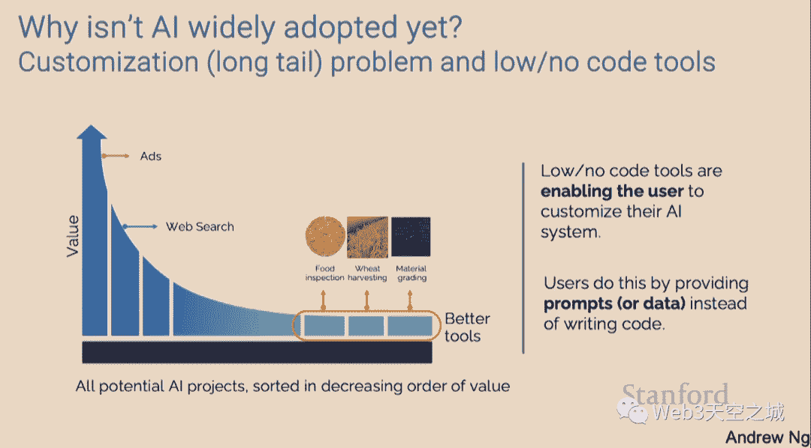

所以在这条曲线的左边头部，有少数十亿美元级别的项目，我们知道如何执行这些项目创造价值。但在其他行业，我看到有成千上万个 5000 万美元级别的项目的长尾，到现在由于高昂的定制成本很难执行。我认为一个激动人心的趋势是，AI 社区一直在建立更好的工具，让我们聚合这些用例，并让终端用户轻松定制。

具体而言，我看到许多令人兴奋的低代码和无代码工具，它让用户定制 AI 系统。这意味着，我不必太担心比萨饼图片，我们有工具，正在见到可以让比萨饼工厂的 IT 部门用自己的比萨饼图片训练 AI 系统，实现 500 万美元的价值。顺便说一下，比萨饼图片不存在于互联网上，谷歌和必应无法获得这些图片。我们需要的工具是真正可以被比萨饼工厂自己使用，构建、部署和维护适用于自己比萨饼图片的定制 AI 系统。

广义地，实现这一点的技术包括提示、文本提示、视觉提示，或者大型语言模型和类似工具，或者一种叫做数据中心 AI 的技术，其中我们不要求比萨饼工厂编写大量代码，这很有挑战性，而是要求他们提供数据，这更可行。

我认为第二个趋势很重要，因为我认为这是将 AI 价值从目前仍高度集中在科技界和消费软件互联网界推广到所有行业和更大的经济体的关键部分。有时候很容易忘记，除了科技界之外的其他经济体规模其实更大。

所以我分享的两个趋势是，AI 作为通用技术，存在大量具体用例有待实现，以及低代码、无代码、易用工具，使 AI 能够应用到更多行业。我们该如何抓住这些机遇？

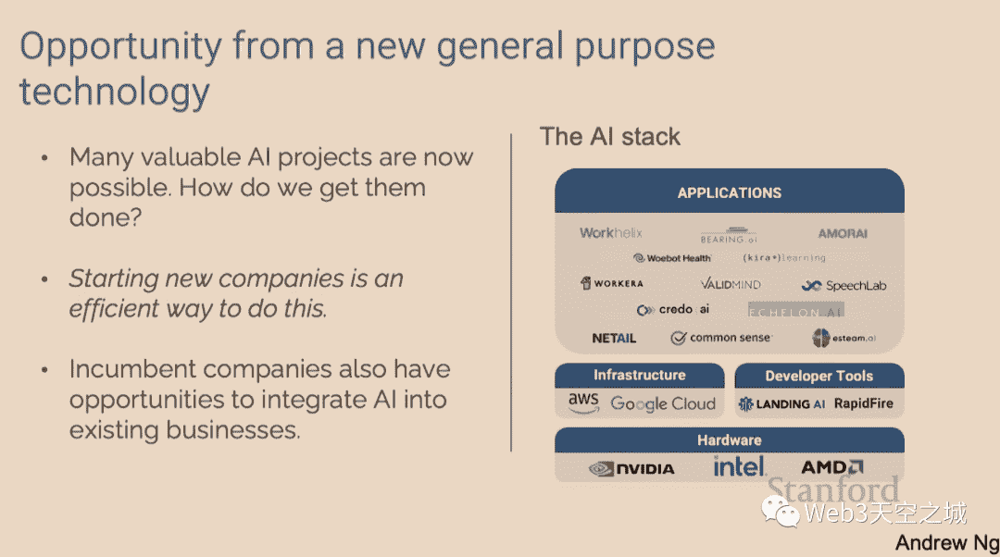

#### AI 栈与创业机会

大约 5 年前，我想解决一个难题，那时我觉得现在许多有价值的 AI 项目都是可能的。我在思考，我们如何完成这些项目？在谷歌和百度等大公司领导 AI 团队后，我很难想出在一个大科技公司里操作一个团队去追求各种各样的机遇，从航运到教育再到金融服务、医疗保健等等。

场景非常多样化，进入市场非常多样化，真正的客户基础和应用也非常多样化。我觉得最有效的方法是，如果我们可以启动许多不同的公司来追求这些非常多样化的机会。所以，这就是为什么我最终创立了 AI 基金，这是一家孵化创业公司的创业工作室，以追求各种各样的机会。当然，除了许多创业公司，现有公司也有大量机会将 AI 整合到现有业务中。事实上，我看到的一种模式是，对现有公司来说，分销通常是现有公司的周期性优势之一，如果他们玩好牌，可以让他们非常有效地将 AI 整合到产品中。

但具体而言，机会在哪里？我把它看作是一个 AI 栈。底层是硬件半导体层。这里有巨大的机会，但非常资本密集，高度集中。所以有很多资源，但获胜者相对较少。所以有些人可以并且应该在这里发展。我个人不喜欢在这里发展。

还有一个基础设施层。同样，巨大的机会，但非常资本密集，高度集中。所以我也倾向不在这里发展。然后是一个开发者工具层。我刚才展示的就是我实际上正在使用 OpenAI 的 API 作为开发者工具。我认为开发者工具领域竞争激烈。看看所有在追逐 OpenAI 的创业公司，但会有一些大赢家。所以我有时在这里发展，但主要是当我认为有重大技术优势时，因为我认为这为你赢得成为大赢家的权利或机会。

# 应用层成功是基础设施与工具层成功的关键

最后，尽管媒体关注和热点集中在基础设施和开发者工具层，但事实证明，只有当应用层更成功时，那一层才能成功。我们在 SaaS 的兴起中也看到了这一点。很多关注和兴奋集中在技术和工具层面，这很好，没什么问题。但它成功的唯一途径是应用层更成功，所以实际上它们可以产生足够的收入来支付基础设施和工具层。

实际上，让我举一个例子。Armoury，我昨天刚给 CEO 发短信。Armoury 是我们创建的一家使用 AI 进行恋爱关系指导的公司。我是一个 AI 人，但我觉得我对浪漫一无所知。如果你不相信我，可以问问我妻子，她会确认我对浪漫一无所知。但我们想建立这个，我们想与 Tinder 前 CEO Renata Naibog 合作，利用我团队的 AI 专长和她的恋爱关系专长，我们能够建立一些独特的东西，使用 AI 进行某种程度的恋爱关系指导。

这样的应用程序有趣之处在于，当我们环顾四周时，全球有多少团队同时拥有 AI 和恋爱关系的专业知识呢？所以在应用层面，我看到许多激动人心的机会，似乎拥有非常大的市场，但相对于机会的规模，竞争者很少。这并不是说没有竞争对手，但与开发者工具或基础设施层相比，竞争明显少得多。

# 创业公司构建配方与 Bering AI 案例

因为我花了很多时间在构建创业公司的过程上迭代，所以我将透明地告诉你我们开发的创业公司构建配方。经过多年考虑和改进后，这就是我们现在构建创业公司的方式。

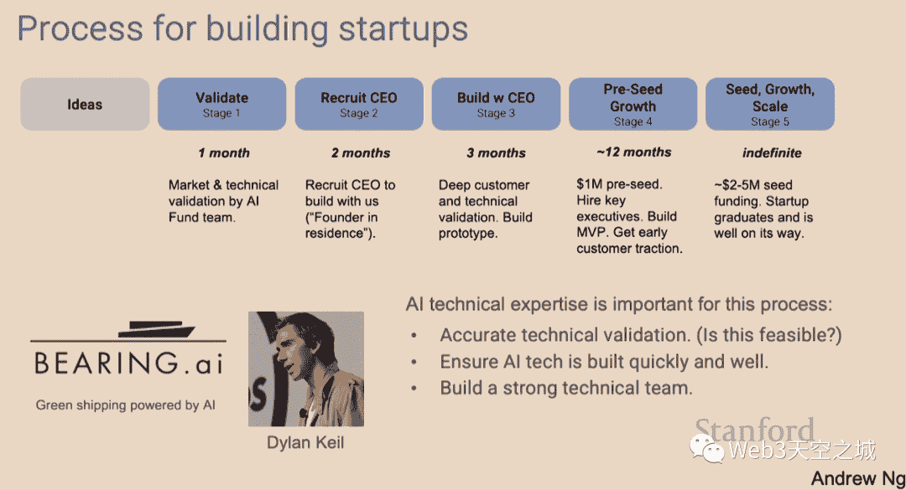

我的团队总是接触到许多不同的想法，来自合作伙伴的内部生成的想法。我想以我们做的一件事为例阐述这个过程，那就是 Bering AI 公司，它使用 AI 使船舶更加节油。这个想法来自几年前，一个大型日本财团三井，它是某种程度上运营大型航运公司的主要股东。他们来找我，说，嘿，吴恩达，你应该建立一个业务，使用 AI 使船舶更节油。

具体的想法是，可以把它看作是船舶版的谷歌地图，我们可以对船舶提供建议或指示，以按时到达目的地，但使用 10%更少的燃料。所以我们现在所做的是花大约一个月的时间验证这个想法。仔细检查这个想法在技术上是否可行，然后与潜在客户交谈，确保有市场需求。我们花大约一个月的时间来做这些。如果它通过了这个阶段，我们就会招募一位 CEO 与我们合作这个项目。

刚开始时，我会在带上 CEO 之前自己工作这个项目很长时间。但通过迭代，我们意识到从一开始就带上领导与我们合作可以减少很多知识转移的负担，或者 CEO 进来后需要重新验证我们发现的东西。所以我们发现这个流程可以更有效，我们会从一开始就带上领导。

对于 Bering AI，我们找到了优秀的 CEO Dylan Kyle，他是重复创业者，之前有过一次成功。然后我们花了 3 个月，6 个 2 周冲刺与他们合作构建原型和进行深入的客户验证。

如果它通过这个阶段，我们有大约三分之二的 66%的存活率，我们会进行第一个融资，这为公司提供资源来聘请管理团队、建立关键团队、使 MVP 最小可行产品工作并获得一些真实客户。之后，希望它可以成功融资额外的外部资金轮，我们可以继续增长和扩张。

我为我的团队能够支持三井的想法和 Dylan Kyle 作为 CEO 感到非常自豪。今天，现在就有数百艘船在公海上以不同的方式航行，因为有了 Bering AI。10%的燃油节省转换到大概每艘船每年 45 万美元的燃料节省。当然，坦率地说，这对环境也更好。

我认为如果没有 Dylan 的出色工作，这个创业公司就不会存在。然后还有，你知道，三井把这个想法带给我。我喜欢这个例子，因为这是一个创业的想法，我只想指出，这绝不是我自己会想到的，对吧？因为，你知道，我坐过船，但我对海运知之甚少。是三井的专业知识产生了这个见解，与 Dylan 以及我团队的 AI 专业知识配合，才使这成为可能。

# 与领域专家合作及具体想法的验证

所以在 AI 领域工作，我学到的一件事是，我的领域是 AI，仅此而已，因为我没有时间。要成为海运、恋爱关系、医疗保健、金融服务等所有领域的专家对我来说非常困难。所以我学到如果我只能提供准确的技术验证，然后利用 AI 资源快速而出色地构建 AI 技术，我认为我们一直能够帮助公司建立强大的技术团队，那么与主题专家合作往往会带来激动人心的新机会。

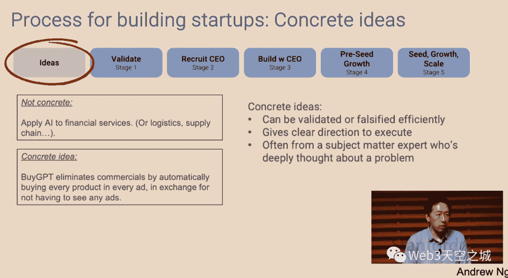

我想与你分享关于建立创业公司的另一个奇怪的经验教训，那就是我只喜欢在有具体想法时参与。这与你从设计思维方法中听到的许多建议相反，它通常说，不要急于找到解决方案，对吧？探索许多替代方案，避免解决方案。说实话，我们试过了，但进展很慢。但是我们学到的是，在构想阶段，如果有人对我说，嘿，吴恩达，你应该把 AI 应用到金融服务，因为我不是金融服务的专家，我去学习足够的金融服务知识非常缓慢。我意思是，最终你可能会有好的结果。但这对我来说是一个非常劳动密集型、缓慢、昂贵的过程，去逐一学习不同的行业。

相比之下，我的一个合作伙伴提出了一个具体的想法，买下 GPT，通过自动购买每一个广告中的产品来消除商业广告，以此换取不看广告。这可能不是一个好主意，但它是一个具体的想法。事实证明，具体的想法可以有效地进行验证或证伪。它们也为团队提供了明确的执行方向。我发现在当今世界，由于许多人对 AI 的兴奋、关注和接触，现在有许多主题专家已经对一个问题思考了几个月甚至一两年，但还没有技术实现伙伴。当我们与他们团队，他们与我们分享想法时，这允许我们与他们合作很快进行验证和构建。我发现这种方法行之有效，是因为已经有许多人做了探索许多想法并归纳出真正好的想法的设计思考，存在这样许多没人处理的好的想法，找到别人已经有的想法并与我们分享、寻求技术伙伴，这被证明是更有效的引擎。

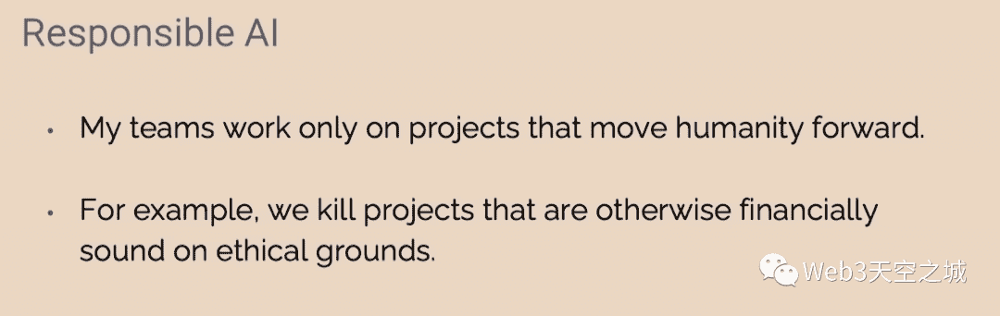

# AI 的风险与社会影响

**所以，在我们进入问题环节之前，**我想用几张幻灯片讨论风险和社会影响。

AI 是一个非常强大的技术。我想明确的是，我和我的团队只从事推动人类进步的项目。我们多次因为伦理理由否决了在财务上合理的项目。事实证明，我对人们设计真正不应该建造但看似盈利的坏主意的创造力感到惊讶和失望。我们因此否决了几个项目。然后，我认为必须承认，AI 今天在偏见、公平性、准确性方面确实存在问题，但技术也在快速改进。所以我看到，相比六个月前，AI 系统今天偏见更少，更加公平。这不是轻视这些问题的重要性。它们确实存在，我们应该继续努力。但我也对许多 AI 团队努力解决这些问题感到欣慰。

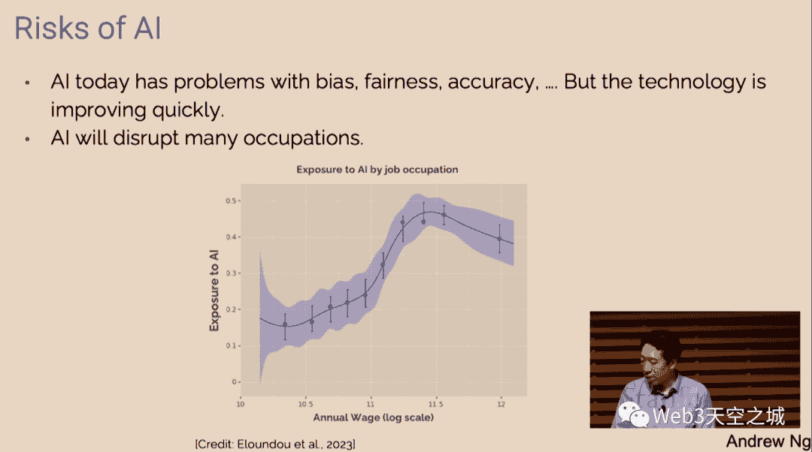

当我思考 AI 的最大风险时，我认为最大的风险之一是对就业的冲击。这是我在宾夕法尼亚大学的一个朋友和 OpenAI 的一些人撰写的一篇论文中的图表，分析了不同工作对 AI 自动化的敞口。尽管之前的自动化浪潮主要影响较低工资工作，如当我们在工厂使用机器人时，但这波自动化浪潮影响的实际上似乎是这条坐标轴右侧的较高工资工作，它们的更多任务面临 AI 自动化。所以即使我们利用 AI 创造巨大价值，作为公民和公司、政府和整个社会，我觉得我们有强烈义务确保那些生计被冲击的人仍能获得很好的照顾和对待。

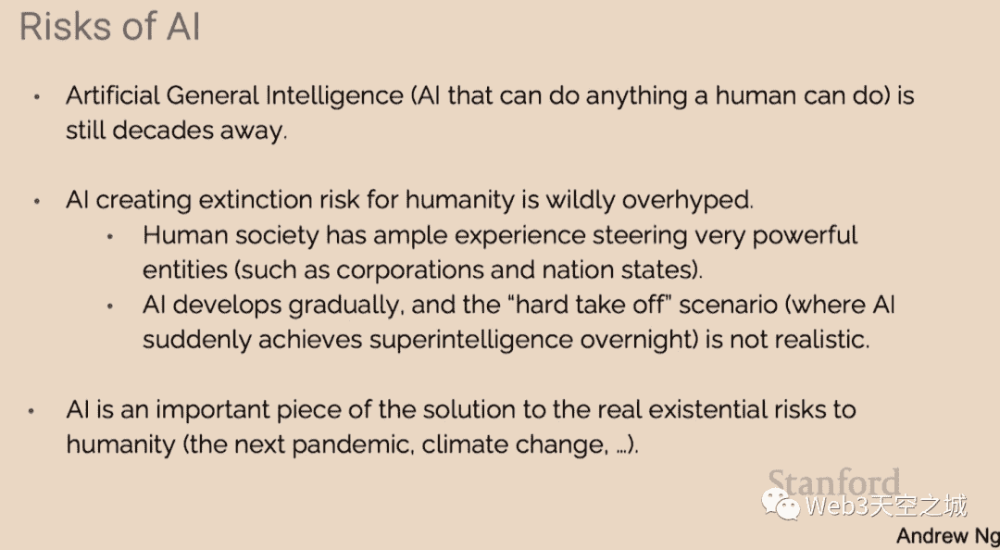

最后，我觉得每次 AI 取得重大进展，就会出现一波关于通用 AI 的炒作。当十年前深度学习开始工作得很好时就出现一波，现在通用 AI 工作得很好又出现一波。但我认为通用 AI 要实现人类所有能力还需要几十年，可能 30-50 年，甚至更长。我希望我们有生之年能看到，但我认为不会很快实现。一个挑战是人类和 AI 走向智能的生物路径和数字路径非常不同。关于通用 AI 的定义基准是一个非常不同的数字智能路径和生物智能路径，这很有趣。我认为大型语言模型在某些关键维度上比任何人都更智能，但在其他维度上远不如人。强迫它做人能做的任何事是一种奇怪的比较。但我希望我们能实现它，也许在我们有生之年。

我也认为关于 AI 给人类带来灭绝风险的说法过于夸大。坦白说，我不这么看。我不认为 AI 给人类带来任何重大的灭绝风险。我认为人们担心我们无法控制 AI，但我们在控制像公司或国家这样更强大的实体方面有丰富经验，确保它们在很大程度上惠及人类。而且技术也在逐步发展，所谓的硬起飞场景也不现实。

我认为如果要使人类在未来一千年存活和繁荣，与其降低 AI 速度，不如使 AI 尽可能快。所以总结一下，我认为 AI 作为一项通用技术为每个人创造了许多新机遇。我们所有人面前激动人心和重要的工作就是去实现这些具体用例。希望未来我也有机会与你们更多人合作这些机遇。非常感谢大家。
