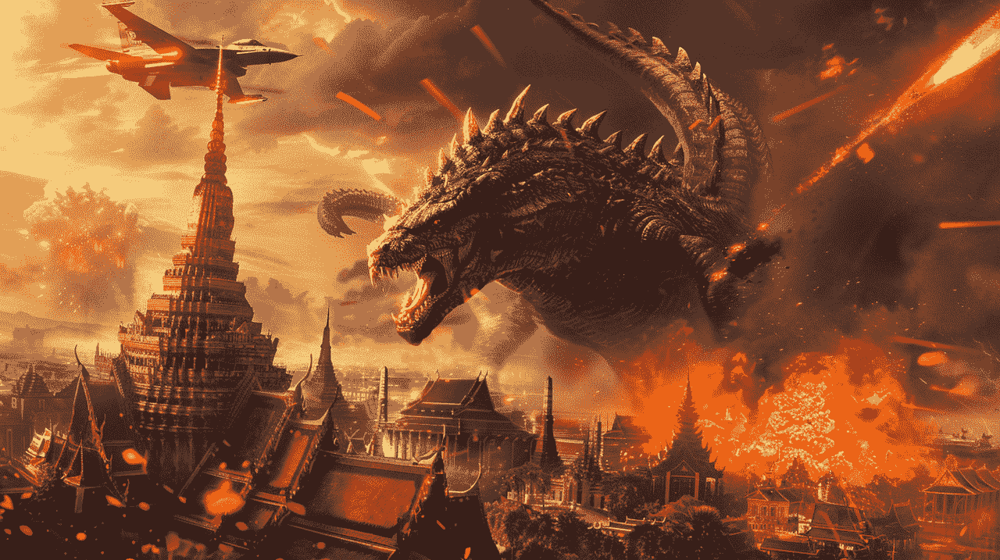

# 240225 - 0219｜谷歌 Gemini 生图功能紧急关闭；Tesla Optimus 大更新：有史以来最快的步态，速度约为 0.6 米/秒；英伟达成立最壕 AI 实验室：Jim Fan 领衔，专攻具身智能；清华叉院、理想提出 DriveVLM，视觉大语言模型提升自动驾驶能力；Stable Diffusion 3 震撼发布，采用 Sora 同源技术，文字终于不乱码了；Gemini 1.5 Pro 在几秒钟内将一部完整的电影变成了摘要；马斯克：Neuralink 首位人类受试者已康复 可凭思维控制鼠标；Sora 到底懂不懂物理世界？一场头脑风暴正在 AI 圈大佬间展开...

> 来源：[https://leonzhang.feishu.cn/docx/IkvFdSaqrof32WxR0elcw4ZTnDd](https://leonzhang.feishu.cn/docx/IkvFdSaqrof32WxR0elcw4ZTnDd)

Writer: Leon ｜ Date: 2024/02/26 ｜ #AI Weekly



```
Thailand at Wat Phra Kaew Battle of the Thai army VS Kaiju, F16 squadron, war of the world, realistic, 16k resolution. --ar 16:9 --v 6.0 
```

## 🎞️ 上周二三事

### 谷歌 Gemini 生图功能紧急关闭，口碑一夜塌房，Yann LeCun：我早就知道

https://mp.weixin.qq.com/s/gmzBY9XhNEQtUVfRF5pfPg

Gemini AI 图像生成功能出现偏见，谷歌紧急关闭并承诺改进

❗️ 问题原因 Gemini AI 模型生成偏见图像，引发负面反响

🔄 谷歌回应 Gemini 图像生成功能已关闭，承诺改进

💬 Yann LeCun 观点 AI 专家 LeCun 早有预料，指出数据偏差问题

### 英伟达成立最壕 AI 实验室：Jim Fan 领衔，专攻具身智能

https://mp.weixin.qq.com/s/3l7N2zdbxPchAqjF_Nqq8w

英伟达成立最壕 AI 实验室，专攻具身智能

⭐️ 重点研究方向： 通用具身智能体，2024 年机器人、游戏 AI 和模拟

📄 相关成果： Eureka、Voyager、MineDojo、VIMA 等具体项目成果

👤 黄仁勋的影响： 推动具身智能研究，引发高校和产业关注

### 清华叉院、理想提出 DriveVLM，视觉大语言模型提升自动驾驶能力

https://mp.weixin.qq.com/s/v6f29qeZAZOi4NdnwRlvZw

⭐️ DriveVLM 特点 结合视觉语言模型和传统自动驾驶系统

⏩ DriveVLM-Dual 优势 提升规划能力，处理复杂场景

📊 数据集和实验 SUP-AD 数据集验证了 DriveVLM 性能

与生成式 AI 相比，自动驾驶也是近期 AI 最活跃的研究和开发领域之一。要想构建完全的自动驾驶系统，人们面临的主要挑战是 AI 的场景理解，这会涉及到复杂、不可预测的场景，例如恶劣天气、复杂的道路布局和不可预见的人类行为。现有的自动驾驶系统通常包括 3D 感知、运动预测和规划组成部分。具体来说，3D 感知仅限于检测和跟踪熟悉的物体，忽略了罕见物体及其属性， 运动预测和规划则关注物体的轨迹动作，通常会忽略物体和车辆之间的决策级交互。

最近清华大学交叉信息研究院、理想汽车提交的新论文中，作者提出了 DriveVLM，受到最近生成式 AI 领域兴起的视觉语言模型（VLM）启发，DriveVLM 在视觉理解和推理方面表现出了非凡的能力。 在业界，这是第一个提出自动驾驶快慢系统的工作，方法充分结合了主流自动驾驶 pipeline 和具备逻辑思考的大模型 pipeline，并第一个完成端测部署的大模型工作（基于 Orin 平台）。DriveVLM 包含一个 Chain-of-Though （CoT） 流程，该流程具有三个关键模块：场景描述、场景分析和分层规划。场景描述模块用语言描述驾驶环境，并识别场景中的关键对象；场景分析模块深入研究关键对象的特征及其对自我车辆的影响；分层规划模块从元动作和决策描述到路径点逐步制定计划。

### 2770 亿美元，英伟达创史上最大单日涨幅，黄仁勋：生成式 AI 已到临界点

https://mp.weixin.qq.com/s/Wb4ZU-lYoS6Kj0gNezMlaA

⬆️🔴 股价暴涨 英伟达市值单日暴涨 2770 亿美元，创历史新高

👥 黄仁勋财富增长 黄仁勋财富增加 85 亿美元，即将跻身全球前 20 富豪行列

💻 AI 生成工厂 英伟达 CEO 表示生成式 AI 已到临界点，数据中心转向加速计算

### Stable Diffusion 3 震撼发布，采用 Sora 同源技术，文字终于不乱码了

https://mp.weixin.qq.com/s/KOjeMQJoTLQt6uDBGRMXeQ

🪄✨ 技术背后 Stable Diffusion 3 使用 Diffusion Transformer 和 Flow Matching 技术。

1️⃣ 参数量 参数量从 800M 到 8B，适用于便携式设备。

⤴️ 开源计划 CEO 表示会在得到反馈后将模型开源。

📰 收购消息 Stability AI 收购了图像生成应用公司 Clipdrop。

### Gemini 1.5 Pro 在几秒钟内将一部完整的电影变成了摘要

https://x.com/mattshumer_/status/1759737197710704939?s=20

Gemini 1.5 Pro 只是在几秒钟内直接从一部完整的电影变成了摘要。

没有转录，没有中间步骤。只是视觉标记 - >摘要。

接下来，验证大海捞针测试。

### 三星电子据悉在硅谷成立新团队，开发通用人工智能芯片

https://www.huxiu.com/moment/942638.html

2 月 20 日消息，知情人士透露，三星电子已在硅谷成立新团队，开发通用人工智能芯片。据悉，谷歌前开发人员 Woo Dong-hyuk 将领导该团队。

### 为训大模型不择手段的 AI 公司，打破了这个古老的互联网协议

https://mp.weixin.qq.com/s/aRyWs56OAf5_buTzK7gCiw

AI 公司打破了 30 年来的互联网协议

📄 robots.txt 一个简单有效的协议，用于控制网站被爬虫抓取的权限

📶 搜索爬虫与 AI AI 公司提取数据训练模型，引发数据所有者反抗

🔄 数据被用来训练 AI 出版商和平台感觉数据被偷窃，开始封锁 AI 爬虫

🙅♂️ 阻止 AI 爬虫 robots.txt 不是法律文件，依赖于相关方的善意

### Figma CEO 最新专访：Figma 从来不只是一个设计工具，从一开始就是消除想象与现实之间的差距

https://mp.weixin.qq.com/s/YqO5sxMlneM_bhq2TmZjjA

Figma 联合创始&CEO Dylan Field 在近期接受了 theVerge 的采访。Dylan 提到了将 Figma 扩展到更普遍的生产力软件领域的可能性，不认为 Figma 会进入笔记应用领域，但他们希望探索更多与设计、编码、发布和衡量软件相关的价值链，他们可能通过合作伙伴关系来扩展，而不是独立开发这些功能。此外， Dylan 讨论了 AI 能如何影响设计工作。他认为，AI 的出现降低了设计的门槛，使更多人能够参与其中。他认为，AI 可以提高效率，让设计师在更短的时间内完成更多工作，AI 并不会完全取代人类设计师，因为设计工作中的情感、品牌体验和用户流程等方面，AI 目前还无法涵盖。

### 马斯克：Neuralink 首位人类受试者已康复 可凭思维控制鼠标

https://news.mydrivers.com/1/964/964321.htm

据媒体报道，特斯拉 CEO 马斯克在社交媒体平台 X 上透露，脑机接口公司 Neuralink 的首位人类受试者“似乎已完全康复，并能仅凭思维在电脑屏幕上移动鼠标”。Neuralink 公司此前已在猴子身上进行了芯片植入实验，并得到美国食品和药物管理局的批准，正式开始了首次脑植入设备的临床试验。

### 10 倍英伟达 GPU：大模型专用芯片一夜成名，来自谷歌 TPU 创业团队

https://mp.weixin.qq.com/s/2lEvK7Sh3aUSzh8FJf1-sg

Groq 的 LPU 芯片在大模型任务上击败 GPU，速度快 10 倍成本仅为 GPU 的 10%

⚡ 性能优势 Groq 的 LPU 芯片速度快 10 倍，成本仅为 GPU 的 10%

💻 架构设计 LPU 采用精简架构，提供确定性性能，更环保

↕️ 可扩展性 LPU 具有极高的可扩展性，成为大模型开发商的新选择

👥 背景信息 Groq 创始团队出自谷歌，曾设计 TPU，公司成立于 2016 年

### 在 Sora 引爆视频生成时，Meta 开始用 Agent 自动剪视频了，华人作者主导

https://mp.weixin.qq.com/s/iKwy6VLQzLAsPWVPGOO53A

视频剪辑迎来 AI 自动化大爆发，华人作者主导

✂️ LAVE 剪辑工具 使用 LLM 提供的语言增强功能，实现视频剪辑目标

🔳 用户界面 包含语言增强视频库、剪辑时间轴和视频剪辑智能体

🔄 后端系统 采用 GPT-4 构建 LAVE 智能体，支持多种 LLM 驱动的编辑功能

### [英伟达首次公开目前最快 AI 超算](https://news.mydrivers.com/1/963/963904.htm)：搭载 4608 个 H100 GPU！

https://news.mydrivers.com/1/963/963904.htm

**快科技 2 月 18 日消息，近日，英伟达首次向外界公布了其最新的面向企业的 AI 超级计算**机 Eos，同时也是英伟达目前速度最快的 AI 超级计算机。据介绍，Eos 共配备了 4608 个英伟达 H100 GPU，同时还配备了 1152 个英特尔 Xeon Platinum 8480C 处理器（每个 CPU 有 56 个内核）。Eos 还采用了英伟达 Mellanox Quantum-2 InfiniBand 技术，数据传输速度高达 400 Gb/s，对训练大型 AI 模型和系统扩展至关重要。

### 扎克伯格最新对谈：智能手机不会消失，AR 会是主流移动计算设备，XR 则是桌面计算设备，生成式 AI 实现人机交流

https://mp.weixin.qq.com/s/A3IdPYZqV-_1MB_oy8Qbkw

扎克伯格认为 AR 将成为主流移动计算设备，XR 是桌面计算设备，AI 实现人机交流

👓 AR 和 XR AR 眼镜将成为下一代计算的手机，XR 头戴设备可能是下一代的电脑或电视屏幕

🎤 AI 交流 AI 模型使人们可以与设备交谈并提问，实现多种功能

🎮 竞争与产品 扎克伯格对 Apple Vision Pro 进行了比较，认为自家产品更具价值

### Sora 证明马斯克的是对的，但特斯拉和人类可能都输了

https://mp.weixin.qq.com/s/FyxRCUGPMsdns2__z7n0EA

Sora 推出，马斯克可能是心情最复杂的一个。不仅因为其本人与 OpenAI 早年的纠葛，更因为 Sora 实现的其实是特斯拉早几年间一直在探索的方向。2 月 18 日，马斯克在科技主播 @Dr.KnowltAll 一条主题为「OpenAI 的重磅炸弹证实了特斯拉的理论」的视频下留言，称「特斯拉已经能够用精确物理原理制作真实世界视频大约一年了」。随后他在 X 上转发了一条 2023 年的视频，内容是特斯拉自动驾驶总监 Ashok Elluswamy 向外界介绍特斯拉如何用 AI 模拟真实世界驾驶。视频中，AI 同时生成了七个不同角度的驾驶视频，同时只需要输入「直行」或者「变道」这样的指令，就能让这七路视频同步变化。

### Sora 到底懂不懂物理世界？一场头脑风暴正在 AI 圈大佬间展开

https://mp.weixin.qq.com/s/r_dSOWaV-bZbL8WanLg4rg

Sora 是否懂物理引发争议

↔️ Yann LeCun 观点 生成视频与因果预测不同

↔️ François Chollet 观点 Sora 的物理模型是否准确

↔️ 田渊栋观点 学习物理需要主动学习或策略强化学习

↔️ 其他观点 Sora 被认为是「数据驱动的物理引擎」太荒谬

### 揭秘 Sora 技术路线：核心成员来自伯克利，基础论文曾被 CVPR 拒稿

https://mp.weixin.qq.com/s/_HyZTyrN95Ys6ZFJzY-mkg

最近几天，据说全世界的风投机构开会都在大谈 Sora。自去年初 ChatGPT 引发全科技领域军备竞赛之后，已经没有人愿意在新的 AI 生成视频赛道上落后了。在这个问题上，人们早有预判，但也始料未及：AI 生成视频，是继文本生成、图像生成以后技术持续发展的方向，此前也有不少科技公司抢跑推出自己的视频生成技术。不过当 OpenAIl 出手发布 Sora 之后，我们却立即有了「发现新世界」的感觉——效果和之前的技术相比高出了几个档次。这次 Sora 的参与者中，已知的核心成员包括研发负责人 Tim Brooks、William Peebles、系统负责人 Connor Holmes 等。这些成员的信息也成为了众人关注的焦点。

### Windows、Office 直接上手，大模型智能体操作电脑太 6 了

https://mp.weixin.qq.com/s/MNsRNr40vDqXdvoQ1_R-4Q

当我们谈到 AI 助手的未来，很难不想起《钢铁侠》系列中那个令人炫目的 AI 助手贾维斯。贾维斯不仅是托尼・斯塔克的得力助手，更是他与先进科技的沟通者。如今，大模型的出现颠覆了人类使用工具的方式，我们或许离这样的科幻场景又近了一步。想象一下，如果一个多模态 Agent，能够直接像人类一样通过键盘和鼠标直接操控我们身边的电脑，这将是多么令人振奋的突破。

大模型智能体可以直接操作电脑，无需辅助定位标签

🔗 论文地址 https://arxiv.org/abs/2402.07945

🔗 项目地址 https://github.com/niuzaisheng/ScreenAgent

⭐️ 关键能力 大模型直接操作电脑，无需标签

📊 实验结果 ScreenAgent 在动作属性预测方面表现优异

### 100 万 token，一次能分析 1 小时 YouTube 视频，「大世界模型」火了

https://mp.weixin.qq.com/s/8ONe7_ej🐧IT1UwqDGK-vg

不仅 Sora，现如今大模型虽然发展迅速，然而其自身也存在缺点，比如在现实世界中不容易用语言描述的内容，模型理解起来非常困难，又比如这些模型难以处理复杂的长程任务。视频模型的出现在一定程度上缓解了这个问题，其能提供语言和静态图像中所缺少的时间信息，这种信息对 LLM 非常有价值。随着技术的进步，模型开始变得对文本知识和物理世界有了更好的理解，从而帮助人类。然而，由于内存限制、计算复杂性和有限的数据集，从数百万个视频和语言序列的 token 中进行学习挑战巨大。为了应对这些挑战，来自 UC 伯克利的研究者整理了一个包含各种视频和书籍的大型数据集，并且提出了大世界模型（Large World Model，LWM），利用 RingAttention 技术对长序列进行可扩展训练，逐渐将上下文大小从 4K 增加到 1M token。

## 📱 好玩推荐

### Persuva AI

https://persuva.ai/

**Persuva** 是一款基于人工智能的广告文案生成器，帮助您量身定制各类营销活动，提升效果。

**✏️ 定制化广告：** 为不同平台生成专用的广告信息，精准触达目标受众。

**🖌️ 内容优化： **根据受众特征和转化目标，调整广告文案，引发共鸣并驱动转化。

**🔗 工具集成： **与 Facebook、Twitter 等常用营销平台无缝整合，方便高效地管理广告投放。

**💬 用户口碑： **使用 Persuva 的用户报告其广告参与度和利润均得到了显著提升。

### Decktopus AI

https://www.decktopus.com/

Decktopus AI 是一款基于人工智能的在线演示文稿生成器，可帮助您快速轻松地创建高质量的演示文稿。

👥 用户： 全球超过 200 万用户

⌚ 节省时间： 使用人工智能节省 64% 的准备时间

👤 响应速度： 平均响应时间不到 1 分钟

📄 演示文稿： 已使用 Decktopus 创建 402,000 份演示文稿

### Recall AI

https://www.getrecall.ai/

Recall AI 可以帮助用户总结任何在线内容并将其保存到个人知识库中。同时，它可以实现知识的自动分类，链接和摘要的保存，以便于查找和建立内容之间的联系。此外，Recall 还可以通过间隔重复和主动调用等方式优化长期知识留存，并安排复习以巩固所学内容。

### Groq 以接近 500tok/s 的速度提供 Mixtral，在定制构建的 GPU 上运行超快速 LLM

https://x.com/levelsio/status/1759372467825521112?s=20

在定制 GPU 上运行速度超快 LLM

以毫秒为单位的答案，而不是以秒为单位的答案

### ElevenLabs 分享新产品展览，AI 音效，配合 Sora

https://x.com/LukeHarries_/status/1759252986407100830?s=20

在 ElevenLabs，我们之前只在公众面前展示过我们的文本到语音模型。然而，我们还在开发更多的产品。当 OpenAI 宣布他们的 Sora 模型——这个模型可以生成令人难以置信的视频，但没有声音时—一我们决定展示我们新产品线的预览。

## 🤖 智能硬件

### Tesla Optimus 大更新：有史以来最快的步态，速度约为 0.6 米/秒

https://x.com/_milankovac_/status/1761465357460701298?s=20

这是我们有史以来最快的步态，速度约为 0.6 米/秒，自去年 12 月的最后一个视频以来速度提高了 30%以上。

我们改善了我们的前庭系统、脚的轨迹以及与地面的接触逻辑。我们升级了我们的运动规划器，并且减少了整个机器人的循环延迟。Optimus 现在整体上更加稳定、更加自信-即便是在转弯时。我们还增加了轻微的躯干和手臂的摆动。

### 下个爆点人形机器人？OpenAI、英伟达、贝索斯向同一家公司投了 6.7 亿刀

https://mp.weixin.qq.com/s/MHulii2uUAWYB5gKPgXz8Q

多家科技公司投资人形机器人初创公司

⭐️ 产品特点： Figure 01 是世界上第一个商业可行的自主人形机器人

💲 融资金额： 约 6.7 亿美元，估值 20 亿美元

🔄 合作计划： 与宝马合作引入通用化机器人到汽车制造领域

## 💰 投融资

### 90 后带队，宇树科技完成近 10 亿元 B2 轮融资_投资界

https://news.pedaily.cn/202402/530114.shtml

💲 融资金额： 近 10 亿元人民币

👥 投资方： 美团、金石投资、源码资本等

📊 发展历程： 创始人王兴兴的发展历程

### 「今日人才」获近亿元 C 轮融资，AI 提供中高端用人服务_投资界

https://news.pedaily.cn/202402/530124.shtml

💲 融资详情 盛景嘉成和凯思博领投，估值近 20 亿人民币

📊 业务范围 覆盖珠三角、长三角等国内五大城市群区域

👥 招聘模式 采用“协作招聘+AI 算法”结合的形式

### 人工智能发展不断向前，资本开始押注 AI 安全，多家人工智能安全公司完成早期融资｜Antler 创投周报

https://mp.weixin.qq.com/s/xDHeUHyoW5PA1XiEp4YRVA

多家人工智能安全公司完成早期融资

👥 AI.Fashion 完成 360 万美元种子轮融资 利用 AI 技术实现虚拟拍摄和高级设计

🛡️ Armilla AI 完成 450 万美元种子轮融资 帮助企业了解 AI 风险并提供保险方案

⭐️ Elemind 完成 1200 万美元种子轮融资 使用神经技术改善睡眠和治疗神经系统疾病

🔒 Clarity 完成 1600 万美元种子轮融资 帮助组织识别和消除深度伪造视频

### 融资超 10 亿美金，AI 公司「月之暗面」获红杉、📕、美团、阿里新一轮投资｜智涌独家

https://mp.weixin.qq.com/s/unr45dijDMG9WpImESIm0Q

月之暗面获得 10 亿美金融资，估值达 25 亿美金，积极研发多模态模型。

💲 融资金额： 超 10 亿美金，估值 25 亿美金

• 投资方： 红杉、📕、美团、阿里

🔄 发展方向： 研发通用多模态模型

## 📚 学习资料

### 浅谈 Sora 未来的百倍推理算力需求

https://zhuanlan.zhihu.com/p/683636677?utm_medium=social&utm_oi=58993338744832&utm_psn=1745132318698971136&utm_source=wechat_session&s_r=0

文章主要分析了 Sora 与 GPT-4 在算力需求方面的差异。文章指出 Sora 的训练算力需求不会超过 GPT-4，大约是 GPT-4 的四分之一。然而，Sora 的推理算力需求是 GPT-4 的 100 至 1000 倍之间。文章还讨论了 Sora 模型的大小估计、训练数据量和视频编码器的设计。此外，文中提到 Sora 模型复现的难度并不大，主要挑战在于算法和数据。最后，文章探讨了国产芯片在低功耗、大显存的 LLM 推理芯片设计方面的机遇，以及下一代 LLM 推理芯片的潜在发展。

### AI-Native 的大产品时代

https://mp.weixin.qq.com/s/knu3_pbZHQCaffI_twTFcA

GenAI 产品在 2023 年已成为全球互联网产品中的新势力

⬆️ 排名上升 OpenAI 从 200 名左右提升到了 11 月的顶峰 104

📊 产品影响 GenAI 技术对信息商品经济产生深刻影响

⭐️ 大产品时代 GenAI 技术将带来新的大产品时代

• 产品范式转移 GenAI 技术带来的产品范式转移

### 为什么说 Sora 是世界的模拟器？

https://mp.weixin.qq.com/s/045y97ziRj6UdpxBVW3ABQ

Sora 被誉为“世界的模拟器”，因为它能够生成符合物理世界规律的视频，展现出对运动中物理世界的深刻理解。OpenAI 的技术报告显示，Sora 通过自监督学习海量视频数据，能够在文本描述的基础上生成不违反物理规律的长视频。与虚幻引擎（UE）等硬编码物理引擎不同，Sora 采用端到端的数据驱动方法，结合了 Transformer 模型和视频数据 token 化，实现了与语言模型（LLM）的无缝融合。这种设计使得 Sora 在模拟物理世界时更加通用和鲁棒，有望成为连接虚拟与现实世界的通用模拟器。

### LLaMA 2 你所需要的一切资源

https://mp.weixin.qq.com/s/Igq_6tCOoKdWzan6XD4nig

LLaMA 2 是新的 Meta 开源大型语言模型，可用于研究和商业用途。

ℹ️ LLaMA 2 是什么？ LLaMA 2 是 Meta 发布的新一代大型语言模型，具有商业许可证。

🎮 在 LLaMA 游乐场试玩 可通过 HuggingChat 和 Hugging Face Spaces 测试不同大小的 LLaMA 2 模型。

📊 LLaMA 2 的性能 在众多基准测试中优于其他开源语言模型，包括推理、编程和知识测验。

🪄 如何训练 LLaMA 2 可使用微调技术如 PEFT 来训练 LLaMA 2，提供了多种学习资源。

### GenAI 的“关键一跃”：推理与知识

https://mp.weixin.qq.com/s/GSaohRL8YFujEnlNs13dwA

本文探讨了生成式人工智能（GenAI）在推理和知识获取方面的重大进展，标志着人工智能领域的范式转变。文章回顾了计算革命的历史，特别是哥德尔和图灵的贡献，以及它们如何影响现代 AI 的发展。GenAl 通过技术如思维链（CoT）和检索增强生成（RAG）模拟人类推理，展示了在解决问题时的“深思熟虑”。同时，文章讨论了 GenAl 面临的挑战，如扩展图灵的经验主义方法，并提出了从哥德尔的角度审视这些问题。文章还探讨了 P vS。 NP 问题对 AGI 的潜在影响，以及 GenAI 如何通过目我参照和目我改进的技术（如 Auto-CoT 和 Self-RAG）买现目我增强。最后，文章提出了对 GenAI 未来发展的前瞻性见解。