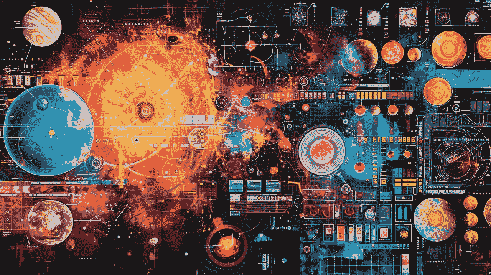
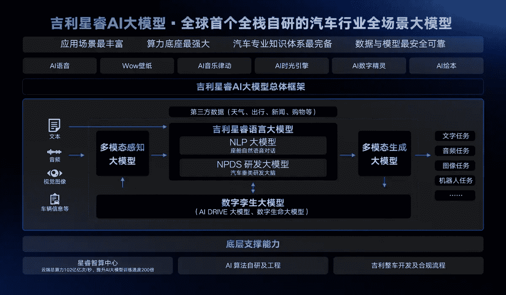
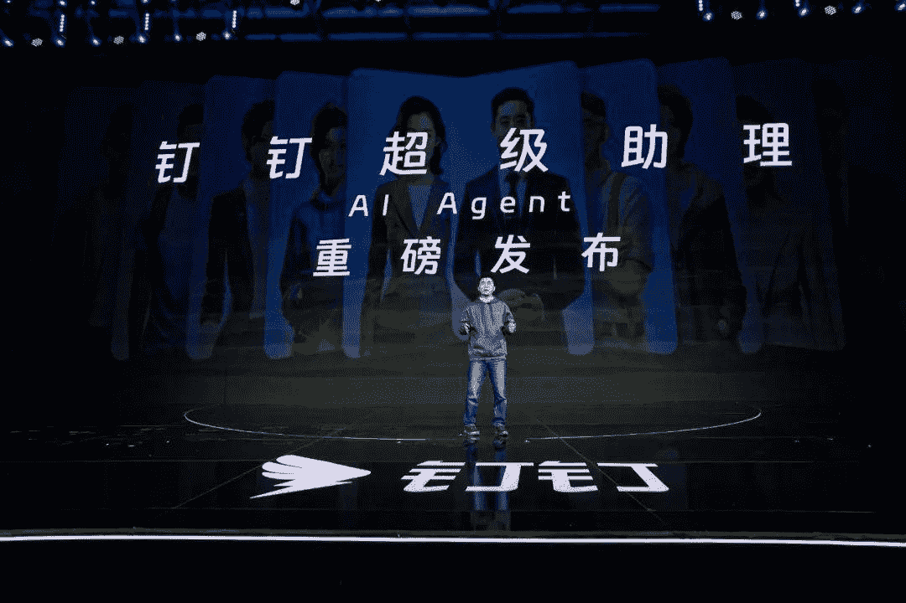
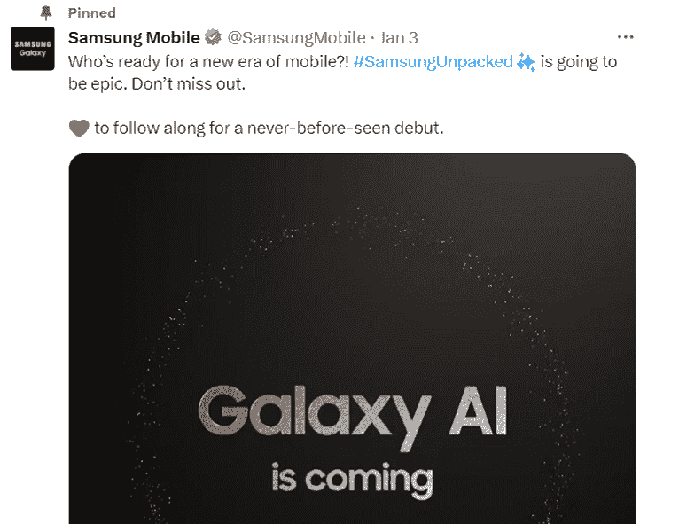

# 240114 - 0108｜GPT Store 上线，可销售/定制 ChatBot；微软高管加入 OpenAI 董事会；全球首个汽车行业全栈自研全场景 AI 大模型，吉利星睿 AI 大模型；Intel 推出车载 AI 芯片挑战英伟达、高通；钉钉超级助理 AI Agent 玩家发布；三星发布 AI 大模型端侧手机，定位“AI 手机”；CES 2024（必看）；Apple 宣布下月初发布 Vision Pro；Rokid 完成近五亿元 C+轮融资，将在合肥落地三大中心...

> 来源：[https://leonzhang.feishu.cn/docx/ZgFYdFWMYogv6Tx7ephctlbGnzd](https://leonzhang.feishu.cn/docx/ZgFYdFWMYogv6Tx7ephctlbGnzd)

> 施工中



```
periodic table of heliocentricity, periodic pulse movement, waveforms, orbitals, artifacts, hyperdetailed, some annotation, full cosmic color, --ar 16:9
```

## 🎞️ 上周二三事

### [O](https://www.ithome.com/0/744/521.htm)penAI 正式推出 GPT 商店，可销售 / 共享定制版 ChatGPT 聊天机器人 - IT 之家

> https://www.ithome.com/0/744/521.htm

OpenAI 在经过一个月的推迟后，正式推出了 GPT 商店和 ChatGPT Team 服务。自 GPT 发布以来，用户已经创建了超过 300 万个 ChatGPT 自定义版本，并有许多人分享了他们的版本供他人使用。GPT 商店汇集了用户为各种任务创建的定制化 ChatGPT，如教育、研究、编程、教育和生活方式等领域的机器人。OpenAI 还为小型公司提供了新的付费 ChatGPT 方案，每位用户每月起价 25 美元。此外，GPT 商店提供了排行榜和按类别搜索的功能，类似于苹果 App Store 和谷歌 Play 商店。OpenAI 去年 8 月首次推出了 ChatGPT 企业版，增加了功能和隐私保护。增加了功能和隐私保护。

### 微软高管 Dee Templeton，加入 OpenAI 董事会

> https://mp.weixin.qq.com/s/fyyr7kDLaxXtO-1wMS2CwQ

微软高管 Dee Templeton 加入了 OpenAI 的董事会，作为无投票权观察员。这是自 2019 年 7 月微软向 OpenAI 投资 10 亿美元后，微软首次指派人员加入 OpenAI 董事会。OpenAI 目前有四位董事，包括前 Salesforce 联合首席执行官 Bret Taylor（担任主席）、前美国财政部长 Larry Summers、全球最大知识问答社区 Quora 联合创始人 Adam D'Angelo 以及新加入的 Dee Templeton。Dee Templeton 在微软工作了 25 年 3 个月，担任过多个高级职位，包括 Azure loT 互联汽车平台和解决方案首席产品经理、CTO 技术合作负责人等。Dee 的加入主要是为了监督董事会行为，避免类似之前 CEO Sam Altman 被罢免的事件再次发生。微软首席执行官 Satya Nadella 在 Sam Altman 被罢免后，全力支持他，并发布了官方声明，强调与 OpenAI 的稳固合作关系。

### 全球首个汽车行业全栈自研全场景 AI 大模型！吉利星睿 AI 大模型正式发布

> https://www.sohu.com/a/751143992_121072032

吉利汽车集团发布了全球首个汽车行业全栈自研全场景 AI 大模型——吉利星睿 AI 大模型。这一模型基于吉利星睿智算中心的强大算力，融合了自研基础大模型与吉利的 NPDS 研发体系和造车全链路场景数据库。星睿 AI 大模型旨在成为汽车行业应用场景最丰富、算力最强大、专业知识体系最完备，数据与模型最安全可靠的大模型。

星睿 AI 大模型包括语言大模型、多模态大模型、数字孪生大模型三大基础模型，并衍生出六种能力模型，如 NLP 语言大模型、NPDS 研发大模型等。它在大模型通用能力官方评测中获得了最高 4+评级，并成为中国人工智能产业发展联盟汽车行业推进组的副组长单位，牵头制定行业标准。



### [荣耀发布自研 70 亿参数端侧平台级 A](https://www.ithome.com/0/744/405.htm)I 大模型“魔法大模型” - IT 之家

> https://www.ithome.com/0/744/405.htm

荣耀在 MagicOS 8.0 发布会上发布了自研的 70 亿参数端侧平台级 AI 大模型“魔法大模型”。这一模型将由即将发布的荣耀 Magic 6 手机首发。荣耀还宣布与百度智能云达成战略合作，魔法大模型将通过百度智能云的千帆大模型平台端云协同生成专业内容。此外，荣耀还与高德地图和航旅纵横达成合作，这些应用将与荣耀魔法大模型联动，预计在今年第二季度陆续升级。

荣耀魔法大模型的发布，标志着荣耀在 AI 技术领域的进一步发展。该模型将为用户带来智慧成片、图库语义搜索、一拖日程等功能，这些功能都在端侧本地运行。荣耀 CEO 赵明表示，现有的操作系统都值得用 AI 重做一遍，以让手机 AI 了解更多功能，进行不断学习和优化，方便用户日常生活。

### 英特尔（INTC.US）推出车载 AI 芯片 挑战英伟达和高通

> https://www.zhitongcaijing.com/content/detail/1052882.html

英特尔宣布将推出其最新人工智能芯片的汽车版本，以在未来的半导体市场上与高通和英伟达竞争。英特尔还计划收购法国初创公司 Silicon Mobility，该公司专注于电动汽车电机控制和车载充电系统的片上系统技术和软件。英特尔汽车业务主管 Jack Weast 在国际消费电子展（CES）前表示，中国汽车制造商极氪将成为首家使用英特尔人工智能芯片系统在汽车上创造“增强客厅体验”的汽车制造商。

### 对标 GPTs 但没有创建门槛，应用层的 AI Agent 玩家终于来了

> https://www.jiqizhixin.com/articles/2024-01-09-12

2024 年初，大厂开始在 AI Agent 领域展开激烈竞争。AI Agent 被视为 AIGC（人工智能生成内容）下一阶段的关键。OpenAI 发布了 AI Agent 初级形态产品 GPTs，展示了智能体的应用前景。谷歌和亚马逊也在这一领域有所涉足，比尔·盖茨认为 AI Agent 是 AI 的未来，并预言未来每个人都将拥有专属 AI 助理。



### 三星打响“AI 手机”第一枪，2024 会是 AI 终端元年吗？

> https://www.ofweek.com/ai/2024-01/ART-201700-8440-30622451.html

在 2024 年初三星推出的 Galaxy S24 系列手机，这些手机被定位为 AI 手机，预示着 AI 终端设备的竞争正在升温。三星的新款手机预计将引入多项 AI 功能，如视频 AI 处理、本地 AI 聊天机器人、影像画面处理、通话实时翻译等。特别地，三星 S24 系列将搭载自研的生成式模型“三星高斯”，并可能内置其他公司的人工智能模型，使其成为全球首款拥有多模型的 AI 手机。



### 文生视频“黑马”Morph Studio 来袭：好用、1080P、7 秒时长还免费

> https://posts.careerengine.us/p/6597d80ed540a94bcc2391de

Morph Studio 近期更新了其 text-to-video 生成技术，提供 1080P 画质和 7 秒生成时长的免费服务，着重在文本理解和细节处理上取得行业领先。与其他产品相比，Morph Studio 在动物、建筑、人物和自然风景生成任务中表现更为稳定和准确，展示了高分辦率输出的视觉优势。模型采用扩散模型技术，其发展代表着文生视频技术的突破，被认为是 AI 行业竞赛的下一个阶段。

## 📱 好玩推荐

### **CES 2024 **

+   https://mp.weixin.qq.com/s/GB1GGu8ii0l1JUpcVKQzIA

+   https://x.com/rowancheung/status/1744736547277258795?s=20 ｜第一个手机壳我就很喜欢，hh

在 2024 年的国际电子消费展（CES）上，人工智能（AI）成为了绝对的主角，各大科技公司纷纷围绕 AI 主题展示了众多创新产品。AI PC 成为了一个重要关键词，英伟达推出了新的显卡和实时 AI 数字人生产技术，而英特尔发布了旗舰处理器和 AI PC 处理器。IDC 预测，AI PC 在中国 PC 市场的装配比例将在未来几年快速增长。

智能汽车领域，德系汽车三巨头奔驰、大众和宝马都在积极拥抱 AI 大模型，推出了新的人工智能虚拟助手和集成了 ChatGPT 技术的语音助手。此外，自动驾驶技术也在展会上得到了展示，高通展示了 Snapdragon Ride 平台，英特尔旗下的 Mobileye 公司宣布多个国际品牌将基于其核心平台实施新的自动驾驶解决方案，英伟达则表示四家中国电动汽车制造商将在其自动驾驶系统中使用其技术。

在其他生活场景中，三星推出了一系列 AI 家电，LG 电子计划推出智能家居 AI 机器人。这些展示表明，AI 技术已经成为科技产品的必争之地，预示着一场全球范围内的大型 AI 卡位之战将在 2024 年展开。

## 🤖 智能硬件

### [苹](https://redirect.ruguoapp.com/?redirect=https%3A%2F%2Fwww.ithome.com%2F0%2F744%2F050.htm)果宣布 Vision Pro 将于 2 月 2 日在美国上市，256GB 版本起售价 3499 美元 - IT 之家

> https://www.ithome.com/0/744/050.htm

苹果公司宣布其混合现实头显 Vision Pro 将于 2 月 2 日在美国的 Apple Store 零售店和苹果官网正式发售，预购将于 1 月 19 日开始。Vision Pro 是苹果首次发布的混合现实头显，售价 3499 美元，具有 4K 单眼分辨率，并允许用户在增强现实（AR）和虚拟现实（VR）之间切换。该设备搭载苹果自家的 M2 芯片和新的 R1 芯片，支持眼睛、头部和手部追踪，无需手柄即可使用。苹果 CEO 蒂姆·库克表示，Vision Pro 将重新定义人们连接、创造和探索的方式。Vision Pro 运行的是苹果的新操作系统 visionOS，与大多数 iPhone 和 iPad 应用程序兼容。苹果还公布了镜片插片价格详情，以及头显的标配配件。对于其他国家和地区，Vision Pro 将在稍晚些时候上市。

### [时空壶发布同声传译器 X1:最多 20 人、5 种语言同步](https://www.ithome.com/0/744/173.htm)互译，定价 4999 元 - IT 之家

> https://www.ithome.com/0/744/173.htm

时空壶 Timekettle 在 CES 2024 上发布了其新旗舰同声传译器 X1，定价为 4999 元人民币，计划于 2024 年 2 月发售。X1 的设计灵感来源于《2001 太空漫游》中的“黑方碑”，分为传译器和耳机两部分。传译器配备了 3.4 英寸屏幕和四麦降噪耳机，支持双人对话同声传译，无需下载 App，同时支持旁听翻译和一键翻译发言至其他参会者。X1 还具备音视频翻译功能，能够生成双语字幕并学习用户的音色。该设备支持最多 20 人、5 种语言同步互译，是全球首款多人多语 AI 翻译设备。X1 搭载 12nm CPU，运行 X OS 系统，主机续航 10 小时，耳机支持快速充电。官方宣称支持 40 种语言、93 种口音、13 组离线翻译对，平均翻译准确率达 95%。

## 💰 上周融资

### Rokid 完成近五亿元 C+轮融资，将在合肥落地三大中心丨智涌首发

> 地址：https://mp.weixin.qq.com/s/6RnS-6ga1-yS8hFHg6fxbg

杭州灵伴科技有限公司（Rokid）完成了近五亿元人民币的 C+轮融资，这是由合肥市政府牵头并引入多家财务和战略投资机构共同参与的。易凯资本在交易中担任了 Rokid 的独家战略业务顾问及财务顾问。这笔资金将用于提升 Rokid 在 B 端的服务和产研能力，并在合肥打造 XR（扩展现实）生态圈。

Rokid 成立于 2014 年，专注于新一代人机交互技术的产品平台。此次融资是合肥市首次布局 AR（增强现实）眼镜行业，也是近年来国内 AR 领域单笔规模最大的战略性融资。Rokid 的创始人兼 CEO 祝铭明表示，合肥是国内工业制造最发达的地方，有着丰富的集成电路和汽车产业链积累。融资后，Rokid 将在合肥新站高新区落地工业元宇宙总部、生态中心及研发中心三大项目。

Rokid 的 AR 眼镜在文旅、消费端和工业三大方向上实现了商业化落地，其中工业领域的增长速度尤为突出。2023 年，Rokid 的营收同比增长 200%，其中工业领域占整体营收的 1/4，且有强劲的增长态势。在工业领域，AR 眼镜的应用场景包括数字培训、远程协助和数字孪生等，能够显著提升工业协作的沉浸感和工作效率。

### [专](https://www.36kr.com/p/2596250121419401)注电商及营销场景，AIGC 智能设计平台「Nolibox」获数千万元 A 轮融资 | 36 氪首发 -36 氪

> https://www.36kr.com/p/2596250121419401

AIGC 智能设计平台「Nolibox 计算美学」完成数千万元 A 轮融资，由尖晶资本和 GRIP Capital 跟投。成立于 2020 年的 Nolibox 是一家智能设计引擎服务商，以 AIGC 一站式图像解决方案为企业提供服务。融资将用于技术研发、市场开拓，加深与电商、营销等领域的合作。Nolibox

已推出多项基于 AI 的图片生成产品，包括无限画板、AI 海报设计生成等，针对电商和营销领域提供 AIGC 服务，已获得世界 500 强付费客户支持。未来计划着重推进商业化，加强与标杆企业的合作，提供更高价值的解决方案。