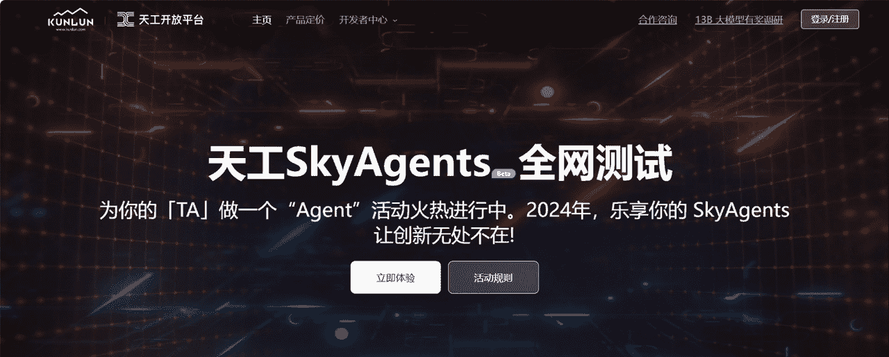
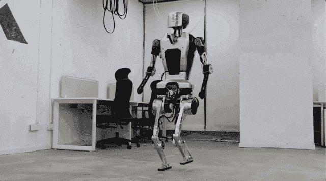
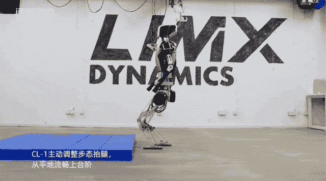

# 231231 - 1225｜OpenAI 被《纽约时报》指控数据侵权；微软 Copilot 上线安卓；华为 AI 编程助手来了；快手 Agents 系统/模型/数据全开源；OPPO Find X7 首搭 70 亿参数端侧大模型；昆仑万维 AI Agents Bata 版全网测试；国产人形机器人具备实时感知规划，告别“盲走”；

> 来源：[https://leonzhang.feishu.cn/docx/CjJwdRKxIofE9bxSHyTcpUmwnEe](https://leonzhang.feishu.cn/docx/CjJwdRKxIofE9bxSHyTcpUmwnEe)


```
needle felted theatrical scene of winnie the pooh and his friends in Hundred Acre Wood --ar 16:9
```

## 🎞️ 上周二三事

### [OpenAI 微软被起诉！《纽约时报》指控](https://mp.weixin.qq.com/s/YSRaSf29EHK-IYkFQcphAw) AI 侵权，要求销毁侵权模型和训练数据

OpenAI 和微软面临《纽约时报》提起的版权侵权诉讼，该诉讼指控 OpenAI 的 AI 模型 ChatGPT 在输出内容时与《纽约时报》的新闻文章高度相似，涉嫌侵犯版权。《纽约时报》提交了 220,000 页的附件，列举了 100 个证据，显示 ChatGPT 的输出与《纽约时报》文章几乎一模一样。《纽约时报》要求 OpenAI 和微软销毁包含侵权材料的模型和训练数据，并赔偿数十亿美元的法定和实际损失。这是迄今为止规模最大的针对生成式 AI 的版权诉讼之一，且《纽约时报》拥有充足的证据和强大的律师团队。OpenAI 和微软目前尚未达成和解，诉讼结果尚待观察。

### [奥特曼新举惹怒开发者！ChatGPT](https://posts.careerengine.us/p/658bef0d52f9653cfdabd045) 插件被打入冷宫，暗示作者转向 GPTs

奥特曼最新动向激怒开发者，收到 OpenAI 邮件，暗示插件开发者将被取代为 GPTs 使用者。邮件提到 GPTS 可调用 API 和 DALLE，疑似揭示插件可能下线。ChatGPT 团队回应称插件未下线，但未来不确定。OpenAIl 或认为 GPTs 更吸引普通用户，同时插件可能存在安全隐患。用户反馈 GPTs 与插件使用体验不同。界面更新后，插件入口变隐蔽。争议中，用户需观察后续发展。

### 微软「ChatGPT 全家桶」上线安卓，GPT-4 不登录免费玩

微软悄悄推出了 Copi**lot 的安卓版，是类似** ChatGPT 的应用程序。与 Bing Chat 不同，Copilot 主打 AI 聊天，支持 GPT-4V、GPT-4 和 DALL-E.3，还有 GPT-4 Turbo。安卓版特点包括无需登录即可体验、语音输入、上传照片，响应速度较快。虽有优点如朗读回复和良好的用户体验，但也存在缺点，如无法访问自定义 GPT 和语音输入录音可能中断。iOS 版预计即将发布。

### [华为 AI 编程助手来了，研发大模型 CodeAr](https://www.ithome.com/0/741/960.htm)ts Snap 明日公测 - IT 之家

华为云宣布大模型 CodeArts Snap 将于 12 月 28 日开始公测，提供智能生成、问答和协同能力，可在多种研发场景中优化软件开发，据称可提高开发效率超过 20%。该智能开发助手具有八大核心功能，支持 VSCode 和 JetBrains 插件市场，公测期间免费使用。

### 快手 Agents 系统、模型、数据全部开源！

「KwaiAgents」是快手与哈尔滨工业大学联合研发的系统，使 7B/13B 模型在任务规划、工具使用等方面超越 GPT-3.5。该系统包含轻量级 Al Agents 系统、Meta-Agent Tuning 后的大模型及训练数据、自动化评测 Benchmark。系统采用认知内核、记忆机制、工具库，通过混合向量检索提升生成内容准确性。模型引入 Meta-Agent Tuning 方法，通过模板生成和指令微调提高大模型通用性。评测结果显示超越 GPT-3.5 的效果。

### [O](https://www.ithome.com/0/741/887.htm)PPO Find X7 系列手机首搭 70 亿参数 AndesGPT 端侧大模型，小布助手全新升级 - IT 之家

在 OPPO Find X7 系列技术沟通会上，真布 AndesGPT 大模型全新升级，支持 1800 亿、700 亿、70 亿参数，实现端云协同部署。通过 SwappedAttention 技术解决长期记忆带来的首字推理延迟问题，AndesGPT 70 亿参数使 Find X7 实现超快首字响应速度，领先友商 20 倍。在文本内容摘要场景下，200 字首字生成仅需 0.2 秒，领先友商 2.5 倍。AndesGPT 70 亿参数语言模型在理解能力上明显优于 10 亿参数大模型，提供更精准的通话摘要功能。

## 📱 好玩推荐

### [昆仑万维 AI Agents 开发平台“天工 SkyAgent](https://www.ithome.com/0/741/426.htm)s”Beta 版全网测试 - IT 之家

昆仑万维推出了其 AI Agents 开发平台“天工 SkyAgents”的 Beta 版本，该平台基于昆仑万维的“天工大模型”构建，旨在提供从感知到决策再到执行的自主学习和独立思考能力。用户可以通过自然语言构建自己的 AI 代理，无需编程能力即可快速部署 AI Agents，以满足个人或企业定制化需求。个人用户可以利用该平台完成行业报告、单据填写等任务，而企业用户则可以将其能力应用于 IT、客服、培训等多个领域。平台在 2023 年 12 月 20 日至 2024 年 1 月 15 日期间为新老用户提供限时免费创建 Agent 的资格，并提供对话轮次优惠。



## 🤖 智能硬件

### 国产具身人形机器人征服复杂场景： 实时感知规划，动态运动告别“盲走”

深圳公司逐际动力（LimX Dynamics）开发的国产人形机器人 CL-1 在复杂场景中展示了实时感知规划和动态运动的能力。CL-1 能够自主调整步态，从平地迈上台阶，上楼梯，下斜坡，甚至在室内外不同环境条件下行走。这些任务的完成不依赖于地形建模，而是通过动态实时感知来实现。这是国产人形机器人首次基于实时地形感知动态上楼梯和下斜坡。

逐际动力成立于 2022 年，已经完成了近 2 亿的早期融资，并在资本层面得到了证明。公司专注于运动控制算法的研发，目标是提升人形机器人的泛化能力，使其能够去人能去的地方，做人能做的事情。





## 💰 上周融资

### 优必选宣布港交所挂牌上市，成为“人形机器人第一股” - IT 之家

深圳市优必选科技股份有限公司（简称“优必选”）宣布在香港交易所主板挂牌上市，成为“人形机器人第一股”。优必选在 IPO 中发行了 1128.2 万股股份，香港公开发售部分和国际发售部分均获得了超额认购。

截至报道时，优必选的股价为每股 90.10 港元，市值约为 376.5 亿港元（约合人民币 342.62 亿元）。优必选成立于 2012 年，是一家全球领先的人工智能和人形机器人研发、制造和销售的高科技创新企业。截至 2022 年 9 月 30 日，优必选已服务全球 40 多个国家和地区，拥有近 1000 家企业客户，共售出 50 万台机器人。

### [AI 芯片公司「鲲云科技」获数亿元 C 轮融资，](https://www.36kr.com/p/2579176272078464)由普罗资本领投｜36 氪首发 -36 氪

深圳鲲云信息科技有限公司（简称“鲲云科技”）宣布完成了数亿元人民币的 C 轮融资，由普罗资本领投，鼎晖百孚、联通旗下联创基金、张科垚坤基金、钟楼金控集团跟投。鲲云科技成立于 2017 年，专注于基于可重构数据流技术路线研发高性能、低成本的大算力 AI 芯片。

2020 年，公司发布了全球首款可重构数据流架构 AI 芯片 CAISA，该芯片在芯片利用率上实现了显著提升。本轮资金将主要用于支持下一代 CAISA AI 芯片的研发和产业化应用，以及构建 CAISA 芯片在各垂直行业的产业化生态。