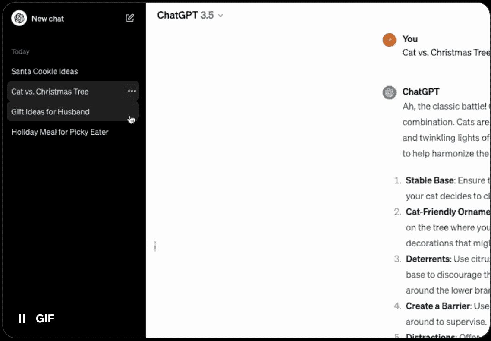

# 231224 - 1218｜ChatGPT 支持存档聊天记录；OpenAI 暂停字节的 GPT；MJ V6 升级；Adobe 终止收购 Figma；苹果技术突破，可在 iPhone 上运行大模型；bai 支持 5000 万 Token；三星、LG 明年初推出 AI 效能的笔记本；

> 来源：[https://leonzhang.feishu.cn/docx/QPWqdOjBMoRbRcx2V2Fcnq4fndb](https://leonzhang.feishu.cn/docx/QPWqdOjBMoRbRcx2V2Fcnq4fndb)


```
wide-angle establishing shot of an abandoned Maui beach at dusk, beautiful soft bokeh bonfire, defocused crashing waves and sunset in the background, beautiful soft dusk lighting, DOF, Beautiful, Award-Winning photography --ar 16:9
```

## 🎞️ 上周二三事

###  ChatGPT 支持存档聊天记录！

存档会从侧边栏中删除聊天内容，但不会删除它们。在“设置”中查看已存档的聊天记录。目前可在 Web 和 iOS 上使用，Android 即将推出。



### OpenAI 因字节跳动使用 GPT 训练竞争模型而暂停其账户

在发表的声明中，OpenAI 强调 API 客户必须遵守使用政策，保证技术合理使用。尽管字节跳动在 API 使用上较少，但 OpenAI 已在进一步调查期间暂停其账户，保留要求合规变更或终止账户的权利。需注意字节跳动大部分 GPT 使用通过微软的 Azure 平台，而非直接通过 OpenAl。

### 谷歌 Gemini 技术报告出炉，作者多达 900 余人

谷歌发布了《Gemini: A Family of Highly Capable Multimodal Models》技术报告，详细介绍了 Gemini 系列，包括 Ultra:Pro 和 Nano 三个版本。Gemini 是原生多模态大模型，在图像、音频、视频和文本理解方面表现出卓越能力。报告强调 Gemini 的跨模态推理和语言理解能力，支持各种应用，如教育环境中解决复杂问题。报告还讨论了 Gemini 的模型架构、训练基础设施、训练数据集以及在多领域基准测试上的性能表现。

### [Midjourney V6 史诗级升级，网友惊呼太逼真！神图](https://www.ithome.com/0/740/837.htm)接连曝出，传今明两天上线 - IT 之家

Midjourney V6 社区评价第二轮启动，用户惊叹其图像质感，光影效果逼真，与照片几乎无差异。V6 进入最后一轮 RLHE。预计将在圣诞节前发布。神图展示了其卓越的生图能力，包括真实感的皮肤纹理、动物毛发和食物细节。用户表示 V6 可能改变 AI 生图领域，简化提示输入，更准确地理解用户指令。V6 已被誉为专家级内容创作工具，普通用户也能轻松创作。

### [S](https://twitter.com/StabilityAI/status/1737588219863339206?s=20)tability AI API 新增 Stable Video Diffusion：用于生成视频的基础模型

“稳定视频扩散”已加入 Stability AI 开发者平台 API，为广告、电影等领域提供强大视频生成工具。注重性能和安全，支持多种功能和格式，满足开发需求。会员资格可在本地托管，同时注册等待列表，成为首批访问 web 界面的用户。

### 视频生成可以无限长？谷歌 VideoPoet 大模型上线

谷歌推出的视频生成大语言模型 VideoPoet 在生成式 AI 领域引起轰动。该模型能文生成视频、图生成视频，具备风格迁移和视频转语音功能。人们对其多样化、流畅的运动效果表示惊叹，认为是革命性的 zero-shot 视频生成工具。有呼声要求谷歌开源该模型以推动技术发展。VideoPoet 还能生成长视频、扩展视频，进行交互式视频编辑和视频修复，展示了令人惊叹的多模态应用。

### 百度灵境矩阵升级为智能体平台，人人可开发智能体时代到来 - 齐思

百度「灵境矩阵」平台于 12 月 18 日升级为「文心大模型智能体平台」，支持多样化开发方式，以大模型为基础，帮助开发者降低成本、获得流量分发路径和商业机会。平台已有超过 3 万开发者入驻，提供零代码、低代码和全代码三种模式。已有 2000 多个智能体上线，包括法律智能助手、TreeMind 树图、职场密码 AI 智能简历等，成功跑通从开发到变现的路径，拓展智能体应用领域。

### Adobe 终止 200 亿美元收购 Figma 计划：监管阻力难克服

Adobe 以高达 200 亿美元的价格收购 Figma 的计划宣告失败，监管机构未批准并购，英国和欧盟竞争监管机构担心垄断，认为其可能导致产品价格上升、质量下降。Adobe 将支付 Figma10 亿美元的终止费，双方对监管机构结论表示异议，计划向竞争和市场管理局提出抗议。

### [微软 Copilot 再添新功能，只需](https://www.ithome.com/0/740/381.htm)文字描述就能生成完整歌曲 - IT 之家

微软 Copilot 与 Al 音乐创作平台 Suno 合作，在 Edge 浏览器中推出新功能。用户通过简短描述，Copilot 即可生成包含器乐、歌词和演唱的歌曲片段。生成过程需 10 分钟，但暂无音乐播放。Suno 插件逐步推出，未来或覆盖所有用户，尚不清楚是否扩展到其他浏览器。

### [苹果取得技术突破：可在 iPho](https://www.ithome.com/0/740/808.htm)ne 上运行大型语言模型 - IT 之家

苹果的人工智能研究人员表示，他们已取得一项重大突破，通过一种创新的闪存利用技术，成功地在内存有限的 iPhone 和其他苹果设备上部署了大型语言模型（LLM）。这一成果有望让更强大的 Siri、实时语言翻译以及融入摄影和增强现实的尖端 AI 功能登陆未来 iPhone。苹果研究人员提出了一种巧妙的闪存利用技术，将 LLM 模型的数据存储在闪存中。这项技术可以让 AI 模型的运行规模达到 iPhone 可用内存的两倍，这意味着标准处理器（CPU）的速度提高了 4-5 倍，图形处理器（GPU）的速度提高了 20-25 倍。这一突破对于在资源有限的环境中部署先进的 LLM 至关重要，极大地扩展了它们的适用性和可访问性。

### [支持 5000 万 tokens！百川发布全](https://mp.weixin.qq.com/s/7qdx8gb7TXXTJ_OSIcGEDg)新 API 产品，解决 99%定制化需求

百川智能近期发布了基于搜索增强的 Baichuan2-Turbo 系列 API，包括 Baichuan2-Turbo-192K 和 Baichuan2-Turbo。这一产品解决方案旨在解决大量定制化需求，支持 5000 万 tokens 的知识库。搜索增强被认为是大模型落地应用的关键，能够解决 99%的知识库定制化需求。通过长文本大模型和搜索增强的结合，模型能够获取互联网实时信息并接入企业完整知识库。百川智能实现了稀疏检索和向量检索并行，以及搜索系统与大模型的对齐。搜索增强知识库能够替代大部分企业个性化微调，解决 99%的企业知识库定制化需求。这一 API 产品旨在用产品化取代项目化，降低企业成本，实现定制化需求。

继上周 Kimi Chat 支持 20 万上下文的中文长文本后，Baichuan2 也来到了 192K 的上下文长文本，LLLM 时代不远矣。对比而言，Baichuan2-Turbo 侧重于搜索增强和知识库定制化，而 Kimi Chat 则更侧重于长文本处理。

<https://my.feishu.cn/sync/JUqmdNBCes3FHsbqsn1cTbTSnSc>

## 🤖 智能硬件

### 三星、LG 明年初推具备 AI 效能笔电 加入 AI PC 浪潮

18 日讯，三星电子和 LG 电子都将在明年推出具备人工智能（AI）效能的笔记型电脑，加入业界把 AI 整合进智能手机等装置的行列。三星电子的 Galaxy Book 4 系列笔电将在明年初上市，有 Ultra、Pro 及 Pro 360 等三种机型，搭载英特尔首款整合中央处理器、制图处理器及神经处理器的 Core Ultra 9 芯片。三星电子表示，这款产品是历来最智能与最强力的 Galaxy Book 笔电。LG 以 AI 驱动的 Gram 笔电，将在明年 1 月上市，同样安装英特尔 Core Ultra 处理器。

## 📱 好玩推荐

### 适用于 IOS 和 Android 的 Digi 版本（1.0）

数码人工智能浪漫伴侣 Digi 的 v（1.0）版本已在 IOS 和 Android 上发布。该应用通过与迪士尼和皮克斯角色设计师合作，创造了独特的人物形象，避免了“不真实谷”效应。除了独特的外观，应用还提供自主开发的音频模型，实现了实时对话和声音克隆。用户可以通过混合 Character.ai 和 replika.ai 进行个性化定制，包括头发、肤色、嘴唇、眼睛等。

## 💰 上周融资

### [萨姆·奥特曼个人风险投资基金今年 6](https://www.163.com/tech/article/IMCT9EPV00097U7T.html) 月获得密歇根大学 7500 万美元投资

今年 3 月，OpenAI 首席执行官萨姆•奥特曼创建风险投资基金 Hydrazine IV，获得 7500 万美元支持，其中来自密歇根大学的捐赠基金。这显示奥特曼在管理 OpenAI 同时积极进行投资活动，涉及个人和机构资本。尽管基金细节未透露，密歇根大学表示长期合作。奥特曼近期曾因投资行为成为外界关注焦点。

### [光子 AI 计算芯片初创公司 Lightmatt](https://www.businesswire.com/news/home/20231219681989/en/Lightmatter-Accelerates-Growth-and-Expands-Photonic-Chip-Deployments-With-155M-in-New-Funding-Now-Valued-at-1.2B)er 获 1.55 亿美元 C2 轮融资

波士顿光子学领导者 Lightmatter 宣布筹集 1.55 亿美元 C-2 系列资金，由 Google Ventures 和 Viking Global

Investors 领投，使总融资超过 4.2 亿美元，估值超过 12 亿美元。公司致力于光子技术，改变芯片计算和通信方

式，以满足人工智能高性能计算需求。新资金将加速增长，扩大团队，提供先进人工智能工作负载性能。

### 商业智能初创公司 Meltwater 获 6500 万美元投资

Meltwater 因媒体监控而闻名，近期以估值 5.42 亿欧元（约 5.92 亿美元）被挪威私募股权公司 Verdane 收购其 11%股份。交易中，Verdane 通过收购 Fountain Venture 的大量股份，实现了对 Meltwater 的投资。交易反映欧洲科技公司面临的估值压力，Verdane 通过投资 Fountain Venture 来分散风险，同时突显科技公司在人工智能领域的关键角色。|Meltwater 表示每天为客户分析约 10 亿份文档。