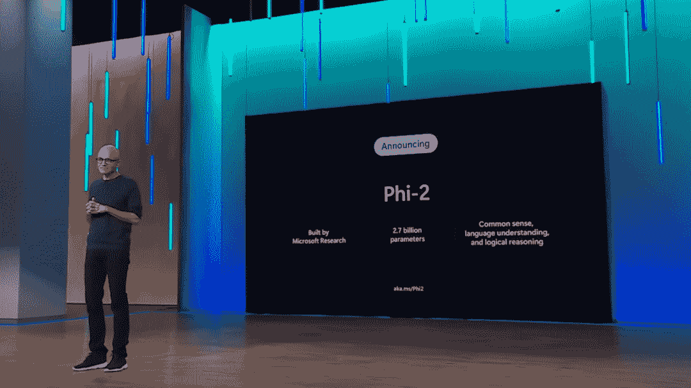
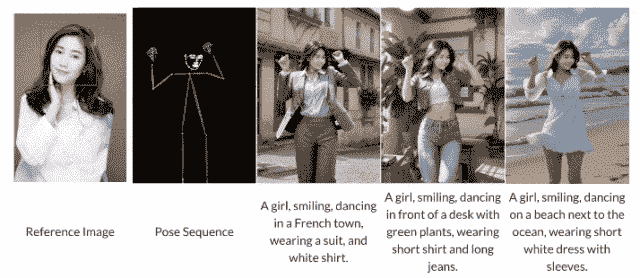
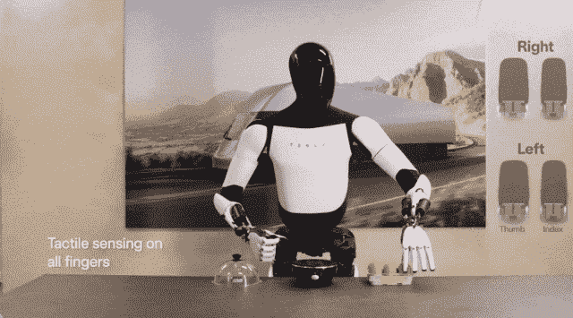
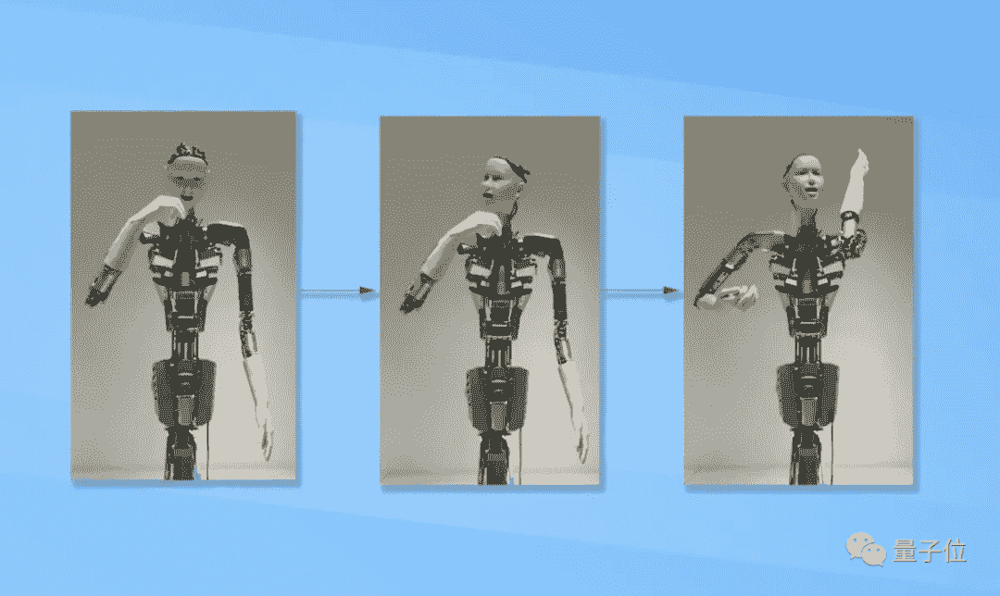

# 231217 - 1211｜GPT-2 监督 GPT-4，OpenAI 的论文来了；微软小模型击败大模型，手机就能跑；王小川：大模型还没到谈 PMF 的时候；开次长文本，即 Long LLM 时代；数学代码测试，Gemini 惨遭 GPT-4 碾压；特斯拉 Optimus 2.0 上线；GPT-4 驱动的人形机器人

> 来源：[https://leonzhang.feishu.cn/docx/S2bldTjnsof8wsxhnX7cDwIankd](https://leonzhang.feishu.cn/docx/S2bldTjnsof8wsxhnX7cDwIankd)


```
branding graphic design presentation for the autumn festival, with the branding concept of &quot;gold leaf&quot;::2 brutalist liminal space design::1 close up shot photography, depth of field, film grain, shot on Leica M6, 35mm
```

## 🎞️ 上周二三事

### [GPT-2 能监督 GPT-4，Ilya ](https://posts.careerengine.us/p/657bdb5ef02e71726b5c652b)带头 OpenAI 超级对齐首篇论文来了

OpenAI 首席科学家 Ilya Sutskever 表示，模型若能预测下一个词，即可理解深刻现实，暗示未来可能诞生超越人工智能的系统。OpenAI 的“超级对齐”团队发布首篇论文，以弱监督训练强模型。在 NLP 任务、国际象棋及奖励建模任务中，研究发现通过简单方法可显著提高弱到强的泛化。此举引发对“超级人工智能”可能带来负面影响的担忧。

### ChatGPT 成为 Nature 年度十大人物，首个非人类实体

《Nature》2023 年度十大人物中，首次包括大型语言模型 ChatGPT。该模型在科学领域取得深远影响，与人类合作起草科学论文，并在项目中扮演重要角色。然而，生成式 AI 技术也存在潜在危险，可能被滥用。模型的创造者之一是 OpenAI 首席科学家 Ilya Sutskever，他一直致力于创建超越人类智能的通用人工智能系统。ChatGPT 的入选引发对 AI 局限性、人类智能本质及相互作用调节的讨论。

### 微软小模型击败大模型：27 亿参数，手机就能跑

微软公布了 Phi-2 模型，这是一款只有 27 亿参数的小型语言模型，表现超越了大型模型如 Llama2 和 Mistral，尤其在常识推理、语言理解、数学和编码任务上表现出色。Phi-2 的关键亮点包括通过小型模型实现大型模型的性能、优化训练数据质量以及知识迁移技术。Phi-2 将成为研究人员的理想模型，可用于各种实验和探索。



### 李彦宏：卷 AI 原生应用才有价值，别卷大模型了！

这篇文章是百度创始人李彦宏在极客公园创新大会 2024 上的访谈。李彦宏认为，大模型时代的真正价值在于原生应用，而原生应用对于大厂、中小企业和创业者来说都是巨大的机会。他强调，现在的关注点应该从基础模型转向 AI 原生应用，并且呼吁大家尽早把握这个机会，多尝试和探索。李彦宏还谈到了百度在大模型领域的战略和取舍，以及如何在 AI 时代成为一个成功的产品经理。他建议创业者和开发者要尝试和探索新的技术能力，找到符合自己发展的道路。

### 王小川创业 8 个月：大模型还没到谈 PMF 的时候

主要讨论了大模型时代下，创业公司如何找到合适的产品市场契合度（PMF）以及技术产品契合度（TPF）。王小川认为，在大模型时代，过去的 PMF 标准不再适用，而应该寻找 TPF。他提出了两个层面：“拉远”和“拉近”。拉远意味着从人类根本需求出发，关注健康、快乐和创造力等方面；拉近则要求产品经理在大模型技术的基础上，找到合适的应用场景。王小川强调，产品经理需要具备好奇心和想象力，以便在大模型时代找到新的应用方向。

此外，文章还讨论了如何将大模型技术与强化学习相结合，实现“学”与“思”的结合。王小川认为，大模型代表了“学”，而强化学习如 AlphaZero 代表了“思”。将两者结合，可以产生更强大的 AI 系统。

最后，王小川分享了他在创业过程中的心得体会，认为在大模型时代，中国公司有机会在应用落地方面走得更快。他希望在未来两年内，能够证明大模型确实可以创造出像互联网时代那样的超级应用，为人类带来巨大的帮助和希望。

### [久等了，欢迎与 Moonshot AI 共同开启 ](https://mp.weixin.qq.com/s/stKAB8wX7xWj2Js8FSoJpA)Loooooooooong LLM 时代

Moonshot AI 发布的首个支持输入 20 万汉字的智能助手产品 Kimi Chat。Kimi Chat 在中文上具备显著优势，实际使用效果能够支持约 20 万汉字的上下文，远超其他公司的类似产品。Kimi Chat 通过创新的网络结构和工程优化，在千亿参数下实现了无损的长程注意力机制。文章强调了长文本能力对于大模型的重要性，以及 Kimi Chat 在多语言能力、应用场景和算法工程挑战方面的突破。Kimi Chat 的发布标志着大模型从 LLM 时代进入 Long LLM （LLLM）时代，为人们的工作、生活和学习带来更多可能性。

### [陆奇不创业这一年](https://mp.weixin.qq.com/s/GSPtvn5w1qHVmLBRUSOU4Q)

尽管 Qi 没有亲自下场创业，但陆奇今年对于 AI 及大语言模型的跟进非常坚决，奇绩创坛是国内目前投资 AI 和大模型赛道最为“激进”的机构之一。陆奇在年轻人中的号召力“无与伦比”，他支持年轻创业者，但并非无脑支持，而是通过严格筛选，选择最优秀的年轻人。并希望在中国建立类似 YC 的创业体系，强调公司的社会责任感。

### [ChatGPT 发布 1 周年，红杉美国对话黄仁勋：成立三](https://mp.weixin.qq.com/s/L1byV32QJoIvhnpgLtWwiw)十年，英伟达 AI 转型背后的经验与教训

文章主要讨论了英伟达（Nvidia）的发展历程、转型经验以及在 AI 领域的突破。文章通过访谈英伟达创始人黄仁勋（Jensen Huang）和其他相关人员，回顾了英伟达从创立之初的图形卡业务，到后来成功转型为全球领先的 AI 计算公司的过程。文章强调了英伟达在面临竞争和市场挑战时，如何坚持创新、调整战略并最终实现突破。同时，文章还提到了英伟达在 AI 领域的持续发展，以及其对未来技术的展望。

### [Kimi Chat 公布“大海捞针”](https://mp.weixin.qq.com/s/IC5-FGLVHzHHYqH6x-aNng)长文本压测结果，也搞清楚了这项测试的精髓

在近期的长文本处理实验中，包括 Moonshot AI 的 Kimi Chat、OpenAI 的 GPT-4 Turbo 和 Anthropic 的 Claude 2.1 等模型都参与了开发者 Greg Kamradt 的“大海捞针”实验。实验旨在测试这些大模型在处理大量文本数据时的性能。经过多次实验和调整，Kimi Chat 在处理 20 万字上下文的长文本方面展现出了卓越的性能。相比之下，GPT-4 Turbo 和 Claude 2.1 在某些方面表现略逊一筹。这些实验结果揭示了各大模型在长文本处理能力上的差异，为进一步优化和提高大模型性能提供了有益的参考。

### [谷歌 OpenAI 大模型巅峰对决！Gemini 激战 GPT](https://www.ithome.com/0/738/282.htm)-4，数学代码却惨遭碾压 - IT 之家

在这场 AI 模型的比较中，Gemini Pro（Bard）与 GPT-3.5 和 GPT-4 进行了多项性能测试，包括代码编写、数学应用、讲笑话、事实检索、创意写作和辩论对话。结果显示，尽管 Gemini Pro 在某些方面取得了显著进步，但在数学和代码编写方面，GPT-4 仍然占据优势。在讲笑话和创意写作方面，两者表现相当，而在事实检索方面，Gemini Pro 提供了更准确的信息。报道还提到，真正的巅峰对决可能会在 Gemini Ultra 或集成了 OpenAI 神秘 Q*技术的新模型出现后发生。

## 📱 好玩推荐

### 阿里又整活儿：一张人脸一句话就能跳《擦玻璃》，服装背景随意换！

阿里发布最新研究 DreaMoving，通过一张脸部照片和简短描述，实现任何人随时随地跳舞，包括卡通动漫人物。挑战在于缺乏开源舞蹈视频数据集和准确文本描述。阿里团队收集了 1000 个高质量人类舞蹈视频，Minigpt-v2 生成文本描述，3 采用 DreaMoving 模型，包含去噪 U-Net、视频控制网络和内容引导器。



### [WonderJourney：根据文](https://twitter.com/xiaohuggg/status/1733779657722622449)本描述或图片，生成 3D 场景的连续画面

WonderJourney 是由斯坦福大学和谷歌合作开发的项目，通过用户提供的文本描述或图片，自动生成多样化而连贯的 3D 场景序列。用户可以从任意起始点开始，经历长时间的虚拟旅程，探索多样的目的地。这个创新项目利用大语言模型、文本驱动的点云生成管道和视觉语言模型，确保生成的场景在视觉上连贯且多样化。

## 🤖 智能硬件

### 练习时长两年半，特斯拉人形机器人 Optimus 二代上线

特斯拉人形机器人「Optimus」第二代在特斯拉 AI 日活动上惊艳亮相，得益于特斯拉设计的致动器和传感器的改进，行走速度提高 30%，重量減轻 10 千克。机器人具备优雅的双手，11 个自由度，能够处理精致物体，如鸡蛋，演示视频表明所有动作均为实时无 CGI 效果。随着进步，实现机器人管家的设想似乎离我们不远。



### [首个 GPT-4 驱动的人形机器人！无需编](https://mp.weixin.qq.com/s/pNDsAy65LD_Qs3O7mH12uw)程+零样本学习，还可根据口头反馈调整行为

东京大学和 Alternative Machine 公司的研究展示，用 GPT-4 语言模型操纵人形机器人 Alter3，无需编程或训练，仅通过口头指令。机器人表演各种滑稽动作，引发网友热议，尽管动作怪异，但符合指令。这一研究探索了 GPT-4 控制机器人动作的能力，減少人机交互的复杂性、采用 CoT 和 zero-shot 技术，使 Alter3 能理解自然语言并执行任务。



## 💰 上周融资

### [红杉美国和 Index 5400 ](https://mp.weixin.qq.com/s/0anbZxqJlX26BGYfwuZYww)万美元投资了这家德国 AI 供应链公司！

德国初创公司 Tacto Technology GmbH 以 5400 万美元融资完成。该公司通过 AI 技术帮助企业识别成本节省机会，降低采购支出约 10%。总部位于慕尼黑的 Tacto 专注于解决工业企业在供应链管理中的复杂性和挑战，通过数字化采购和优化资源，创造可持续供应链，为中小型企业提供解决方案。投资由 Sequoia Capital 和 Index   Ventures 领投，突显对可持续性和企业软件公司的关注。

### [Transformer 一作再创业！新获 4 亿融资，谷](https://mp.weixin.qq.com/s/fM7dmiAhbm_DSgCmDWNEfA)歌英伟达 AMD 参与，此前长期隐身发展

中国大模型初创公司 Essential AI 成立不到一年即获得约 4 亿人民币的 A 轮融资，投资者包括谷歌、英伟达、AMD 等科技巨头。Essential 专注于基于大模型的全栈型智能产品，致力于通过 AI 技术弥合人与计算机在知识和技能方面的鸿沟。公司由 Transformer 论文的作者 Ashish Vaswani 和 NikiParmar 创立。

### 创富港战略投资点漾科技，加速 AI 大模型应用项目落地

创富港副总裁唐伟代表公司与点漾科技签署战略投资协议，投资资金将用于点漾科技的技术研发和业务扩展。创富港致力于紧跟科技发展，认为投资 AI 大模型是未来趋势，此举标志着在大模型技术应用上迈出关键一步。双方将展开深度战略合作，加速实现 AI 客服、AI 销售、AI 财税等大模型应用项目的落地，推动人工智能技术在共享办公领域创新应用。